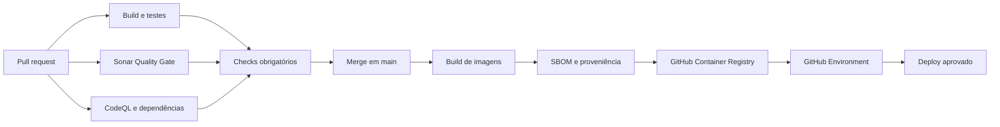

# Guia de CI/CD e Segurança no GitHub

Este documento descreve os recursos de repositório e da plataforma GitHub recomendados para o processo de integração contínua, entrega contínua, segurança e supply chain do Basalt Notes. O Sonar integra esse processo como gate de qualidade e segurança do código, sem substituir os controles nativos do GitHub.

> A disponibilidade de alguns recursos depende da visibilidade do repositório, do plano GitHub contratado e da edição do Sonar. Confirme essas condições antes de tornar um check obrigatório.

## Visão geral

O processo é dividido em quatro camadas:

1. **Governança do código:** pull requests, rulesets, revisões e ownership.
2. **CI/CD:** build, testes, empacotamento, publicação e promoção.
3. **Segurança:** análise de código, dependências, secrets e containers.
4. **Supply chain:** SBOM, proveniência, attestations, tags e digests imutáveis.



## Recursos versionados no repositório

Os arquivos abaixo tornam as automações e políticas auditáveis e reproduzíveis:

| Arquivo | Responsabilidade |
| --- | --- |
| `.github/workflows/ci.yml` | format, lint, build e testes |
| `.github/workflows/codeql.yml` | análise de segurança com CodeQL |
| `.github/workflows/container.yml` | build, smoke test e scan das imagens |
| `.github/workflows/release.yml` | release, SBOM, attestations e publicação |
| `.github/workflows/deploy.yml` | promoção e implantação por environment |
| `.github/dependabot.yml` | atualizações de npm, NuGet, Actions e imagens |
| `.github/CODEOWNERS` | ownership por módulo e arquivos sensíveis |
| `.github/SECURITY.md` | reporte e tratamento de vulnerabilidades |
| `sonar-project.properties` ou configuração equivalente | escopo e parâmetros de análise do Sonar |

Os manifests e lockfiles de npm, NuGet e ferramentas também fazem parte do controle de supply chain. Dependências e actions devem permanecer fixadas de forma reproduzível.

## GitHub Actions

GitHub Actions é o motor de CI/CD. No monorepo do Basalt Notes, separe responsabilidades em jobs com nomes estáveis:

| Job | Validação principal |
| --- | --- |
| `frontend` | format, lint, testes Vitest e build Angular |
| `backend` | format, análise estática, build e testes .NET |
| `integration` | PostgreSQL real, filesystem e Testcontainers |
| `contracts` | OpenAPI e detecção de breaking changes |
| `e2e` | Playwright com a aplicação containerizada |
| `sonar` | análise, cobertura e Quality Gate |
| `security` | CodeQL, dependency review e scanners adicionais |
| `container` | BuildKit, smoke test, scan e inspeção do contrato |

### Práticas de execução

- Use workflows reutilizáveis para build, análise e publicação compartilhados.
- Use filtros de paths para evitar trabalhos caros quando um módulo não foi alterado.
- Mantenha um job agregador que sempre conclua; checks obrigatórios não podem ficar indefinidamente em estado pendente quando um job é ignorado.
- Use `concurrency` para cancelar execuções antigas do mesmo pull request.
- Use matrix somente quando a compatibilidade com múltiplas versões ou plataformas for requisito real.
- Use cache de npm, NuGet e Sonar baseado em lockfiles, sem armazenar tokens ou credenciais.
- Publique como artifacts os relatórios de testes, cobertura e Playwright necessários ao diagnóstico.
- Defina retenção curta para artifacts transitórios e retenção proporcional para evidências de release.
- Fixe actions de terceiros pelo SHA completo e documente a versão correspondente.

### Runners

Prefira runners hospedados pelo GitHub para CI de pull requests. Eles são efêmeros e reduzem o risco de persistência entre execuções.

Use runners self-hosted somente quando houver necessidade de rede privada, hardware específico ou SonarQube Server inacessível pela internet. Nesse caso:

- isole runners por confiança e ambiente;
- não execute código de forks não confiáveis;
- não mantenha credenciais permanentes na máquina;
- restrinja acesso à rede e aos secrets;
- descarte ou restaure o runner após cada execução quando possível.

## Governança da branch principal

Crie um ruleset para `main` com as seguintes regras:

- exigir pull request;
- impedir push direto, exclusão e force push;
- exigir ao menos uma aprovação;
- invalidar aprovações quando novos commits forem enviados;
- exigir resolução das conversas;
- exigir revisão de CODEOWNERS;
- exigir histórico linear;
- exigir os status checks definidos pelo projeto;
- restringir bypass, inclusive administrativo, conforme o modelo operacional.

Checks obrigatórios recomendados:

```text
CI / Frontend
CI / Backend
CI / Integration
CI / Contracts
CI / E2E
SonarQube Code Analysis
CodeQL
Dependency Review
Container Security
```

O arquivo `.github/CODEOWNERS` deve atribuir responsáveis para frontend, backend, contratos, banco, deployment, workflows e para o próprio CODEOWNERS. A revisão por owner só se torna obrigatória quando ativada no ruleset ou na proteção de branch.

## Integração com Sonar

### SonarQube Cloud ou SonarQube Server

**SonarQube Cloud** é adequado quando se deseja integração SaaS com GitHub, manutenção reduzida e início rápido.

**SonarQube Server** é adequado quando a análise e os dados precisam permanecer em infraestrutura controlada. Ele exige operação, atualização, backup, disponibilidade, TLS e conectividade entre runners e servidor.

Recursos de análise de branches, pull requests e monorepo variam por edição. No SonarQube Server, confirme a edição necessária antes de desenhar o pipeline; o suporte formal de monorepo é associado à edição Enterprise na documentação atual.

Para o início do Basalt Notes, a opção preferencial é SonarQube Cloud, salvo requisito de isolamento ou operação self-hosted.

### Responsabilidade do Sonar

Configure o Sonar para:

- decorar pull requests com os resultados da análise;
- publicar um Quality Gate usado como check obrigatório;
- aplicar a estratégia **Clean as You Code**, priorizando código novo;
- importar cobertura Angular no formato LCOV;
- importar cobertura .NET em formato compatível, como OpenCover;
- detectar bugs, vulnerabilidades, hotspots, duplicação e problemas de manutenção;
- excluir código gerado, artifacts, dependências e fixtures quando justificável;
- manter caminhos e exclusões documentados e específicos.

Ponto de partida para o Quality Gate em código novo:

- zero bugs novos;
- zero vulnerabilidades novas;
- Security Hotspots revisados;
- cobertura mínima de 80%;
- duplicação dentro do limite acordado pelo time;
- ratings de confiabilidade, segurança e manutenção aprovados.

Esses valores devem ser ajustados com evidência. Não reduza o gate apenas para fazer uma execução passar.

### Configuração no GitHub Actions

- Use checkout com `fetch-depth: 0` para oferecer histórico suficiente ao scanner.
- Armazene `SONAR_TOKEN` como GitHub Actions Secret.
- Para SonarQube Server, armazene `SONAR_HOST_URL` como variable, pois a URL normalmente não é sensível.
- Prefira token de análise limitado ao projeto em vez de token global.
- Não exponha tokens em argumentos impressos, artifacts ou logs.
- Mantenha a análise Sonar no mesmo fluxo que produz os relatórios de cobertura.
- Use a decoração do pull request como resultado principal; aguardar o Quality Gate dentro do scanner aumenta a duração e é mais útil como bloqueio de release ou deploy.

Em pull requests originados de forks, secrets não são disponibilizados. O workflow deve tratar esse cenário sem executar código não confiável com credenciais privilegiadas.

### Sonar e recursos nativos

As ferramentas são complementares:

| Ferramenta | Responsabilidade principal |
| --- | --- |
| Sonar | qualidade, cobertura, bugs, duplicação, vulnerabilidades e hotspots |
| CodeQL | análise de fluxo de dados e vulnerabilidades em C# e TypeScript |
| Dependabot | vulnerabilidades e atualização de componentes de terceiros |
| Secret scanning | detecção de tokens, senhas e credenciais expostas |
| Scanner de imagem | vulnerabilidades do sistema operacional e pacotes da imagem |

Não desative CodeQL ou secret scanning porque o Sonar está habilitado. Evite apenas regras duplicadas que produzam alertas contraditórios sem ownership definido.

## Segurança nativa do GitHub

### Dependências

Ative:

- Dependency Graph;
- Dependabot Alerts;
- Dependabot Security Updates;
- Dependabot Version Updates;
- Dependency Review em pull requests.

Configure `.github/dependabot.yml` para npm, NuGet, GitHub Actions e Docker. Agrupe atualizações compatíveis para reduzir ruído, mas mantenha atualizações de segurança prioritárias e submetidas aos mesmos testes das demais mudanças.

### Code scanning com CodeQL

O CodeQL suporta C# e JavaScript/TypeScript, as linguagens principais do Basalt Notes. Execute:

- análise em pull requests;
- análise após merge em `main`;
- análise completa agendada;
- suites adicionais de segurança quando o custo for aceitável.

Resultados externos que suportem SARIF também podem ser enviados ao GitHub Code Scanning, centralizando alertas de scanners de infraestrutura e containers.

### Secret scanning e push protection

Secret scanning examina o histórico Git e outras superfícies do GitHub em busca de credenciais. Push protection bloqueia o secret antes que ele seja enviado ao repositório.

Quando um secret for detectado:

1. revogue ou rotacione a credencial imediatamente;
2. determine o alcance do acesso possível;
3. remova o secret da configuração e do código;
4. trate a reescrita do histórico como ação adicional, não como substituta da revogação;
5. registre a resposta de acordo com a política de segurança.

### Disponibilidade por plano

- Em repositórios públicos, vários recursos de code scanning e secret scanning estão disponíveis sem custo adicional.
- Em repositórios privados de organizações, recursos avançados podem exigir GitHub Code Security, GitHub Secret Protection, GitHub Team ou GitHub Enterprise.
- Environments em repositórios privados exigem plano compatível, como GitHub Pro para contas pessoais ou GitHub Team para organizações.
- Secrets no nível da organização têm restrições adicionais no GitHub Free para repositórios privados.

Consulte a documentação e a página de billing do repositório antes de depender de um recurso em um gate obrigatório.

## Secrets, tokens e identidade

### Escopos de configuração

- Use **repository secrets** para integrações exclusivas do repositório, como `SONAR_TOKEN`.
- Use **environment secrets** para credenciais específicas de staging e production.
- Use **organization secrets** somente para integrações compartilhadas, restringindo os repositórios autorizados.
- Use variables para valores não sensíveis, como URLs, nomes de projeto e regiões.

### Permissões mínimas

Defina o `GITHUB_TOKEN` como somente leitura por padrão:

```yaml
permissions:
  contents: read
```

Eleve permissões apenas no job que necessita, por exemplo:

- `packages: write` para publicar no GHCR;
- `security-events: write` para enviar SARIF;
- `id-token: write` para autenticação OIDC;
- `attestations: write` para gerar attestations;
- `contents: write` somente quando a automação realmente criar release ou tag.

Evite o evento `pull_request_target` para executar código de um pull request. Ele opera em contexto privilegiado e exige desenho específico contra injeção e exfiltração de secrets.

### OIDC

Use OpenID Connect para autenticar o workflow em provedores compatíveis. OIDC troca a identidade do workflow por credenciais temporárias e evita armazenar service principals, chaves ou tokens permanentes.

A política do provedor deve limitar a confiança por:

- repositório;
- branch ou tag;
- environment;
- workflow autorizado;
- audience esperada.

## Containers e supply chain

Publique imagens no GitHub Container Registry com nomes como:

```text
ghcr.io/lzocateli/basaltnotes-web:1.0.0
ghcr.io/lzocateli/basaltnotes-api:1.0.0
ghcr.io/lzocateli/basaltnotes-worker:1.0.0
```

Para cada release:

- construa com BuildKit em estágios reproduzíveis;
- execute smoke test da imagem produzida;
- inspecione usuário, entrypoint, portas, volumes, labels e health check;
- gere SBOM em SPDX ou CycloneDX;
- execute Trivy, Grype ou scanner equivalente;
- envie resultados SARIF quando suportado;
- gere artifact attestation e proveniência;
- publique tag SemVer imutável e digest SHA-256;
- crie GitHub Release com changelog e evidências necessárias;
- nunca use somente `latest` como referência de implantação.

Construa a imagem uma vez e promova o mesmo digest entre ambientes. Rebuild durante o deploy quebra a garantia de que o artifact validado é o artifact implantado.

## Environments e deploy

Crie os environments `development`, `staging` e `production`.

Para `production`:

- exija aprovação de pessoa ou equipe responsável;
- impeça autoaprovação quando o plano oferecer essa opção;
- restrinja branches e tags que podem implantar;
- impeça bypass das proteções quando operacionalmente viável;
- mantenha secrets exclusivos do ambiente;
- use `concurrency` para impedir deploys simultâneos;
- registre URL, versão, digest, autor da aprovação e resultado do deploy;
- execute smoke test e tenha rollback explícito.

O deploy deve promover uma imagem já publicada e validada. Não execute build, resolução de dependências ou análise de código dentro do job de produção.

## Pipeline recomendado por evento

### Pull request

1. Validar formatação e lint.
2. Compilar Angular e .NET.
3. Executar testes unitários.
4. Executar testes de integração com PostgreSQL e filesystem reais.
5. Validar OpenAPI e contratos.
6. Executar Playwright quando o fluxo do usuário for afetado.
7. Publicar cobertura e executar Sonar.
8. Executar CodeQL e dependency review.
9. Construir e escanear containers quando os arquivos relacionados mudarem.
10. Bloquear merge enquanto algum gate obrigatório falhar.

### Merge em `main`

1. Reexecutar os checks de confiança necessários.
2. Construir artifacts e imagens reproduzíveis.
3. Gerar SBOM e proveniência.
4. Escanear os artifacts finais.
5. Publicar imagens candidatas no GHCR por digest.
6. Disponibilizar para staging sem reconstrução.

### Tag ou release

1. Aceitar somente tags SemVer protegidas.
2. Associar a tag ao commit já validado em `main`.
3. Promover os mesmos digests publicados.
4. Criar GitHub Release e changelog.
5. Exigir aprovação do environment de produção.
6. Implantar, executar smoke test e registrar o resultado.

### Execução agendada

- CodeQL completo;
- atualização e triagem de dependências;
- scan das imagens publicadas;
- validação de expiração e rotação de credenciais;
- teste de backup e restore;
- smoke test de ambientes;
- revisão de artifacts, caches e uso de Actions.

## Estratégia de gates

Um gate deve ter owner, resultado observável e regra de tratamento:

| Estado | Significado |
| --- | --- |
| `PASS` | evidência executada e aprovada |
| `FAIL` | evidência executada e reprovada; bloqueia promoção |
| `WAIVED` | exceção temporária, justificada, aprovada e com prazo |
| `NOT RUN` | não executado; não equivale a aprovação |

Waivers de segurança ou qualidade devem registrar risco, responsável, prazo, mitigação e issue de acompanhamento. Geração de release e deploy não devem interpretar `NOT RUN` como `PASS`.

## Ordem de implantação

1. Criar CI básico para Angular, .NET e contratos.
2. Configurar ruleset de `main` e checks obrigatórios.
3. Adicionar CODEOWNERS e política de revisão.
4. Integrar Sonar e estabilizar o Quality Gate.
5. Habilitar Dependabot e dependency review.
6. Habilitar CodeQL, secret scanning e push protection conforme o plano.
7. Criar build e smoke test dos containers.
8. Publicar no GHCR com SBOM, scan e attestations.
9. Criar environments e promoção por digest.
10. Integrar deploy por OIDC e aprovação de produção.

Essa ordem evita criar um pipeline de deploy antes de haver evidências confiáveis sobre o código e os artifacts que serão promovidos.

## Checklist inicial

- [ ] Visibilidade e plano do repositório confirmados.
- [ ] SonarQube Cloud ou Server e respectiva edição definidos.
- [ ] Ruleset de `main` configurado.
- [ ] CODEOWNERS criado e protegido.
- [ ] Checks obrigatórios estáveis e não condicionais.
- [ ] Dependabot configurado para todos os ecossistemas.
- [ ] Sonar recebe cobertura Angular e .NET.
- [ ] CodeQL cobre C# e JavaScript/TypeScript.
- [ ] Secret scanning e push protection habilitados quando disponíveis.
- [ ] `GITHUB_TOKEN` usa permissões mínimas.
- [ ] Actions de terceiros estão fixadas por SHA.
- [ ] Containers possuem smoke test e scanner de vulnerabilidades.
- [ ] Releases geram SBOM e attestations.
- [ ] Imagens são promovidas por digest, sem rebuild.
- [ ] Production usa environment protegido e autenticação OIDC.
- [ ] Rollback, backup e restore possuem evidência executável.

## Referências oficiais

- [GitHub Actions](https://docs.github.com/en/actions)
- [Rulesets](https://docs.github.com/en/repositories/configuring-branches-and-merges-in-your-repository/managing-rulesets/about-rulesets)
- [CODEOWNERS](https://docs.github.com/en/repositories/managing-your-repositorys-settings-and-features/customizing-your-repository/about-code-owners)
- [GitHub environments](https://docs.github.com/en/actions/how-tos/deploy/configure-and-manage-deployments/manage-environments)
- [Code scanning com CodeQL](https://docs.github.com/en/code-security/code-scanning/introduction-to-code-scanning/about-code-scanning-with-codeql)
- [Dependabot Security Updates](https://docs.github.com/en/code-security/dependabot/dependabot-security-updates/about-dependabot-security-updates)
- [Secret scanning](https://docs.github.com/en/code-security/secret-scanning/introduction/about-secret-scanning)
- [Secrets em GitHub Actions](https://docs.github.com/en/actions/how-tos/write-workflows/choose-what-workflows-do/use-secrets)
- [SonarQube Server com GitHub Actions](https://docs.sonarsource.com/sonarqube-server/analyzing-source-code/ci-integration/github-actions/)
- [SonarQube Cloud com GitHub](https://docs.sonarsource.com/sonarqube-cloud/getting-started/github/)
