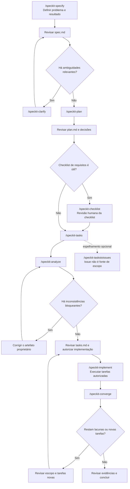

# Tutorial de GitHub Copilot no Nodra

Este guia explica como usar as customizações do GitHub Copilot presentes em `.github` para planejar, desenvolver, testar, revisar e preparar releases do Nodra.

O objetivo não é aprender a escrever frases sofisticadas. O objetivo é fornecer ao Copilot contexto, resultado esperado, limites e evidências suficientes para que ele trabalhe como parte do processo de engenharia.

## 1. Modelo mental

As customizações cumprem funções diferentes:

| Recurso | O que representa | Como é usado | Exemplo |
| --- | --- | --- | --- |
| Instrução global | regras permanentes do repositório | carregada automaticamente | Markdown é a fonte canônica |
| Instrução específica | regras de um domínio ou caminho | carregada quando a tarefa ou arquivo corresponde | regras Angular para `frontend/web` |
| Agente | profissional especializado com ferramentas e responsabilidades | selecionado no chat ou chamado por outro agente | `Altivy .NET Engineer` |
| Prompt | comando curto para uma tarefa focada | digitado com `/` no chat | `/speckit-plan` |
| Skill | fluxo especializado acionado explicitamente ou gate complementar | digitado com `/` no chat | `/altivy-notes-generate-tests` |
| Documento | fonte humana de arquitetura, processo ou política | lido pelo Copilot quando referenciado | plano mestre, ADR, segurança |
| Template | estrutura mínima de um artefato | preenchido por pessoa ou Copilot | pull request e ADR |

Uma forma simples de lembrar:

- **instruções dizem como trabalhar**;
- **agentes dizem quem deve trabalhar**;
- **prompts dizem qual tarefa executar**;
- **skills dizem qual processo completo seguir**;
- **documentos dizem por que e dentro de quais decisões o produto existe**.

## 2. O que acontece automaticamente

Você não precisa anexar manualmente todas as regras em cada conversa.

O arquivo [copilot-instructions.md](copilot-instructions.md) fornece contexto global. As instruções em `instructions/` possuem `description` e `applyTo`, permitindo que o Copilot as descubra pela tarefa ou pelo arquivo alterado.

Exemplo: ao solicitar uma alteração em `frontend/web/src/app/features/editor`, o Copilot deve receber as regras globais, Angular, segurança e possivelmente design system. Ao alterar uma migration em `backend/libs`, deve receber as regras .NET, PostgreSQL, segurança e arquitetura.

Ainda assim, escreva explicitamente o resultado desejado. Instruções definem padrões; elas não substituem requisitos.

## 3. Preparação no VS Code

1. Abra a raiz `altivy` no workspace.
2. Confirme que a extensão GitHub Copilot Chat está habilitada e autenticada.
3. Abra o painel de Chat do Copilot.
4. Use o seletor de agentes no topo do chat para escolher um agente especializado.
5. Digite `/` no campo do chat para listar prompts e skills disponíveis.
6. Quando o Copilot solicitar permissão para editar arquivos ou executar comandos, leia a ação e aprove apenas se ela corresponde à tarefa.

Os nomes e a interface podem variar ligeiramente conforme a versão do VS Code e da extensão. Se um prompt ou agente novo não aparecer, recarregue a janela com `Developer: Reload Window` e abra um novo chat no workspace.

## 4. Como escrever um bom pedido

Um pedido útil contém cinco elementos:

1. **Contexto:** quem precisa e em qual situação.
2. **Resultado:** comportamento observável esperado.
3. **Escopo:** módulos ou superfícies incluídas.
4. **Limites:** o que não deve mudar.
5. **Evidência:** como saber que terminou corretamente.

Modelo:

```text
Contexto: [pessoa e problema].
Resultado: [comportamento observável].
Escopo: [projetos, módulos ou fluxos].
Limites: [restrições e não escopo].
Validação: [testes, comandos ou cenários].
```

Exemplo fraco:

```text
Faça backlinks.
```

Exemplo melhor:

```text
Contexto: ao abrir uma nota, o usuário precisa descobrir quais notas apontam para ela.
Resultado: mostrar backlinks agrupados pela nota de origem, com trecho e navegação por clique.
Escopo: contrato, backend, painel contextual Angular e testes.
Limites: não implementar grafo global nem embeddings.
Validação: criar duas notas ligadas por [[Wiki Link]], abrir a nota de destino e verificar o backlink; links não resolvidos não devem aparecer como backlink resolvido.
```

Você não precisa indicar classes, tabelas ou implementação se ainda não souber. Descreva o problema e deixe o agente localizar o módulo proprietário.

## 5. Instruções

### 5.1 Quando você usa instruções

Na maior parte do tempo, instruções são automáticas. Você não as invoca com `/`.

Use-as conscientemente para:

- conferir qual padrão será aplicado a um arquivo;
- explicar por que o Copilot rejeitou ou evitou uma solução;
- alterar uma convenção permanente do projeto;
- orientar uma nova área ainda não coberta.

Exemplo de efeito automático:

```text
Crie o endpoint de atualização de nota com controle de concorrência.
```

Ao trabalhar em `backend/apps/api` e `backend/libs`, o Copilot deve aplicar, entre outras:

- `.github/copilot-instructions.md`;
- `architecture.instructions.md`;
- `backend-dotnet.instructions.md`;
- `contracts-api.instructions.md`;
- `security.instructions.md`.

Isso deve levá-lo a usar ETag/`If-Match`, `ProblemDetails`, autorização antes do acesso e testes apropriados.

### 5.2 Quando alterar uma instrução

Altere uma instrução quando a regra deve valer para várias tarefas futuras.

Bom exemplo:

```text
Todas as migrations devem registrar impacto esperado de lock e tempo de execução.
```

Mau exemplo para uma instrução permanente:

```text
Na issue 42, o botão deve ficar à esquerda.
```

Esse segundo item pertence ao requisito da issue ou ao prompt da implementação.

### 5.3 Como conferir o carregamento

Se o Copilot ignorar uma regra:

1. confirme que o arquivo está dentro da raiz correta do workspace;
2. confira o `applyTo` da instrução;
3. confira se a `description` contém termos relacionados à tarefa;
4. mencione a instrução explicitamente no pedido;
5. abra um novo chat após modificar customizações.

Exemplo:

```text
Revise esta mudança considerando explicitamente as instruções de segurança e PostgreSQL em .github/instructions.
```

## 6. Agentes

Agentes são especialistas. Selecione o agente no topo do chat antes de enviar o pedido. Um agente também pode delegar partes da tarefa a outros agentes quando sua configuração permite.

### 6.1 Qual agente escolher

| Situação | Agente recomendado |
| --- | --- |
| feature envolvendo várias camadas | `Altivy Delivery Lead` |
| decisão arquitetural ou novo componente | `Altivy Solution Architect` |
| componente, estado ou UX Angular | `Altivy Angular Engineer` |
| API, domínio, worker ou PostgreSQL | `Altivy .NET Engineer` |
| criação e execução de testes | `Altivy Quality Engineer` |
| threat model ou revisão de segurança | `Altivy Security Reviewer` |
| revisão de diff ou pull request | `Altivy Code Reviewer` |

### 6.2 Delivery Lead

Use para coordenar uma entrega ponta a ponta depois da autorização humana dos artefatos Spec Kit. Ele não cria requisitos, critérios de aceite ou tarefas.

Exemplo:

```text
Implemente as tarefas autorizadas em `specs/<feature>/tasks.md` para favoritos de notas. Preserve os requisitos e limites aprovados; não crie nem altere tarefas.
```

O esperado é que o agente:

1. confirme o diretório da feature, a autorização humana e a análise Spec Kit;
2. execute `/speckit-implement` sobre as tarefas aprovadas, sem ampliar o escopo;
3. delegue somente fatias técnicas já definidas nas tarefas;
4. execute validações e use `/speckit-converge` para verificar lacunas;
5. relate evidências sem commit ou deploy automático.

### 6.3 Solution Architect

Use antes de implementar uma decisão estrutural.

Exemplo:

```text
Avalie se a fila de indexação deve permanecer no PostgreSQL ou migrar para RabbitMQ quando houver múltiplos workers. Considere volume de 100 mil notas, operação self-hosted, idempotência, recuperação e custo operacional. Não edite arquivos.
```

O agente deve comparar opções e recomendar uma decisão. Ele não deve adicionar RabbitMQ apenas porque é tecnicamente possível.

### 6.4 Angular Engineer

Use para uma tarefa frontend já definida e autorizada, normalmente delegada por `/speckit-implement`.

```text
Tarefa autorizada: `specs/<feature>/tasks.md`, T###. Implemente a navegação por teclado descrita nessa tarefa. Preserve virtualização e o contrato aprovado.
```

### 6.5 .NET Engineer

Use para uma tarefa backend já definida e autorizada, normalmente delegada por `/speckit-implement`.

```text
Tarefa autorizada: `specs/<feature>/tasks.md`, T###. Implemente somente a reconciliação descrita nessa tarefa, usando as decisões e validações aprovadas no plano.
```

### 6.6 Quality Engineer

Use para produzir evidência de uma tarefa de teste já definida e autorizada pelo Spec Kit.

```text
Tarefa autorizada: `specs/<feature>/tasks.md`, T###. Implemente e execute os testes definidos para rename de nota; reporte lacunas ao Spec Kit sem acrescentar critérios.
```

### 6.7 Reviewers

Reviewers são read-only. Eles relatam problemas, mas não alteram o código.

Exemplo de segurança:

```text
Revise o fluxo de upload de anexos. Trace nome do arquivo, MIME, assinatura, path final, autorização e resposta HTTP. Liste achados por severidade e proponha teste de regressão. Não edite arquivos.
```

Exemplo de código:

```text
Revise as alterações da branch atual contra main. Priorize perda de dados, regressões de contrato, concorrência e testes ausentes. Ignore preferências estilísticas já cobertas por ferramentas.
```

## Frontend Angular e PO UI

PO UI (`@po-ui/ng-components`) é a única biblioteca de componentes de UI genérica aprovada para o frontend. O editor Markdown (CodeMirror 6) e o grafo de notas (Cytoscape) são exceções já aprovadas, por não terem equivalente no portfólio. Antes de desenhar uma tela fora dessas duas superfícies, consulte `https://po-ui.io/llms.txt` (índice), `https://po-ui.io/llms-full.txt` (documentação completa) ou, preferencialmente, o servidor MCP `po-ui` configurado em `.vscode/mcp.json` (ferramentas `list_components`, `search_docs`, `get_component_docs`, `get_guide`, `get_component_examples`). Regras completas em `.github/instructions/frontend-po-ui.instructions.md`.

Se nenhum componente do portfólio atender a necessidade, não invente substituto: registre a lacuna e pergunte antes de prosseguir.

Toda tela ou componente novo (incluindo editor e grafo) passa por um loop de screenshot, análise e ajuste (`frontend-visual-verification.instructions.md`) antes de ser considerado pronto, com no máximo 3 iterações antes de perguntar.

## 7. Prompts

Prompts são comandos focados. No chat, digite `/` e selecione o prompt. Depois complete os argumentos solicitados.

### 7.1 Prompts disponíveis

| Comando | Quando usar | O que você faz |
| --- | --- | --- |
| `/speckit-constitution` | Uma vez após instalar/inicializar o Spec Kit | Confirma princípios já verdadeiros para o projeto; revisa a constituição gerada |
| `/speckit-specify` | Iniciar ou alterar uma feature | Descreve problema, usuários, resultado e limites; depois revisa `spec.md` |
| `/speckit-clarify` | A spec ainda contém ambiguidades relevantes | Responde às perguntas do Copilot; revise as alterações em `spec.md` |
| `/speckit-plan` | A spec está compreendida e pronta para desenho | Informa restrições técnicas e decisões pendentes; decide trade-offs de produto/arquitetura |
| `/speckit-tasks` | O desenho técnico está revisado | Revisa cobertura, dependências, testes e caminhos de cada tarefa |
| `/speckit-analyze` | Após gerar tarefas e antes de implementar | Lê o relatório; direciona correções ao artefato dono de cada problema |
| `/speckit-checklist` | Gate opcional de qualidade dos requisitos | Define foco da revisão e decide quais critérios estão satisfeitos; não marca implementação concluída |
| `/speckit-implement` | Só após autorização humana explícita | Autoriza o escopo/tarefas; responde a gates e revisa mudanças por etapa |
| `/speckit-converge` | Depois da implementação | Revisa lacunas e tarefas acrescentadas; autoriza nova rodada de implementação |
| `/speckit-bug-assess`, `/speckit-bug-fix`, `/speckit-bug-test` | Defeitos, após instalar a extensão Bug Fixing | Confirma diagnóstico/remediação e revisa evidências da correção |
| `/altivy-notes-create-adr` | Somente quando `/speckit-plan` ou uma tarefa Spec Kit justificar ADR | Selecione `Altivy Solution Architect`; a skill cria somente ADR justificado, vinculado e `proposed` |
| `/altivy-notes-generate-tests` | Apoio a tarefa autorizada de Spec Kit | Selecione `Altivy Quality Engineer`; não cria critérios paralelos |
| `/altivy-notes-review-change` | Revisão de diff vinculado ao Spec Kit | Selecione `Altivy Code Reviewer`; inspeção não edita e validação exige autorização |
| `/altivy-notes-localize-speckit` | Auditoria/tradução de textos humanos do Spec Kit | Invocação explícita; sem modo, somente audita; sem alvo, inventaria |
| `/pull-request-review`, `/release-readiness` | Gates posteriores | Revisa achados e decide aceite/release; não substituem os artefatos da feature |

### 7.2 Processo obrigatório para features

Cada feature tem um diretório em `specs/<número>-<slug>/`. `/speckit-specify` escolhe o próximo número sequencial e cria os artefatos conforme as necessidades:

```text
specs/NNN-nome-da-feature/
├── spec.md             # problema, cenários, requisitos e critérios de sucesso
├── plan.md             # desenho técnico, pesquisa e decisões de implementação
├── tasks.md            # tarefas executáveis, ordenadas e rastreáveis
├── checklists/         # checklists opcionais de qualidade dos requisitos
├── research.md         # pesquisa técnica, quando gerada
├── data-model.md       # modelo de dados, quando aplicável
├── contracts/          # contratos novos/alterados, quando aplicável
└── quickstart.md       # passos de validação, quando aplicável
```

O fluxo abaixo concentra as etapas e os gates humanos em um único lugar:



`clarify` e `checklist` dependem das ambiguidades e dos riscos dos requisitos. Se `analyze` encontrar problemas, corrija o artefato que os originou e execute a análise novamente. A autorização humana é obrigatória antes de implementar; tarefas novas encontradas na convergência também precisam ser revisadas e autorizadas antes da próxima execução.

Agentes e prompts locais podem ajudar em partes técnicas, mas não criam requisitos, planos ou tarefas substitutos. Sem tarefa ativa em `specs/<feature>/`, interrompa a implementação.

### 7.3 Processo obrigatório para defeitos

Após instalar a extensão oficial Bug Fixing, use os comandos nesta ordem. O desenvolvedor fornece a reprodução e valida o diagnóstico antes de autorizar a correção:

1. `/speckit-bug-assess`: informe sintoma, esperado/observado e evidência; revise `assessment.md` e confirme se a causa/remediação fazem sentido.
2. `/speckit-bug-fix`: somente após autorizar a remediação; revise código, testes e `fix.md`.
3. `/speckit-bug-test`: execute/acompanhe a validação; revise `test.md` e confirme se o resultado pode ser considerado verificado.

Não use os comandos de bug fixing antes da instalação da extensão; não substitua a extensão por um prompt local ou correção avulsa.

### 7.4 Criar um ADR

ADR não substitui nem duplica os artefatos da feature: `spec.md` registra o que/por quê, `plan.md` e `research.md` registram como a feature será desenhada e as alternativas locais, e `tasks.md` organiza o trabalho. ADR preserva uma decisão arquitetural duradoura para orientar outras features e revisões futuras.

Crie ADR somente quando a decisão for transversal ou duradoura, mudar uma fronteira/contrato importante, ou exigir registro formal por segurança, compatibilidade, operação ou migração. Uma escolha local, reversível e já justificada no plano não precisa de ADR.

Fluxo:

1. Inicie a feature com `/speckit-specify` e esclareça dúvidas com `/speckit-clarify`, se necessário.
2. Em `/speckit-plan`, peça para comparar opções e declarar se a decisão atende aos critérios de ADR. Sem justificativa, mantenha-a em `plan.md` ou `research.md` e não crie ADR.
3. Se o plano justificar ADR, selecione `Altivy Solution Architect` e invoque `/altivy-notes-create-adr`. A skill gera `docs/adr/AAAA-NNNN-titulo.md` com status `proposed`; não aceita nem implementa a decisão.
4. Revise o ADR e aponte a decisão em `plan.md`; `/speckit-tasks` deve incluir sua revisão/registro e qualquer gate dependente. Use `/speckit-analyze` para verificar consistência.
5. O mantenedor decide explicitamente se aceita, rejeita ou pede revisão. Se a implementação depender da decisão, ela fica bloqueada até essa decisão humana. IA nunca muda o status para `accepted`.
6. Só então siga o gate normal de autorização e `/speckit-implement`; mantenha o ADR referenciado no PR e nos artefatos afetados.

```text
/speckit-plan

Para esta feature, compare UUID no frontmatter, identidade somente no PostgreSQL e inferência por hash/path. Avalie compatibilidade, edição externa, privacidade e recuperação. Diga se a escolha é local à feature ou uma decisão duradoura que requer ADR; se exigir ADR, registre a justificativa e o gate humano no plano.
```

Quando `/speckit-plan` justificar o ADR, use o prompt auxiliar:

```text
/altivy-notes-create-adr

Decisão identificada em specs/NNN-feature/plan.md: [resuma a decisão e o impacto transversal]. Compare opções, preserve o vínculo com a feature e gere somente um ADR em status proposed. Não implemente nem aceite a decisão.
```

### 7.5 Gerar testes

```text
/altivy-notes-generate-tests

Tarefa autorizada: `specs/<feature>/tasks.md`, T###. Crie os testes previstos para o comportamento dessa tarefa, incluindo concorrência com filesystem e PostgreSQL reais quando aplicável.
```

### 7.6 Revisar uma mudança

```text
/altivy-notes-review-change

Revise a branch atual contra main. O objetivo da mudança é adicionar pesquisa por tags. Confirme autorização por vault, paginação, índices, contrato OpenAPI e estados de UI.
```

## 8. Skills

As skills `speckit-*` expõem os comandos oficiais do ciclo de feature e da extensão Bug Fixing, usando os artefatos e templates de `.specify/`. As skills auxiliares de ADR, testes, revisão e localização fornecem fluxos especializados subordinados ao Spec Kit; nenhuma cria requisitos ou substitui os artefatos canônicos.

### 8.1 Skills disponíveis

| Comando | Quando usar |
| --- | --- |
| `/speckit-constitution`, `/speckit-specify`, `/speckit-clarify`, `/speckit-plan`, `/speckit-tasks`, `/speckit-analyze`, `/speckit-implement`, `/speckit-converge`, `/speckit-checklist` | ciclo oficial de feature e qualidade dos requisitos |
| `/speckit-bug-assess`, `/speckit-bug-fix`, `/speckit-bug-test` | fluxo oficial de diagnóstico, correção e validação de defeitos |
| `/speckit-taskstoissues` | espelhar tarefas Spec Kit em Issues sem transferir a autoridade dos artefatos |
| `/altivy-notes-create-adr` | redigir ADR justificado; selecione `Altivy Solution Architect`; nunca aceita ou implementa decisão |
| `/altivy-notes-generate-tests` | gerar/validar testes de tarefa autorizada; selecione `Altivy Quality Engineer` |
| `/altivy-notes-review-change` | revisão read-only vinculada à tarefa; selecione `Altivy Code Reviewer`; validação exige autorização |
| `/altivy-notes-localize-speckit` | auditar/traduzir explicitamente textos humanos, preservando contratos e exclusões |
| `/pull-request-review` | revisão completa de PR em várias dimensões |
| `/release-readiness` | decisão GO/NO-GO antes de uma release |

### 8.2 Pull request review

```text
/pull-request-review

Revise a branch feature/note-trash contra main. Issue: #27. ADR relacionado: docs/adr/0004-note-trash.md. Execute apenas validações read-only ou que não alterem artefatos versionados.
```

Espere achados por severidade, com cenário, impacto e correção. Um resultado sem achados deve declarar testes não executados e risco residual.

### 8.3 Release readiness

```text
/release-readiness

Versão candidata: 0.3.0.
Base: 0.2.1.
Ambientes: Docker Desktop Windows e Docker Engine Linux.
Mudanças principais: backlinks, lixeira e OIDC.
Não publique nem faça deploy; produza somente a matriz de gates e recomendação GO/NO-GO.
```

`NOT RUN` não significa sucesso. Para obter `GO`, cada gate obrigatório precisa de evidência ou waiver formal.

## 9. Documentos e templates

### 9.1 Plano mestre e documentos técnicos

Use como fontes de decisão:

- [plano mestre](../docs/plano-mestre.md): visão, escopo e arquitetura global;
- [frontend](../docs/frontend.md): implementação Angular e UX;
- [backend](../docs/backend.md): implementação .NET, dados e filesystem;
- [evolução do produto](../docs/evolucao-produto.md): fases, gates e métricas.

Use esses documentos como restrições de contexto ao produzir artefatos Spec Kit; não solicite propostas ou planos de feature fora deles.

Exemplo de pedido com contexto explícito:

```text
Leia docs/plano-mestre.md e docs/backend.md. Inicie `/speckit-specify` para permitir links não resolvidos. Preserve reconstrução integral a partir do vault e não implemente antes de `spec.md`, `plan.md`, `tasks.md` e análise de consistência estarem revisados.
```

### 9.2 ADR

ADR registra decisão duradoura ou transversal, não uma decisão local de implementação. Use o fluxo Spec Kit descrito em [7.4](#74-criar-um-adr): `/speckit-plan` avalia se há necessidade, `/altivy-notes-create-adr` redige quando justificado, e `plan.md`/`tasks.md` mantêm o vínculo e os gates. A skill escolhe a próxima sequência anual e usa status `proposed`; somente o mantenedor pode aceitar a decisão.

### 9.3 Spec Kit e planos

O Spec Kit foi inicializado na branch `chore/adotar-spec-kit` com CLI `1.0.13` e integração Copilot. A constituição inicial registra somente princípios existentes e a regra documental pt-BR. Em futuras inicializações brownfield, siga o guia oficial de [projetos existentes](https://github.github.io/spec-kit/guides/existing-projects.html): crie uma base revisável, execute o CLI em container e revise o diff, pois `--force` pode substituir caminhos gerenciados.

Para cada feature, use os artefatos Spec Kit em `specs/<feature>/`: `spec.md` para requisitos e cenários, `plan.md` para desenho técnico e `tasks.md` para tarefas. Esses arquivos são a fonte específica da feature; não duplique conteúdo em `docs/plan`.

Os comandos são executados no chat do agente, não no terminal. No Copilot em modo skills, use a forma `/speckit-*`; outras integrações podem expor outra grafia, como `/speckit.specify`. Use o identificador oferecido pelo agente ativo. O desenvolvedor revisa os artefatos e autoriza explicitamente a implementação; a existência dos arquivos não constitui aprovação. Uma tarefa só pode ser marcada como concluída após execução e validação, o que não substitui aceite de produto ou revisão.

Para a sequência, as revisões e a repetição do ciclo de feature, consulte [o fluxo de features na seção 7.2](#72-processo-obrigatório-para-features). Para referências atualizadas sobre comandos e integrações, consulte a [documentação oficial do Spec Kit](https://github.github.io/spec-kit/reference/agentic-sdd.html), [integrações](https://github.github.io/spec-kit/reference/integrations.html) e [extensões](https://github.github.io/spec-kit/reference/extensions.html).

`docs/plan` e [PLAN_TEMPLATE.md](PLAN_TEMPLATE.md) estão congelados e não autorizam desenvolvimento. Os sete planos legados abertos foram convertidos em oito conjuntos Spec Kit, de `specs/001-alternancia-vaults/` a `specs/008-workspace-frontend/`; o plano de alternância foi dividido entre navegação e provisioning. Todos estão em rascunho e aguardam revisão humana. Os originais permanecem como referência congelada até essa revisão; planos `completed` permanecem históricos e `superseded` não são reativados.

### 9.4 Issues

Use os templates em `ISSUE_TEMPLATE` para registrar o problema antes de uma mudança relevante.

Uma boa issue de feature descreve problema e resultado. Não imponha solução técnica sem necessidade.

Uma boa issue de bug inclui reprodução, esperado, observado, ambiente e impacto. Vulnerabilidades não devem virar issues públicas; siga [SECURITY.md](SECURITY.md).

### 9.5 Pull request

O [template de pull request](PULL_REQUEST_TEMPLATE.md) exige evidências. Não marque uma caixa se o comando não foi executado.

Peça ao Copilot para ajudar a preencher sem inventar resultados:

```text
Com base exclusivamente no diff e nos comandos executados nesta sessão, prepare o texto do template de PR. Mantenha desmarcado tudo que não foi executado e liste riscos residuais.
```

### 9.6 Guia de contribuição e segurança

- [CONTRIBUTING.md](CONTRIBUTING.md) define o fluxo humano e Definition of Done.
- [SECURITY.md](SECURITY.md) define reporte privado de vulnerabilidades.

## 10. Como fornecer contexto ao Copilot

### 10.1 Contexto mínimo útil

Para uma tarefa localizada, forneça:

- comportamento esperado;
- arquivo, símbolo, erro ou teste, se conhecido;
- restrições;
- comando de validação.

Exemplo:

```text
O teste NotePathTests falha para nomes Unicode no Windows. Corrija a causa sem alterar o contrato de path relativo e execute somente a suíte relacionada antes do build amplo.
```

### 10.2 Referencie arquivos

Você pode mencionar caminhos diretamente:

```text
Considere docs/plano-mestre.md, docs/backend.md e contracts/openapi/altivy.yaml.
```

No VS Code, também pode adicionar arquivos pelo recurso de contexto do chat. Evite anexar o repositório inteiro sem necessidade; excesso de contexto pode esconder o que importa.

### 10.3 Use erros reais

Prefira:

```text
dotnet test falha em NoteWriterTests com UnauthorizedAccessException ao substituir o arquivo temporário. Ocorre apenas no Windows.
```

Em vez de:

```text
O backend não funciona.
```

### 10.4 Não envie dados sensíveis

Nunca forneça ao chat:

- senhas, tokens e chaves;
- connection strings reais;
- conteúdo confidencial de notas;
- dumps de banco;
- arquivos `.env` reais;
- logs com dados pessoais.

Sanitize exemplos antes de enviá-los.

No desenvolvimento local em Windows, mantenha todo secret somente em
`$env:APPDATA\Microsoft\UserSecrets\Altivy.Notes\.env`, fora do repositório.
Isso inclui credenciais administrativas do Keycloak e PostgreSQL, client
secrets, connection strings, SMTP, IdPs e demais valores sensíveis. Não peça ao
agente para criar `.env` ou arquivo equivalente dentro da estrutura do projeto.

## 11. Como acompanhar o trabalho do agente

Durante a execução, observe:

1. **Hipótese:** o agente explicou o que acredita controlar o comportamento?
2. **Escopo:** está alterando somente módulos relacionados?
3. **Primeira validação:** executou teste/build logo após a primeira edição?
4. **Falhas:** corrigiu a causa ou apenas silenciou o teste?
5. **Segurança:** paths, autorização, conteúdo e secrets foram considerados?
6. **Evidência:** os comandos realmente foram executados?
7. **Conclusão:** há riscos e limitações claramente declarados?

Interrompa ou redirecione quando perceber ampliação indevida:

```text
Pare a expansão de escopo. Não altere o design system. Concentre-se apenas no conflito de ETag e reexecute o teste que falhava.
```

Para pedir status sem encerrar:

```text
Informe o que já foi confirmado, quais arquivos foram alterados, qual validação passou e qual é o próximo passo. Depois continue.
```

## 12. Aprovação de ferramentas e comandos

O Copilot pode pedir autorização para executar terminal, editar arquivos ou usar recursos externos.

Antes de aprovar, confira:

- o comando está no repositório correto;
- não contém secret;
- não publica, faz deploy ou push sem sua intenção;
- não usa operação destrutiva como reset, limpeza de dados ou remoção de bind mount;
- a validação é proporcional à mudança;
- instalações de dependências são realmente necessárias.

Comandos de leitura, build e teste normalmente são esperados. Comandos de migração, publicação, exclusão, alteração de infraestrutura e acesso à nuvem merecem revisão adicional.

## 13. Fluxos completos de exemplo

### 13.1 Da ideia à implementação

Primeiro, especifique e planeje a feature:

```text
/speckit-specify

Quero permitir fixar notas importantes no topo do explorador. O recurso é individual por usuário e vault. Não deve alterar os arquivos Markdown.
```

Depois revise `spec.md`, gere e revise o desenho e as tarefas:

```text
/speckit-plan
/speckit-tasks
/speckit-analyze
```

Com autorização explícita para implementar, execute:

```text
/speckit-implement

Execute as tarefas autorizadas para notas fixadas. Preserve o contrato definido, adicione testes e não faça commit.
```

Depois da implementação, verifique lacunas remanescentes:

```text
/speckit-converge
```

Depois revise:

```text
/altivy-notes-review-change

Revise o diff da feature de notas fixadas contra os critérios aprovados. Priorize autorização por vault e remoção de referências após exclusão de nota.
```

### 13.2 De um bug à regressão protegida

```text
/speckit-bug-assess

Ao salvar duas abas da mesma nota, a segunda sobrescreve a primeira sem aviso. Avalie a causa e o impacto de duas versões concorrentes do mesmo ETag.
```

Depois da avaliação, use a sequência oficial:

```text
/speckit-bug-fix
/speckit-bug-test
```

Depois peça revisão especializada:

```text
Selecione Altivy Code Reviewer:
Revise somente a correção de concorrência. Confirme status HTTP, preservação das versões e cobertura do cenário simultâneo.
```

### 13.3 De uma decisão a um ADR

```text
/altivy-notes-create-adr

Avaliar histórico de revisões: cópias no vault, tabela PostgreSQL ou Git interno. Considere Markdown como fonte canônica, NAS, retenção, restore e experiência de usuário.
```

A skill cria `docs/adr/AAAA-NNNN-historico-revisoes.md` como `proposed`. Somente após decisão humana explícita o mantenedor altera o status para `accepted`; use então o ADR como contexto na implementação.

### 13.4 Antes de uma release

```text
/release-readiness

Avalie 1.0.0-rc.1 contra 0.9.0. Não publique. Exija restore testado, migration PostgreSQL, Playwright, imagens, SBOM, scan e documentação de upgrade.
```

Não peça ao agente para transformar `NO-GO` em `GO`. Corrija ou aceite formalmente os riscos e execute novamente.

## 14. Erros comuns ao usar IA

### Pedido amplo demais

```text
Crie o Obsidian completo.
```

Divida por capacidade e critérios de aceite. Use `/speckit-specify` para criar a fonte de requisitos antes do desenho e da implementação.

### Pedir tecnologia em vez de problema

```text
Adicione Redis.
```

Prefira:

```text
A fila PostgreSQL está causando atraso medido de 10 minutos com três workers. Analise a causa e opções antes de adicionar infraestrutura.
```

### Confiar sem validar

Código plausível pode estar incorreto. Exija testes executados, diagnósticos e revisão.

### Aceitar mudanças gigantes

Peça slices pequenos e validação após cada etapa. Pull requests menores são mais fáceis de revisar e reverter.

### Deixar a IA decidir produto sozinha

O Copilot pode estruturar opções, mas prioridade, risco aceito e decisão de produto são responsabilidades humanas.

### Pedir para ignorar testes

Se um teste falha, descubra se é regressão, ambiente ou teste inválido. Não remova evidência para obter build verde.

### Misturar planejamento e execução sem intenção

Use os comandos oficiais Spec Kit para todo planejamento e execução. Prompts, agentes e skills locais não iniciam processos alternativos nem autorizam implementação fora de uma tarefa Spec Kit.

## 15. Checklist rápido

Antes do pedido:

- [ ] Sei qual problema quero resolver.
- [ ] Defini resultado e não escopo.
- [ ] Escolhi agente, prompt ou skill adequado.
- [ ] Removi dados sensíveis do contexto.

Durante:

- [ ] O agente declarou hipótese e validação.
- [ ] As mudanças permanecem no escopo.
- [ ] Os testes são executados, não apenas sugeridos.
- [ ] Decisões irreversíveis foram interrompidas para revisão.

Depois:

- [ ] Li o diff.
- [ ] Conferi comandos e resultados.
- [ ] Solicitei review apropriado.
- [ ] Documentação, contrato e migration estão sincronizados.
- [ ] Riscos residuais estão explícitos.
- [ ] Nenhum commit, push ou deploy ocorreu sem minha decisão.

## 16. Caminho recomendado para começar

Para as primeiras tarefas, consulte estas referências:

1. Revise a constituição uma única vez após inicializar o Spec Kit; veja [Spec Kit e planos](#93-spec-kit-e-planos).
2. Para features, siga o fluxo canônico e o diagrama em [Processo obrigatório para features](#72-processo-obrigatório-para-features).
3. Para defeitos, use [o fluxo oficial Bug Fixing](#73-processo-obrigatório-para-defeitos).
4. Depois, aplique review e release readiness como gates posteriores.

Não selecione agentes de engenharia para iniciar trabalho de aplicação independente do Spec Kit. Após a autorização, `/speckit-implement` pode acioná-los para executar subtarefas técnicas já definidas; use Delivery Lead para coordenar tarefas que cruzam áreas.
