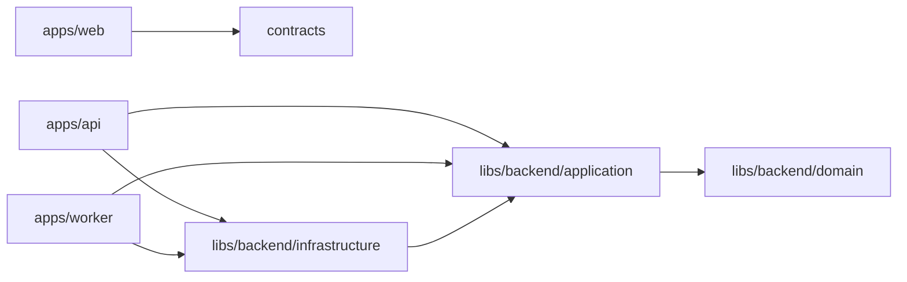

# Arquitetura

## Limites

- Adote monólito modular com hosts separados para API e worker.
- Hosts em `apps/` são composition roots; não concentre regras de negócio neles.
- `libs/backend/domain` não depende de infraestrutura, ASP.NET Core ou EF Core.
- `libs/backend/application` orquestra casos de uso e depende do domínio e de portas explícitas.
- `libs/backend/infrastructure` implementa PostgreSQL, filesystem, identidade e providers externos.
- `apps/web` consome contratos HTTP; não conhece schema do banco nem paths físicos do host.
- `libs/frontend` não importa features ou arquivos internos de `apps/web`.
- `contracts` contém contratos independentes de C# e TypeScript e é a origem para geração de clientes.

## Dependências permitidas

- Dependências apontam para dentro; domínio não referencia hosts ou adapters.
- Comunicação API-worker ocorre por estado durável no PostgreSQL, não por memória compartilhada.
- Não introduza mensageria externa sem ADR, métricas e plano operacional.

## Decisões que exigem ADR

- novo serviço, datastore, framework estrutural ou provider externo;
- mudança na fonte canônica, consistência ou resolução de links;
- mudança incompatível em API, arquivo Markdown ou schema;
- autenticação, autorização, criptografia ou retenção;
- CRDT, plugins, colaboração, embeddings ou envio de conteúdo a terceiros;
- alteração relevante de deployment, backup, RPO ou RTO.

O ADR deve registrar contexto, forças, opções, decisão, consequências, segurança, migração e rollback.

## Design

- Modele invariantes no domínio e casos de uso na aplicação.
- Prefira composição e módulos explícitos a abstrações genéricas.
- Crie interfaces somente em fronteiras substituíveis ou testáveis.
- Torne operações distribuídas idempotentes e observáveis.
- Trate filesystem e PostgreSQL como recursos sem transação compartilhada; reconciliação é parte do desenho.
- Preserve compatibilidade e implemente mudanças de contrato por expand-contract.

## Evidência de conclusão

- testes de arquitetura impedem dependências proibidas;
- caminhos críticos têm testes de integração e falha parcial;
- observabilidade cobre latência, erro e atraso de consistência;
- documentação e ADR correspondem ao código entregue.