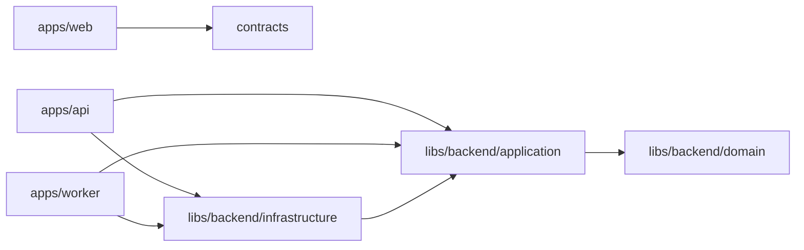

# Arquitetura

## Limites

- Adote monólito modular com hosts separados para API e worker.
- Hosts em `apps/` são composition roots; não concentre regras de negócio neles.
- `libs/backend/domain` não depende de infraestrutura, ASP.NET Core ou EF Core.
- `libs/backend/application` orquestra casos de uso e depende do domínio e de portas explícitas.
- `libs/backend/infrastructure` implementa PostgreSQL, filesystem e integrações com providers externos.
- Keycloak é a plataforma externa obrigatória de identidade e decisão de autorização; a solução não implementa cadastro local, senha, recuperação de conta, MFA, diretório de usuários, memberships ou políticas próprias de acesso.
- O BFF atua somente como cliente OIDC confidencial, gerenciador da sessão técnica do browser e relay de tokens; ele não se torna um provedor de identidade ou motor de autorização.
- A API atua como Policy Enforcement Point: valida o token e exige as permissões emitidas pelo Keycloak antes de acessar qualquer recurso, sem reproduzir localmente a decisão da política.
- Recursos e scopes específicos do domínio, como vaults e operações permitidas, são registrados no Keycloak Authorization Services por integração idempotente e reconciliável.
- `apps/web` consome contratos HTTP; não conhece schema do banco nem paths físicos do host.
- `libs/frontend` não importa features ou arquivos internos de `apps/web`.
- `contracts` contém contratos independentes de C# e TypeScript e é a origem para geração de clientes.

## Dependências permitidas

- Dependências apontam para dentro; domínio não referencia hosts ou adapters.
- Comunicação API-worker ocorre por estado durável no PostgreSQL, não por memória compartilhada.
- Não introduza mensageria externa sem ADR, métricas e plano operacional.

## Decisões que exigem ADR

- novo serviço, datastore, framework estrutural ou provider externo;
- mudança na fonte canônica, consistência ou resolução de links;
- mudança incompatível em API, arquivo Markdown ou schema;
- autenticação, autorização, integração com Keycloak, criptografia ou retenção;
- CRDT, plugins, colaboração, embeddings ou envio de conteúdo a terceiros;
- alteração relevante de deployment, backup, RPO ou RTO.

O ADR deve registrar contexto, forças, opções, decisão, consequências, segurança, migração e rollback.

## Design

- Modele invariantes no domínio e casos de uso na aplicação.
- Prefira composição e módulos explícitos a abstrações genéricas.
- Crie interfaces somente em fronteiras substituíveis ou testáveis.
- Use DDD para limites e linguagem do domínio, Ports and Adapters nas integrações e CQRS pragmático para separar escrita de projeções de leitura; não adote Event Sourcing.
- Use eventos de domínio dentro do processo e Outbox/jobs duráveis para trabalho assíncrono após commit. Mediator in-process não substitui entrega durável; handlers com efeitos repetíveis permanecem idempotentes.
- Torne operações distribuídas idempotentes e observáveis.
- Trate filesystem e PostgreSQL como recursos sem transação compartilhada; reconciliação é parte do desenho.
- Preserve compatibilidade e implemente mudanças de contrato por expand-contract.

## Dependências externas e licenças

- Antes de sugerir ou adicionar pacote, imagem, action, fonte, asset ou ferramenta, verifique a licença na fonte oficial e registre a evidência no pull request.
- Aceite automaticamente apenas licenças permissivas e gratuitas para os usos previstos, como MIT, Apache-2.0, BSD-2-Clause, BSD-3-Clause, ISC e PostgreSQL.
- Não use dependência paga, proprietária, source-available, com licença comercial obrigatória, copyleft ou restrição incompatível com distribuição, modificação ou operação self-hosted.
- Licença ausente, ambígua, alterada entre versões ou não verificada bloqueia a inclusão. Não presuma que gratuidade, código público ou pacote disponível implica licença permissiva.
- O padrão Mediator é permitido quando reduzir acoplamento real entre remetentes, handlers e comportamentos de pipeline. Quando necessário, use exclusivamente `Nuuvify.CommonPack.Mediator` como implementação externa aprovada.
- Não use a biblioteca MediatR. A restrição decorre do licenciamento do pacote e não proíbe o padrão Mediator.
- Mesmo com Mediator, casos de uso, transações, autorização e efeitos permanecem explícitos; notificações in-process não substituem Outbox, jobs duráveis ou integração entre processos.
- Prefira recursos da plataforma e dependências já aprovadas. Uma nova dependência ainda exige necessidade real, manutenção ativa, versão fixada, análise de vulnerabilidades e SBOM.

## Evidência de conclusão

- testes de arquitetura impedem dependências proibidas;
- caminhos críticos têm testes de integração e falha parcial;
- observabilidade cobre latência, erro e atraso de consistência;
- documentação e ADR correspondem ao código entregue.