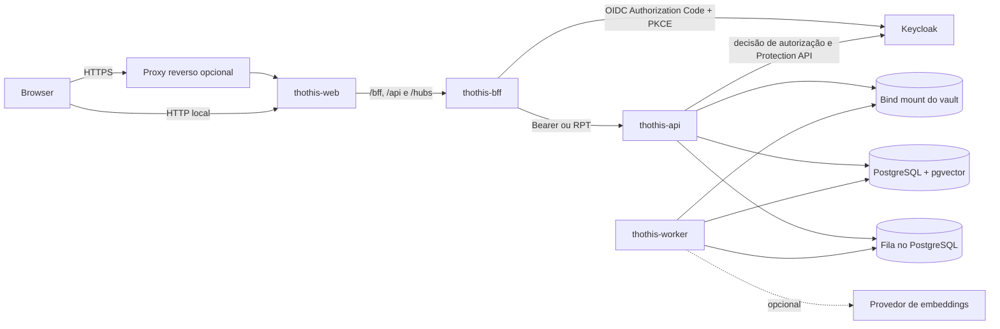

    

# Thothis

## Plano mestre da solução

**Status:** proposta arquitetural inicial  
**Data de referência:** 28 de julho de 2026  
**Objetivo:** orientar produto, arquitetura, implementação, implantação e evolução do Thothis.

## 1. Visão do produto

O Thothis será uma plataforma web self-hosted de gestão de conhecimento baseada em Markdown. A experiência deve oferecer edição, organização, links entre notas, backlinks, propriedades, pesquisa e visualização em grafo, sem exigir instalação de software no computador do usuário além de um navegador.

A solução será distribuída por containers e deverá funcionar tanto em uma máquina com Docker Desktop quanto em um servidor atrás de proxy reverso. Os documentos e demais dados persistentes ficarão em bind mounts configuráveis, incluindo pastas locais, compartilhamentos de rede e NAS compatíveis com o host dos containers.

### 1.1 Origem do nome

O nome **Thothis** é fortemente associado a **Thoth**, divindade egípcia da escrita, do conhecimento, da sabedoria, da ciência e do registro da informação. Essa origem estabelece uma relação direta com o propósito do produto: organizar conhecimento, preservar memória e tornar informação conectada acessível e pesquisável.

**Thothis** possui associação conceitual forte com conhecimento, escrita, documentação, memória, inteligência artificial e gestão de conhecimento. O nome é adequado para uma plataforma de notas, wiki corporativa, documentação, pesquisa e recursos de RAG ou LLM, mantendo uma identidade curta, memorável e premium.

A pronúncia oficial é **TÔ-TIS**. Essa forma é simples para falantes de português, espanhol e inglês, preserva uma sonoridade forte e facilita o uso internacional consistente da marca.

Os endereços oficiais previstos são **thothis.app** e **thothis.zocate.li**.

### 1.2 Proposta de valor

- experiência de notas conectadas acessível pelo navegador;
- documentos Markdown portáveis e legíveis fora da aplicação;
- implantação sem instalador de desktop;
- operação local, em rede corporativa ou infraestrutura própria;
- pesquisa textual, relacional e semântica no mesmo produto;
- controle organizacional sobre dados, identidade, backup e retenção.

### 1.3 Princípios

1. **Markdown como fonte canônica:** o conteúdo do usuário pertence aos arquivos `.md`.
2. **Banco reconstruível:** metadados, índices, links e vetores podem ser refeitos a partir do vault.
3. **Local-first no servidor:** conteúdo, persistência, busca e edição não dependem de nuvem; o acesso autenticado exige um Keycloak configurado, que pode operar na rede local em ambientes isolados.
4. **Segurança por padrão:** menor privilégio, isolamento de rede e conteúdo não confiável sanitizado.
5. **Operação simples:** uma implantação deve ser iniciada e atualizada por Docker Compose.
6. **Evolução orientada por evidências:** componentes adicionais entram somente quando houver necessidade medida.
7. **Compatibilidade aberta:** arquivos, links e frontmatter devem usar formatos documentados e exportáveis.

## 2. Escopo funcional

### 2.1 Capacidades essenciais

- criar, abrir, editar, renomear, mover e excluir notas Markdown;
- organizar notas em pastas e navegar por árvore de arquivos;
- criar links Markdown e wiki links no formato `[[Nota]]`;
- exibir backlinks, links não resolvidos e menções;
- utilizar tags, aliases e propriedades YAML no frontmatter;
- editar em modo fonte com realce e visualizar o conteúdo renderizado;
- trabalhar com múltiplas notas em abas;
- pesquisar por texto, título, caminho, tag, propriedade e similaridade semântica;
- visualizar grafo global e grafo local de relacionamentos;
- anexar e referenciar imagens, PDFs e outros arquivos permitidos;
- recuperar alterações por histórico, lixeira e backup;
- operar por teclado por meio de command palette e atalhos configuráveis;
- refletir alterações externas realizadas diretamente no bind mount.

### 2.2 Capacidades corporativas

- autenticação, federação, SSO e MFA centralizados no Keycloak por OpenID Connect;
- autorização fina por vault, recurso e scope decidida pelo Keycloak Authorization Services;
- trilha de auditoria para ações sensíveis;
- políticas de sessão, upload, retenção e tipos de arquivo;
- execução atrás de proxy reverso com TLS;
- métricas, logs estruturados, traces e health checks;
- backup e restauração documentados e verificáveis.

### 2.3 Fora do escopo inicial

- compatibilidade binária ou de API com plugins do Obsidian;
- execução de JavaScript arbitrário fornecido por plugins ou notas;
- edição colaborativa simultânea em tempo real;
- aplicativo desktop ou móvel nativo;
- banco de grafos dedicado;
- dependência obrigatória de LLM, embeddings em nuvem ou Redis;
- implementação interna de cadastro, senha, diretório de usuários, memberships ou políticas de autorização;
- paridade imediata com todo o ecossistema do Obsidian.

Esses itens podem ser reavaliados conforme os critérios definidos em [Evolução do Produto](docs/evolucao-produto.md).

## 3. Decisões de arquitetura

### 3.1 Stack adotada

| Camada | Decisão | Motivo principal |
| --- | --- | --- |
| Frontend | Angular 22 e TypeScript | experiência da equipe, ecossistema web e separação clara da API |
| Editor | CodeMirror 6 | edição de texto extensível e preservação fiel do Markdown |
| Visualização do grafo | Cytoscape.js | filtros, layouts, eventos e desempenho adequados ao domínio |
| Backend | ASP.NET Core em .NET 10 LTS | robustez, desempenho, tipagem e suporte de longo prazo |
| Acesso a dados | EF Core, Npgsql e pgvector-dotnet | integração madura com PostgreSQL e migrações versionadas |
| Banco | PostgreSQL 18 com pgvector 0.8.5 | dados relacionais, full-text search e vetores no mesmo motor |
| Identidade e autorização | Keycloak por OIDC e Authorization Services | IAM e decisão de política fora da solução, com autorização fina por recurso e scope |
| Tempo real | SignalR | notificação de alteração e progresso de indexação |
| Observabilidade | OpenTelemetry | padrão aberto para logs, métricas e traces |
| Empacotamento | Docker, imagens multi-stage e Docker Compose | execução sem instalação da stack no cliente |

Blazor WebAssembly não será usado na primeira versão. O núcleo da interface depende intensamente de bibliotecas JavaScript de edição e grafos; Angular reduz interoperabilidade adicional e aproveita a familiaridade técnica existente.

### 3.2 Fonte de verdade e consistência

Os arquivos Markdown são a fonte de verdade do conteúdo. O PostgreSQL mantém uma projeção consultável contendo catálogo, propriedades, relacionamentos, índice textual, chunks e embeddings.

A API é a responsável primária por alterações feitas na interface. Cada gravação deve:

1. validar autorização, caminho, tamanho e versão esperada;
2. escrever um arquivo temporário no mesmo filesystem;
3. substituir o arquivo de destino atomicamente quando suportado;
4. registrar uma solicitação de indexação durável;
5. devolver ao cliente a nova versão ou `ETag`.

Como filesystem e PostgreSQL não compartilham uma transação, inconsistências temporárias são tratadas por operações idempotentes e reconciliação periódica. Eventos do filesystem são apenas aceleradores; não são a garantia de consistência, especialmente em NAS.

### 3.3 Topologia de execução

### 3.4 Containers

| Serviço | Responsabilidade | Exposição | Persistência |
| --- | --- | --- | --- |
| `thothis-web` | arquivos estáticos, headers e roteamento para o BFF | única porta pública | nenhuma |
| `thothis-bff` | cliente OIDC, sessão técnica, antiforgery e relay para API/SignalR | somente rede interna | key ring e estado técnico conforme ADR |
| `thothis-api` | PEP, regras de negócio, arquivos, consultas e SignalR | somente rede interna | vault em leitura e escrita |
| `thothis-worker` | reconciliação, parsing, indexação e embeddings | nenhuma | mesmo vault, conforme estratégia de escrita |
| `thothis-postgres` | catálogo, busca, relações, jobs e vetores | somente rede interna | dados e backups em bind mounts |
| `embedding-provider` | embeddings locais opcionais | somente rede interna | cache/modelos, se necessário |
| Keycloak externo | identidade, sessões de SSO e decisão de autorização | HTTPS configurado pelo operador | fora do ciclo de vida do Thothis |

A imagem de banco obrigatória é `lzocateli/postgresql:18.4-pgvector0.8.5-bookworm`, mantida separadamente em `containers-lzo/postgres`. O Thothis não deve duplicar seu Dockerfile.

### 3.5 Estilo arquitetural e padrões

O Thothis adota **monólito modular orientado a domínio**, com hosts separados para BFF, API e worker, **Clean Architecture pragmática** e **Ports and Adapters** nas integrações. Os módulos seguem limites de negócio explícitos; dependências apontam para o domínio, e os hosts apenas compõem e expõem casos de uso. A convenção de namespaces e assemblies do backend é detalhada nas instruções do Copilot em [.github/instructions/architecture.instructions.md](.github/instructions/architecture.instructions.md) e usa o prefixo `Infra.<nome>` para a camada de infraestrutura.

O backend usa **DDD** para linguagem, invariantes, aggregates e value objects; **CQRS pragmático** para separar commands de consultas sobre projeções; **optimistic concurrency** com ETag; e processamento assíncrono por **Outbox/jobs duráveis**, consumers idempotentes, lease, retry com backoff e dead letter. Como filesystem e PostgreSQL não compartilham transação, gravação segura, detecção por hash e reconciliação periódica fazem parte da consistência do sistema.

Não serão adotados inicialmente microsserviços, Event Sourcing, broker externo, banco de grafos, transação distribuída ou repository genérico. Frameworks estruturais só entram por necessidade comprovada, respeitando a política de licenças. O padrão Mediator pode ser aplicado para desacoplar dispatch, handlers e pipelines; quando necessário, a implementação adotada é `Nuuvify.CommonPack.Mediator`. A biblioteca MediatR permanece proibida especificamente por seu licenciamento.

Dependências externas devem possuir licença permissiva, gratuita para distribuição, modificação e operação self-hosted, e verificada antes da inclusão. Dependências pagas, proprietárias, source-available, com licença comercial obrigatória, copyleft ou licença ausente, ambígua ou incompatível são proibidas. Licenças permissivas aceitas incluem MIT, Apache-2.0, BSD-2-Clause, BSD-3-Clause, ISC e PostgreSQL.

## 4. Domínios e componentes

O backend será um monólito modular com worker separado. Essa forma preserva limites internos sem introduzir o custo operacional de microsserviços prematuros.

| Módulo | Responsabilidade |
| --- | --- |
| Vaults | configuração, acesso, políticas e estado do vault |
| Notes | ciclo de vida do arquivo Markdown e controle de concorrência |
| Markdown | frontmatter, links, headings, blocos e renderização segura |
| Knowledge Graph | resolução de links, backlinks e consultas de vizinhança |
| Search | pesquisa lexical, fuzzy, filtros e ranking híbrido |
| Indexing | jobs, reconciliação, chunks, vetores e reprocessamento |
| Attachments | upload, validação, armazenamento e entrega segura |
| Audit | eventos administrativos e ações de conteúdo configuradas |
| Operations | health, readiness, métricas, migração e manutenção |

Identidade e decisão de autorização não formam módulo de domínio do Thothis. O BFF integra OIDC, o Keycloak mantém usuários e políticas, e a API apenas aplica as permissões externas antes de acessar cada recurso.

Os detalhes estão em [Implementação do Backend](docs/backend.md). A experiência e arquitetura da interface estão em [Implementação do Frontend](docs/frontend.md).

## 5. Modelo conceitual de dados

| Entidade | Finalidade |
| --- | --- |
| `vaults` | identifica uma raiz lógica, política e configuração |
| `notes` | catálogo do arquivo, hash, versão, título e estado |
| `note_properties` | propriedades normalizadas para consulta relacional |
| `note_links` | arestas resolvidas, não resolvidas e tipos de link |
| `tags` / `note_tags` | taxonomia e associação de tags |
| `attachments` | metadados, hash, tipo e vínculo com arquivo físico |
| `note_chunks` | segmentos pesquisáveis com posição no documento |
| `embeddings` | modelo, dimensão, hash de origem e vetor |
| `index_jobs` | fila durável com tentativas e idempotência |
| `revisions` | histórico configurável sem substituir backups |
| `audit_events` | trilha append-only das ações selecionadas, referenciando `sub` somente quando necessário |

O conteúdo integral pode ser mantido temporariamente na projeção para indexação e comparação, mas nunca deve substituir o arquivo como fonte canônica.

## 6. Busca e grafo

### 6.1 Pesquisa híbrida

A pesquisa combina:

- `tsvector` com índice GIN para relevância lexical;
- `pg_trgm` para títulos, caminhos e termos aproximados;
- filtros relacionais por vault, pasta, tags, propriedades e datas;
- pgvector para proximidade semântica;
- Reciprocal Rank Fusion para combinar listas sem tornar um único sinal dominante.

Embeddings são opcionais. Sem provedor configurado, todas as funções essenciais e a pesquisa textual continuam disponíveis. O modelo e a dimensão usados devem ser registrados junto de cada vetor para permitir reindexação segura.

### 6.2 Grafo

O grafo é derivado de `note_links`. A primeira versão usa consultas SQL e CTEs recursivas para vizinhança com profundidade limitada. Um banco dedicado somente será considerado se medições demonstrarem gargalo que índices e consultas do PostgreSQL não resolvam.

## 7. Segurança

### 7.1 Controles obrigatórios

- normalizar caminhos e rejeitar traversal, caminhos absolutos e escapes por symlink;
- limitar todo acesso ao diretório raiz autorizado do vault;
- sanitizar HTML renderizado e bloquear scripts, handlers e URLs perigosas;
- aplicar Content Security Policy e headers de segurança;
- validar extensão, MIME, assinatura, nome e tamanho de anexos;
- usar conta não root nos containers da aplicação;
- usar role PostgreSQL de runtime sem privilégios administrativos;
- manter secrets fora de imagens, Compose versionado e logs;
- não publicar a porta do PostgreSQL por padrão;
- proteger endpoints mutáveis contra CSRF quando cookies forem usados;
- aplicar rate limiting em login, busca onerosa, uploads e renderização;
- mascarar dados pessoais e conteúdo de notas nos logs;
- gerar SBOM e realizar scan de vulnerabilidades no fluxo de release.

### 7.2 Perfis de implantação

| Perfil | Autenticação | Acesso recomendado |
| --- | --- | --- |
| pessoal local | realm dedicado no Keycloak configurado | bind em `127.0.0.1` e Keycloak alcançável |
| equipe interna | Keycloak OIDC e Authorization Services | proxy reverso com TLS |
| ambiente isolado | Keycloak operado na rede interna | rede privada sem dependência de internet pública |

## 8. Persistência, backup e recuperação

Bind mounts obrigatórios:

- vault de documentos e anexos;
- dados do PostgreSQL em `/var/lib/postgresql`;
- backups lógicos do PostgreSQL;
- configuração/secrets quando fornecidos por arquivo;
- modelos locais, apenas quando embeddings locais forem ativados.

O backup consistente deve cobrir o vault e o banco. A recuperação mínima aceita é restaurar o vault e reconstruir integralmente a projeção. Backups do banco reduzem o tempo de recuperação e preservam auditoria e histórico. Backup, restore e disponibilidade do realm Keycloak são responsabilidades operacionais externas e devem possuir runbook próprio.

Metas iniciais:

- **RPO pessoal:** até 24 horas, ajustável pelo operador;
- **RPO corporativo:** até 1 hora quando a infraestrutura suportar;
- **RTO inicial:** até 4 horas para restauração documentada;
- teste de restauração obrigatório antes de uma release estável.

## 9. Requisitos não funcionais

### 9.1 Desempenho inicial

- abrir uma nota típica em até 500 ms no percentil 95 em rede local;
- salvar uma nota em até 750 ms no percentil 95, sem aguardar embeddings;
- pesquisa textual em até 800 ms no percentil 95 para 100 mil notas;
- carregar primeira vizinhança do grafo em até 1 segundo;
- suportar inicialmente notas de até 5 MB e anexos de até 50 MB, configuráveis;
- indexação assíncrona sem bloquear leitura ou gravação de notas.

As metas devem ser validadas em Windows/Docker Desktop e Linux com armazenamento local e NAS representativo.

### 9.2 Confiabilidade

- gravação atômica quando suportada pelo filesystem;
- detecção explícita de conflito, nunca sobrescrita silenciosa;
- jobs idempotentes com retry, backoff e dead letter lógico;
- degradação controlada quando banco ou embeddings estiverem indisponíveis;
- readiness distinta de liveness;
- encerramento gracioso de API e worker.

### 9.3 Compatibilidade e acessibilidade

- versões atuais de Chrome, Edge e Firefox;
- layout responsivo para desktop e tablet; celular inicialmente para consulta e edição simples;
- conformidade progressiva com WCAG 2.2 nível AA;
- navegação completa por teclado nas funções essenciais;
- UTF-8 e nomes de arquivo válidos em Windows e Linux;
- documentação explícita das limitações de SMB/NFS e sensibilidade a maiúsculas.

## 10. Estratégia de qualidade

| Nível | Cobertura esperada |
| --- | --- |
| unitário | parser de links, paths, ranking, autorização e regras de domínio |
| integração | PostgreSQL real via Testcontainers, filesystem e migrações |
| contrato | OpenAPI, erros, paginação, ETags e compatibilidade frontend/backend |
| componente | editor, árvore, pesquisa, grafo e estados de erro |
| ponta a ponta | criar, vincular, pesquisar, mover, conflitar, excluir e restaurar nota |
| segurança | traversal, XSS, CSRF, upload malicioso, autorização e dependências |
| desempenho | vaults sintéticos, busca híbrida, indexação e grafos densos |
| recuperação | backup, restauração e reconstrução completa do índice |

Cada release deve validar build reprodutível, migrações de ida, compatibilidade de dados, smoke test em Compose e ausência de secrets no contexto.

## 11. Entrega e operação

### 11.1 Ambientes

- `development`: frontend e backend com hot reload, banco em container;
- `test`: Compose efêmero com dados sintéticos;
- `staging`: imagens candidatas, proxy e persistência semelhante à produção;
- `production`: tags imutáveis, secrets externos e backups agendados.

### 11.2 Versionamento

- SemVer para o produto;
- tags de imagem imutáveis por versão;
- versão do schema controlada por migrações EF Core;
- compatibilidade de pelo menos uma versão anterior durante atualização;
- notas de release com mudanças de contrato e procedimento de rollback.

### 11.3 Observabilidade

- correlation ID propagado entre web, API e worker;
- métricas de latência, erros, fila, indexação, conflitos e busca;
- traces para gravação, pesquisa e processamento de jobs;
- logs estruturados sem conteúdo integral das notas;
- endpoints separados de liveness, readiness e startup.

## 12. Governança arquitetural

As seguintes decisões exigem Architecture Decision Record antes de implementação:

- formato e resolução de wiki links;
- integração com Keycloak, BFF e autorização externa por recurso;
- algoritmo de chunking e contrato do provedor de embeddings;
- política de histórico e lixeira;
- modelo de autorização por vault;
- consistência e locking em NAS;
- exposição da API de extensões;
- introdução de Redis, object storage, CRDT ou banco de grafos.

## 13. Riscos principais

| Risco | Impacto | Mitigação |
| --- | --- | --- |
| eventos perdidos em NAS | índice desatualizado | reconciliação periódica por hash e estado observável |
| edição concorrente | perda de conteúdo | ETag, conflito explícito e revisão recuperável |
| Markdown malicioso | XSS ou exfiltração | parser controlado, sanitização e CSP |
| grafos muito grandes no browser | interface bloqueada | consulta por vizinhança, filtros e Web Worker |
| troca do modelo de embeddings | vetores incompatíveis | versionar modelo/dimensão e reindexar em paralelo |
| promessa de paridade com Obsidian | escopo indefinido | matriz de capacidades e releases incrementais |
| permissões de bind mount no Windows/Linux | falha de operação | preflight, diagnóstico claro e documentação por plataforma |
| migração interrompida | indisponibilidade | backup, migrações testadas e política de rollback |
| Keycloak indisponível ou política divergente | login ou acesso protegido indisponível | falhar fechado, health, reconciliação, alertas e runbook |

## 14. Critérios para o primeiro release estável

O produto estará apto a receber a versão `1.0.0` quando:

- os fluxos essenciais funcionarem em Docker Desktop e Linux;
- nenhum cenário conhecido sobrescrever conteúdo silenciosamente;
- o índice puder ser reconstruído integralmente a partir do vault;
- busca, backlinks e grafo permanecerem consistentes após mover e renomear notas;
- login OIDC, logout, revogação e autorização fina pelo Keycloak estiverem testados;
- backup e restauração tiverem sido executados em ambiente limpo;
- controles críticos de segurança tiverem testes automatizados;
- métricas de desempenho acordadas forem atendidas;
- imagens tiverem tags imutáveis, SBOM e scan de vulnerabilidades;
- documentação de instalação, atualização e recuperação estiver completa.

## 15. Documentos de implementação

- [Implementação do Frontend](docs/frontend.md)
- [Implementação do Backend](docs/backend.md)
- [Evolução do Produto](docs/evolucao-produto.md)
- [CI/CD e Segurança no GitHub](docs/ci-cd-seguranca.md)
- [Plano do BFF com Keycloak](docs/plan/bff-keycloak.md)
- [Tutorial de configuração do Keycloak](docs/configuracao-keycloak.md)

Esses documentos detalham a execução. Em caso de divergência sobre visão, escopo, princípios ou decisões arquiteturais, este plano mestre prevalece e deve ser atualizado por decisão explícita.
