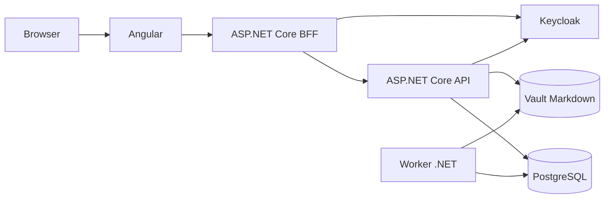

# Altivy Nodra

Nodra é uma aplicação web self-hosted para gestão de conhecimento em Markdown.
Ela combina edição, organização, links entre notas, backlinks, propriedades,
pesquisa e visualização em grafo sem exigir um aplicativo instalado no computador
do usuário.

**Your connected knowledge workspace.**

## Identidade e posicionamento

- **Empresa:** Altivy.
- **Produto e aplicativo:** Nodra.
- **Marca completa:** Altivy Nodra.
- **Repositório:** [altivy-it/nodra](https://github.com/altivy-it/nodra).
- **CLI futura:** `nodra`; ainda não implementada.

> Altivy Nodra is an AI-powered knowledge workspace that connects your notes, documents, ideas, and conversations into a searchable personal knowledge graph.

O nome Nodra remete a *node*: notas interligadas, grafo de conhecimento e IA.
A sequência conceitual da marca é **Notes → Nodes → Connections → Knowledge → AI**.
O posicionamento expressa a direção do produto, não uma promessa de capacidades
de IA já entregues. IA é opcional; o núcleo de notas, edição, persistência e
busca não depende de nuvem, embeddings ou internet.

## Estado do projeto

O projeto está em desenvolvimento ativo e ainda não possui uma versão estável.
Frontend Angular, API, BFF, worker e bibliotecas de domínio já possuem estrutura
executável. A primeira composição self-hosted local está em implementação, mas
OIDC real, backup/restore e atualização ainda não foram validados. Não use o
estado atual como implantação de produção.

## Princípios

- arquivos Markdown no vault são a fonte canônica do conteúdo;
- PostgreSQL mantém uma projeção reconstruível para catálogo, busca e relações;
- conflitos nunca causam sobrescrita silenciosa;
- conteúdo, persistência e busca essenciais funcionam sem nuvem ou embeddings;
- Keycloak fornece identidade e decisões de autorização;
- aplicações e dependências são distribuídas por containers;
- formatos e contratos permanecem documentados e exportáveis.

## Arquitetura

O Nodra adota um monólito modular com hosts separados para web, BFF, API e
worker. O BFF mantém tokens fora do navegador, a API aplica as decisões de
autorização do Keycloak e o worker processa reconciliação e indexação duráveis.



## Estrutura do repositório

```text
backend/       hosts, domínio, aplicação, infraestrutura e testes .NET
frontend/      aplicação e bibliotecas Angular e testes de interface
contracts/     OpenAPI e schemas públicos
deploy/        containers, proxy, Keycloak e operação
docs/          arquitetura, planos, ADRs e runbooks
tests/         fixtures e evidências compartilhadas
tools/         automação do repositório
```

## Documentação

- [Plano mestre](docs/plano-mestre.md)
- [Evolução do produto](docs/evolucao-produto.md)
- [Arquitetura do frontend](docs/frontend.md)
- [Arquitetura do backend](docs/backend.md)
- [CI/CD e segurança](docs/ci-cd-seguranca.md)
- [Configuração do Keycloak](docs/configuracao-keycloak.md)
- [Instalação self-hosted](deploy/self-hosted/README.md): pré-requisitos,
  comando único de subida e sequência automatizada de backup, migrations,
  configuração OIDC, health checks e smoke test.
- [Governança do repositório](.github/GOVERNANCE.md)
- [Guia de contribuição](.github/CONTRIBUTING.md)
- [Política de segurança](.github/SECURITY.md)

## Contribuição e segurança

Antes de propor uma mudança, leia o [guia de contribuição](.github/CONTRIBUTING.md)
e o documento da área afetada. Não publique vulnerabilidades, tokens, dados
pessoais ou conteúdo real de vault em issues; siga a
[política de segurança](.github/SECURITY.md).

O núcleo open source do Nodra é disponibilizado sob a [licença MIT](LICENSE).
Funcionalidades comerciais futuras serão extensões opcionais e não retirarão
direitos já concedidos sobre código publicado sob MIT.
