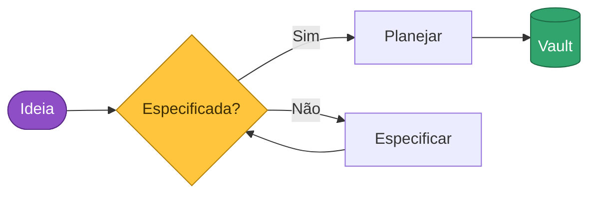
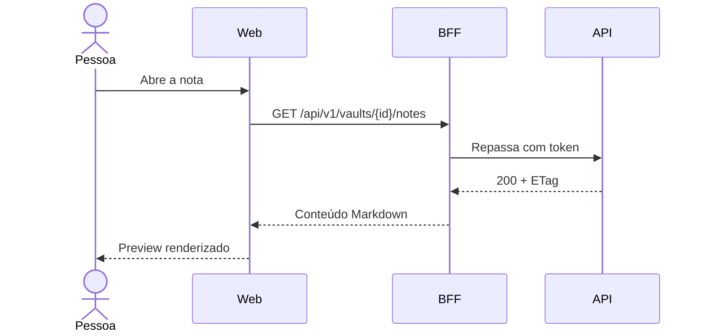
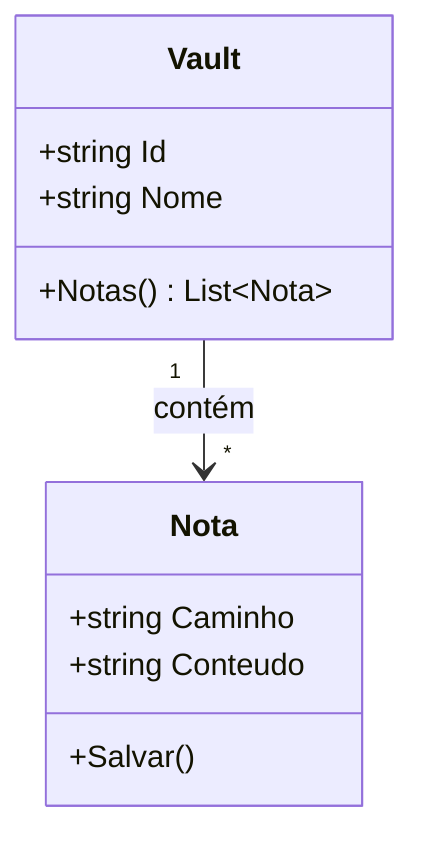
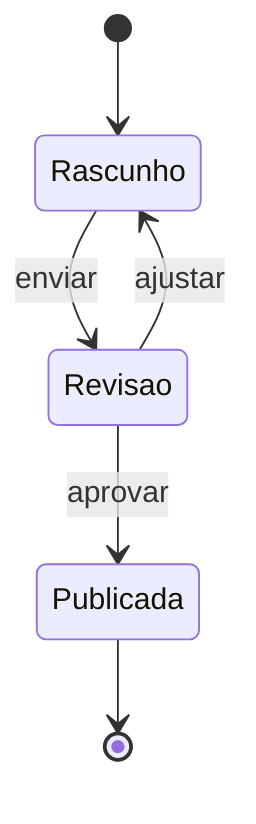
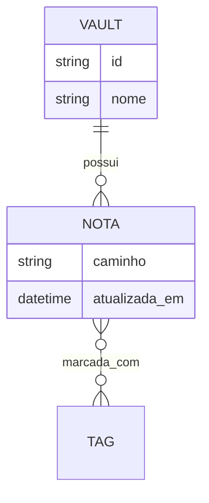
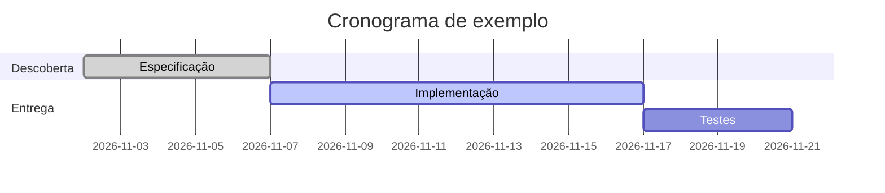
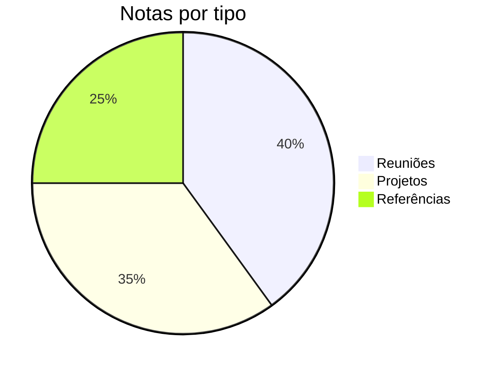
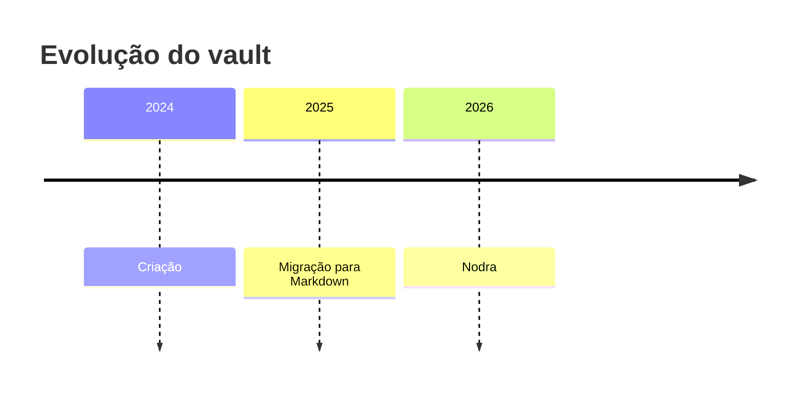
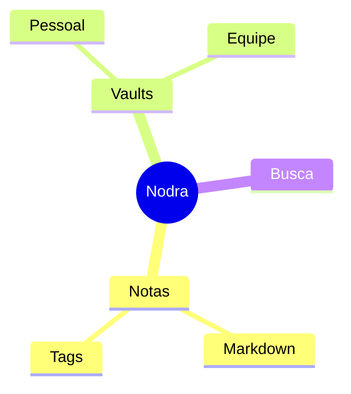
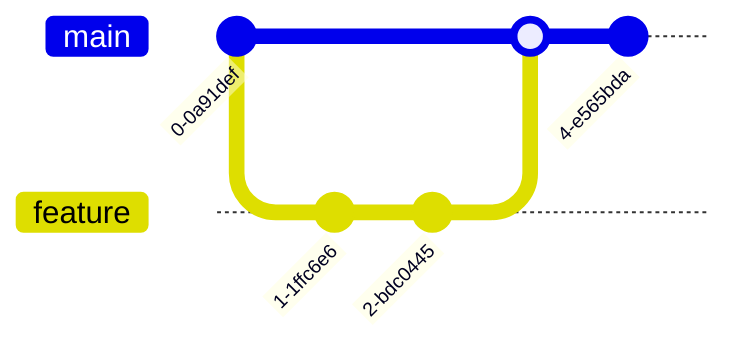

# Documento modelo do Nodra

> **Para que serve este documento?** Ele reúne, em um só lugar, os recursos de Markdown que o Nodra renderiza no preview. Copie os trechos que precisar. O arquivo `.md` é a fonte canônica: tudo o que você escreve aqui é gravado exatamente como digitado.

<p align="center"></p>

## Sumário

1. [Títulos](#títulos)
2. [Ênfase e texto](#ênfase-e-texto)
3. [Cores](#cores)
4. [Listas](#listas)
5. [Tarefas](#tarefas)
6. [Links e imagens](#links-e-imagens)
7. [Citações e avisos](#citações-e-avisos)
8. [Código](#código)
9. [Tabelas](#tabelas)
10. [Fórmulas matemáticas](#fórmulas-matemáticas)
11. [Diagramas Mermaid](#diagramas-mermaid)
12. [HTML embutido](#html-embutido)
13. [Caracteres especiais](#caracteres-especiais)

---

## Títulos

# Título nível 1
## Título nível 2
### Título nível 3
#### Título nível 4
##### Título nível 5
###### Título nível 6

Título alternativo nível 1
==========================

Título alternativo nível 2
--------------------------

---

## Ênfase e texto

Texto normal com **negrito**, __negrito alternativo__, *itálico*, _itálico alternativo_, ***negrito e itálico***, ~~riscado~~ e `código inline`.

Combinações: **negrito com *itálico* dentro**, ~~riscado com **negrito**~~ e `código` no meio da frase.

Recursos via HTML: <ins>sublinhado</ins>, <mark>marcado</mark>, <small>texto pequeno</small>, H<sub>2</sub>O (subscrito), x<sup>2</sup> (sobrescrito), <abbr title="Markdown">MD</abbr> (abreviação), <kbd>Ctrl</kbd> + <kbd>S</kbd> (teclas), <q>citação curta</q>, <cite>Obra citada</cite>, <dfn>definição</dfn>, <var>variavel</var>, <samp>saída de programa</samp> e <s>texto obsoleto</s>.

Quebra de linha simples: esta frase termina aqui
e continua na linha de baixo, porque o Nodra preserva as quebras de linha.

Parágrafos são separados por uma linha em branco.

---

## Cores

### Texto colorido

<span style="color:#e5484d">Vermelho</span> · <span style="color:#f76b15">Laranja</span> · <span style="color:#ffc53d">Amarelo</span> · <span style="color:#30a46c">Verde</span> · <span style="color:#0090ff">Azul</span> · <span style="color:#8e4ec6">Roxo</span> · <span style="color:#d6409f">Rosa</span> · <span style="color:#8b8d98">Cinza</span>

<span style="color:var(--accent)">Cor de destaque do tema atual</span>: acompanha os temas claro, escuro e alto contraste.

### Fundo e marcadores

<span style="background:#ffe7a3;color:#3d2c00;padding:0 4px;border-radius:4px">fundo amarelo</span> <span style="background:#d5f5e3;color:#0b3d24;padding:0 4px;border-radius:4px">fundo verde</span> <span style="background:#dbeafe;color:#0b2a5c;padding:0 4px;border-radius:4px">fundo azul</span> <span style="background:#fde2e4;color:#5c0b16;padding:0 4px;border-radius:4px">fundo vermelho</span>

### Etiquetas

<span style="display:inline-block;padding:2px 10px;border-radius:999px;background:#30a46c;color:#fff;font-size:12px;font-weight:600">CONCLUÍDO</span> <span style="display:inline-block;padding:2px 10px;border-radius:999px;background:#ffc53d;color:#3d2c00;font-size:12px;font-weight:600">EM ANDAMENTO</span> <span style="display:inline-block;padding:2px 10px;border-radius:999px;background:#e5484d;color:#fff;font-size:12px;font-weight:600">BLOQUEADO</span> <span style="display:inline-block;padding:2px 10px;border-radius:999px;background:#8e4ec6;color:#fff;font-size:12px;font-weight:600">NODRA</span>

### Paleta

| Amostra | Nome | Hexadecimal |
| :-----: | ---- | ----------- |
| <span style="display:inline-block;width:28px;height:16px;border-radius:4px;background:#8e4ec6"></span> | Roxo Nodra | `#8e4ec6` |
| <span style="display:inline-block;width:28px;height:16px;border-radius:4px;background:#0090ff"></span> | Azul | `#0090ff` |
| <span style="display:inline-block;width:28px;height:16px;border-radius:4px;background:#30a46c"></span> | Verde | `#30a46c` |
| <span style="display:inline-block;width:28px;height:16px;border-radius:4px;background:#e5484d"></span> | Vermelho | `#e5484d` |

### Gradiente

<div style="height:14px;border-radius:7px;background:linear-gradient(90deg,#8e4ec6,#0090ff,#30a46c,#ffc53d,#e5484d)"></div>

Cores também funcionam em fórmulas, como $\color{#e5484d}{x^2} + \color{#0090ff}{y^2}$, e em [diagramas Mermaid](#diagramas-mermaid).

---

## Listas

### Não ordenada

- Item com hífen
* Item com asterisco
+ Item com sinal de mais
- Item com subníveis
  - Segundo nível
    - Terceiro nível
      - Quarto nível

### Ordenada

1. Primeiro
2. Segundo
3. Terceiro
   1. Subitem 3.1
   2. Subitem 3.2

### Iniciando em outro número

7. Sétimo
8. Oitavo
9. Nono

### Mista com parágrafos e código

1. Execute os testes.

   O comando roda dentro do container:

   ```bash
   ng test --watch=false
   ```

2. Revise o resultado.
   - Testes aprovados
   - Build sem avisos

### Lista de definições (HTML)

<dl>
  <dt>Vault</dt>
  <dd>Pasta de notas Markdown que o Nodra organiza.</dd>
  <dt>Nota</dt>
  <dd>Arquivo <code>.md</code> dentro de um vault.</dd>
</dl>

---

## Tarefas

- [x] Criar o documento modelo
- [x] Incluir exemplos de cores
- [ ] Revisar com a equipe
  - [x] Subtarefa concluída
  - [ ] Subtarefa pendente

---

## Links e imagens

- Link externo: [Guia de Markdown](https://www.markdownguide.org "Abre o guia")
- Link relativo para uma nota do vault: [este documento](documento-modelo.md)
- Link para uma seção deste documento: [ir para Tabelas](#tabelas)
- Link automático: <https://commonmark.org>
- URL sem marcação (GFM): https://github.github.com/gfm/
- E-mail: <contato@example.test>
- Link por referência: [CommonMark][commonmark] e [GFM][gfm]
- Link em nova aba: <a href="https://www.markdownguide.org" target="_blank">Guia de Markdown</a>

[commonmark]: https://commonmark.org "Especificação CommonMark"
[gfm]: https://github.github.com/gfm/

Imagem com texto alternativo e título:


Imagem com tamanho controlado por HTML:


Imagem que é link:

<a href="#documento-modelo-do-nodra"></a>

Figura com legenda:

<figure>
  
  <figcaption>Figura 1 — Logo do Nodra.</figcaption>
</figure>

---

## Citações e avisos

> Citação simples.

> Citação com várias partes.
>
> Pode ter **ênfase**, `código` e listas:
>
> - item um
> - item dois
>
>> Citação aninhada.
>>
>>> Terceiro nível.

> **💡 Dica:** use avisos para destacar informações importantes.

<div style="border-left:4px solid #0090ff;background:rgba(0,144,255,.08);padding:8px 12px;border-radius:6px;margin-bottom:8px">
  <strong style="color:#0090ff">ℹ️ Informação</strong><br>
  Este aviso usa HTML com cores.
</div>

<div style="border-left:4px solid #30a46c;background:rgba(48,164,108,.08);padding:8px 12px;border-radius:6px;margin-bottom:8px">
  <strong style="color:#30a46c">✅ Sucesso</strong><br>
  Operação concluída.
</div>

<div style="border-left:4px solid #ffc53d;background:rgba(255,197,61,.12);padding:8px 12px;border-radius:6px;margin-bottom:8px">
  <strong style="color:#b07d00">⚠️ Atenção</strong><br>
  Revise antes de publicar.
</div>

<div style="border-left:4px solid #e5484d;background:rgba(229,72,77,.08);padding:8px 12px;border-radius:6px">
  <strong style="color:#e5484d">⛔ Perigo</strong><br>
  Esta ação não pode ser desfeita.
</div>

---

## Código

Código inline: `const ativo = true;` e com crase interna: `` `crase` ``.

Bloco indentado com quatro espaços:

    texto pré-formatado
    sem destaque de sintaxe

Bloco cercado sem linguagem:

```
Texto puro em bloco.
```

Bloco com til:

~~~
Também é um bloco de código.
~~~

### JSON

```json
{
  "vault": "pessoal",
  "notas": 42,
  "sincronizado": true,
  "tags": ["modelo", "markdown"]
}
```

### C#

```csharp
public sealed record Nota(string Caminho, string Conteudo)
{
    public bool EstaVazia => string.IsNullOrWhiteSpace(Conteudo);
}
```

### SQL

```sql
SELECT n.caminho, n.atualizado_em
FROM notas AS n
WHERE n.vault_id = 'pessoal'
ORDER BY n.atualizado_em DESC
LIMIT 10;
```

### Bash

```bash
#!/usr/bin/env bash
set -euo pipefail
for nota in *.md; do
  echo "Nota: $nota"
done
```

### JavaScript

```javascript
const notas = ['a.md', 'b.md'];
notas.forEach((nota, indice) => console.log(`${indice + 1}. ${nota}`));
```

### CSS

```css
.destaque {
  color: #8e4ec6;
  border-radius: 8px;
}
```

### HTML

```html
<button type="button" class="destaque">Salvar</button>
```

### Diff

```diff
- texto removido
+ texto adicionado
  texto inalterado
```

---

## Tabelas

### Simples

| Recurso | Suporte | Sintaxe |
| ------- | ------- | ------- |
| Negrito | Sim | `**texto**` |
| Tabelas | Sim | GFM |
| Mermaid | Sim | bloco `mermaid` |

### Alinhamento

| Esquerda | Centro | Direita |
| :------- | :----: | ------: |
| A | B | 1,00 |
| Texto mais longo | C | 100,00 |
| D | **E** | 10.000,00 |

### Com formatação e cores

| Tarefa | Responsável | Estado |
| ------ | ----------- | :----: |
| Especificar | *Ana* | <span style="color:#30a46c">● Concluído</span> |
| Implementar | **Bruno** | <span style="color:#b07d00">● Em andamento</span> |
| Publicar | `ci` | <span style="color:#e5484d">● Bloqueado</span> |
| Barra vertical no texto | a \| b | — |

### Tabela HTML com células mescladas

<table>
  <thead>
    <tr><th rowspan="2">Trimestre</th><th colspan="2">Notas</th></tr>
    <tr><th>Criadas</th><th>Editadas</th></tr>
  </thead>
  <tbody>
    <tr><td>T1</td><td>120</td><td>340</td></tr>
    <tr><td>T2</td><td style="color:#30a46c"><strong>180</strong></td><td>410</td></tr>
  </tbody>
</table>

---

## Fórmulas matemáticas

Inline: a energia é $E = mc^2$ e a área do círculo é $A = \pi r^2$.

Em bloco:

$$
\int_{a}^{b} x^2 \, dx = \frac{b^3 - a^3}{3}
$$

Somatório e limite:

$$
\sum_{i=1}^{n} i = \frac{n(n+1)}{2} \qquad \lim_{x \to 0} \frac{\sin x}{x} = 1
$$

Matriz:

$$
A = \begin{bmatrix} 1 & 2 & 3 \\ 4 & 5 & 6 \end{bmatrix}
$$

Sistema com cores:

$$
\begin{cases} \color{#8e4ec6}{2x} + y = 5 \\ x - \color{#0090ff}{y} = 1 \end{cases}
$$

---

## Diagramas Mermaid

### Fluxograma com cores



### Sequência



### Classes



### Estados



### Entidade-relacionamento



### Gantt



### Pizza



### Linha do tempo



### Mapa mental



### Git



---

## HTML embutido

<details>
<summary><strong>Clique para expandir</strong></summary>

Conteúdo recolhido. Aceita **Markdown** dentro:

- item A
- item B

</details>

<details open>
<summary>Seção já aberta</summary>

Use o atributo `open` para iniciar expandido.

</details>

<div style="display:flex;gap:12px;flex-wrap:wrap;margin-top:12px">
  <div style="flex:1;min-width:160px;padding:12px;border:1px solid #8e4ec6;border-radius:8px"><strong style="color:#8e4ec6">Cartão 1</strong><br>Layout em colunas.</div>
  <div style="flex:1;min-width:160px;padding:12px;border:1px solid #0090ff;border-radius:8px"><strong style="color:#0090ff">Cartão 2</strong><br>Com bordas coloridas.</div>
</div>

Barra de progresso: <progress value="70" max="100">70%</progress> 70%

Medidor: <meter value="0.6" min="0" max="1">60%</meter> 60%

<p align="center"><em>Texto centralizado com HTML.</em></p>

Quebra forçada com HTML:<br>nova linha.

Linha horizontal em HTML:

<hr>

Desenho SVG embutido:

<svg width="160" height="40" viewBox="0 0 160 40" role="img" aria-label="Formas coloridas">
  <circle cx="20" cy="20" r="14" fill="#8e4ec6" />
  <circle cx="60" cy="20" r="14" fill="#0090ff" />
  <circle cx="100" cy="20" r="14" fill="#30a46c" />
  <rect x="124" y="8" width="28" height="24" rx="6" fill="#ffc53d" />
</svg>

<!-- Comentários HTML não aparecem no preview. -->

---

## Caracteres especiais

Escapando símbolos do Markdown: \* \_ \` \# \+ \- \. \! \[ \] \( \) \{ \} \\ \|

Entidades HTML: &copy; &reg; &trade; &mdash; &hellip; &larr; &rarr; &hearts;

Emojis: ✅ ⚠️ ❌ 🚀 🎉 📝 📁 🔍 💡 🔒

Separadores horizontais em três formas:

***

___

- - -

<p align="center" style="color:#8b8d98"><small>Fim do documento modelo · Altivy Nodra</small></p>
