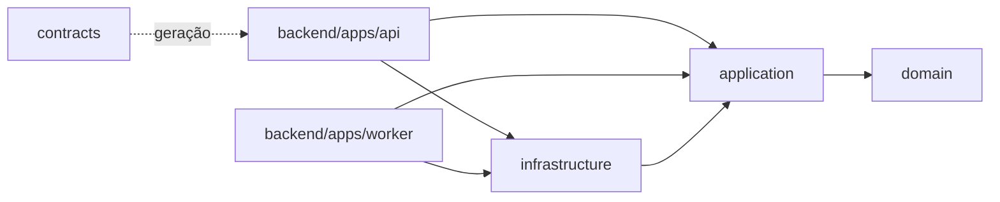

# Altivy - Implementação do Backend

## 1. Objetivo

Definir a implementação da API, worker, persistência e integrações do Altivy. As decisões globais permanecem no [Plano Mestre](../README.md).

## 2. Estrutura da solução .NET

```text
apps/
├── api/                          # host HTTP, OpenAPI, auth e SignalR
└── worker/                       # host de jobs, reconciliação e indexação
backend/libs/
├── domain/                       # entidades, value objects, invariantes e eventos
├── application/                  # casos de uso, commands, queries e portas
├── infrastructure/               # adapters compartilhados por responsabilidade estável
	├── data/                     # PostgreSQL, filesystem, projeções e repositórios
	├── http/                     # clientes externos e integrações HTTP
	└── bus/                      # orquestração de mediator, consumers, pipeline behaviors ou outbox/job plumbing
└── plugins/                      # extensões opcionais confiáveis incluídas na distribuição
	├── abstractions/             # manifesto, compatibilidade, capacidades e lifecycle
	└── microsoft-teams/          # primeiro adapter concreto, sem dependência inversa do núcleo
contracts/                        # OpenAPI e contratos públicos versionados
tests/
└── backend/                      # testes unitários, integração, arquitetura e desempenho
```

A convenção de assemblies e namespaces do backend fica documentada nas instruções do Copilot em [.github/instructions/architecture.instructions.md](../.github/instructions/architecture.instructions.md); a camada de infraestrutura usa o prefixo `Infra.<nome>` e os hosts mantêm namespaces próprios em `Altivy.Notes.Api` e `Altivy.Worker`, sem concentrar código reutilizável de domínio.

Usar monólito modular orientado a domínio, Clean Architecture pragmática e Ports and Adapters. Regras de domínio não dependem de ASP.NET Core, EF Core ou filesystem. API e worker são composition roots e não contêm regras reutilizáveis. Não criar interfaces para classes sem fronteira ou substituição real.

### 2.1 Dependências entre camadas



- Domain contém regras, aggregates, value objects e eventos de domínio.
- Application contém casos de uso, commands, queries, autorização contextual e portas requeridas pelo negócio.
- Infrastructure se divide em `data`, `http` e `bus` para manter fronteiras estáveis; `data` concentra PostgreSQL, filesystem e projeções, `http` concentra clientes externos e `bus` concentra mediator, jobs duráveis e plumbing assíncrono.
- Plugins implementam capacidades opcionais por contratos mínimos. Domain e
	Application não dependem de plugins concretos; apenas API e worker, como
	composition roots, podem registrá-los explicitamente.
- API e worker resolvem dependências e convertem entradas e saídas, sem acessar detalhes internos de outros módulos.
- Contracts define o contrato público; DTOs não são entidades de domínio nem modelos EF Core.

### 2.2 Padrões obrigatórios

| Padrão | Uso no Altivy |
| --- | --- |
| DDD estratégico | módulos, linguagem ubíqua e limites de negócio explícitos |
| Aggregate e Value Object | invariantes de `Vault`, `Note`, jobs, paths, hashes, versões e ETags |
| Application Service / Use Case | uma classe explícita coordena cada operação pública |
| Ports and Adapters | isola PostgreSQL, filesystem, integrações HTTP e jobs duráveis |
| Dependency Inversion | domínio e aplicação dependem de portas, não de adapters concretos |
| Repository orientado a aggregate | persiste aggregates somente quando a fronteira de domínio justificar |
| Unit of Work | delimita a transação PostgreSQL do caso de uso, normalmente pelo `DbContext` |
| CQRS pragmático | commands alteram estado; queries leem projeções sem reconstruir aggregates |
| Optimistic Concurrency | versão, hash, ETag e `If-Match` impedem sobrescrita silenciosa |
| Outbox / Durable Job | estado assíncrono é persistido na mesma transação da projeção PostgreSQL |
| Idempotent Consumer | repetição ou entrega duplicada não corrompe projeções |
| Competing Consumers e Lease | `FOR UPDATE SKIP LOCKED` distribui jobs e permite recuperar abandono |
| Retry, backoff, jitter e Dead Letter | falhas transitórias são limitadas e falhas persistentes ficam observáveis |
| Reconciliation | detecta e repara divergência entre a fonte canônica e a projeção |
| Circuit Breaker | interrompe chamadas repetidamente falhas a providers externos opcionais |
| Strategy e Adapter | seleciona provider, ranking ou política sem contaminar o domínio |
| PEP e Keycloak Authorization Services | Keycloak decide por recurso e scope; a API aplica a permissão antes de revelar dados |
| Problem Details | erros HTTP seguem `application/problem+json` sem detalhes internos |

Eventos de domínio comunicam fatos dentro do processo. Eventos de integração ou solicitações de trabalho destinadas ao worker são versionados e persistidos como Outbox/job durável antes de qualquer notificação. SignalR informa clientes, mas não é canal durável.

O Outbox não cria atomicidade entre filesystem e PostgreSQL. O caso de uso grava o arquivo de forma segura, persiste estado reconciliável e usa hash e reconciliação para recuperar falhas parciais. Não usar transação distribuída nem framework de Saga para esse fluxo.

### 2.3 Padrões condicionais e padrões excluídos

Specification, Factory, Decorator, Pipeline, State, Cache-Aside e Bulkhead só devem ser introduzidos quando removerem complexidade observada ou atenderem requisito medido. O padrão deve permanecer local ao problema e possuir teste que demonstre seu valor.

O padrão Mediator também é condicional: use chamada direta quando ela mantiver o fluxo simples e aplique Mediator quando múltiplos remetentes, resolução desacoplada de handlers ou behaviors transversais de pipeline reduzirem acoplamento mensurável. Nessa situação, use `Nuuvify.CommonPack.Mediator`, com registro nos composition roots, versão centralizada e testes dos handlers e behaviors.

A biblioteca MediatR não pode ser usada por sua política de licenciamento. Essa proibição é específica à biblioteca e não ao padrão Mediator. O domínio não referencia o mediator, behaviors não ocultam autorização ou transações, e notificações in-process não substituem Outbox ou jobs duráveis.

### 2.3.1 Ferramentas locais do .NET

As ferramentas de desenvolvimento são versionadas no manifesto raiz
`dotnet-tools.json` e não dependem de instalação global no servidor:

- `dotnet-ef` `10.0.0`, para migrations e operações de design-time do EF Core;
- `dotnet-reportgenerator-globaltool` `5.5.11`, comando `reportgenerator`, para
  consolidar relatórios de cobertura.

Para restaurar as ferramentas em uma máquina limpa, execute na raiz do
repositório:

```powershell
dotnet tool restore
```

Use as ferramentas pelo manifesto, evitando depender do PATH global:

```powershell
dotnet tool run dotnet-ef --version
dotnet tool run reportgenerator --version
```

Exemplo de cobertura para os testes .NET:

```powershell
dotnet test Altivy.slnx --configuration Release --collect:"XPlat Code Coverage"
dotnet tool run reportgenerator `
  -reports:"tests/**/TestResults/**/coverage.cobertura.xml" `
  -targetdir:"artifacts/coverage" `
  -reporttypes:"Html;TextSummary"
```

O servidor deve executar `dotnet tool restore` após clonar ou atualizar o
repositório. Não é necessário instalar `dotnet-ef` ou ReportGenerator
globalmente.

Não usar inicialmente:

- microsserviços, Event Sourcing ou CQRS com bancos separados;
- Kafka, RabbitMQ, Redis ou banco de grafos;
- repository genérico sobre EF Core ou abstração para toda API do framework;
- service locator, entidades anêmicas por convenção ou interfaces sem fronteira real;
- a biblioteca MediatR ou implementação alternativa de Mediator diferente de `Nuuvify.CommonPack.Mediator` sem nova decisão arquitetural.

### 2.4 Política de dependências e licenças

Antes de adicionar pacote NuGet ou npm, imagem, GitHub Action, fonte, asset ou ferramenta, verificar na fonte oficial a licença da versão exata, gratuidade para todos os usos previstos, manutenção, vulnerabilidades e necessidade real. Registrar a evidência no pull request e incluir o componente no inventário/SBOM aplicável.

São aceitas automaticamente licenças permissivas como MIT, Apache-2.0, BSD-2-Clause, BSD-3-Clause, ISC e PostgreSQL. É proibida dependência paga, proprietária, source-available, com licença comercial obrigatória, copyleft ou restrição incompatível com uso, modificação, distribuição ou operação self-hosted. Licença ausente, ambígua, não verificada ou alterada entre versões bloqueia a inclusão.

Código publicamente acessível ou pacote gratuito não significa licença permissiva. Quando houver dúvida, não adicionar a dependência; prefira a plataforma, uma dependência já aprovada ou uma implementação local pequena e testável.

`Nuuvify.CommonPack.Mediator` é a implementação aprovada para o padrão Mediator. Antes de adicionar a versão escolhida ao manifest, ainda é obrigatório verificar e registrar licença, manutenção e vulnerabilidades da versão exata, fixar a versão centralmente e refletir o componente no SBOM.

## 3. Módulos

### 3.1 Integração com Keycloak

- nenhum cadastro, senha, recuperação de conta, usuário, membership ou política de autorização é mantido pelo Altivy;
- o BFF usa OIDC Authorization Code com PKCE e mantém tokens fora do browser;
- Keycloak administra usuários, credenciais, MFA, federação, SSO, sessões, grupos e roles;
- Keycloak Authorization Services mantém recursos, scopes, políticas e decisões de acesso;
- cada vault é registrado como recurso externo por integração idempotente e reconciliável;
- a API valida token e permissão como PEP antes de consultar path, metadado ou conteúdo;
- referências ao claim estável `sub` são permitidas somente para auditoria e rastreabilidade técnica;
- roles `Owner`, `Editor` e `Reader` e sua associação com scopes permanecem no Keycloak, sem cópia em PostgreSQL.

### 3.2 Vaults

- raiz física configurada pelo operador, nunca pelo usuário comum;
- identificador estável independente do caminho físico;
- validação de acesso e capacidade de leitura/escrita no startup;
- políticas de anexos, limites, histórico e indexação;
- estado operacional: disponível, somente leitura, degradado ou indisponível.

O catálogo público usa `GET /api/v1/vaults` com paginação por cursor. O
PostgreSQL fornece apenas candidatos ordenados por ID; antes de incluir ID ou
nome na resposta, a API consulta o Keycloak Authorization Services para o
recurso `vault-{id}` e scope `vault:read`. Decisões negativas são omitidas. Se
qualquer decisão necessária estiver indisponível, a requisição inteira retorna
`503 application/problem+json`, sem página parcial. A API processa no máximo
quatro decisões simultâneas, aceita páginas de 1 a 100 itens e não persiste
membership, policy ou cache de autorização.

### 3.3 Notes

- CRUD de notas e pastas;
- paths relativos normalizados com `/` no contrato;
- extensão `.md` obrigatória para notas;
- hash SHA-256 e versão monotônica na projeção;
- ETag forte baseada em versão/hash;
- rename e move tratados como operações de domínio;
- lixeira dentro de área controlada do vault;
- gravação temporária e replace atômico quando suportado.

### 3.4 Markdown

- parsing no backend com Markdig e extensões controladas;
- frontmatter YAML com parser seguro;
- extração de headings, tags, links, embeds e blocos;
- resolução documentada de wiki links e aliases;
- renderização HTML sanitizada;
- conteúdo desconhecido preservado, não descartado pelo parser.

### 3.5 Search e Knowledge Graph

- indexação textual com configuração adequada a português e conteúdo multilíngue;
- trigramas para títulos e caminhos;
- chunks determinísticos por heading e limites de tokens/caracteres;
- vetores associados a modelo, dimensão e versão do chunker;
- ranking híbrido por Reciprocal Rank Fusion;
- arestas explícitas para links resolvidos e não resolvidos;
- consultas de vizinhança com profundidade e limites obrigatórios.

### 3.6 Plugin Host e integrações opcionais

- plugins são módulos .NET confiáveis, versionados e incluídos por allowlist na
	distribuição; não existe upload ou carregamento arbitrário de código;
- `PluginManifest` declara ID estável, versão SemVer, compatibilidade com o
	host, capacidades, configuração, endpoints, jobs e scopes necessários;
- o plugin representa código confiável da distribuição; `PluginConnection`
	representa a configuração administrada de uma conta, tenant ou serviço e
	referencia secrets externos sem persistir seu valor;
- capacidades neutras incluem `external-push/v1`, `external-pull/v1`,
	`subscription-webhook/v1` e `external-action/v1`; nenhum plugin é obrigado a
	implementar todas;
- abstrações não dependem de ASP.NET Core, EF Core, filesystem ou SDK externo;
- plugins usam portas de aplicação para autorização, inbox, jobs, auditoria,
	telemetria e secrets referenciados, sem receber `DbContext` ou acesso direto
	ao vault;
- ativação e desativação são administrativas, auditadas e exigem restart na
	primeira versão para recompor endpoints e jobs;
- falha de plugin opcional degrada somente sua capacidade e não o CRUD, busca,
	indexação local ou backup;
- o perfil `private-egress-only` executa polling incremental no worker, com
	cursor durável, quota, backoff, jitter e egress allowlist, sem registrar rota
	pública;
- o perfil `public-callbacks` usa flags independentes para bot, subscription e
	`external-push`; callbacks aplicam a validação disponível no provider,
	persistem apenas um sinal na inbox e nunca acessam diretamente o filesystem;
- Microsoft Teams será o primeiro plugin e implementará a capacidade
	`external-push/v1`; seu SDK permanece confinado ao adapter;
- Google Calendar e Outlook Calendar via Microsoft Graph são candidatos a
	`external-pull/v1`; cada provider exige plano, POC de OAuth/permissões,
	threat model e verificação de licença próprios antes da implementação;
- plugins não confiáveis, sandbox, marketplace e processo externo exigem outro
	ADR, threat model e modelo operacional.

## 4. Persistência PostgreSQL

### 4.1 Convenções

- schema `altivy`;
- chaves primárias UUID v7 quando disponíveis na aplicação;
- timestamps em UTC com `timestamptz`;
- nomes em `snake_case` no banco;
- optimistic concurrency nas entidades mutáveis;
- exclusão física somente quando exigida por política;
- migrações EF Core revisadas e versionadas.

### 4.2 Índices iniciais

- unicidade de `(vault_id, normalized_path)` em notas ativas;
- B-tree para vault, datas, estado e foreign keys;
- GIN para `tsvector` e propriedades consultáveis quando apropriado;
- GIN/GiST de trigramas para título e caminho;
- índice por origem e destino em `note_links`;
- HNSW com distância cosseno apenas após volume e recall serem medidos;
- índice único de idempotência em `index_jobs`.

Começar com busca vetorial exata em bases pequenas. Índice aproximado não deve ser criado apenas por disponibilidade da extensão.

### 4.3 Migrações e bootstrap

- a imagem PostgreSQL habilita extensões no primeiro bootstrap;
- a aplicação valida `vector`, `pg_trgm`, `pgcrypto` e `citext` no readiness;
- migrações da aplicação não são colocadas em `/docker-entrypoint-initdb.d`;
- um processo explícito e exclusivo aplica migrações antes da nova API receber tráfego;
- a role de runtime não recebe privilégios para criar database ou role;
- mudanças destrutivas usam estratégia expand-contract entre releases.

A migration deve ser aplicada pelo operador ou pipeline de rollout, nunca pelo
startup da API. O tutorial completo de secrets externos, roles separadas,
scaffolding, criação de migration, atualização do banco e geração de SQL está
em [backend/libs/infrastructure/data/README.md](../backend/libs/infrastructure/data/README.md).

## 5. Contrato HTTP

### 5.1 Padrões

- API RESTful sob `/api/v1`, com recursos e sub-recursos nomeados por substantivos e sem rotas RPC ou sufixos de ação;
- `QUERY` para consultas seguras e idempotentes que exijam corpo estruturado e não possam ser representadas adequadamente por `GET`;
- OpenAPI gerado e validado no CI;
- documentação OpenAPI informativa em toda operação, incluindo finalidade, autenticação, autorização, entradas, respostas, erros, headers e exemplos;
- `application/problem+json` para erros;
- correlation ID em resposta e logs;
- paginação por cursor para listas mutáveis;
- `ETag`, `If-Match` e `If-None-Match` para notas;
- `Idempotency-Key` em uploads e operações adequadas;
- datas ISO 8601 em UTC;
- breaking changes somente em nova versão do contrato.

### 5.2 Recursos iniciais

```text
GET    /api/v1/session
GET    /api/v1/vaults
GET    /api/v1/vaults/{vaultId}/tree
POST   /api/v1/vaults/{vaultId}/notes
GET    /api/v1/vaults/{vaultId}/notes/{noteId}
PUT    /api/v1/vaults/{vaultId}/notes/{noteId}
PATCH  /api/v1/vaults/{vaultId}/notes/{noteId}
DELETE /api/v1/vaults/{vaultId}/notes/{noteId}
GET    /api/v1/vaults/{vaultId}/notes/{noteId}/backlinks
GET    /api/v1/vaults/{vaultId}/search
GET    /api/v1/vaults/{vaultId}/graph
POST   /api/v1/vaults/{vaultId}/attachments
GET    /api/v1/vaults/{vaultId}/index/status
POST   /api/v1/vaults/{vaultId}/index-jobs
```

IDs são usados nos recursos; paths aparecem como dados e não devem ser inseridos diretamente em segmentos sem encoding e validação.

## 6. Filesystem

### 6.1 Proteções

- combinar somente raiz confiável e path relativo normalizado;
- comparar o caminho final com a raiz usando semântica apropriada ao sistema operacional;
- rejeitar `..`, paths absolutos, nomes reservados e caracteres inválidos;
- tratar symlinks/reparse points segundo política restritiva;
- impedir acesso às áreas internas da aplicação;
- limitar profundidade, comprimento e quantidade de entradas por operação.

### 6.2 Gravação

1. adquirir lock lógico curto para a nota;
2. comparar ETag recebida com estado atual;
3. validar encoding, tamanho e política;
4. gravar temporário no mesmo diretório;
5. garantir flush conforme política de durabilidade;
6. substituir o destino;
7. atualizar catálogo e criar job na mesma transação de banco;
8. publicar evento de domínio após commit.

Se a atualização do catálogo falhar após a escrita, a reconciliação deve detectar o novo hash. Se a escrita falhar, nenhuma projeção de sucesso deve ser persistida.

### 6.3 Alterações externas

- `FileSystemWatcher` gera sinais de baixa latência quando confiável;
- debounce agrupa eventos duplicados;
- varredura incremental compara path, tamanho, mtime e hash;
- varredura completa periódica detecta divergências acumuladas;
- rename externo é inferido por identidade/hash quando possível;
- conflitos com uma edição aberta geram notificação, não sobrescrita.

## 7. Jobs e worker

Usar tabela PostgreSQL como fila inicial, consumida com `FOR UPDATE SKIP LOCKED`.

Estados:

- `pending`;
- `processing` com lease;
- `completed`;
- `retry_scheduled`;
- `dead_letter`;
- `cancelled`.

Cada job possui chave de idempotência, tipo, payload versionado, contador de tentativas, próxima execução e erro sanitizado. O worker renova lease, aplica backoff com jitter e recupera jobs abandonados.

Tipos iniciais:

- `note.index`;
- `note.remove_projection`;
- `vault.reconcile`;
- `vault.rebuild`;
- `embedding.generate`;
- `attachment.inspect`;
- `revision.prune`.

## 8. Pipeline de indexação

1. ler arquivo e confirmar hash esperado;
2. detectar encoding e validar limites;
3. parsear frontmatter e Markdown;
4. atualizar nota, propriedades, headings, tags e links em transação;
5. gerar `tsvector` e chunks determinísticos;
6. resolver links contra catálogo atual;
7. criar jobs de embedding quando configurado;
8. publicar atualização via SignalR;
9. registrar métricas sem conteúdo sensível.

Reprocessar somente etapas afetadas quando versão do parser, chunker ou modelo mudar.

## 9. Embeddings

Criar uma interface de provider com:

- identificação imutável de modelo e versão;
- dimensão declarada;
- limite de batch e tamanho;
- timeout, retry e circuit breaker;
- suporte local e remoto;
- política explícita sobre envio de conteúdo para terceiros.

O padrão do produto é embeddings desabilitados. Ativação de provedor remoto exige consentimento administrativo e indicação clara de que conteúdo pode sair do ambiente.

## 10. Autenticação e autorização

- Keycloak como autoridade externa de identidade, sessão de SSO e decisão de autorização;
- OpenID Connect Authorization Code com PKCE no BFF confidencial;
- cookies `Secure`, `HttpOnly` e `SameSite` apropriado para UI same-origin;
- antiforgery em operações mutáveis;
- recursos e scopes por vault no Keycloak Authorization Services;
- API como PEP, validando issuer, audience, expiração e permissão antes de consultar path ou conteúdo;
- Protection API acessada por credencial de serviço de menor privilégio, nunca por conta administrativa do realm;
- falha fechada quando token, permissão ou decisão estiver ausente, inválida, expirada ou indisponível;
- auditoria de acesso sensível e alterações de recurso sem conteúdo de token ou claims pessoais desnecessárias.

## 11. Observabilidade e saúde

### 11.1 Métricas

- duração e falhas de leitura/gravação;
- conflitos por vault;
- profundidade e idade da fila;
- duração e falha de indexação;
- atraso entre arquivo e projeção;
- latência e quantidade de resultados de busca;
- disponibilidade do provider de embeddings;
- disponibilidade e latência de login, decisão de autorização e reconciliação com Keycloak;
- conexões SignalR.

### 11.2 Health checks

- liveness verifica apenas o processo;
- readiness verifica PostgreSQL, schema, acesso ao vault e dependências obrigatórias da integração Keycloak;
- startup permite migração e primeira reconciliação sem reinício prematuro;
- indisponibilidade de embeddings não torna a API indisponível.

## 12. Testes

### 12.1 Unitários

- normalização e segurança de paths;
- resolução de wiki links e aliases;
- parsing de frontmatter;
- mapeamento de operação para recurso e scope exigidos;
- ETags e conflitos;
- chunking e Reciprocal Rank Fusion;
- transições de jobs.

### 12.2 Integração

- PostgreSQL real com a imagem definida no plano mestre;
- extensões e migrações;
- leitura, escrita, replace e reconciliação em filesystem temporário;
- concorrência de consumers da fila;
- índices e planos das consultas críticas;
- autenticação e autorização em endpoints.

### 12.3 Resiliência e segurança

- falha entre escrita do arquivo e atualização da projeção;
- worker encerrado durante job;
- banco indisponível e recuperação;
- eventos duplicados e fora de ordem;
- traversal, symlink escape e nomes maliciosos;
- XSS no Markdown e frontmatter;
- upload poliglota e MIME inconsistente;
- usuário tentando acessar outro vault.

## 13. Sequência de implementação

1. solution, convenções, CI e arquitetura modular;
2. Compose de desenvolvimento, PostgreSQL e migrações;
3. vault, segurança de paths e catálogo;
4. CRUD de notas com ETag e gravação segura;
5. parser, propriedades, links e backlinks;
6. fila, worker e reconciliação;
7. pesquisa textual, fuzzy e filtros;
8. grafo e SignalR;
9. anexos, lixeira, revisão e auditoria;
10. OIDC, embeddings, hardening e desempenho.

## 14. Critérios de aceite do backend

- reconstrução do índice produz resultado funcional equivalente;
- operações concorrentes nunca perdem conteúdo silenciosamente;
- nenhum path aceito escapa da raiz do vault;
- jobs podem ser repetidos sem corromper projeções;
- indisponibilidade de embeddings degrada somente busca semântica;
- migrações são testadas contra versão anterior suportada;
- API publica contrato OpenAPI estável e erros padronizados;
- logs e traces não contêm conteúdo integral nem secrets;
- testes de integração usam PostgreSQL e filesystem reais.
