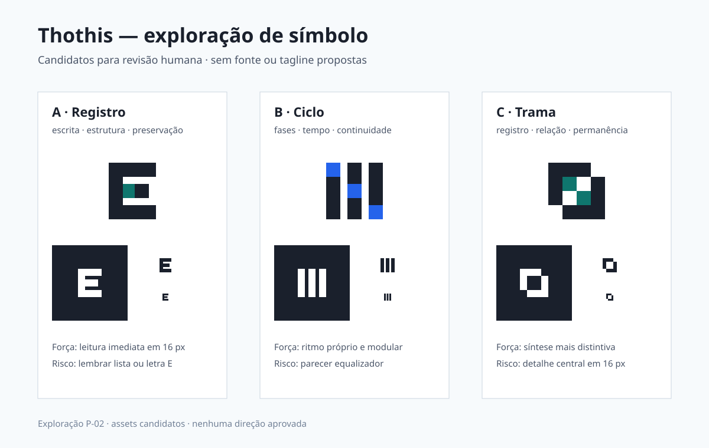
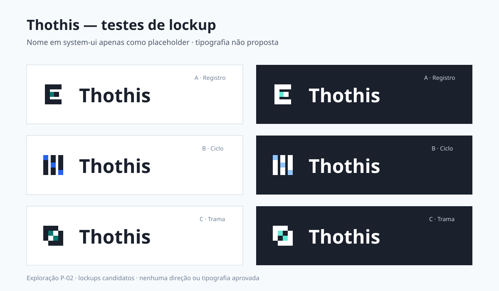
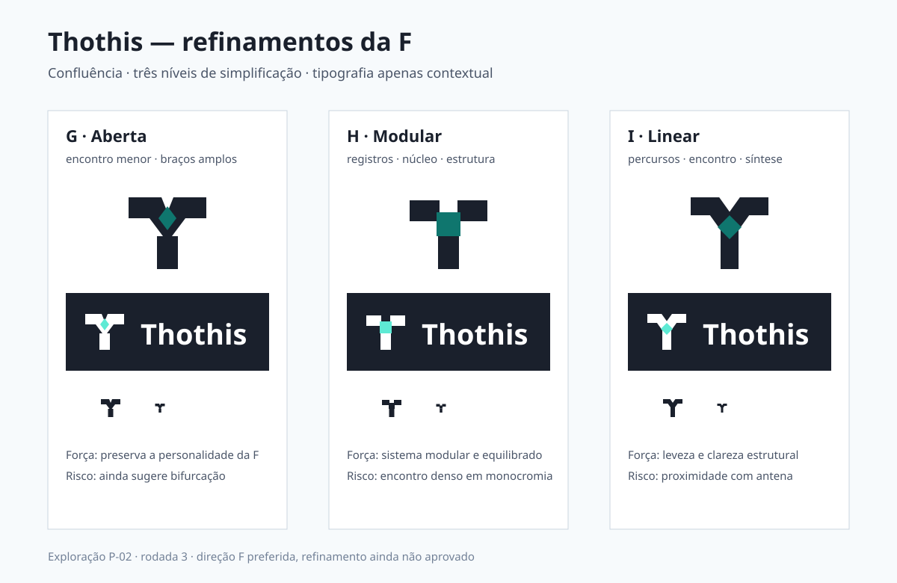
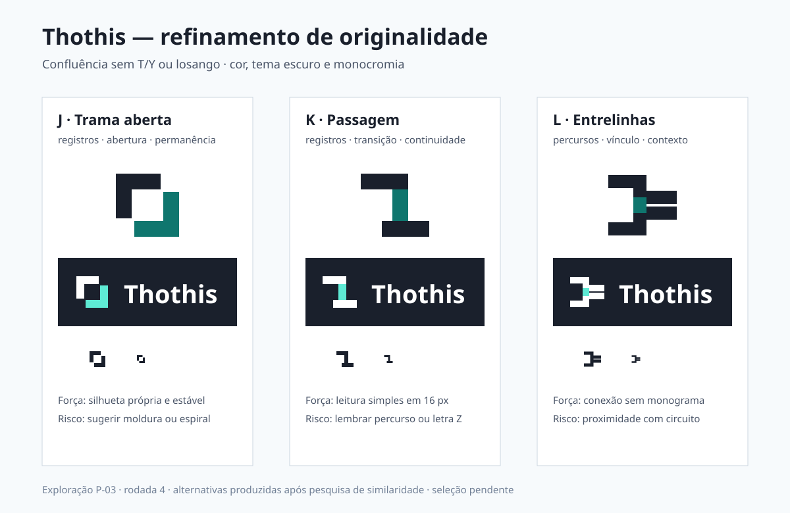
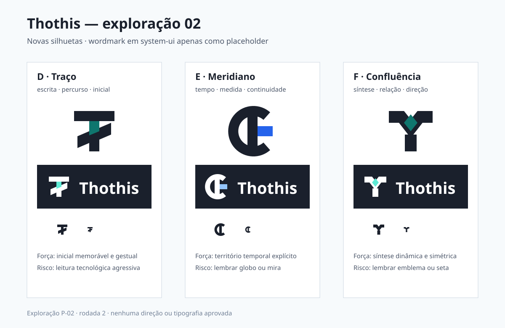

# Exploração visual — P-02

**Status:** direção G selecionada para verificação  
**Data:** 2026-07-31  
**Relacionado:** [Plano de branding](../plan/thothis-branding.md) e [brief](brief.md)

Esta exploração compara símbolos geométricos originais em rodadas sucessivas. Os arquivos são
propostas para seleção, não assets finais ou autorizados para integração.
Nenhuma fonte, biblioteca, modelo generativo ou material de terceiros foi usado
na construção dos símbolos.

## Rodada 1

Nos lockups, o nome usa `system-ui` somente para avaliar proporção e convivência
entre símbolo e texto. A forma das letras não é proposta de wordmark e não
antecipa a decisão tipográfica de P-04.

### Alternativas da rodada 1

| Conceito | Território | Hipótese | Principal risco |
| --- | --- | --- | --- |
| [A — Registro](assets/concept-a-register.svg) | escrita e registro | uma haste com linhas preservadas comunica estrutura documental | pode ser percebido como lista ou letra `E` |
| [B — Ciclo](assets/concept-b-cycle.svg) | lua e tempo | fases deslocadas em três eixos comunicam progressão e medição | pode ser percebido como equalizador |
| [C — Trama](assets/concept-c-weave.svg) | síntese | registros entrelaçados comunicam permanência e relação | o centro exige validação adicional em `16x16` |

## Matriz preliminar

Escala: `1` fraco, `3` adequado, `5` forte. As notas são hipóteses da
exploração e não substituem a revisão humana nem a pesquisa de similaridade.

| Critério | A | B | C |
| --- | ---: | ---: | ---: |
| Silhueta em tamanho reduzido | 5 | 5 | 4 |
| Relação com escrita e registro | 5 | 2 | 4 |
| Relação com ciclo e tempo | 2 | 5 | 3 |
| Conhecimento conectado sem grafo literal | 3 | 3 | 5 |
| Distinção preliminar | 3 | 3 | 4 |
| Funcionamento monocromático | 5 | 5 | 5 |

## Rodada 3 — refinamentos da F

A direção [F — Confluência](assets/concept-f-confluence.svg) foi indicada pelo
revisor humano como preferida para uma nova rodada. Isso orienta a exploração,
mas ainda não constitui aprovação do símbolo final.

| Conceito | Variação | Hipótese | Principal risco |
| --- | --- | --- | --- |
| [G — Confluência aberta](assets/concept-g-open-confluence.svg) | reduz o núcleo e amplia os braços | preserva a personalidade da F com menos leitura de emblema | ainda pode sugerir bifurcação |
| [H — Confluência modular](assets/concept-h-modular-confluence.svg) | separa registros, núcleo e haste | comunica peças de conhecimento organizadas por um núcleo | o encontro pode ficar denso em monocromia |
| [I — Confluência linear](assets/concept-i-linear-confluence.svg) | reduz a forma a percursos | comunica convergência com menos massa visual | pode lembrar antena |

### Matriz preliminar da rodada 3

| Critério | G | H | I |
| --- | ---: | ---: | ---: |
| Silhueta em tamanho reduzido | 5 | 5 | 4 |
| Continuidade com a direção F | 5 | 4 | 4 |
| Conhecimento conectado sem grafo literal | 4 | 5 | 4 |
| Redução da leitura de seta ou emblema | 3 | 5 | 4 |
| Funcionamento monocromático | 5 | 5 | 5 |
| Distinção preliminar | 4 | 4 | 4 |

## Rodada 4 — refinamento de originalidade

A pesquisa preliminar de P-03 encontrou recorrência do motivo `T/Y + losango`
em logos de estoque. Esta rodada explorou uma possível mitigação, preservando a
ideia de registros relacionados sem a silhueta de monograma ou núcleo em
losango.

| Conceito | Variação | Hipótese | Principal risco |
| --- | --- | --- | --- |
| [J — Trama aberta](assets/concept-j-open-weave.svg) | dois cantos entrelaçados com centro aberto | comunica registros relacionados e permanência sem monograma | pode sugerir moldura, crop ou espiral |
| [K — Passagem escalonada](assets/concept-k-stepped-passage.svg) | registros deslocados unidos por uma passagem | mantém conexão e leitura simples em `16x16` | pode ser percebido como percurso ou letra `Z` |
| [L — Entrelinhas conectadas](assets/concept-l-connected-lines.svg) | percursos paralelos ligados no centro | comunica contexto e vínculo sem núcleo emblemático | pode se aproximar de circuito eletrônico |

### Matriz preliminar da rodada 4

| Critério | J | K | L |
| --- | ---: | ---: | ---: |
| Silhueta em tamanho reduzido | 4 | 5 | 4 |
| Continuidade conceitual com G | 4 | 4 | 4 |
| Conhecimento conectado sem grafo literal | 4 | 3 | 4 |
| Redução da leitura T/Y + losango | 5 | 5 | 5 |
| Funcionamento monocromático | 5 | 5 | 5 |
| Distinção preliminar | 4 | 3 | 3 |

As notas são hipóteses de exploração. Nenhuma alternativa foi adotada; o
revisor humano manteve G e aceitou o risco residual documentado em P-03.

## Rodada 2

A segunda rodada abandona as estruturas que podiam ser percebidas como letra
`E`, equalizador ou elo quadrado. Ela testa uma inicial gestual, um eixo temporal
circular e uma confluência simétrica.

### Alternativas da rodada 2

| Conceito | Território | Hipótese | Principal risco |
| --- | --- | --- | --- |
| [D — Traço](assets/concept-d-stroke.svg) | escrita e registro | um percurso contínuo forma uma inicial `T` sem usar pena, página ou livro | pode parecer agressivo ou excessivamente tecnológico |
| [E — Meridiano](assets/concept-e-meridian.svg) | lua e tempo | ciclo aberto e eixo comunicam continuidade e medição | pode ser percebido como globo ou mira |
| [F — Confluência](assets/concept-f-confluence.svg) | síntese | dois registros convergem em direção e eixo comuns | pode ser percebido como emblema ou seta |

### Matriz preliminar da rodada 2

| Critério | D | E | F |
| --- | ---: | ---: | ---: |
| Silhueta em tamanho reduzido | 5 | 4 | 5 |
| Relação com escrita e registro | 4 | 2 | 3 |
| Relação com ciclo e tempo | 2 | 5 | 2 |
| Conhecimento conectado sem grafo literal | 4 | 3 | 5 |
| Distinção preliminar | 4 | 4 | 4 |
| Funcionamento monocromático | 5 | 5 | 5 |

## Proveniência

- criação vetorial original realizada no repositório em 2026-07-31;
- construção manual exclusivamente com `path`, `rect`, `g`, `title`, `desc` e
  texto de apresentação nas pranchas;
- símbolos individuais não contêm texto, fonte, script, imagem, referência
  externa, gradiente ou metadado sensível;
- cores candidatas: Archive Ink `#1A202C`, Scribe Teal `#0F766E` e Signal Blue
  `#2563EB`;
- o texto da prancha usa `system-ui` apenas para apresentação e não integra os
  símbolos candidatos.

## Decisão necessária

## Decisão registrada

**Direção selecionada:** [G — Confluência aberta](assets/concept-g-open-confluence.svg)  
**Decisor:** Lincoln Zocateli  
**Data:** 2026-07-31  
**Escopo da decisão:** avançar a direção G para verificação e refinamento técnico.

A seleção conclui a comparação de P-02, mas não aprova o SVG exploratório como
asset final. P-03 ainda deve registrar pesquisa de similaridade, proveniência e
decisões de licença antes da produção do sistema de marca em P-05. As demais
alternativas permanecem registradas apenas como histórico da exploração.

### Decisão após revisão de P-03

**Decisão:** manter G e não adotar J, K ou L.  
**Decisor:** Lincoln Zocateli  
**Data:** 2026-08-01  
**Escopo:** aceitar o risco residual do motivo genérico `T/Y + losango`, pois a
pesquisa não identificou marca ou logo idêntico.