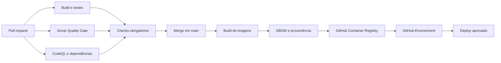

# CI/CD e segurança no GitHub

**Status:** implementação local da feature 011; configuração remota e homologação pendentes
**Data de referência:** 28 de julho de 2026  
**Escopo:** recursos do repositório e da plataforma GitHub para integração contínua, entrega, segurança e cadeia de fornecimento do Nodra.

## 1. Objetivo

O contrato atual é definido pelo [ADR aceito](adr/2026-0009-padronizacao-cicd-groundwork.md)
e pelo [processo canônico](../.github/CI-CD.md), com Groundwork 0.11.3 MIT.
Arquivos `gw-*` são gerenciados; `ci.yml`, `publish.yml`, `post-release.yml` e
`deploy.yml` são sementes do Nodra. Não copiar código do Dokpod AGPL nem editar
hashes para contornar os checks. As seções de ferramentas futuras abaixo não
representam integrações instaladas ou autorização de dependências adicionais.

CI não usa secrets, não publica nem implanta. O único check agregador é
`Result`. Publicação exige a equipe administrativa validada nos quatro
ambientes protegidos; auto-deploy permanece desativado. Nenhum workflow de
release ou deploy foi executado como parte desta implementação local.

Este documento descreve como utilizar o GitHub para proteger mudanças, executar validações, publicar imagens de container e promover releases do Nodra. O Sonar faz parte dessa estratégia como gate de qualidade e segurança do código, mas não substitui os controles nativos do GitHub.

A solução deve combinar quatro camadas:

1. **governança do código:** pull requests, responsáveis, aprovações e rulesets;
2. **CI/CD:** build, testes, empacotamento, publicação e implantação;
3. **segurança:** código, dependências, secrets, workflows e containers;
4. **cadeia de fornecimento:** lockfiles, SBOM, proveniência, assinaturas e artefatos imutáveis.



## 2. Responsabilidades entre repositório e plataforma

### 2.1 Configuração versionada no repositório

O comportamento reproduzível deve ficar no Git:

| Arquivo ou diretório | Responsabilidade |
| --- | --- |
| `.github/workflows/ci.yml` | format, lint, build, testes e contratos |
| `.github/workflows/gw-gitleaks.yml` | scan do histórico Git por secrets, chamado pelo CI |
| `.github/workflows/gw-release.yml` e `gw-preview.yml` | Release PR, candidata, manifesto e gates de origem |
| `.github/workflows/publish.yml` | cinco imagens Nodra e pacote self-hosted, com aprovação administrativa |
| `.github/workflows/gw-deploy.yml` e `deploy.yml` | guard na tag e hook externo por manifesto validado |
| `deploy/self-hosted/` | instalação e operação local por Docker Compose no host escolhido pelo operador |
| `.github/dependabot.yml` | atualizações de npm, NuGet, GitHub Actions e imagens base |
| `.github/CODEOWNERS` | responsáveis por módulos e arquivos críticos |
| `.github/SECURITY.md` | política de reporte e resposta a vulnerabilidades |
| lockfiles e manifests | versões reproduzíveis das dependências |
| configuração do Sonar | escopo, exclusões justificadas e relatórios de cobertura |

Os workflows existentes são a implementação inicial dos nomes e responsabilidades acima. CodeQL, Sonar, revisão de dependências, regras administrativas e promoção de outros ambientes permanecem controles futuros ou dependentes da configuração da conta GitHub.

### 2.2 Estado de implementação

O repositório possui workflows versionados de CI e release:

- `.github/workflows/ci.yml` executa baseline documental, testes Angular/.NET, integração PostgreSQL e build das imagens, agregando os resultados em `CI / Result`;
- `tools/scripts/validate-repository.ps1` verifica arquivos obrigatórios, destinos locais de links e imagens Markdown, referências explícitas, IDs explícitos de headings, status geral e por etapa dos planos e fixação de actions externas por SHA ou digest completo;
- `tools/scripts/test-validate-repository.ps1` cobre o cenário válido e rejeições de link ausente, referência sem definição, action mutável, status geral inválido e etapa sem status;
- os validadores permanecem em PowerShell 7 porque usam apenas APIs nativas, já executam em Windows e Linux e não justificam adicionar Python ou bootstrap com `uv`;
- `.github/CODEOWNERS` registra ownership global e explícito para arquivos críticos;
- `.github/dependabot.yml` atualiza GitHub Actions semanalmente;
- `.github/SECURITY.md` prepara a política de reporte responsável e informa que o canal ainda não está operacional;
- os workflows canônicos usam Release Please e GitHub App, candidata em quality e manifesto atestado; a semente publish.yml lista os cinco Dockerfiles e recusa modos preflight/publish_only ainda não implementados;
- `deploy/self-hosted/` contém a composição inicial operada pelo responsável no host self-hosted; CI e release não iniciam nem alteram instalações;
- deploy-shared-infra.yml permanece fora do fluxo; deploy.yml agora implementa somente o contrato opcional aceito no ADR 0009, sem instalar hook ou reativar VPS automaticamente;
- `deploy/production/` e o runbook de VPS permanecem como histórico supersedido, sem workflow ativo;
- um checklist administrativo do mantenedor deve registrar configurações que exigem acesso a **Settings** e evidência manual.

No job `Container Images`, um Docker Engine fixado é criado somente no runner
efêmero com `containerd-snapshotter` ativo e `lazy-pull` desativado. O
`validate-release-images.ps1` mantém `--load`, proveniência `mode=max` e um
gerador SBOM fixado por digest; o Trivy lê o arquivo de `docker save` e executa
os dois scans sem receber o socket Docker. Seu cache usa um volume exclusivo,
removido ao fim da validação para evitar problemas de permissões no host.
Após os builds, o CI consulta a API local do Engine e valida SBOM SPDX e
proveniência vinculados à mesma imagem em um container sem rede nem socket.
A proveniência `mode=max` inclui valores de
argumentos de build: nunca passe secrets por `ARG`. Para testar localmente, use
um Engine isolado compatível, sem reconfigurar o daemon de um host compartilhado.
As evidências e limitações estão no [guia da feature 011](../specs/011-padronizacao-cicd/quickstart.md).

As imagens de runtime .NET usam a base `10.0.15-noble-v1` por digest; a
[receita da base](https://github.com/lzocateli/containers/blob/cca7fba17eca7777b12a437f012a90dbfa9b95ed/LICENSE)
declara MIT. O bundle autossuficiente de migrations usa o SDK `10.0.404`
por digest, compatível com `global.json`; a
[licença do SDK](https://github.com/dotnet/sdk/blob/v10.0.404/LICENSE.TXT) e a
[licença da receita oficial](https://github.com/dotnet/dotnet-docker/blob/810fe040864a3c1a8a516294bfd39af05d2e1af6/LICENSE)
são MIT. A web usa nginx `1.30.7-trixie` por digest; o
[nginx](https://github.com/nginx/nginx/blob/release-1.30.7/LICENSE) e a
[receita oficial](https://github.com/nginx/docker-nginx/blob/a2a986d19aac4a79a330e6e0b5171aae4e521926/LICENSE)
declaram BSD-2-Clause. O pacote `zlib1g` corrigido também é fixado no Dockerfile:
se a versão deixar de estar disponível no repositório Debian, o build deve
falhar até ser atualizada e novamente verificada, sem dispensar o scan.

A publicação de imagens ainda depende de configuração e homologação no GitHub
com os secrets da GitHub App; o CI não depende desses secrets. A instalação
self-hosted permanece pendente de configuração local, bootstrap seguro das
roles, callbacks OIDC, smoke test e validação de backup/restore. O CI atual
ainda não executa Sonar, CodeQL, Dependency Review nem E2E autenticado; esses
gates devem ser adicionados antes de declarar release estável.

### 2.3 Configuração administrativa na plataforma GitHub

Alguns controles não vivem em arquivos do repositório e devem ser configurados em **Settings**:

- rulesets e proteção de branches e tags;
- checks obrigatórios;
- permissões padrão do `GITHUB_TOKEN`;
- GitHub Actions permitidas e política de fixação de versões;
- secrets e variables de repositório, ambiente ou organização;
- environments, revisores e branches autorizadas para implantação;
- Dependabot, code scanning, secret scanning e push protection;
- retenção de logs, artifacts e caches;
- acesso ao GitHub Container Registry;
- instalação e permissões do GitHub App do Sonar;
- limites de gastos e consumo do GitHub Actions.

Essas configurações devem ser inventariadas em checklist ou evidência administrativa, porque não são completamente reconstruídas apenas pelo clone do repositório.

## 3. GitHub Actions como motor de CI/CD

GitHub Actions executa workflows YAML em resposta a eventos como `pull_request`, `push`, tags, agenda e acionamento manual. Para o monorepo do Nodra, a divisão recomendada é:

| Job | Validação principal |
| --- | --- |
| `frontend` | format, lint, testes Vitest e build Angular |
| `backend` | format, análise estática, build e testes .NET |
| `integration` | PostgreSQL real, filesystem e Testcontainers |
| `contracts` | OpenAPI, schemas, clientes gerados e breaking changes |
| `e2e` | Playwright contra a aplicação containerizada |
| `sonar` | análise e Quality Gate |
| `codeql` | fluxos vulneráveis em C# e TypeScript |
| `dependency-review` | novas dependências e vulnerabilidades introduzidas pelo PR |
| `container` | BuildKit, smoke test, contrato e scan das imagens |
| `ci-result` | resultado agregado e estável para proteção da branch |

### 3.1 Recursos úteis do GitHub Actions

- **GitHub-hosted runners:** máquinas efêmeras mantidas pelo GitHub, preferidas para CI comum.
- **Self-hosted runners:** necessários somente para rede privada, hardware ou dependências especiais.
- **Service containers:** PostgreSQL e serviços auxiliares durante testes.
- **Matrix:** versões ou sistemas operacionais realmente suportados.
- **Cache:** pacotes npm, NuGet, Playwright e scanner Sonar, sempre derivados de lockfiles.
- **Artifacts:** cobertura, resultados de testes, traces do Playwright, logs sanitizados e SBOM.
- **Reusable workflows:** componentes compartilhados para build, scan, publicação e deploy.
- **Concurrency:** preserva execuções de PR/merge group e impede deploys simultâneos no mesmo destino.
- **Path filters:** reduzem trabalho em monorepo, desde que não deixem checks obrigatórios pendentes.
- **Manual dispatch:** operações controladas, como promoção, rollback ou teste de recuperação.

Caches não são artefatos confiáveis ou assinados. Nunca devem conter tokens, certificados, credenciais ou arquivos que serão executados sem validação. Pull requests de forks podem ler caches acessíveis da branch base.

### 3.2 Segurança dos workflows

- declarar `permissions: {}` globalmente e conceder somente o necessário por job;
- conceder `packages: write`, `security-events: write`, `attestations: write` ou `id-token: write` apenas onde necessário;
- fixar actions externas pelo SHA completo do commit;
- manter o Dependabot atualizando as referências das actions;
- evitar interpolar diretamente dados de issue, PR ou branch em scripts de shell;
- evitar `pull_request_target` executando código do pull request;
- não disponibilizar secrets em workflows de código não confiável;
- usar runners efêmeros e separar runners de build dos de deploy;
- definir timeout para jobs e limites de concorrência;
- não registrar conteúdo de notas, tokens ou connection strings nos logs.

Self-hosted runners não devem processar pull requests não confiáveis quando possuírem estado persistente, credenciais, acesso à rede interna ou ao daemon de containers do host.

## 4. Proteção da branch principal

Deve existir um ruleset para `main` com, no mínimo:

- pull request obrigatório;
- push direto e force push bloqueados;
- ao menos uma aprovação;
- aprovação anterior descartada após novos commits relevantes;
- resolução obrigatória de conversas;
- revisão de Code Owner quando houver equipe suficiente;
- checks de CI e segurança obrigatórios;
- histórico linear;
- exclusão da branch bloqueada;
- bypass restrito e auditável;
- merge queue quando a concorrência de contribuições justificar.

Check agregador do contrato atual:

```text
Result
```

Os nomes efetivos devem permanecer estáveis. Um check marcado como obrigatório não pode desaparecer por causa de filtro de path. O job agregador `CI / Result` deve sempre executar e informar claramente quais validações foram executadas, ignoradas de forma válida ou falharam.

### 4.1 CODEOWNERS

O arquivo `.github/CODEOWNERS` pode atribuir responsáveis a áreas como:

```text
# Configurar somente com uma equipe GitHub administrativa real e validada.
# Não usar identificadores fictícios nem conta pessoal como fallback.
```

O próprio arquivo e os workflows devem possuir owner explícito. Em uma equipe de uma pessoa, CODEOWNERS ainda documenta responsabilidade, mas não cria independência de aprovação. A exigência de aprovação deve ser ajustada para não bloquear o trabalho individual sem oferecer ganho real.

## 5. Estratégia do Sonar

### 5.1 SonarQube Cloud ou SonarQube Server

| Opção | Vantagens | Custos e limitações |
| --- | --- | --- |
| SonarQube Cloud | SaaS, menor operação e integração direta com GitHub | código e resultados processados pelo serviço; plano conforme visibilidade e volume |
| SonarQube Server | controle de dados, rede e atualização | exige infraestrutura, TLS, backup, atualização, disponibilidade e licença para recursos avançados |

Para a fase inicial, SonarQube Cloud reduz o custo operacional. SonarQube Server é indicado quando houver requisito de manter análise e resultados dentro da infraestrutura controlada.

No SonarQube Server, recursos de branches, pull requests e monorepo dependem da edição. A documentação da SonarSource deve ser conferida antes da compra; o suporte formal de monorepo no Server está associado à edição Enterprise na documentação vigente desta referência.

### 5.2 Integração recomendada

- instalar o GitHub App oficial do Sonar com acesso apenas aos repositórios necessários;
- habilitar análise de pull request e PR decoration;
- tornar o Quality Gate um status check obrigatório;
- usar checkout com histórico completo, `fetch-depth: 0`;
- armazenar `SONAR_TOKEN` em GitHub Actions Secret;
- armazenar `SONAR_HOST_URL` como variable quando usar Server;
- usar token de projeto em vez de token global sempre que possível;
- importar cobertura Angular em LCOV;
- importar cobertura .NET em formato aceito pelo scanner, como OpenCover;
- definir corretamente fontes, testes, código gerado e exclusões justificadas;
- usar análise orientada a código novo, seguindo o princípio **Clean as You Code**.

Não se deve habilitar simultaneamente análise automática e análise pelo CI para o mesmo projeto quando isso gerar resultados duplicados.

### 5.3 Quality Gate inicial

Uma política inicial para código novo pode exigir:

- nenhuma vulnerabilidade nova;
- nenhum bug novo de severidade bloqueadora ou crítica;
- todos os Security Hotspots novos revisados;
- cobertura mínima de 80% no código novo;
- duplicação dentro do limite acordado no código novo;
- rating de confiabilidade, segurança e manutenibilidade compatível com release.

O limite de cobertura deve orientar comportamento, não incentivar testes sem valor. Código de integração com filesystem, PostgreSQL, autenticação e concorrência exige evidência adequada mesmo quando uma métrica global já foi atingida.

### 5.4 Sonar não substitui os demais controles

| Ferramenta | Responsabilidade predominante |
| --- | --- |
| Sonar | qualidade, bugs, duplicação, cobertura, vulnerabilidades e hotspots |
| CodeQL | análise de fluxo de dados e vulnerabilidades em C# e TypeScript |
| Dependabot | vulnerabilidades e atualização de componentes de terceiros |
| Dependency Review | impacto das dependências adicionadas ou alteradas no PR |
| Secret scanning | credenciais e tokens expostos |
| Trivy ou Grype | pacotes do sistema, filesystem e imagens de container |

Achados duplicados devem ser triados, mas a simples sobreposição não justifica desativar uma camada com cobertura diferente.

## 6. Segurança nativa do GitHub

### 6.1 Dependências

Ativar:

- Dependency Graph;
- Dependabot Alerts;
- Dependabot Security Updates;
- Dependabot Version Updates;
- atualizações agrupadas por ecossistema quando reduzirem ruído;
- Dependency Review em pull requests.

O `.github/dependabot.yml` deve cobrir npm, NuGet, GitHub Actions e Docker. Atualizações de segurança continuam passando pelos mesmos builds e testes das demais mudanças. Automerge só deve ser considerado para categorias de baixo risco e depois de checks completos.

Toda dependência nova ou atualizada deve ter a licença da versão exata verificada na fonte oficial e registrada no pull request. O gate de Dependency Review deve bloquear licenças desconhecidas ou incompatíveis, e o inventário de release deve preservar essa informação no SBOM.

Aceitar somente licenças permissivas e gratuitas para os usos previstos, como MIT, Apache-2.0, BSD-2-Clause, BSD-3-Clause, ISC e PostgreSQL. Bloquear dependências pagas, proprietárias, source-available, com licença comercial obrigatória, copyleft ou restrição incompatível com uso, modificação, distribuição e operação self-hosted. Licença ausente, ambígua, não detectada ou modificada entre versões exige bloqueio, não aprovação automática.

A biblioteca MediatR é proibida no projeto por sua política de licenciamento; essa restrição não se aplica ao padrão Mediator. Quando o padrão for necessário, a implementação aprovada é `Nuuvify.CommonPack.Mediator`, cuja versão exata ainda deve passar por verificação de licença, vulnerabilidades, manutenção, lockfile, Dependency Review e SBOM. Commands, queries, handlers e behaviors permanecem explícitos e testáveis.

### 6.2 Code scanning com CodeQL

CodeQL suporta as linguagens principais do Nodra:

- C# para API, worker e bibliotecas backend;
- JavaScript/TypeScript para Angular e bibliotecas frontend;
- workflows GitHub Actions para problemas na automação.

A configuração inicial pode usar default setup. A configuração avançada é indicada quando forem necessários query packs adicionais, controle de build compilado, agenda específica ou integração com outros resultados SARIF.

Resultados de scanners compatíveis, como Trivy, podem ser enviados em SARIF para a área de Code Scanning. Isso centraliza triagem e histórico, mas não elimina a necessidade de manter o relatório original como artifact quando útil.

### 6.3 Secret scanning e push protection

Secret scanning procura credenciais no histórico Git e em outras superfícies do GitHub. Push protection bloqueia credenciais reconhecidas antes que entrem no repositório.

Ao detectar um secret:

1. revogar ou rotacionar imediatamente;
2. investigar utilização indevida;
3. substituir o mecanismo por secret seguro ou OIDC;
4. remover do histórico somente quando necessário;
5. documentar o incidente sem repetir o valor sensível.

Apagar o texto do commit não torna uma credencial novamente segura. A rotação é obrigatória.

### 6.4 Security Advisories e reporte privado

Para um projeto público, habilitar **Private Vulnerability Reporting** permite receber relatos sem exposição antecipada. GitHub Security Advisories possibilita discutir, corrigir e preparar uma release de segurança de forma privada antes da divulgação coordenada.

Private Vulnerability Reporting é um recurso da plataforma GitHub, não um arquivo adicional do repositório. Quando habilitado, o pesquisador utiliza a aba **Security**, entra em **Advisories** e seleciona **Report a vulnerability** para enviar o relato em um canal privado.

Para habilitá-lo posteriormente, um administrador do repositório deve:

1. abrir **Settings** no repositório GitHub;
2. acessar **Security** ou **Code security and analysis**;
3. localizar **Private vulnerability reporting**;
4. selecionar **Enable**;
5. confirmar na aba **Security** que a opção de reporte privado está disponível.

Os nomes e a organização dos menus podem mudar conforme a evolução da interface do GitHub. Se o recurso não estiver disponível, verificar a visibilidade do repositório, o plano da conta e a documentação oficial antes de publicar um canal alternativo.

A política pública de reporte permanece no arquivo [`.github/SECURITY.md`](../.github/SECURITY.md). Esse documento orienta o pesquisador sobre versões suportadas, escopo e informações esperadas; o Private Vulnerability Reporting é o canal que recebe e gerencia o relato de forma privada.

**Ação pendente:** habilitar o Private Vulnerability Reporting nas configurações do repositório e registrar a evidência no checklist administrativo do mantenedor antes de divulgar a política de segurança como canal oficial.

## 7. Secrets, variables e identidade

Use o menor escopo possível:

| Escopo | Uso recomendado |
| --- | --- |
| Repository variable | URL, nome de projeto e configuração não sensível |
| Repository secret | token necessário em CI para todo o repositório, como `SONAR_TOKEN` |
| Environment variable | configuração não sensível específica de staging ou production |
| Environment secret | credencial de implantação liberada somente após as proteções do ambiente |
| Organization secret | valor compartilhado com política explícita de repositórios autorizados |

Secrets não são enviados normalmente para workflows originados de forks e não são repassados automaticamente a reusable workflows. O contrato de inputs e secrets deve ser explícito.

### 7.1 OIDC

Quando o provedor de infraestrutura oferecer suporte, GitHub Actions deve usar OpenID Connect para trocar a identidade do workflow por credenciais temporárias. Isso evita armazenar service principals, chaves ou tokens de longa duração.

Uma política OIDC deve restringir:

- organização e repositório;
- branch, tag ou environment permitido;
- workflow autorizado;
- audiência esperada;
- permissões concedidas no provedor.

O job de deploy recebe `id-token: write`; os jobs de build não recebem essa permissão.

## 8. Containers e cadeia de fornecimento

As imagens podem ser publicadas no GitHub Container Registry:

```text
ghcr.io/altivy-it/nodra-web:1.0.0
ghcr.io/altivy-it/nodra-api:1.0.0
ghcr.io/altivy-it/nodra-bff:1.0.0
ghcr.io/altivy-it/nodra-worker:1.0.0
ghcr.io/altivy-it/nodra-migrations:1.0.0
```

Cada release deve:

- construir com BuildKit e contexto mínimo;
- utilizar imagens base fixadas e atualizadas de forma controlada;
- executar smoke test e health check;
- inspecionar usuário, entrypoint, portas, volumes e labels OCI;
- gerar SBOM em SPDX ou CycloneDX;
- executar scanner como Trivy ou Grype;
- publicar resultado SARIF quando aplicável;
- gerar artifact attestation e proveniência;
- publicar tag semântica imutável e registrar o digest SHA-256;
- criar GitHub Release com changelog e referências aos artefatos;
- promover exatamente o mesmo digest entre ambientes, sem rebuild.

`latest` pode existir como conveniência, mas nunca deve ser a única referência nem a referência de produção. O deploy deve usar versão imutável ou digest.

## 9. Environments e implantação

Criar environments conforme a topologia real:

| Environment | Proteção sugerida |
| --- | --- |
| `ci` | validação sem secrets de release/deploy |
| `copilot` | automação reservada, sem credenciais operacionais |
| `quality` | tags v*, equipe administrativa validada e aceite da candidata |
| `release` | main/tags v*, aprovação administrativa antes de publicar |
| `distribution` | main/tags v*, autorização de divulgação |
| `production` | tags v*, implantação explicitamente autorizada; sem auto-deploy |

## Configuração Necessária para a Feature 011

Cadastrar pelo GitHub, nunca pelo chat ou em arquivos do repositório:

| Nome | Tipo | Escopo | Finalidade |
| --- | --- | --- | --- |
| `RELEASE_APP_ID` | variável | repositório | identificador do App instalado no Nodra |
| `RELEASE_APP_PRIVATE_KEY` | secret | repositório/organização com acesso restrito | chave do mesmo App |
| `ALTIVY_ADMIN_TEAM` | variável | repositório | slug da equipe administrativa validada nos quatro ambientes protegidos |
| `DEPLOY_SSH_TARGET` | variável | quality/production | usuário e host do Nodra |
| `DEPLOY_HOOK` | variável | quality/production | caminho absoluto do hook Nodra com apply/check |
| `DEPLOY_SSH_KEY` | secret | quality/production | chave dedicada de menor privilégio |
| `DEPLOY_SSH_KNOWN_HOSTS` | secret | quality/production | host key conferida por canal confiável |

O inventário versionado de nomes, escopos e dos seis ambientes está em
`.github/ci-cd.json` (`repositorySetup`). Ele não contém valores e não cria
configuração no GitHub. Groundwork 0.11.3 não consegue materializar hoje esse
contrato: faltam `ci`/`copilot`, variáveis próprias e reviewers de equipe. A
política remota permanece bloqueada até atualização suportada do catálogo,
identificação da equipe e revisão do dry-run; não sincronize a política atual.

O nome legado `RELEASE_APP_CLIENT_ID` foi substituído no fluxo por
`RELEASE_APP_ID`; não copiar nem apagar valores sem conferir a migração.
A equipe administrativa ainda não foi identificada; não basta usar o papel
RepositoryRole/5 dos rulesets como reviewer de Environment. A publicação
verifica uma equipe real nos quatro ambientes e falha fechada se faltar.
O CODEOWNERS legado aguarda essa equipe, sem inventar destinatário.

As consultas realizadas encontraram ausência de cadastros diretos; herança da
organização não foi confirmada. Instalar o App e conceder acesso são ações do
operador. Nenhum PAT, chave SSH ou segredo deve ser enviado ao assistente.
O CI funciona sem essas configurações; release/deploy permanecem bloqueados.

Para releases self-hosted:

- CI constrói, testa e publica artefatos imutáveis com SBOM, scan e proveniência;
- o responsável configura secrets e executa Compose no host sob seu controle;
- a instalação usa digest de release, migrations exclusivas e backup antes de upgrade;
- smoke test, backup, restore e rollback são registrados pelo procedimento operacional.

Environments de repositórios privados e algumas deployment protection rules dependem do plano GitHub.

## 10. Pipeline recomendado por evento

### 10.1 Pull request

Executar:

1. validação de arquivos e lockfiles;
2. format e lint;
3. build Angular e .NET;
4. testes unitários;
5. testes de integração com PostgreSQL e filesystem reais;
6. validação de contratos OpenAPI;
7. Playwright para fluxos afetados;
8. análise Sonar e Quality Gate;
9. CodeQL;
10. Dependency Review;
11. build e scan de imagens quando arquivos de container forem afetados;
12. check agregador.

O pull request não publica release nem recebe credenciais de produção.

### 10.2 Push em `main`

Após repetir as validações necessárias:

- construir artefatos reproduzíveis;
- construir imagens candidatas uma única vez;
- gerar SBOM, scan e proveniência;
- publicar no GHCR com tag de commit;
- opcionalmente implantar em `development`;
- preservar relatórios e digests para promoção posterior.

### 10.3 Tag e release

Uma tag no padrão `vX.Y.Z` deve:

- apontar para commit aprovado de `main`;
- confirmar todos os gates;
- associar tags semânticas às imagens já construídas ou reconstruí-las de forma verificável conforme política definida;
- gerar GitHub Release e changelog;
- publicar SBOM e proveniência;
- promover por digest para staging e production;
- respeitar aprovação do environment.

A estratégia preferida é **build once, promote many**: o mesmo digest validado é promovido, sem recompilar para cada ambiente.

### 10.4 Execuções agendadas

Executar periodicamente:

- CodeQL completo;
- varredura das imagens publicadas;
- revisão de dependências e imagens base;
- testes de backup e restauração;
- smoke tests de ambientes;
- verificação de certificados e secrets com expiração;
- auditoria de actions desatualizadas e permissões excessivas.

## 11. Disponibilidade por plano

A disponibilidade exata deve ser confirmada no plano contratado e na visibilidade do repositório.

- GitHub Actions possui cotas de minutos, armazenamento, cache e artifacts.
- Repositórios públicos recebem gratuitamente vários recursos de segurança.
- Em repositórios privados, code scanning avançado e proteções de secrets podem exigir GitHub Code Security, GitHub Secret Protection, Team ou Enterprise.
- Environments em repositórios privados exigem GitHub Pro para conta pessoal ou GitHub Team para organização; algumas regras possuem restrições adicionais.
- Secrets de organização para repositórios privados não estão disponíveis no GitHub Free.
- Rulesets em múltiplos repositórios e controles organizacionais avançados dependem de Team ou Enterprise.
- SonarQube Cloud possui planos próprios.
- SonarQube Server possui edições com recursos distintos para branches, PRs e monorepos.

Licenciamento muda ao longo do tempo. Antes de implementar um controle como gate obrigatório, confirmar que ele está disponível para o proprietário e a visibilidade atuais do repositório.

## 12. Ordem de implantação

### Fase 1: governança e CI básico

- criar workflows de frontend, backend, testes e contratos;
- configurar ruleset de `main`;
- criar CODEOWNERS;
- limitar permissões do `GITHUB_TOKEN`;
- fixar actions por SHA;
- configurar cache e artifacts sem dados sensíveis.

### Fase 2: qualidade e segurança do código

- integrar Sonar e tornar o Quality Gate obrigatório;
- habilitar Dependency Graph, Dependabot e Dependency Review;
- habilitar CodeQL;
- habilitar secret scanning e push protection quando disponíveis;
- definir processo de triagem e prazo de correção.

### Fase 3: containers e releases

- criar build e smoke test das imagens;
- adicionar scanner de container e SARIF;
- publicar no GHCR;
- gerar SBOM e artifact attestations;
- criar release versionada e tags imutáveis.

### Fase 4: implantação controlada

- criar environments;
- configurar OIDC;
- separar permissões de build e deploy;
- adicionar aprovações de production;
- implementar pós-deploy, rollback e histórico de deployment;
- testar recuperação antes do primeiro release estável.

## 13. Critérios mínimos de aceite

O processo estará adequado para o primeiro release quando:

- `main` não aceitar mudanças sem pull request e checks obrigatórios;
- builds Angular e .NET forem reproduzíveis a partir dos lockfiles;
- testes unitários, integração, contrato e E2E produzirem evidências;
- o Quality Gate do Sonar bloquear código novo fora da política;
- CodeQL, dependências e secrets tiverem controles ativos ou limitação documentada;
- imagens forem testadas, escaneadas, identificadas por digest e acompanhadas por SBOM;
- credenciais de longa duração tiverem sido eliminadas do deploy quando OIDC estiver disponível;
- production exigir as proteções compatíveis com o tamanho da equipe e o plano GitHub;
- backup, restauração e rollback tiverem sido executados em ambiente controlado;
- exceções possuírem responsável, justificativa e prazo de revisão.

## 14. Referências oficiais

- [GitHub Actions](https://docs.github.com/en/actions)
- [Rulesets](https://docs.github.com/en/repositories/configuring-branches-and-merges-in-your-repository/managing-rulesets/about-rulesets)
- [CODEOWNERS](https://docs.github.com/en/repositories/managing-your-repositorys-settings-and-features/customizing-your-repository/about-code-owners)
- [Environments](https://docs.github.com/en/actions/how-tos/deploy/configure-and-manage-deployments/manage-environments)
- [Segurança no GitHub Actions](https://docs.github.com/en/actions/reference/security/secure-use)
- [CodeQL](https://docs.github.com/en/code-security/code-scanning/introduction-to-code-scanning/about-code-scanning-with-codeql)
- [Dependabot Security Updates](https://docs.github.com/en/code-security/dependabot/dependabot-security-updates/about-dependabot-security-updates)
- [Secret scanning](https://docs.github.com/en/code-security/secret-scanning/introduction/about-secret-scanning)
- [Artifact attestations](https://docs.github.com/en/actions/concepts/security/artifact-attestations)
- [SonarQube Cloud com GitHub](https://docs.sonarsource.com/sonarqube-cloud/getting-started/github/)
- [SonarQube Server com GitHub Actions](https://docs.sonarsource.com/sonarqube-server/analyzing-source-code/ci-integration/github-actions/)
