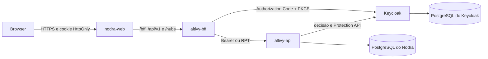

# Tutorial de configuração do Keycloak para o Nodra

## 1. Objetivo e estado atual

Este tutorial ensina, passo a passo, como preparar o Keycloak necessário ao
Altivy, mesmo para quem nunca administrou um realm. Ele cobre laboratório local,
realm, clients, usuários, autorização, tema visual personalizado, produção,
backup, diagnóstico e login social com Facebook, GitHub, Google, Microsoft,
LinkedIn e X/Twitter.

O [plano do BFF com Keycloak](plan/bff-keycloak.md) está com status `accepted`. Este tutorial documenta a configuração inicial recomendada e não substitui os ADRs do produto. O catálogo multi-vault já usa avaliação remota UMA no fluxo da API; a validação ponta a ponta ainda depende do laboratório autenticado.

- o laboratório possui os candidatos sintéticos `lab-0001` e `lab-0002`;
- a API avalia `vault:read` no Keycloak antes de revelar cada candidato;
- decisões negativas são omitidas e indisponibilidade retorna `503` sem página parcial;
- callbacks e tempos marcados como exemplos devem ser confirmados no ambiente;
- a jornada autenticada de troca e revogação ainda requer execução do Compose E2E com credenciais locais.

> **Regra de segurança:** nunca use o realm `master` como realm da aplicação. Um administrador humano pode entrar no `master` para administrar o servidor, mas BFF, API, usuários e credenciais pertencem ao realm `altivy`.
> **Fonte visual canônica:** o tema usa somente os arquivos versionados em
> `$env:USERPROFILE\projetos\Altivy\docs\brand`. Não copie assets para uma
> nova fonte de verdade, não use CDN e não coloque secrets, tokens ou exports
> reais no artefato ou no Git.

## 2. O que cada componente faz



| Componente | Responsabilidade |
| --- | --- |
| Keycloak | Usuários, credenciais, MFA, sessões, roles, grupos, recursos, scopes e políticas. |
| `altivy-bff` | Login OIDC, callback, logout, cookie técnico e tokens no servidor. |
| `altivy-api` | Validação do token e aplicação da decisão antes do domínio. |
| Angular | Interface; nunca recebe access token ou refresh token. |
| PostgreSQL do Keycloak | Estado operacional do Keycloak; exige backup próprio. |
| PostgreSQL do Nodra | Projeções; não armazena usuários, memberships ou políticas. |

Os bancos devem usar bancos, roles, senhas, backups e ciclos de vida distintos. Recomenda-se separá-los também por instância em produção.

## 3. Nomes usados neste guia

| Item | Valor do plano ou exemplo |
| --- | --- |
| Realm | `altivy` |
| Client confidencial do BFF | `altivy-bff` |
| Client de recurso da API | `altivy-api` |
| Client público do spike | `altivy-authorization-spike` |
| Audience da API | `altivy-api` |
| Roles iniciais | `Owner`, `Editor`, `Reader` |
| Scopes de vault | `vault:read`, `vault:write`, `vault:manage`, `vault:delete` |
| Recurso sintético | `urn:altivy:vault:00000000-0000-0000-0000-000000000001` |
| Keycloak real indicado | `https://credential.zocate.li` |
| Keycloak do laboratório | `http://localhost:8080` |
| BFF local de exemplo | `https://localhost:7443` |
| Origem pública principal | `https://altivy.it` |
| Origem pública alternativa | `https://altivy.it` |

Escolha uma única origem canônica por instalação e cadastre somente a que estiver
implantada. Não copie o recurso sintético para produção: a API registrará vaults
por identificador opaco.

## 4. Pré-requisitos

Para o laboratório:

1. PowerShell 7 ou superior.
2. Docker com suporte a containers Linux.
3. Portas locais `8080` e `9000` livres.
4. Pelo menos 2 GiB de memória disponível.
5. Imagens `lzocateli/keycloak:26.7.0` e
  `lzocateli/postgresql:18.4-pgvector0.8.6-bookworm`.

As tags foram verificadas em 29 de julho de 2026. Antes de promover outra versão, confirme licença, release notes, CVEs, compatibilidade e restauração. Keycloak usa Apache-2.0 e PostgreSQL usa PostgreSQL License.

Para o ambiente real, você também precisa de acesso administrativo a `https://credential.zocate.li`, DNS e TLS válidos, origem pública definitiva, cofre de secrets e autorização para criar realm, clients e credenciais.

## 5. Parte A: laboratório local descartável

O laboratório usa HTTP, `start-dev` e credenciais locais no arquivo ignorado
`$env:APPDATA\Microsoft\UserSecrets\Altivy.Notes\.env`. Não o exponha à rede e não o trate como produção.

### 5.1 Preparar credenciais e tema

Crie ou edite o arquivo local único de credenciais. Não reutilize senhas reais
ou de outros ambientes.

```powershell
$SecretsDirectory = Join-Path $env:APPDATA 'Microsoft\UserSecrets\Altivy.Notes'
New-Item -ItemType Directory -Force $SecretsDirectory | Out-Null
notepad (Join-Path $SecretsDirectory '.env')
./deploy/keycloak/build-theme.ps1
```

O arquivo externo de secrets não pertence ao repositório. O banco em `.tmp/`
e o artefato em `.build/` são ignorados pelo Git. O build copia tokens, fontes
e símbolo de `frontend/web` sem alterar essas fontes.

### 5.2 Publicar tema e iniciar a plataforma central

O Keycloak, PostgreSQL e gateway são operados exclusivamente pela plataforma
central `architecture-knowledge-base/platforms/identity`. Gere o tema no
Nodra e publique-o no bind mount central antes de iniciar a plataforma:

```powershell
./deploy/keycloak/build-theme.ps1
Set-Location ../architecture-knowledge-base/platforms/identity
./scripts/publish-product-theme.ps1 `
  -Product altivynotes `
  -SourcePath ../../Nodra/deploy/keycloak/.build/keycloak-theme/altivy
./scripts/initialize-local-platform.ps1
./scripts/start-platform.ps1
./scripts/test-platform.ps1
```

O bind mount PostgreSQL permanece em
`$env:APPDATA\keycloak\postgres-data`; a plataforma não o remove. Os realms e
clients do Nodra devem ser reconciliados por credenciais restritas ao
realm `altivy`.

### 5.3 Validar o laboratório

```powershell
$Discovery = Invoke-RestMethod `
  https://localhost:7443/realms/altivy/.well-known/openid-configuration
$Discovery.issuer
```

O script `test-platform.ps1` deve concluir com sucesso e o issuer deve ser
`https://localhost:7443/realms/altivy`.

### 5.4 Parar ou recriar

O ciclo de vida da infraestrutura é responsabilidade da plataforma central.
Use seus scripts de operação; nunca remova
`$env:APPDATA\keycloak\postgres-data` a partir do Nodra, pois o bind
mount é compartilhado com outros realms.

### 5.5 Entrar no console

1. Abra `https://localhost:7443/admin/`.
2. Entre com `admin` e a senha informada no terminal.
3. Confirme que o seletor **Current realm** mostra `master`.
4. Clique em **Current realm** para abrir o seletor de realms e escolha
  `altivy`.
5. Se `altivy` não aparecer no seletor, abra **Manage realms** e confirme se o
  realm foi criado ou importado. Também é possível abrir diretamente
  `https://localhost:7443/admin/altivy/console/`.

Você está administrando o servidor, não configurando a aplicação. Selecione o
realm importado `altivy` antes de alterar configurações da aplicação.

Durante a primeira inicialização, o Keycloak pode exibir o aviso **You are
logged in as a temporary admin user**. Isso significa que a conta usada para o
bootstrap ainda é temporária. Em um ambiente persistente, crie uma conta
administrativa nominativa, proteja-a com MFA e remova a conta ou credencial de
bootstrap conforme o procedimento de operação. Esse aviso não significa que o
realm `altivy` esteja selecionado; confirme sempre o nome exibido em
**Current realm**.

## 6. Parte B: criar e proteger o realm

Os nomes dos menus correspondem ao Admin Console 26.7.0.

### 6.1 Confirmar o realm `altivy`

O laboratório importa o realm automaticamente no primeiro boot. O arquivo
versionado não contém usuários nem secrets. Em ambientes reais, aplique a
configuração pelo processo de provisioning aprovado, não por import ad hoc.

Valide o discovery:

```powershell
$Discovery = Invoke-RestMethod `
  http://localhost:8080/realms/altivy/.well-known/openid-configuration
$Discovery.issuer
$Discovery.authorization_endpoint
$Discovery.token_endpoint
$Discovery.jwks_uri
```

O issuer local deve ser `http://localhost:8080/realms/altivy`. Em produção, deve ser exatamente `https://credential.zocate.li/realms/altivy`.

### 6.2 Aplicar política inicial de sessão e tokens

Use este baseline inicial e ajuste-o depois de medir o fluxo real do BFF:

| Menu | Configuração | Valor inicial recomendado |
| --- | --- | --- |
| **Realm settings > Sessions** | SSO Session Idle | 30 minutos |
| **Realm settings > Sessions** | SSO Session Max | 10 horas |
| **Realm settings > Sessions** | Client Session Idle | 15 minutos |
| **Realm settings > Sessions** | Client Session Max | 8 horas |
| **Realm settings > Sessions** | Login timeout | 5 minutos |
| **Realm settings > Sessions** | Login action timeout | 5 minutos |
| **Realm settings > Tokens** | Access Token Lifespan | 5 minutos |
| **Realm settings > Tokens** | Client login timeout | 1 minuto |
| **Realm settings > Tokens** | User-initiated action lifespan | 5 minutos |
| **Realm settings > Tokens** | Admin-initiated action lifespan | 12 horas |

Esses valores não são contrato aprovado. Access tokens curtos reduzem a janela
após revogação, mas aumentam renovações e dependência do Keycloak. Mantenha
**Offline access** desabilitado para `altivy-bff` até existir necessidade e ADR.
Habilite **Revoke Refresh Token** somente depois de confirmar que o middleware
do BFF persiste sempre o refresh token mais recente.

### 6.3 Login, força bruta e MFA

1. Em **Realm settings > Login**, mantenha **User registration** desligado.
2. Ative **Forgot password** somente após configurar e testar SMTP.
3. Mantenha **Remember me** desligado até existir política explícita para sessões
  persistentes.
4. Em **Authentication > Policies > Password policy**, preserve `argon2` e os
  parâmetros recomendados pela versão, exija comprimento mínimo de 14, **Not
  username**, **Not email** e histórico de 5 senhas. Uma denylist de senhas
  comuns é preferível a regras de composição excessivas.
5. Em **Realm settings > Security defenses > Brute force detection**, use
  inicialmente bloqueio temporário, 5 falhas, incremento de 1 minuto, espera
  máxima de 15 minutos, reset em 12 horas, quick login de 1000 ms e espera
  rápida mínima de 1 minuto.
6. Evite bloqueio permanente como primeira resposta: um atacante pode provocar
  negação de serviço contra usuários conhecidos. Combine o bloqueio temporário
  com rate limit no proxy e alertas por origem.
7. Em **Authentication > Required actions**, habilite **Configure OTP**,
  **Recovery Authentication Codes**, **Verify Email**, **Update Password** e
  **Webauthn Register**.
8. Em **Authentication > Policies > OTP Policy**, use TOTP, período de 30
  segundos, janela 1, seis dígitos e códigos não reutilizáveis. SHA-256 é
  preferível quando todos os autenticadores homologados o suportarem.
9. Exija OTP ou WebAuthn para administradores e `Owner` em produção. Ofereça
  recovery codes, guarde-os fora do dispositivo do segundo fator e teste a
  recuperação antes de tornar MFA obrigatório.

MFA, cadastro e recuperação pertencem ao Keycloak ou IdP federado, nunca ao Nodra.

### 6.4 Criar o tema visual personalizado

Esta etapa prepara o tema `altivy` para o laboratório. A autenticação continua
sendo executada pelo Keycloak; o tema altera somente a apresentação das telas.
O procedimento usa a imagem fixada `lzocateli/keycloak:26.7.0`, que deve
ser revalidada contra as notas de versão e o inventário de vulnerabilidades
antes de promoção.

#### Tema no laboratório

O Compose monta somente o diretório do tema em modo de leitura e desabilita o
cache visual no laboratório. O import declarativo já seleciona `altivy` como
tema de login. A URL de teste é:

```text
http://localhost:8080/realms/altivy/protocol/openid-connect/auth?client_id=altivy-lab&redirect_uri=http%3A%2F%2Flocalhost%3A8080%2F&response_type=code&scope=openid
```

O Compose usa `lzocateli/keycloak:26.7.0` e
`lzocateli/postgresql:18.4-pgvector0.8.6-bookworm`, publica somente em
`127.0.0.1` e mantém o banco em `$env:APPDATA\keycloak\postgres-data` por bind mount.

O empacotador combina a fonte versionada do tema com os tokens, as fontes e o
símbolo mantidos em `frontend/web` (spec 007), em um artefato descartável:

```powershell
./deploy/keycloak/build-theme.ps1 --help
./deploy/keycloak/build-theme.ps1 -OutputPath ./deploy/keycloak/.build/keycloak-theme
Get-Content ./deploy/keycloak/.build/keycloak-theme/SHA256SUMS
```

O tema versionado em `deploy/keycloak/themes/altivy/login` contém somente
`theme.properties` (pai `keycloak.v2`, sem JavaScript, `darkMode=false`) e
`resources/css/login.css`. O build acrescenta `css/tokens.css` e `css/fonts.css`
de `frontend/web/src/styles`, as fontes Outfit e JetBrains Mono com suas licenças
OFL-1.1 e `img/nodra-mark.svg` de `frontend/web/public/brand`. O diretório
`deploy/keycloak/.build` é saída de build local e não deve conter secrets nem ser
tratado como fonte canônica.

Abra uma sessão privada para validar o fluxo sem cookies antigos. Alterações no
tema exigem novo build e recriação do serviço `keycloak`.

Valide, quando habilitados no realm:

1. login e mensagem de credencial inválida;
2. erro de autorização ou sessão expirada sem revelar detalhes internos;
3. desafio e configuração de OTP;
4. recuperação de credencial e atualização de senha;
5. foco visível, contraste mínimo WCAG 2.2 AA e leitura em viewport móvel;
6. ausência de fontes, imagens, scripts ou CSS carregados de URLs externas.

O tema segue a identidade do app: base escura Obsidian, véus violeta, cartão
de vidro com fallback para `prefers-reduced-transparency`, CTA em pílula,
símbolo Nodra no cabeçalho e foco visível. Os seletores PatternFly usados pelo
E2E (`.pf-v5-c-alert__title`, campos e botão **Sign In**) são preservados. A
decisão está no [ADR 2026-0010](adr/2026-0010-design-system-proprio-base-obsidian.md).

#### Rollback do tema

Para retornar à apresentação padrão, selecione **keycloak** em **Login theme**
no realm `altivy`, salve e reinicie o container sem o volume do artefato. Não
altere callbacks, clients, credenciais, roles ou políticas para contornar uma
falha visual. Em produção, promova o artefato anterior ou a configuração
versionada como unidade e mantenha o tema somente leitura.

#### Promoção entre ambientes

Ainda não existe, neste repositório, um ambiente de homologação ou produção
além do laboratório local e do laboratório E2E; qualquer promoção real exige
primeiro provisionar esse ambiente. Quando ele existir, promova o tema como
unidade auditável:

1. gere o artefato com `build-theme.ps1` e confira `SHA256SUMS` antes de
   qualquer cópia; nunca promova um artefato cujo checksum não bata com o
   commit revisado;
2. fixe a tag do Keycloak e a versão do artefato do tema juntas; uma mudança
   de versão do Keycloak exige revalidar o tema antes da promoção;
3. mantenha o artefato anterior acessível (por exemplo, a tag Git anterior ou
   uma cópia local do diretório `.build`) para permitir rollback imediato sem
   recriar dados de usuário, sessão ou realm;
4. monte o tema como volume somente leitura no serviço Keycloak do ambiente de
   destino, sem copiar segredos, exports de usuário ou dados reais;
5. após a promoção, valide login, erro, recuperação e a alternância manual de
   tema claro/escuro antes de considerar o rollout concluído.

Monitore falhas de login, callback e carregamento de assets pelas métricas e
alertas gerais do Keycloak já documentados no runbook de indisponibilidade e
recuperação do plano `bff-keycloak`; nenhuma métrica específica de "falha ao
carregar tema" existe hoje, então investigue erros 404/500 em
`/resources/.../login/altivy/**` diretamente nos logs do Keycloak até que essa
lacuna seja fechada.

### 6.5 Automatizar JSON e Admin REST API

O provisioning usa duas camadas complementares:

1. `deploy/keycloak/realm/altivy-realm.json` contém o baseline estático sem
   secrets: hardening do realm, tempos de sessão e token, auditoria, tema,
   clients, roles e grupos;
2. `tools/scripts/configure-keycloak.ps1` reconcilia pela Admin REST API o que
  depende do ambiente: URLs do BFF, secrets, SMTP, usuário `lzocateli` e IdPs.

O import JSON ocorre somente na criação do realm. Ele não deve ser reaplicado
sobre um banco existente para atualizar produção. O script é idempotente para
os recursos que administra e pode ser executado novamente após mudanças.

Para cada vault projetado no catálogo PostgreSQL, reconcilie no Authorization
Services do client `altivy-api` um recurso com nome `vault-{id}` e o scope
`vault:read`. A listagem da API avalia cada candidato antes de revelar seu ID
ou nome; portanto, criar a projeção PostgreSQL sem policy positiva não concede
acesso. O laboratório usa os IDs sintéticos `lab-0001` e `lab-0002`, e as
associações de usuários ou grupos permanecem exclusivamente no Keycloak.

Primeiro, visualize o plano sem rede nem credenciais:

```powershell
./tools/scripts/configure-keycloak.ps1 --help
./tools/scripts/configure-keycloak.ps1 `
  -BaseUrl https://credential.zocate.li `
  -BffBaseUrl https://altivy.it `
  -FulanoEmail lzocateli@outlook.com `
  -DryRun
```

Para o laboratório, preencha no arquivo local único apenas as integrações
usadas. Em produção, injete os mesmos nomes diretamente pelo cofre do pipeline,
sem materializar arquivo. Para usar a coleção REST, feche todas as instâncias
do VS Code e execute o bloco em um PowerShell externo na raiz do repositório:

```powershell
$SecretsDirectory = Join-Path $env:APPDATA 'Microsoft\UserSecrets\Altivy.Notes'
New-Item -ItemType Directory -Force $SecretsDirectory | Out-Null
$EnvironmentPath = Join-Path $SecretsDirectory '.env'
notepad $EnvironmentPath

$ProvisioningEnvironment = Get-Content -Raw `
  $EnvironmentPath | ConvertFrom-StringData
foreach ($Entry in $ProvisioningEnvironment.GetEnumerator()) {
  [Environment]::SetEnvironmentVariable($Entry.Key, $Entry.Value, 'Process')
}

code --new-window .
```

A coleção permanece em `RestClient/keycloak.http` e consome as variáveis
herdadas pelo processo do VS Code com `{{$processEnv NOME_DA_VARIAVEL}}`.
Use a instância iniciada pelo comando acima; uma instância que já estava aberta
pode reutilizar o processo antigo e não receber as variáveis. Registre também
no `.env` os IDs obtidos pelas consultas de listagem.

Execute contra o laboratório já saudável:

```powershell
./tools/scripts/configure-keycloak.ps1 `
  -BaseUrl http://localhost:8080 `
  -BffBaseUrl https://localhost:7443 `
  -FulanoEmail lzocateli@outlook.com
```

O script administra:

- políticas de login, senha, força bruta, sessão, tokens e eventos;
- clients confidenciais `altivy-api` e `altivy-bff`, incluindo PKCE `S256`;
- client scope e mapper que incluem `altivy-api` no audience do access token;
- roles `Owner`, `Editor` e `Reader` e seus grupos correspondentes;
- `lzocateli`, sem e-mail verificado, com troca de senha, OTP e grupo `readers`;
- `VERIFY_EMAIL` e recuperação de senha somente quando SMTP estiver configurado;
- SMTP quando `ALTIVY_SMTP_HOST` e `ALTIVY_SMTP_FROM` estiverem definidos;
- Facebook, GitHub, Google, Microsoft, LinkedIn e X quando o par de variáveis
  `ALTIVY_IDP_<PROVEDOR>_CLIENT_ID` e `CLIENT_SECRET` estiver completo.

O script não cria Authorization Services por recurso/vault, políticas de
permissão finais, mappers de claims específicos nem fluxos de autenticação
customizados. Essas estruturas dependem do modelo definitivo do Nodra e devem
ser adicionadas ao reconciliador somente com testes de contrato. Ele também não
testa SMTP, login social ou callbacks; execute os checklists da seção 16.

Não passe secrets na linha de comando, não registre saída com trace HTTP e não
versione export do realm. Exports podem conter hashes, identificadores e
credenciais. Para produção, use conta de automação temporária e de menor
privilégio, execute por HTTPS, audite as mudanças e revogue a credencial ao fim.

### 6.6 Confirmar o login provisionado no realm `altivy`

Depois de executar o script, confirme o usuário pelo Admin Console ou pela
página de conta do realm. No laboratório local, use estas URLs:

| Finalidade | URL |
| --- | --- |
| Admin Console | `http://localhost:8080/admin/` |
| Conta e login do realm Altivy | `http://localhost:8080/realms/altivy/account/` |
| Issuer OIDC do realm | `http://localhost:8080/realms/altivy` |
| Discovery OIDC | `http://localhost:8080/realms/altivy/.well-known/openid-configuration` |

Para confirmar pelo Admin Console:

1. Abra `http://localhost:8080/admin/` e entre com a conta administrativa do
  laboratório no realm `master`.
2. No seletor de realms, escolha `altivy`.
3. Abra **Users > Users** e pesquise pelo username `lzocateli`.
4. Confirme `Email = lzocateli@outlook.com` e `Enabled = ON`.
5. Em **Groups**, confirme a associação ao grupo `/altivy/readers`.
6. Em **Credentials**, confirme que existe uma credencial temporária e que a
  troca de senha ainda é exigida no primeiro acesso.
7. Em **Details > Required user actions**, confirme `Update Password` e
  `Configure OTP`. Com SMTP configurado, confirme também `Verify Email`.
8. Em **Role mapping > Effective roles**, confirme a role `Reader` do client
  `altivy-api`, herdada pelo grupo. Não atribua a role diretamente ao usuário.

Para testar o login, abra uma janela privada em
`http://localhost:8080/realms/altivy/account/` e use o usuário provisionado e a
senha temporária entregue por canal seguro. O primeiro acesso deve solicitar
troca de senha e configuração do OTP; quando o SMTP estiver funcional, também
deve solicitar a verificação do e-mail.

O teste não estará concluído se o usuário conseguir entrar sem trocar a senha,
sem configurar o segundo fator ou sem concluir a verificação de e-mail exigida.
No laboratório sem SMTP funcional, valide apenas as ações habilitadas e não
marque o e-mail como verificado manualmente para simular o fluxo de produção.

## 7. Parte C: criar o resource server, roles e usuários

### 7.1 Criar `altivy-api`

1. Abra **Clients > Create client**.
2. Selecione `OpenID Connect` e use Client ID `altivy-api`.
3. Ligue **Client authentication**, **Authorization** e **Service account roles**.
4. Desligue **Standard flow**, **Direct access grants**, **Implicit flow** e grants não necessários.
5. Salve. Esse client não precisa de redirect URI.

### 7.2 Criar client roles e grupos

Em **Clients > altivy-api > Roles**, crie `Owner`, `Editor` e `Reader`.

Em **Groups**, crie:

```text
/altivy
  /owners
  /editors
  /readers
```

Em cada subgrupo, abra **Role mapping > Assign role**, filtre por clients e associe a role correspondente do `altivy-api`.

### 7.3 Criar usuários sintéticos

| Username | Grupo | Uso esperado |
| --- | --- | --- |
| `owner-lab` | `/altivy/owners` | todos os scopes |
| `editor-lab` | `/altivy/editors` | leitura e escrita |
| `reader-lab` | `/altivy/readers` | somente leitura |

Para cada usuário, defina senha fictícia temporária, associe o grupo e confirme a role efetiva. Adicione **Configure OTP** a `owner-lab` para validar MFA. Nunca use esses usuários em produção.

### 7.4 Criar o usuário de exemplo `lzocateli`

Este fluxo representa o onboarding de uma pessoa real. Substitua
Use `lzocateli@outlook.com` ou outro endereço controlado e nunca publique a
senha neste documento.

1. Confirme no canto superior esquerdo que o realm atual é `altivy`.
2. Abra **Users > Add user**.
3. Preencha **Username** com `lzocateli`, **Email** com `lzocateli@outlook.com`,
  **First name** com `Lzocateli` e **Last name** com o sobrenome correto.
4. Mantenha **Enabled** ligado e **Email verified** desligado. Salve.
5. Em **Credentials**, selecione **Set password**, gere uma senha aleatória por
  canal seguro e mantenha **Temporary** ligado. Não envie a senha no mesmo
  canal usado para enviar o nome de usuário.
6. Em **Details > Required user actions**, adicione **Update Password**,
  **Verify Email** e **Configure OTP**. Adicione **Recovery Authentication
  Codes** quando essa ação estiver habilitada no realm.
7. Em **Groups**, selecione **Join group** e associe `/altivy/readers`. Promova
  para `editors` ou `owners` somente mediante aprovação registrada.
8. Em **Role mapping**, confirme em **Effective roles** que `altivy-api / Reader`
  foi herdada do grupo. Não atribua a mesma role diretamente ao usuário.
9. Use **Credentials > Credential reset > Send email** para enviar as ações.
  Defina expiração compatível com o canal e confirme que o SMTP foi testado.

No laboratório sem SMTP, o operador pode entregar a senha temporária por um
canal local e executar as ações durante o primeiro login. Não marque e-mail como
verificado manualmente em produção sem evidência de posse.

Valide em uma janela privada:

1. a senha temporária não pode permanecer como senha definitiva;
2. o e-mail precisa ser verificado antes de concluir o onboarding;
3. o QR code de OTP aparece e o login seguinte exige o segundo fator;
4. `lzocateli` recebe `vault:read` somente no recurso autorizado;
5. `vault:write`, `vault:manage` e `vault:delete` são negados;
6. remover `lzocateli` do grupo e encerrar suas sessões revoga o acesso conforme a
  janela medida de tokens e caches.

## 8. Parte D: configurar o client `altivy-bff`

### 8.1 Criar o client confidencial

1. Em **Clients > Create client**, selecione `OpenID Connect`.
2. Use Client ID `altivy-bff`.
3. Ligue **Client authentication** e apenas **Standard flow**.
4. Desligue direct grants, implicit, service account, device flow e grants não usados.
5. Em **Advanced settings**, configure PKCE como `S256`.
6. Não habilite offline access sem ADR e necessidade comprovada.

### 8.2 Cadastrar callbacks exatos

Enquanto o BFF local usar `https://localhost:7443`, configure:

| Campo | Valor de desenvolvimento |
| --- | --- |
| Root URL | `https://localhost:7443` |
| Home URL | `https://localhost:7443/` |
| Valid redirect URIs | `https://localhost:7443/signin-oidc` |
| Valid post logout redirect URIs | `https://localhost:7443/signout-callback-oidc` |
| Web origins | deixe vazio |

Para produção, use somente o par correspondente à origem implantada:

```text
https://altivy.it/signin-oidc
https://altivy.it/signout-callback-oidc

ou

https://altivy.it/signin-oidc
https://altivy.it/signout-callback-oidc
```

Não cadastre as duas origens sem uma implantação ativa em ambas. Não use `*`,
subdomínio curinga ou callback genérico. Como o Angular não chama o token
endpoint, Web Origins normalmente fica vazio. Os paths são defaults planejados
do middleware .NET; confirme-os em P-04.

### 8.3 Callbacks do Chromium em container

No laboratório E2E, o navegador Playwright acessa o web por
`https://host.containers.internal:7443`. Mantenha os valores `localhost` para o
browser do host e adicione somente estes valores exatos no client `altivy-bff`:

| Campo | Valor adicional do laboratório E2E |
| --- | --- |
| Valid redirect URIs | `https://host.containers.internal:7443/signin-oidc` |
| Valid post logout redirect URIs | `https://host.containers.internal:7443/signout-callback-oidc` |

Não altere **Web origins**: ele permanece vazio, pois o browser não chama o
token endpoint. Root URL, Home URL e Admin URL podem permanecer em
`https://localhost:7443`, pois a aplicação envia o redirect URI explicitamente
no challenge OIDC. Não use `*` nem curingas para acomodar esse cenário.

O import do realm usa `IGNORE_EXISTING`; portanto, realms já criados precisam
receber esses dois valores manualmente no Admin Console, em
**Clients > altivy-bff > Settings**, seguido de **Save**.

### 8.4 Fluxos e segurança observados no laboratório

O baseline correto do client confidencial `altivy-bff` é:

- **Client authentication:** On;
- **Standard flow:** On;
- **Require PKCE:** On, método `S256`;
- **Direct access grants**, **Implicit flow**, **Service account roles**,
  **Standard Token Exchange**, **JWT Authorization Grant** e **OAuth 2.0 Device
  Authorization Grant:** Off;
- **Authorization:** Off, pois a decisão por recurso pertence ao client de
  recurso `altivy-api` no Keycloak;
- **Front channel logout** e **Logout confirmation:** Off; nenhuma URL de
  backchannel é configurada para o BFF neste laboratório.

### 8.5 Guardar o client secret

1. Abra **Clients > altivy-bff > Credentials**.
2. Copie o secret diretamente para o cofre de secrets.
3. Não o cole em issue, documentação, `.env`, imagem, log ou Git.
4. Restrinja a leitura ao deployment do BFF e aos operadores responsáveis.
5. Registre proprietário, criação e procedimento de rotação sem registrar o valor.

No laboratório, mantenha-o apenas na sessão:

```powershell
$env:ALTIVY_BFF_CLIENT_SECRET = Read-Host 'Client secret do BFF' -MaskInput
```

## 9. Parte E: configurar audience e claims mínimos

### 9.1 Criar o client scope de audience

1. Abra **Client scopes > Create client scope**.
2. Use `altivy-api-audience` e protocolo `OpenID Connect`.
3. Em **Mappers**, crie um mapper do tipo **Audience**.
4. Em **Included Client Audience**, escolha `altivy-api`.
5. Inclua no access token, não no ID token sem necessidade.
6. Em **Clients > altivy-bff > Client scopes**, adicione o scope como **Default**.

Depois da implementação do BFF, confirme localmente que:

- `iss` é exatamente o issuer configurado;
- `aud` contém `altivy-api`;
- `sub` existe e é tratado como identificador opaco;
- `exp` e `nbf` são coerentes;
- roles aparecem somente quando necessárias.

Nunca envie tokens reais a sites externos de decodificação nem registre seu payload em logs.

### 9.2 O que a API validará

A API deverá validar assinatura e algoritmo permitido, issuer, audience `altivy-api`, expiração, not-before, client, claims exigidos e permissão para o recurso e scope específicos.

Ter role `Owner`, `Editor` ou `Reader` não basta para acessar um vault. A API deve falhar fechada antes de consultar dados quando a decisão estiver ausente, expirada, negada ou indisponível.

## 10. Parte F: configurar Authorization Services

Esta seção usa um recurso sintético e prepara o spike. Ela não escolhe o transporte final da decisão.

### 10.1 Criar scopes e recurso

Ao habilitar Authorization Services, algumas versões do Keycloak criam um
recurso, uma política e uma permissão padrão. Antes de continuar:

1. revise **Resources**, **Policies** e **Permissions**;
2. remova os itens padrão que concedem acesso amplo;
3. confirme que nenhuma permissão se aplica automaticamente a todos os
  recursos;
4. mantenha somente os itens explícitos criados neste laboratório.

Sem essa limpeza, a avaliação pode permitir acesso por causa da configuração
padrão e mascarar erros nas políticas do Nodra.

Em **Clients > altivy-api > Authorization > Authorization scopes**, crie:

```text
vault:read
vault:write
vault:manage
vault:delete
```

Em **Resources > Create resource**, configure:

| Campo | Valor |
| --- | --- |
| Name | `vault-lab-0001` |
| URI | `urn:altivy:vault:00000000-0000-0000-0000-000000000001` |
| Scopes | os quatro scopes `vault:*` |

Não use nome, path ou título de nota. Recursos reais usarão IDs opacos e serão reconciliados pela API via Protection API.

### 10.2 Criar políticas por role

Em **Policies > Create policy > Role**, crie:

| Política | Client role exigida |
| --- | --- |
| `policy-owner` | `altivy-api / Owner` |
| `policy-editor` | `altivy-api / Editor` |
| `policy-reader` | `altivy-api / Reader` |

Cada política representa um perfil alternativo. Não marque as três roles como obrigatórias dentro da mesma política.

### 10.3 Criar permissões por scope

Em **Permissions > Create scope-based permission**, crie:

| Permissão | Recurso | Scope | Políticas permitidas |
| --- | --- | --- | --- |
| `vault-lab-read` | `vault-lab-0001` | `vault:read` | reader, editor, owner |
| `vault-lab-write` | `vault-lab-0001` | `vault:write` | editor, owner |
| `vault-lab-manage` | `vault-lab-0001` | `vault:manage` | owner |
| `vault-lab-delete` | `vault-lab-0001` | `vault:delete` | owner |

Em cada permissão, configure **Decision strategy** como `Affirmative`, para que
qualquer uma das políticas listadas possa conceder o scope. Não use
`Unanimous` nesse modelo e não aplique essas permissões a todos os recursos por
omissão.

### 10.4 Avaliar no console

Abra **Authorization > Evaluate** e avalie cada usuário contra o recurso e os scopes:

| Usuário | read | write | manage | delete |
| --- | --- | --- | --- | --- |
| `owner-lab` | permite | permite | permite | permite |
| `editor-lab` | permite | permite | nega | nega |
| `reader-lab` | permite | nega | nega | nega |

Faça também testes negativos: usuário sem grupo, recurso inexistente, scope divergente, remoção do grupo durante a sessão e Keycloak indisponível. A API nega ou falha fechada, sem fallback local. Registre tempos e comportamento de revogação como evidência operacional, sem tokens ou dados sensíveis.

## 11. Parte G: credencial da Protection API

A API precisará de uma credencial de serviço para reconciliar somente os recursos do `altivy-api`.

1. Em **Clients > altivy-api > Credentials**, envie o secret ao cofre da API.
2. Em **Service account roles**, confirme somente as roles necessárias ao resource server, incluindo `uma_protection` quando aplicável à versão.
3. Não atribua `realm-management`, `admin`, `manage-realm` ou `manage-users`.
4. Teste que a credencial registra recurso do `altivy-api`.
5. Teste que ela não administra usuários, outro client ou outro realm.

O endpoint e o fluxo de proteção permanecem no backend; a listagem de vaults usa decisões remotas por candidato. Não adicione scripts com o secret ao repositório.

### 11.1 Atribuir o primeiro Owner real

O Nodra não possui bootstrap de usuário. Para a primeira implantação:

1. um administrador autorizado cria ou localiza o usuário no Keycloak;
2. exige MFA e confirma que a identidade não é uma conta compartilhada;
3. associa o usuário ao grupo/role `Owner` aprovado;
4. concede somente as permissões dos vaults que ele administrará;
5. valida o acesso e registra a mudança nos eventos administrativos;
6. remove qualquer concessão temporária usada durante a implantação.

Não crie tabela local de usuários ou um endpoint de “primeiro administrador” no
Altivy. Se não houver Owner válido, o acesso administrativo deve falhar
fechado e exigir intervenção do operador do Keycloak.

### 11.2 Provisionar autorização manual de vault pessoal

Enquanto o runtime não possuir uma alternativa de menor privilégio para criar
policies e permissions, um administrador do Keycloak provisiona cada vault
pessoal com o script idempotente abaixo. O script cria ou reutiliza o recurso,
policy de usuário e permissions `vault:read`, `vault:write`, `vault:manage` e
`vault:delete`; ele não é executado pelo browser, API ou worker.

```powershell
.\tools\scripts\provision-vault-owner-authorization.ps1 `
  -VaultId vault-pessoal-001 `
  -OwnerUsername alice `
  -BaseUrl https://localhost:7443
```

Use `-DryRun` para revisar o alvo sem rede ou credenciais. A senha
administrativa vem de secret de runtime ou `$env:APPDATA\Microsoft\UserSecrets\Altivy.Notes\.env` no laboratório e
nunca deve ser inserida na linha de comando. Registre a execução nos eventos
administrativos do Keycloak e valide a decisão UMA antes de marcar o vault como
pronto.

## 12. Parte H: configurar o ambiente real

### 12.1 Rede, TLS, hostname e proxy

Use imagem imutável, banco persistente e `start --optimized`:

| Opção | Diretriz |
| --- | --- |
| `KC_HOSTNAME` | `https://credential.zocate.li` |
| `KC_HTTP_ENABLED` | `true` somente atrás de proxy TLS confiável |
| `KC_PROXY_HEADERS` | `xforwarded` ou `forwarded`, conforme o proxy real |
| `KC_PROXY_TRUSTED_ADDRESSES` | IPs/CIDRs exatos dos proxies confiáveis |
| `KC_HEALTH_ENABLED` | `true` |
| `KC_METRICS_ENABLED` | `true` |
| `KC_DB` | `postgres` |
| `KC_DB_URL` | JDBC do banco dedicado, por configuração protegida |
| `KC_DB_USERNAME` | role dedicada sem privilégios administrativos |
| `KC_DB_PASSWORD` | secret injetado, nunca versionado |

Regras de exposição:

- publique somente HTTPS no proxy;
- não exponha PostgreSQL, porta `9000` ou HTTP interno;
- bloqueie acesso direto ao container;
- sobrescreva `Forwarded`/`X-Forwarded-*` no proxy;
- configure HSTS, `X-Content-Type-Options`, CSP e limites de request;
- mantenha relógio sincronizado em proxy, Keycloak, BFF e API.

Não copie mecanicamente `KC_PROXY_HEADERS=xforwarded`: confirme o header do proxy real. Erros produzem issuer incorreto, links HTTP, cookies inválidos e loops de login.

### 12.2 Remover o bootstrap permanente

`KC_BOOTSTRAP_ADMIN_*` serve apenas para a primeira inicialização:

1. inicie uma única vez com credencial temporária;
2. crie contas administrativas nominativas e de menor privilégio;
3. exija MFA e teste recuperação administrativa;
4. remova as variáveis do deployment e cofre temporário;
5. revogue a conta de bootstrap conforme o procedimento aprovado.

BFF e API nunca recebem uma conta do `master`.

### 12.3 Configurar SMTP e ambientes

Em **Realm settings > Email**, configure remetente, TLS e credencial vinda do cofre; envie um teste antes de habilitar recuperação ou verificação. Se o IdP federado controla credenciais, direcione a recuperação a ele.

Desenvolvimento, homologação e produção não compartilham usuários, secrets, callbacks ou banco. Prefira instalações separadas; no mínimo, use realms separados e documente o risco. Remova `localhost` dos callbacks de produção.

### 12.4 Preparar login social com segurança

O Keycloak atua como broker: o provedor social autentica a pessoa e retorna ao
Keycloak; somente o Keycloak emite tokens para `altivy-bff`. O Angular e o BFF
nunca recebem o client secret do provedor social.

Antes de cadastrar qualquer provedor:

1. publique o Keycloak em HTTPS com hostname estável;
2. confirme o issuer `https://credential.zocate.li/realms/altivy`;
3. crie uma aplicação separada em cada provedor e em cada ambiente;
4. registre proprietário, finalidade, contatos, termos e política de
  privacidade exigidos pelo provedor;
5. guarde client ID e secret no cofre, com acesso somente ao Keycloak;
6. solicite apenas identidade básica e e-mail; não peça acesso a contatos,
  repositórios, posts ou organizações sem requisito aprovado;
7. revise implicações de privacidade, retenção e transferência internacional de
  dados antes de habilitar o botão publicamente.

Em produção, prefira uma expressão `${vault.nome-da-chave}` nos campos de
secret quando o Vault SPI aprovado estiver configurado. Se o secret for salvo
diretamente pelo Admin Console, ele passa a fazer parte do estado sensível do
Keycloak: restrinja o banco e proteja, criptografe e controle o acesso aos
backups. Nunca registre o valor em export versionado.

Para um alias `{alias}`, a callback do broker segue este formato:

```text
https://credential.zocate.li/realms/altivy/broker/{alias}/endpoint
```

No laboratório, ela começa com `http://localhost:8080`. Copie sempre o valor de
**Redirect URI** mostrado pelo próprio formulário do Keycloak; não o digite de
memória. O alias faz parte da callback e não deve ser renomeado após a entrada
em produção.

Use este baseline em **Identity Providers > Add provider**:

| Campo | Diretriz Altivy |
| --- | --- |
| Enabled | desligado até concluir o teste ponta a ponta |
| Alias | estável, minúsculo e conforme a tabela abaixo |
| Hide on login page | ligado durante homologação |
| Account linking only | desligado para login; ligado somente para um IdP exclusivo de vinculação |
| Store tokens | desligado; Altivy não usa APIs sociais em nome do usuário |
| Stored tokens readable | desligado |
| Trust email | ligado somente quando o provedor comprova `email_verified` e a política foi validada |
| First login flow | cópia controlada de `first broker login` |
| Post login flow | fluxo de MFA do Nodra, quando MFA local for obrigatório |
| Sync mode | `IMPORT`; use `FORCE` somente para atributos que o provedor realmente governa |

Não use **Automatically Set Existing User** nem outro auto-link por e-mail. Um
atacante pode controlar no provedor um endereço não verificado ou reciclado. O
fluxo deve exigir reautenticação da conta existente ou confirmação por e-mail
enviada pelo Keycloak. O e-mail é dado de perfil, não autorização.

O cadastro fechado recomendado para o Nodra é:

1. manter **User registration** desligado;
2. pré-criar o usuário, como `lzocateli`, ou exigir aprovação após o primeiro
  broker login;
3. não definir `/altivy/readers` como grupo padrão do realm;
4. deixar todo usuário social novo sem roles de `altivy-api`;
5. atribuir grupo somente depois da validação humana;
6. para instalações estritamente por convite, duplicar `first broker login`,
  desabilitar **Create User If Unique** e exigir vínculo com conta existente.

Desligar autorregistro não impede que o **First Login Flow** de um IdP crie um
usuário. É a configuração desse fluxo que controla a criação via broker.

### 12.5 Cadastrar cada provedor social

| Provedor | Tipo no Keycloak | Alias | Scopes mínimos |
| --- | --- | --- | --- |
| Facebook | Facebook | `facebook` | `email` |
| GitHub | GitHub | `github` | `read:user user:email` |
| Google | Google | `google` | `openid profile email` |
| Microsoft | Microsoft | `microsoft` | `openid profile email` |
| LinkedIn | LinkedIn | `linkedin` | `openid profile email` |
| X/Twitter | OAuth v2 | `x` | `users.read tweet.read` |

Os nomes de menus e requisitos de aprovação dos provedores mudam com
frequência. As instruções abaixo correspondem ao Keycloak 26.7.0; antes de cada
ativação, compare a documentação oficial do provedor e a tela exibida.

#### Facebook

1. No Keycloak, selecione **Identity Providers > Add provider > Facebook**, use
  alias `facebook` e copie **Redirect URI**.
2. Em [Meta for Developers](https://developers.facebook.com/), crie um app do
  tipo **Consumer**, adicione o produto **Facebook Login** e escolha **Web**.
3. Em **Facebook Login > Settings**, registre a callback em **Valid OAuth
  Redirect URIs**. Configure também o domínio público, URL da política de
  privacidade e URL de exclusão de dados exigidos pela Meta.
4. Copie **App ID** para **Client ID** e **App Secret** para **Client Secret** no
  Keycloak. Use scope `email` e não adicione campos de perfil sem necessidade.
5. Mantenha o app em modo de desenvolvimento durante os testes com contas de
  teste. Solicite revisão da Meta antes de disponibilizar permissões que a
  exijam.

#### GitHub

1. No Keycloak, adicione **GitHub**, use alias `github` e copie a callback.
2. Em **GitHub > Settings > Developer settings**, crie um **OAuth App** dedicado
  ou um GitHub App. Registre a origem pública como homepage e a callback exata
  em **Authorization callback URL**.
3. Copie **Client ID** e gere um **Client secret**. Insira-os no Keycloak.
4. Use `read:user user:email` para recuperar perfil e e-mail, inclusive quando
  o e-mail público estiver oculto. Não solicite `repo`, `org` ou escrita.
5. Habilite **JSON Format** somente se houver necessidade de refresh ou leitura
  técnica do token externo; para o Nodra, mantenha armazenamento de tokens
  desligado.

#### Google

1. No Keycloak, adicione **Google**, use alias `google` e copie a callback.
2. No [Google Cloud Console](https://console.cloud.google.com/), configure a tela
  de consentimento OAuth, público interno ou externo, contatos, domínio e URLs
  exigidas.
3. Crie uma credencial **OAuth client ID > Web application** e adicione a
  callback em **Authorized redirect URIs**.
4. Copie client ID e secret para o Keycloak e use `openid profile email`.
5. Para restringir Google Workspace, configure **Hosted Domain** e ainda valide
  o domínio/claim no fluxo. O parâmetro de interface não substitui validação de
  autorização.

#### Microsoft

1. No Keycloak, adicione **Microsoft**, use alias `microsoft` e copie a callback.
2. No [Microsoft Entra admin center](https://entra.microsoft.com/), crie uma
  **App registration** e escolha explicitamente os tipos de conta aceitos:
  somente o tenant da organização ou também contas pessoais.
3. Em **Authentication**, adicione a plataforma **Web** com a callback. Não
  habilite implicit grant.
4. Em **Certificates & secrets**, crie um secret com expiração curta e processo
  de rotação. Copie o **Value** imediatamente; o Secret ID não é a credencial.
5. Use **Application (client) ID** como Client ID e o valor do secret no
  Keycloak. Solicite apenas `openid profile email`.
6. Para restringir a um tenant corporativo, use a opção de tenant do provider
  quando disponível na versão. Caso contrário, configure um provider OIDC com
  discovery tenant-specific e valide `iss`/tenant; não confie apenas no domínio
  do e-mail.

#### LinkedIn

1. No Keycloak, adicione **LinkedIn**, use alias `linkedin` e copie a callback.
2. No [LinkedIn Developers](https://www.linkedin.com/developers/), crie um app,
  associe a página empresarial exigida e solicite o produto **Sign In with
  LinkedIn using OpenID Connect**.
3. Em **Auth**, registre a callback exata e copie Client ID e Client Secret para
  o Keycloak.
4. Use apenas `openid profile email`. Não solicite publicação, conexões ou dados
  de marketing.
5. Confirme no ambiente de teste que o provider retorna e-mail e estado de
  verificação adequados antes de considerar **Trust email**.

#### X/Twitter

Para novas integrações, use o provider genérico **OAuth v2**; o provider legado
Twitter usa OAuth 1.0 e não deve ser a primeira escolha.

1. No [X Developer Portal](https://developer.x.com/), crie um projeto e um app
  do tipo **Web App** com OAuth 2.0 confidencial.
2. No Keycloak, selecione **OAuth v2**, use alias `x` e copie a callback para
  **Callback URI / Redirect URL** no X.
3. Configure no Keycloak:

| Campo | Valor |
| --- | --- |
| Authorization URL | `https://x.com/i/oauth2/authorize` |
| Token URL | `https://api.x.com/2/oauth2/token` |
| User Info URL | `https://api.x.com/2/users/me?user.fields=confirmed_email` |
| Use PKCE | ligado |
| PKCE Method | `S256` |
| Client authentication | client secret por Basic Auth |
| User ID Claim | `data.id` |
| Username Claim | `data.username` |
| Email Claim | `data.confirmed_email` |
| Scopes | `users.read tweet.read` |

O scope `tweet.read` é exigido atualmente pelo endpoint de perfil mesmo que o
Altivy não leia tweets. A disponibilidade de `confirmed_email` depende do nível
e das permissões concedidas ao app; se não houver e-mail verificável, não
habilite **Trust email** e exija revisão de perfil no primeiro login.

### 12.6 Configurar mappers, vínculo e MFA social

Para cada IdP, abra **Mappers** e importe somente identificadores e atributos de
perfil necessários: identificador externo, username, first name, last name e
e-mail. Não converta claims sociais em `Owner`, `Editor`, `Reader`, grupos ou
permissões de vault.

Duplique os fluxos built-in antes de alterá-los. No fluxo de primeiro login:

1. mantenha **Review Profile** quando algum provedor puder omitir nome ou e-mail;
2. para cadastro aprovado, mantenha **Create User If Unique**, mas o usuário
  nasce sem grupo do Nodra;
3. para cadastro fechado, desabilite criação e exija conta preexistente;
4. para conta existente, exija **Verify Existing Account By Email** ou
  **Verify Existing Account By Re-authentication**;
5. nunca habilite auto-link sem prova adicional de posse.

Se MFA do provedor não satisfizer a política local, crie um **Post login flow**
com OTP ou WebAuthn e associe-o a cada IdP. Um login social bem-sucedido não
executa automaticamente o restante do browser flow. Valide `acr`/`amr` quando o
BFF depender de nível de autenticação; a presença de um botão social não prova
MFA.

Teste cada provedor com uma conta nova, uma conta já vinculada e uma conta cujo
e-mail colide com usuário local. Confirme login, cancelamento, erro do provedor,
vínculo, desvínculo, logout, usuário desabilitado, remoção de grupo e IdP
indisponível. Registre eventos `IDENTITY_PROVIDER_*`, `SOCIAL_LINK`,
`REMOVE_SOCIAL_LINK` e erros, sem registrar tokens ou dados de perfil completos.

## 13. Contrato futuro do BFF e da API

| Consumidor | Configuração |
| --- | --- |
| BFF | Authority `https://credential.zocate.li/realms/altivy` |
| BFF | Client ID `altivy-bff`, secret do cofre, Code + PKCE `S256` |
| API | Mesmo issuer e audience obrigatória `altivy-api` |
| API | Credencial de resource server para Protection API |
| API | Mapeamento endpoint -> recurso opaco + scope `vault:*` |

O nome do usuário na barra superior do Nodra aponta para `GET /bff/account`.
O endpoint exige sessão autenticada e redireciona para o console de conta do
Keycloak (`{Authority}/account/?referrer={ClientId}`), onde o usuário altera
perfil, senha e OTP. O link de retorno usa o `baseUrl` do client `altivy-bff`;
o Nodra não implementa edição de perfil.

O cookie do BFF deve ser host-only, `Secure`, `HttpOnly` e ter `SameSite` explícito. Mutações e SignalR exigem antiforgery e validação de `Origin`. Cookies ou headers de identidade enviados pelo browser devem ser removidos antes do relay. Nenhum token aparece em URL, Web Storage, telemetria ou logs.

## 14. Backup, export e recuperação

O backup primário é o backup consistente do PostgreSQL do Keycloak. Export JSON é útil para configuração sanitizada e migração, mas não substitui backup transacional. Ambos podem conter dados e secrets e devem ser protegidos.

### 14.1 Backup e restauração da plataforma

Backup, restauração e administração do PostgreSQL do Keycloak são operados
pela plataforma central. Execute esses procedimentos a partir de
`architecture-knowledge-base/platforms/identity` com o arquivo externo
`$env:APPDATA\Microsoft\UserSecrets\Altivy.Identity\.env`; nunca leia nem
copie esse arquivo para o Nodra.

O bind mount persistente é `$env:APPDATA\keycloak\postgres-data`. Preserve-o
durante a transição e siga `docs/operations.md` da plataforma para backup e
restore ensaiado. Um restore é responsabilidade compartilhada: valide a
integridade de todos os realms hospedados antes de voltar a disponibilizar o
gateway.

Para export sanitizado, use o comando oficial `kc.sh export` com o servidor parado ou em container separado. Remova usuários, secrets e dados reais antes de versionar. O provisioning declarativo ainda será definido no ADR; não adicione export real ao Git.

## 15. Rotação e revogação

Para client secrets:

1. confirme backup, responsável e janela;
2. gere a nova credencial;
3. atualize o cofre e o consumidor;
4. valide login ou Protection API;
5. revogue a antiga e confirme sua rejeição;
6. registre evidência sem os valores.

Se não houver sobreposição de secrets, trate como mudança coordenada com rollback. Para chaves de assinatura, preserve a chave anterior até expirarem os tokens emitidos por ela e valide o JWKS.

Teste logout atual, todas as sessões, remoção de grupo/role/permissão, desabilitação de usuário e indisponibilidade. O P-03 deve medir quando cada revogação se torna efetiva. Não crie permissão local como fallback.

## 16. Checklist de validação

### 16.1 Realm e OIDC

- [ ] Discovery responde pelo realm `altivy`.
- [ ] Issuer usa HTTPS e hostname canônico em produção.
- [ ] Nenhuma aplicação usa o realm `master`.
- [ ] Login, callback, renovação, logout e revogação foram testados.
- [ ] Redirect URIs são exatas e não contêm curingas.
- [ ] Token com issuer, audience ou client incorreto é rejeitado.
- [ ] Tokens não aparecem no Angular, URL, armazenamento ou logs.

### 16.2 Autorização

- [ ] Audience `altivy-api` aparece no access token correto.
- [ ] `Reader` lê e não escreve.
- [ ] `Editor` lê/escreve e não gerencia/exclui.
- [ ] `Owner` recebe os quatro scopes no recurso permitido.
- [ ] Usuário sem associação recebe negação.
- [ ] Recurso, scope ou vault divergente recebe negação.
- [ ] Indisponibilidade do Keycloak falha fechada.
- [ ] Credencial da Protection API não administra realm ou usuários.

### 16.3 Operação e segurança

- [ ] Admins nominativos usam MFA; bootstrap foi removido.
- [ ] PostgreSQL e porta `9000` não são públicos.
- [ ] Proxy confia somente nos endereços configurados.
- [ ] Secrets vêm do cofre e não existem no Git ou imagem.
- [ ] SMTP, brute force e tempos de sessão foram testados.
- [ ] Backup está criptografado e restore foi provado.
- [ ] Rotação de secret e chave foi ensaiada.
- [ ] Métricas não registram tokens ou claims sensíveis.
- [ ] SBOM, licença e vulnerabilidades foram verificados.

### 16.4 Login social

- [ ] Cada ambiente usa aplicação, client ID, secret e callback próprios.
- [ ] Callback copiada do Keycloak coincide exatamente com a registrada no IdP.
- [ ] Scopes estão limitados a perfil e e-mail necessários.
- [ ] `Store tokens` e `Stored tokens readable` estão desligados.
- [ ] `Trust email` foi decidido por provedor com evidência de verificação.
- [ ] Usuário social novo não recebe grupo ou role automaticamente.
- [ ] Colisão de e-mail exige verificação ou reautenticação; auto-link está desligado.
- [ ] Primeiro login, vínculo, desvínculo, cancelamento e falha do IdP foram testados.
- [ ] MFA pós-broker foi testado quando exigido pela política do Nodra.
- [ ] Rotação e revogação de cada secret social foram ensaiadas.
- [ ] Eventos de broker são auditados sem tokens ou perfil completo.

## 17. Diagnóstico de erros comuns

| Sintoma | Causa provável | Verificação/correção |
| --- | --- | --- |
| `invalid_redirect_uri` | Callback diferente | Compare esquema, host, porta, path e barra final; não use `*`. |
| Loop entre app e login | Hostname/proxy/cookie | Confira `KC_HOSTNAME`, headers, HTTPS e cookie. |
| Issuer inválido | URL interna ou proxy | Compare `iss` com a Authority exatamente. |
| Token sem `altivy-api` em `aud` | Mapper ausente | Confirme mapper e scope default do `altivy-bff`. |
| `403` inesperado | Recurso/scope/policy/role | Use **Evaluate** e confira role herdada. |
| Reader escreve | Permissão excessiva | Revise scope-based permission e políticas. |
| Health retorna `404` | Health ou porta | Habilite health e consulte a porta `9000`. |
| Banco não conecta | Host/rede/credencial | Use nome do container na JDBC e consulte logs. |
| Container encerra | Configuração/migração | Leia o primeiro erro; não apague o banco. |
| Local funciona, produção falha | TLS/DNS/headers | Valide discovery externo e bloqueie bypass. |
| Role demora a revogar | Token/RPT/cache | Meça no P-03; não masque com autorização local. |
| CORS no browser | Endpoint indevido | Angular chama o BFF, não o token endpoint. |
| IdP retorna `redirect_uri_mismatch` | Callback social divergente | Copie **Redirect URI** do provider no Keycloak e compare alias, esquema, host e path. |
| Login social cria usuário inesperado | First Login Flow permite criação | Revise **Create User If Unique**; desligar autorregistro do realm não controla o broker. |
| Conta duplicada ou colisão de e-mail | Vínculo inseguro ou claim inconsistente | Desligue auto-link e exija confirmação por e-mail ou reautenticação. |
| Login social ignora OTP | Browser flow termina após o IdP | Associe um **Post Login Flow** ao provider e valide `acr`/`amr`. |

## 18. Limpar o laboratório

O Nodra não possui mais laboratório de infraestrutura próprio. Para
limpar somente o artefato local do tema, execute:

```powershell
Remove-Item ./deploy/keycloak/.build/keycloak-theme -Recurse -Force
```

Não remova o bind mount `$env:APPDATA\keycloak\postgres-data`: ele pertence à
plataforma central e pode conter realms de outros produtos.

## 19. Próximos passos do plano

1. Registre evidência de discovery, login, logout, audience e permissões.
2. Aprove realm, callbacks, tempos, origem e operação no ADR.
3. Execute P-03 comparando RPT/UMA e avaliação remota.
4. Somente depois implemente BFF P-04 e API P-05.
5. Adicione Playwright, integração, rotação e recuperação antes de P-07.

Não marque etapas como `completed` apenas por configurar o console. A conclusão exige as evidências do plano e decisão humana.

## 20. Referências oficiais

Fontes consultadas em 29 de julho de 2026:

- [Running Keycloak in a container](https://www.keycloak.org/server/containers)
- [Configuring the database](https://www.keycloak.org/server/db)
- [Configuring the hostname](https://www.keycloak.org/server/hostname)
- [Configuring a reverse proxy](https://www.keycloak.org/server/reverseproxy)
- [Bootstrapping and recovering an admin account](https://www.keycloak.org/server/bootstrap-admin-recovery)
- [Importing and exporting realms](https://www.keycloak.org/server/importExport)
- [Authorization Services Guide](https://www.keycloak.org/docs/latest/authorization_services/)
- [Server Administration Guide](https://www.keycloak.org/docs/latest/server_admin/)
- [Keycloak: Social Identity Providers](https://www.keycloak.org/docs/latest/server_admin/#social-identity-providers)
- [Meta: Facebook Login](https://developers.facebook.com/docs/facebook-login/)
- [GitHub: Creating an OAuth app](https://docs.github.com/en/apps/oauth-apps/building-oauth-apps/creating-an-oauth-app)
- [Google: OAuth 2.0 for web server applications](https://developers.google.com/identity/protocols/oauth2/web-server)
- [Microsoft: Register an application](https://learn.microsoft.com/entra/identity-platform/quickstart-register-app)
- [LinkedIn: Sign In with LinkedIn using OpenID Connect](https://learn.microsoft.com/linkedin/consumer/integrations/self-serve/sign-in-with-linkedin-v2)
- [X: OAuth 2.0 Authorization Code Flow with PKCE](https://docs.x.com/fundamentals/authentication/oauth-2-0/authorization-code)

Referências do Nodra:

- [Plano mestre](plano-mestre.md)
- [Plano do BFF com Keycloak](plan/bff-keycloak.md)
- [Implementação do backend](backend.md)
- [Implementação do frontend](frontend.md)
