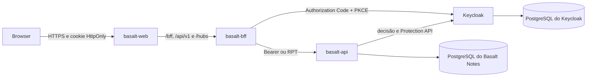

# Tutorial de configuração do Keycloak para o Basalt Notes

## 1. Objetivo e estado atual

Este tutorial ensina, passo a passo, como preparar o Keycloak necessário ao Basalt Notes, mesmo para quem nunca administrou um realm. Ele cobre laboratório local, realm, clients, usuários, autorização, produção, backup e diagnóstico.

O [plano do BFF com Keycloak](plan/bff-keycloak.md) está com status `proposed`. Este tutorial documenta a configuração inicial recomendada e não aprova o plano nem substitui o ADR pendente. Em especial:

- o laboratório permite preparar P-02;
- a autorização sintética permite iniciar o spike P-03;
- a escolha entre RPT/UMA e avaliação remota continua pendente;
- callbacks e tempos marcados como exemplos devem ser confirmados no ADR;
- a integração final depende de P-04, P-05 e P-06.

> **Regra de segurança:** nunca use o realm `master` como realm da aplicação. Um administrador humano pode entrar no `master` para administrar o servidor, mas BFF, API, usuários e credenciais pertencem ao realm `basalt-notes`.

## 2. O que cada componente faz



| Componente | Responsabilidade |
| --- | --- |
| Keycloak | Usuários, credenciais, MFA, sessões, roles, grupos, recursos, scopes e políticas. |
| `basalt-bff` | Login OIDC, callback, logout, cookie técnico e tokens no servidor. |
| `basalt-api` | Validação do token e aplicação da decisão antes do domínio. |
| Angular | Interface; nunca recebe access token ou refresh token. |
| PostgreSQL do Keycloak | Estado operacional do Keycloak; exige backup próprio. |
| PostgreSQL do Basalt Notes | Projeções; não armazena usuários, memberships ou políticas. |

Os bancos devem usar bancos, roles, senhas, backups e ciclos de vida distintos. Recomenda-se separá-los também por instância em produção.

## 3. Nomes usados neste guia

| Item | Valor do plano ou exemplo |
| --- | --- |
| Realm | `basalt-notes` |
| Client confidencial do BFF | `basalt-bff` |
| Client de recurso da API | `basalt-api` |
| Audience da API | `basalt-api` |
| Roles iniciais | `Owner`, `Editor`, `Reader` |
| Scopes de vault | `vault:read`, `vault:write`, `vault:manage`, `vault:delete` |
| Recurso sintético | `urn:basalt-notes:vault:00000000-0000-0000-0000-000000000001` |
| Keycloak real indicado | `https://credential.zocate.li` |
| Keycloak do laboratório | `http://localhost:8080` |
| BFF local de exemplo | `https://localhost:7443` |
| Origem pública de exemplo | `https://notes.example.com` |

Substitua `notes.example.com` pela origem pública aprovada. Não copie o recurso sintético para produção: a API registrará vaults por identificador opaco.

## 4. Pré-requisitos

Para o laboratório:

1. PowerShell 7 ou superior.
2. Docker com suporte a containers Linux.
3. Portas locais `8080` e `9000` livres.
4. Pelo menos 2 GiB de memória disponível.
5. Imagens `quay.io/keycloak/keycloak:26.7.0` e `postgres:18.4-bookworm`.

As tags foram verificadas em 29 de julho de 2026. Antes de promover outra versão, confirme licença, release notes, CVEs, compatibilidade e restauração. Keycloak usa Apache-2.0 e PostgreSQL usa PostgreSQL License.

Para o ambiente real, você também precisa de acesso administrativo a `https://credential.zocate.li`, DNS e TLS válidos, origem pública definitiva, cofre de secrets e autorização para criar realm, clients e credenciais.

## 5. Parte A: laboratório local descartável

O laboratório usa HTTP, `start-dev` e senhas mantidas somente no processo do PowerShell. Não o exponha à rede e não o trate como produção.

### 5.1 Definir valores sem gravar senhas no histórico

Diretório: fora do repositório. Impacto: variáveis somente na sessão atual.

```powershell
$KeycloakImage = 'quay.io/keycloak/keycloak:26.7.0'
$PostgresImage = 'postgres:18.4-bookworm'
$NetworkName = 'basalt-keycloak-lab'
$DatabaseContainer = 'basalt-keycloak-db'
$KeycloakContainer = 'basalt-keycloak'
$DatabaseVolume = 'basalt-keycloak-db-data'

$env:POSTGRES_PASSWORD = Read-Host 'Senha temporária do PostgreSQL' -MaskInput
$env:KC_DB_PASSWORD = $env:POSTGRES_PASSWORD
$env:KC_BOOTSTRAP_ADMIN_PASSWORD = Read-Host 'Senha temporária do admin' -MaskInput
```

Não use senhas reais nem reutilizadas.

### 5.2 Criar rede, volume e PostgreSQL

Impacto: cria recursos Docker locais persistentes.

```powershell
docker network create $NetworkName
docker volume create $DatabaseVolume

docker run --detach `
  --name $DatabaseContainer `
  --network $NetworkName `
  --env POSTGRES_PASSWORD `
  --env POSTGRES_USER=keycloak `
  --env POSTGRES_DB=keycloak `
  --volume "${DatabaseVolume}:/var/lib/postgresql" `
  --health-cmd "pg_isready -U keycloak -d keycloak" `
  --health-interval 5s `
  --health-timeout 5s `
  --health-retries 12 `
  $PostgresImage
```

Valide:

```powershell
docker inspect $DatabaseContainer --format '{{.State.Health.Status}}'
docker logs $DatabaseContainer --tail 30
```

Resultado esperado: `healthy`. A porta `5432` não é publicada no host.

### 5.3 Iniciar o Keycloak

```powershell
docker run --detach `
  --name $KeycloakContainer `
  --network $NetworkName `
  --publish 127.0.0.1:8080:8080 `
  --publish 127.0.0.1:9000:9000 `
  --env KC_BOOTSTRAP_ADMIN_USERNAME=admin `
  --env KC_BOOTSTRAP_ADMIN_PASSWORD `
  --env KC_DB=postgres `
  --env KC_DB_URL=jdbc:postgresql://basalt-keycloak-db:5432/keycloak `
  --env KC_DB_USERNAME=keycloak `
  --env KC_DB_PASSWORD `
  --env KC_HOSTNAME=http://localhost:8080 `
  --env KC_HEALTH_ENABLED=true `
  --env KC_METRICS_ENABLED=true `
  $KeycloakImage start-dev
```

Valide:

```powershell
docker logs $KeycloakContainer --tail 100
Invoke-RestMethod http://localhost:9000/health/ready
```

Resultado esperado: health com `status` igual a `UP`.

### 5.4 Entrar no console

1. Abra `http://localhost:8080/admin/`.
2. Entre com `admin` e a senha informada no terminal.
3. Confirme que o seletor mostra `master`.

Você está administrando o servidor, não configurando a aplicação. O próximo passo cria o limite correto.

## 6. Parte B: criar e proteger o realm

Os nomes dos menus correspondem ao Admin Console 26.7.0.

### 6.1 Criar o realm `basalt-notes`

1. No seletor de realm, clique em **Create realm**.
2. Em **Realm name**, informe `basalt-notes`.
3. Deixe **Enabled** ligado e clique em **Create**.
4. Confirme que o realm ativo é `basalt-notes`.

Valide o discovery:

```powershell
$Discovery = Invoke-RestMethod `
  http://localhost:8080/realms/basalt-notes/.well-known/openid-configuration
$Discovery.issuer
$Discovery.authorization_endpoint
$Discovery.token_endpoint
$Discovery.jwks_uri
```

O issuer local deve ser `http://localhost:8080/realms/basalt-notes`. Em produção, deve ser exatamente `https://credential.zocate.li/realms/basalt-notes`.

### 6.2 Aplicar política inicial de sessão

Em **Realm settings > Tokens**, use como baseline de não produção:

| Configuração | Valor inicial recomendado |
| --- | --- |
| Access Token Lifespan | 5 minutos |
| SSO Session Idle | 30 minutos |
| SSO Session Max | 10 horas |
| Client login timeout | 1 minuto |

Esses valores não são contrato aprovado. Access tokens curtos reduzem a janela após revogação, mas aumentam renovações e dependência do Keycloak.

### 6.3 Login, força bruta e MFA

1. Em **Realm settings > Login**, mantenha **User registration** desligado.
2. Ative **Forgot password** somente após configurar e testar SMTP.
3. Em **Realm settings > Security defenses > Brute force detection**, ative a proteção e valide bloqueio e desbloqueio.
4. Em **Authentication > Required actions**, habilite **Configure OTP**.
5. Exija OTP ao menos para administradores e `Owner` em produção.

MFA, cadastro e recuperação pertencem ao Keycloak ou IdP federado, nunca ao Basalt Notes.

## 7. Parte C: criar o resource server, roles e usuários

### 7.1 Criar `basalt-api`

1. Abra **Clients > Create client**.
2. Selecione `OpenID Connect` e use Client ID `basalt-api`.
3. Ligue **Client authentication**, **Authorization** e **Service account roles**.
4. Desligue **Standard flow**, **Direct access grants**, **Implicit flow** e grants não necessários.
5. Salve. Esse client não precisa de redirect URI.

### 7.2 Criar client roles e grupos

Em **Clients > basalt-api > Roles**, crie `Owner`, `Editor` e `Reader`.

Em **Groups**, crie:

```text
/basalt-notes
  /owners
  /editors
  /readers
```

Em cada subgrupo, abra **Role mapping > Assign role**, filtre por clients e associe a role correspondente do `basalt-api`.

### 7.3 Criar usuários sintéticos

| Username | Grupo | Uso esperado |
| --- | --- | --- |
| `owner-lab` | `/basalt-notes/owners` | todos os scopes |
| `editor-lab` | `/basalt-notes/editors` | leitura e escrita |
| `reader-lab` | `/basalt-notes/readers` | somente leitura |

Para cada usuário, defina senha fictícia temporária, associe o grupo e confirme a role efetiva. Adicione **Configure OTP** a `owner-lab` para validar MFA. Nunca use esses usuários em produção.

## 8. Parte D: configurar o client `basalt-bff`

### 8.1 Criar o client confidencial

1. Em **Clients > Create client**, selecione `OpenID Connect`.
2. Use Client ID `basalt-bff`.
3. Ligue **Client authentication** e apenas **Standard flow**.
4. Desligue direct grants, implicit, service account, device flow e grants não usados.
5. Em **Advanced settings**, configure PKCE como `S256`.
6. Não habilite offline access sem ADR e necessidade comprovada.

### 8.2 Cadastrar callbacks exatos

Enquanto o BFF local usar `https://localhost:7443`, configure:

| Campo | Valor de desenvolvimento |
| --- | --- |
| Root URL | `https://localhost:7443` |
| Home URL | `https://localhost:7443/` |
| Valid redirect URIs | `https://localhost:7443/signin-oidc` |
| Valid post logout redirect URIs | `https://localhost:7443/signout-callback-oidc` |
| Web origins | deixe vazio |

Para produção, substitua somente a origem:

```text
https://notes.example.com/signin-oidc
https://notes.example.com/signout-callback-oidc
```

Não use `*`, subdomínio curinga ou callback genérico. Como o Angular não chama o token endpoint, Web Origins normalmente fica vazio. Os paths são defaults planejados do middleware .NET; confirme-os em P-04.

### 8.3 Guardar o client secret

1. Abra **Clients > basalt-bff > Credentials**.
2. Copie o secret diretamente para o cofre de secrets.
3. Não o cole em issue, documentação, `.env`, imagem, log ou Git.
4. Restrinja a leitura ao deployment do BFF e aos operadores responsáveis.
5. Registre proprietário, criação e procedimento de rotação sem registrar o valor.

No laboratório, mantenha-o apenas na sessão:

```powershell
$env:BASALT_BFF_CLIENT_SECRET = Read-Host 'Client secret do BFF' -MaskInput
```

## 9. Parte E: configurar audience e claims mínimos

### 9.1 Criar o client scope de audience

1. Abra **Client scopes > Create client scope**.
2. Use `basalt-api-audience` e protocolo `OpenID Connect`.
3. Em **Mappers**, crie um mapper do tipo **Audience**.
4. Em **Included Client Audience**, escolha `basalt-api`.
5. Inclua no access token, não no ID token sem necessidade.
6. Em **Clients > basalt-bff > Client scopes**, adicione o scope como **Default**.

Depois da implementação do BFF, confirme localmente que:

- `iss` é exatamente o issuer configurado;
- `aud` contém `basalt-api`;
- `sub` existe e é tratado como identificador opaco;
- `exp` e `nbf` são coerentes;
- roles aparecem somente quando necessárias.

Nunca envie tokens reais a sites externos de decodificação nem registre seu payload em logs.

### 9.2 O que a API validará

A API deverá validar assinatura e algoritmo permitido, issuer, audience `basalt-api`, expiração, not-before, client, claims exigidos e permissão para o recurso e scope específicos.

Ter role `Owner`, `Editor` ou `Reader` não basta para acessar um vault. A API deve falhar fechada antes de consultar dados quando a decisão estiver ausente, expirada, negada ou indisponível.

## 10. Parte F: configurar Authorization Services

Esta seção usa um recurso sintético e prepara o spike. Ela não escolhe o transporte final da decisão.

### 10.1 Criar scopes e recurso

Ao habilitar Authorization Services, algumas versões do Keycloak criam um
recurso, uma política e uma permissão padrão. Antes de continuar:

1. revise **Resources**, **Policies** e **Permissions**;
2. remova os itens padrão que concedem acesso amplo;
3. confirme que nenhuma permissão se aplica automaticamente a todos os
  recursos;
4. mantenha somente os itens explícitos criados neste laboratório.

Sem essa limpeza, a avaliação pode permitir acesso por causa da configuração
padrão e mascarar erros nas políticas do Basalt Notes.

Em **Clients > basalt-api > Authorization > Authorization scopes**, crie:

```text
vault:read
vault:write
vault:manage
vault:delete
```

Em **Resources > Create resource**, configure:

| Campo | Valor |
| --- | --- |
| Name | `vault-lab-0001` |
| URI | `urn:basalt-notes:vault:00000000-0000-0000-0000-000000000001` |
| Scopes | os quatro scopes `vault:*` |

Não use nome, path ou título de nota. Recursos reais usarão IDs opacos e serão reconciliados pela API via Protection API.

### 10.2 Criar políticas por role

Em **Policies > Create policy > Role**, crie:

| Política | Client role exigida |
| --- | --- |
| `policy-owner` | `basalt-api / Owner` |
| `policy-editor` | `basalt-api / Editor` |
| `policy-reader` | `basalt-api / Reader` |

Cada política representa um perfil alternativo. Não marque as três roles como obrigatórias dentro da mesma política.

### 10.3 Criar permissões por scope

Em **Permissions > Create scope-based permission**, crie:

| Permissão | Recurso | Scope | Políticas permitidas |
| --- | --- | --- | --- |
| `vault-lab-read` | `vault-lab-0001` | `vault:read` | reader, editor, owner |
| `vault-lab-write` | `vault-lab-0001` | `vault:write` | editor, owner |
| `vault-lab-manage` | `vault-lab-0001` | `vault:manage` | owner |
| `vault-lab-delete` | `vault-lab-0001` | `vault:delete` | owner |

Em cada permissão, configure **Decision strategy** como `Affirmative`, para que
qualquer uma das políticas listadas possa conceder o scope. Não use
`Unanimous` nesse modelo e não aplique essas permissões a todos os recursos por
omissão.

### 10.4 Avaliar no console

Abra **Authorization > Evaluate** e avalie cada usuário contra o recurso e os scopes:

| Usuário | read | write | manage | delete |
| --- | --- | --- | --- | --- |
| `owner-lab` | permite | permite | permite | permite |
| `editor-lab` | permite | permite | nega | nega |
| `reader-lab` | permite | nega | nega | nega |

Faça também testes negativos: usuário sem grupo, recurso inexistente, scope divergente, remoção do grupo durante a sessão e Keycloak indisponível. A API futura deve negar, nunca aplicar fallback local. Registre tempos e comportamento de revogação como evidência do P-03, sem tokens ou dados sensíveis.

## 11. Parte G: credencial da Protection API

A API precisará de uma credencial de serviço para reconciliar somente os recursos do `basalt-api`.

1. Em **Clients > basalt-api > Credentials**, envie o secret ao cofre da API.
2. Em **Service account roles**, confirme somente as roles necessárias ao resource server, incluindo `uma_protection` quando aplicável à versão.
3. Não atribua `realm-management`, `admin`, `manage-realm` ou `manage-users`.
4. Teste que a credencial registra recurso do `basalt-api`.
5. Teste que ela não administra usuários, outro client ou outro realm.

O endpoint e o fluxo exatos serão implementados em P-03/P-05. Não adicione scripts com o secret ao repositório.

### 11.1 Atribuir o primeiro Owner real

O Basalt Notes não possui bootstrap de usuário. Para a primeira implantação:

1. um administrador autorizado cria ou localiza o usuário no Keycloak;
2. exige MFA e confirma que a identidade não é uma conta compartilhada;
3. associa o usuário ao grupo/role `Owner` aprovado;
4. concede somente as permissões dos vaults que ele administrará;
5. valida o acesso e registra a mudança nos eventos administrativos;
6. remove qualquer concessão temporária usada durante a implantação.

Não crie tabela local de usuários ou um endpoint de “primeiro administrador” no
Basalt Notes. Se não houver Owner válido, o acesso administrativo deve falhar
fechado e exigir intervenção do operador do Keycloak.

## 12. Parte H: configurar o ambiente real

### 12.1 Rede, TLS, hostname e proxy

Use imagem imutável, banco persistente e `start --optimized`:

| Opção | Diretriz |
| --- | --- |
| `KC_HOSTNAME` | `https://credential.zocate.li` |
| `KC_HTTP_ENABLED` | `true` somente atrás de proxy TLS confiável |
| `KC_PROXY_HEADERS` | `xforwarded` ou `forwarded`, conforme o proxy real |
| `KC_PROXY_TRUSTED_ADDRESSES` | IPs/CIDRs exatos dos proxies confiáveis |
| `KC_HEALTH_ENABLED` | `true` |
| `KC_METRICS_ENABLED` | `true` |
| `KC_DB` | `postgres` |
| `KC_DB_URL` | JDBC do banco dedicado, por configuração protegida |
| `KC_DB_USERNAME` | role dedicada sem privilégios administrativos |
| `KC_DB_PASSWORD` | secret injetado, nunca versionado |

Regras de exposição:

- publique somente HTTPS no proxy;
- não exponha PostgreSQL, porta `9000` ou HTTP interno;
- bloqueie acesso direto ao container;
- sobrescreva `Forwarded`/`X-Forwarded-*` no proxy;
- configure HSTS, `X-Content-Type-Options`, CSP e limites de request;
- mantenha relógio sincronizado em proxy, Keycloak, BFF e API.

Não copie mecanicamente `KC_PROXY_HEADERS=xforwarded`: confirme o header do proxy real. Erros produzem issuer incorreto, links HTTP, cookies inválidos e loops de login.

### 12.2 Remover o bootstrap permanente

`KC_BOOTSTRAP_ADMIN_*` serve apenas para a primeira inicialização:

1. inicie uma única vez com credencial temporária;
2. crie contas administrativas nominativas e de menor privilégio;
3. exija MFA e teste recuperação administrativa;
4. remova as variáveis do deployment e cofre temporário;
5. revogue a conta de bootstrap conforme o procedimento aprovado.

BFF e API nunca recebem uma conta do `master`.

### 12.3 Configurar SMTP e ambientes

Em **Realm settings > Email**, configure remetente, TLS e credencial vinda do cofre; envie um teste antes de habilitar recuperação ou verificação. Se o IdP federado controla credenciais, direcione a recuperação a ele.

Desenvolvimento, homologação e produção não compartilham usuários, secrets, callbacks ou banco. Prefira instalações separadas; no mínimo, use realms separados e documente o risco. Remova `localhost` dos callbacks de produção.

## 13. Contrato futuro do BFF e da API

| Consumidor | Configuração |
| --- | --- |
| BFF | Authority `https://credential.zocate.li/realms/basalt-notes` |
| BFF | Client ID `basalt-bff`, secret do cofre, Code + PKCE `S256` |
| API | Mesmo issuer e audience obrigatória `basalt-api` |
| API | Credencial de resource server para Protection API |
| API | Mapeamento endpoint -> recurso opaco + scope `vault:*` |

O cookie do BFF deve ser host-only, `Secure`, `HttpOnly` e ter `SameSite` explícito. Mutações e SignalR exigem antiforgery e validação de `Origin`. Cookies ou headers de identidade enviados pelo browser devem ser removidos antes do relay. Nenhum token aparece em URL, Web Storage, telemetria ou logs.

## 14. Backup, export e recuperação

O backup primário é o backup consistente do PostgreSQL do Keycloak. Export JSON é útil para configuração sanitizada e migração, mas não substitui backup transacional. Ambos podem conter dados e secrets e devem ser protegidos.

### 14.1 Backup do laboratório

Diretório: local seguro fora do Git.

```powershell
$BackupDirectory = Join-Path $HOME 'basalt-keycloak-backup'
New-Item -ItemType Directory -Force $BackupDirectory | Out-Null

docker exec $DatabaseContainer `
  pg_dump --username keycloak --format custom `
  --file /tmp/keycloak.dump keycloak
docker cp "${DatabaseContainer}:/tmp/keycloak.dump" `
  (Join-Path $BackupDirectory 'keycloak.dump')
docker exec $DatabaseContainer rm /tmp/keycloak.dump
```

Criptografe o dump antes de armazenar ou transportar.

### 14.2 Testar restauração

Crie rede e volume com nomes diferentes dos originais e inicie um PostgreSQL
isolado. Depois copie e restaure o dump:

```powershell
$RestoreContainer = 'basalt-keycloak-db-restore'
$RestoreVolume = 'basalt-keycloak-db-restore-data'

docker volume create $RestoreVolume
docker run --detach `
  --name $RestoreContainer `
  --network $NetworkName `
  --env POSTGRES_PASSWORD `
  --env POSTGRES_USER=keycloak `
  --env POSTGRES_DB=keycloak `
  --volume "${RestoreVolume}:/var/lib/postgresql" `
  $PostgresImage

docker cp (Join-Path $BackupDirectory 'keycloak.dump') `
  "${RestoreContainer}:/tmp/keycloak.dump"
docker exec $RestoreContainer `
  pg_restore --username keycloak --dbname keycloak `
  --clean --if-exists /tmp/keycloak.dump
```

Em seguida:

1. inicie a mesma versão do Keycloak contra o banco restaurado, usando outro
   nome e outras portas;
2. valide discovery, login, clients, roles, políticas e chaves;
3. registre duração, responsável, falhas e data;
4. remova o container e o volume de restauração após preservar a evidência.

Nunca teste restore sobrescrevendo produção. Execute backup e restauração representativa antes de atualizar Keycloak ou PostgreSQL.

Para export sanitizado, use o comando oficial `kc.sh export` com o servidor parado ou em container separado. Remova usuários, secrets e dados reais antes de versionar. O provisioning declarativo ainda será definido no ADR; não adicione export real ao Git.

## 15. Rotação e revogação

Para client secrets:

1. confirme backup, responsável e janela;
2. gere a nova credencial;
3. atualize o cofre e o consumidor;
4. valide login ou Protection API;
5. revogue a antiga e confirme sua rejeição;
6. registre evidência sem os valores.

Se não houver sobreposição de secrets, trate como mudança coordenada com rollback. Para chaves de assinatura, preserve a chave anterior até expirarem os tokens emitidos por ela e valide o JWKS.

Teste logout atual, todas as sessões, remoção de grupo/role/permissão, desabilitação de usuário e indisponibilidade. O P-03 deve medir quando cada revogação se torna efetiva. Não crie permissão local como fallback.

## 16. Checklist de validação

### 16.1 Realm e OIDC

- [ ] Discovery responde pelo realm `basalt-notes`.
- [ ] Issuer usa HTTPS e hostname canônico em produção.
- [ ] Nenhuma aplicação usa o realm `master`.
- [ ] Login, callback, renovação, logout e revogação foram testados.
- [ ] Redirect URIs são exatas e não contêm curingas.
- [ ] Token com issuer, audience ou client incorreto é rejeitado.
- [ ] Tokens não aparecem no Angular, URL, armazenamento ou logs.

### 16.2 Autorização

- [ ] Audience `basalt-api` aparece no access token correto.
- [ ] `Reader` lê e não escreve.
- [ ] `Editor` lê/escreve e não gerencia/exclui.
- [ ] `Owner` recebe os quatro scopes no recurso permitido.
- [ ] Usuário sem associação recebe negação.
- [ ] Recurso, scope ou vault divergente recebe negação.
- [ ] Indisponibilidade do Keycloak falha fechada.
- [ ] Credencial da Protection API não administra realm ou usuários.

### 16.3 Operação e segurança

- [ ] Admins nominativos usam MFA; bootstrap foi removido.
- [ ] PostgreSQL e porta `9000` não são públicos.
- [ ] Proxy confia somente nos endereços configurados.
- [ ] Secrets vêm do cofre e não existem no Git ou imagem.
- [ ] SMTP, brute force e tempos de sessão foram testados.
- [ ] Backup está criptografado e restore foi provado.
- [ ] Rotação de secret e chave foi ensaiada.
- [ ] Métricas não registram tokens ou claims sensíveis.
- [ ] SBOM, licença e vulnerabilidades foram verificados.

## 17. Diagnóstico de erros comuns

| Sintoma | Causa provável | Verificação/correção |
| --- | --- | --- |
| `invalid_redirect_uri` | Callback diferente | Compare esquema, host, porta, path e barra final; não use `*`. |
| Loop entre app e login | Hostname/proxy/cookie | Confira `KC_HOSTNAME`, headers, HTTPS e cookie. |
| Issuer inválido | URL interna ou proxy | Compare `iss` com a Authority exatamente. |
| Token sem `basalt-api` em `aud` | Mapper ausente | Confirme mapper e scope default do `basalt-bff`. |
| `403` inesperado | Recurso/scope/policy/role | Use **Evaluate** e confira role herdada. |
| Reader escreve | Permissão excessiva | Revise scope-based permission e políticas. |
| Health retorna `404` | Health ou porta | Habilite health e consulte a porta `9000`. |
| Banco não conecta | Host/rede/credencial | Use nome do container na JDBC e consulte logs. |
| Container encerra | Configuração/migração | Leia o primeiro erro; não apague o banco. |
| Local funciona, produção falha | TLS/DNS/headers | Valide discovery externo e bloqueie bypass. |
| Role demora a revogar | Token/RPT/cache | Meça no P-03; não masque com autorização local. |
| CORS no browser | Endpoint indevido | Angular chama o BFF, não o token endpoint. |

## 18. Limpar o laboratório

Impacto: remove todos os dados do laboratório. Confirme os nomes antes.

```powershell
docker rm --force $KeycloakContainer $DatabaseContainer
docker network rm $NetworkName
docker volume rm $DatabaseVolume

Remove-Item Env:POSTGRES_PASSWORD -ErrorAction SilentlyContinue
Remove-Item Env:KC_DB_PASSWORD -ErrorAction SilentlyContinue
Remove-Item Env:KC_BOOTSTRAP_ADMIN_PASSWORD -ErrorAction SilentlyContinue
Remove-Item Env:BASALT_BFF_CLIENT_SECRET -ErrorAction SilentlyContinue
```

Não execute esses comandos contra o ambiente real.

## 19. Próximos passos do plano

1. Registre evidência de discovery, login, logout, audience e permissões.
2. Aprove realm, callbacks, tempos, origem e operação no ADR.
3. Execute P-03 comparando RPT/UMA e avaliação remota.
4. Somente depois implemente BFF P-04 e API P-05.
5. Adicione Playwright, integração, rotação e recuperação antes de P-07.

Não marque etapas como `completed` apenas por configurar o console. A conclusão exige as evidências do plano e decisão humana.

## 20. Referências oficiais

Fontes consultadas em 29 de julho de 2026:

- [Running Keycloak in a container](https://www.keycloak.org/server/containers)
- [Configuring the database](https://www.keycloak.org/server/db)
- [Configuring the hostname](https://www.keycloak.org/server/hostname)
- [Configuring a reverse proxy](https://www.keycloak.org/server/reverseproxy)
- [Bootstrapping and recovering an admin account](https://www.keycloak.org/server/bootstrap-admin-recovery)
- [Importing and exporting realms](https://www.keycloak.org/server/importExport)
- [Authorization Services Guide](https://www.keycloak.org/docs/latest/authorization_services/)
- [Server Administration Guide](https://www.keycloak.org/docs/latest/server_admin/)

Referências do Basalt Notes:

- [Plano mestre](../README.md)
- [Plano do BFF com Keycloak](plan/bff-keycloak.md)
- [Implementação do backend](backend.md)
- [Implementação do frontend](frontend.md)