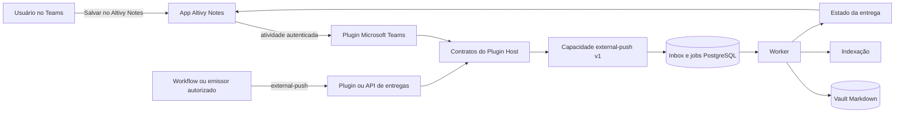

# Plano: Plataforma de plugins e plugin Microsoft Teams

**Status:** approved  
**Data de criação:** 2026-08-15  
**Última atualização:** 2026-08-31
**Responsáveis:** não atribuídos  
**Origem:** IA assistida  
**Revisor humano:** Lincoln Zocateli  
**Relacionado:** [integração de notas de reunião do Microsoft Teams](integracao-teams-notas-reuniao.md) e [ADR 2026-0003](../adr/2026-0003-app-teams-external-push.md)

## Objetivo

Entregar a primeira fundação plugável do Altivy Notes e validá-la com o plugin
**Microsoft Teams**, permitindo ao usuário enviar, por ação explícita, uma
mensagem ou conteúdo digitado para um documento Markdown em um vault autorizado,
sem exigir permissão de leitura no Microsoft Graph.

Entregar também o modo de integração `external-push`: um contrato de ingestão
autenticado, idempotente e durável pelo qual o app do Teams, um Workflow ou
outro emissor previamente autorizado envia conteúdo completo ao Altivy. Esse
modo complementa, mas não substitui, a sincronização automática de documentos
Loop descrita no plano relacionado. A fundação deve permitir adicionar outras
integrações confiáveis por manifesto, capacidades e contratos versionados, sem
alterar o núcleo de Notes, Vaults ou Indexing.

Além de ingressos, a fundação deve suportar conectores que consultam providers
por tráfego exclusivamente de saída. Assim, integrações futuras com Google
Calendar e calendários do Outlook/Microsoft Graph poderão usar sincronização
incremental por polling em instalações privadas, deixando webhooks públicos
como aceleração opcional quando o operador aceitar essa exposição.

## Resultado esperado

O fluxo principal será uma message extension baseada em bot, com a ação
**Salvar no Altivy Notes** disponível sobre uma mensagem e na área de composição. A
ação abrirá um dialog para confirmar título, destino lógico e conteúdo. Após a
confirmação, o Teams enviará a solicitação ao endpoint HTTPS do Altivy, que a
persistirá antes de responder e processará a gravação em segundo plano.



## Contexto e premissas

- O app oferece importação iniciada pelo usuário; ele não observa alterações
  no painel **Notes** nem lê arquivos `.loop` silenciosamente.
- Uma action command de message extension pode ser acionada sobre uma mensagem
  e receber seu conteúdo no payload enviado ao bot.
- Conteúdo do Loop deve ser copiado ou fornecido pelo usuário quando o tenant
  não conceder acesso ao Microsoft Graph.
- O app não solicitará permissões Graph para a entrega inicial.
- O app do Teams é um pacote com manifesto e ícones; sua lógica permanece
  hospedada pelo operador do Altivy e acessível por HTTPS.
- A instalação precisa permitir upload ou distribuição administrativa de app
  personalizado no tenant Microsoft 365.
- O endpoint do bot precisa ser alcançável pela infraestrutura do Teams. Uma
  implantação totalmente privada, sem entrada HTTPS pública ou relay aprovado,
  não suporta o app diretamente.
- O schema de manifesto deve ser a versão GA mais recente compatível no início
  da implementação. Na data deste plano, a referência publicada é 1.30.
- O Teams SDK para C# é o candidato preferencial por alinhamento com .NET 10,
  mas versão, licença, manutenção e compatibilidade serão comprovadas antes da
  adoção.
- O Keycloak continua sendo a autoridade de identidade e autorização do
  Altivy. Identidade, e-mail ou nome exibido pelo Teams não concedem acesso a
  vaults.
- O app e o `external-push` serão entregues como o primeiro plugin confiável;
  API e worker permanecem composition roots do monólito modular. Não será
  criado um microsserviço.
- Plugins são módulos versionados presentes na distribuição, instalados e
  habilitados pelo operador. Não há upload ou execução dinâmica de código.
- O núcleo conhece contratos e capacidades, não protocolos ou SDKs de
  fornecedores. Plugins dependem dos contratos do host; somente composition
  roots podem referenciar implementações concretas para registrá-las.
- O manifesto declara ID, versão, compatibilidade, capacidades, configuração,
  endpoints, jobs e scopes. Desabilitar o plugin remove seus ingressos e jobs.
- Markdown no filesystem continua sendo a fonte canônica após a ingestão; o
  PostgreSQL mantém estado técnico, inbox, jobs e projeções reconstruíveis.
- A entrega externa possui semântica at-least-once. Idempotência, conflito e
  reconciliação são obrigatórios.
- O recurso é candidato da Fase 5 e não bloqueia o MVP.

## Capacidades planejadas

### Capacidades neutras do Plugin Host

- `external-push/v1`: recebe conteúdo enviado por produtor autorizado;
- `external-pull/v1`: consulta mudanças incrementais no provider pelo worker,
  com cursor, retry, backoff e reconciliação duráveis;
- `subscription-webhook/v1`: recebe somente um sinal autenticado de mudança,
  persiste-o rapidamente e delega a busca do conteúdo ao worker;
- `external-action/v1`: executa uma ação explícita de saída no provider com
  escopo e idempotência controlados.

O plugin é o código confiável presente na distribuição. Uma conexão é a
configuração de uma conta, tenant ou serviço externo e referencia secrets fora
do banco. Cada plugin declara apenas as capacidades que implementa; habilitar
uma conexão não amplia automaticamente seus scopes.

| Integração candidata | Operação privada preferencial | Entrada pública | Observação |
| --- | --- | --- | --- |
| Microsoft Teams interativo | não atende à interação do bot | obrigatória para callback | app e bot registrados no tenant |
| Microsoft Graph/Outlook Calendar | `external-pull` com delta/polling | opcional para change notifications | OAuth/consentimento e scopes mínimos |
| Google Calendar | `external-pull` com sync token/polling | opcional para push notifications | OAuth/consentimento e quotas do provider |

Esta matriz orienta a extensibilidade, mas não aprova nem inclui os dois
plugins de calendário nesta entrega.

### Baseline do app Altivy Notes

- message extension baseada em bot com action command **Salvar no Altivy Notes**;
- acionamento a partir de uma mensagem existente ou da área de composição;
- dialog com título, conteúdo, alias de destino e modo de gravação permitido;
- confirmação assíncrona com estado recebido, processado, rejeitado ou em
  conflito;
- conversa pessoal opcional para ajuda, vinculação e consulta das entregas
  recentes;
- pacote organizacional com manifesto, ícones, política de privacidade, termos
  e informações de suporte.

### Produtores external-push

- app oficial Altivy Notes para Microsoft Teams;
- Workflow ou Power Automate que já possua um gatilho e o conteúdo completo;
- Outgoing Webhook do Teams como fallback manual limitado;
- automações corporativas autorizadas por credencial de serviço;
- outros providers somente após registro, threat model e contrato compatível.

## Limitações explícitas

- O app não sincroniza automaticamente Meeting Notes ou componentes Loop.
- O app não acessa chat, roster, arquivos, transcrições ou gravações sem API e
  permissões adicionais aprovadas em outro plano.
- O conteúdo de uma mensagem pode conter apenas o que estava visível e foi
  enviado na interação; anexos e referências externas não são dereferenciados.
- O `external-push` não oferece polling, delta, confirmação de estado da origem
  nem recuperação automática de eventos nunca enviados pelo produtor.
- Uma entrega aceita pelo Altivy não prova que o emissor manterá histórico ou
  tentará novamente após falha permanente.
- Outgoing Webhook exige `@mention`, funciona em canal público, é configurado
  por equipe e não oferece a experiência completa do app.

## Não escopo

- sincronização automática Loop → Altivy, coberta pelo plano relacionado;
- sincronização Altivy → Teams ou edição bidirecional;
- leitura do Microsoft Graph, permissões Graph delegadas ou de aplicação;
- captura invisível de todas as mensagens de canais, chats ou reuniões;
- importação automática de anexos, transcrições, gravações ou resumo do
  Copilot;
- publicação inicial no Microsoft commercial marketplace ou Teams Store;
- app para Outlook ou outros hosts Microsoft 365 na primeira entrega;
- agente de IA, MCP, modelo de linguagem ou processamento semântico do
  conteúdo;
- relay SaaS obrigatório, broker externo ou armazenamento fora do vault e do
  PostgreSQL existentes;
- endpoint aberto que aceite paths físicos ou escolha arbitrária de vault pelo
  produtor;
- exclusão remota de documentos Markdown por uma entrega externa.
- compatibilidade de API ou binária com plugins do Obsidian;
- marketplace, download de plugin em runtime ou execução arbitrária de
  JavaScript, assemblies e scripts de terceiros;
- sandbox de código não confiável e plugins externos fora da distribuição;
- hot reload de plugin sem restart ou atualização da distribuição.

## Decisões arquiteturais propostas

### Plataforma e forma do app

A plataforma usa plugins confiáveis in-process, compostos por allowlist no
build. `Plugin.Abstractions` define manifesto, compatibilidade, capacidades e
lifecycle sem depender de ASP.NET Core, EF Core, filesystem ou SDK externo.
Capacidades de aplicação, começando por `external-push/v1`, expõem portas
estreitas para inbox, autorização, auditoria, telemetria, secrets referenciados
e jobs. Plugins não recebem `DbContext`, path físico ou acesso direto ao vault.

Estados previstos são disponível, habilitado, degradado, desabilitado e
removido. ID duplicado, versão incompatível ou capacidade desconhecida falham
no startup. Plugin opcional indisponível possui health próprio e não torna o
núcleo indisponível. Instalação de código exige uma distribuição compatível;
ativação e desativação são operações administrativas auditadas e exigem
restart na primeira versão para recompor endpoints e jobs.

A baseline recomendada é uma message extension baseada em bot porque action
commands suportam invocação sobre mensagens, dialogs e fluxos interativos. Uma
message extension puramente baseada em API será reavaliada na POC, mas não é a
baseline enquanto não suportar o mesmo action command sem perda funcional.

O plugin `altivy.integrations.microsoft-teams` conterá adapter, manifesto,
ícones, localizações e empacotamento. A capacidade reutilizável ficará em
`Altivy.Backend.Application`; validação do protocolo Teams e seu SDK ficam na
implementação do plugin; `backend/apps/api` e `backend/apps/worker` apenas
compõem explicitamente plugins permitidos e fornecem contratos do host. Essa
referência no composition root não autoriza Domain, Application ou outro plugin
a depender da implementação Teams.

Essa estrutura é proposta e deverá ser confirmada por ADR antes de criar os
projetos físicos.

### Fronteiras HTTP

Serão separados três contratos:

1. callback do protocolo do bot, autenticado conforme o Teams/Bot Framework;
2. recurso público `external-push`, autenticado pelo Keycloak para produtores
   de serviço;
3. recursos administrativos e de consulta usados pelo usuário via BFF.

O callback não gravará arquivos nem executará conversões no caminho síncrono.
Após validar autenticidade, autorização, tamanho e formato, persistirá uma
entrega na inbox e responderá dentro do limite da plataforma.

Uma instalação escolhe explicitamente um perfil de rede:

- `private-egress-only`: não registra ingressos de plugin; jobs do worker
  consultam providers permitidos e o proxy não publica rotas técnicas;
- `public-callbacks`: permite habilitar separadamente callback de bot, callback
  de subscription e `external-push`; BFF administrativo, API interna, worker,
  PostgreSQL e vault continuam privados.

O perfil público exige TLS, validação da garantia realmente oferecida pelo
provider, allowlist de tenant/app, rate limiting, limite de body, idempotência,
inbox durável e telemetria sem conteúdo. Um callback é apenas sinal até o
worker buscar os dados pela API autenticada. O perfil privado troca menor
superfície exposta por maior latência e consumo de quota de polling.

OAuth é configuração da conexão, não uma capacidade de acesso ao vault. O
browser pode retornar a uma URL do Altivy alcançável pelo usuário, ou o plugin
pode usar fluxo de dispositivo se o provider o suportar oficialmente. Redirect
URIs, consentimento, renovação e armazenamento de refresh token devem ser
provados separadamente para cada provider. Authorization Code exige `state`
imprevisível, PKCE, redirect URI exata, expiração, consumo único e vínculo com
a sessão administrativa, conexão e provider. Tokens rotacionáveis ficam em
secret store gravável e protegido; o banco guarda somente referência opaca.

### Envelope external-push

O contrato final será definido em OpenAPI. O envelope conceitual mínimo é:

```json
{
  "source": "teams-app",
  "sourceEventId": "evento-opaco-123",
  "sourceDocumentId": "documento-opaco-456",
  "occurredAt": "2026-08-15T14:30:00Z",
  "destinationAlias": "reunioes-equipe",
  "mode": "upsert",
  "title": "Revisão semanal",
  "contentType": "text/markdown",
  "content": "## Decisões\n\n- Manter o rollout gradual."
}
```

Regras propostas:

- `sourceEventId` e `Idempotency-Key` identificam a tentativa lógica;
- `sourceDocumentId` estabiliza upserts sem expor path físico;
- `destinationAlias` referencia um mapping previamente autorizado;
- `mode` inicia apenas com `create` e `upsert`; `delete` é proibido;
- `contentType` inicia com `text/markdown` e `text/plain`;
- `content` possui limite configurável e nunca aparece em logs;
- `occurredAt` não substitui o timestamp de recebimento do servidor;
- campos desconhecidos seguem política de compatibilidade documentada;
- resposta de criação usa `202 Accepted` e `Location` para o estado da
  entrega;
- replay com a mesma chave e mesmo hash retorna a entrega original;
- mesma chave com conteúdo diferente retorna conflito explícito.

### Identidade e autorização

- O token do Bot Framework prova a origem da atividade, mas não concede acesso
  a vaults.
- O usuário deve autenticar no Altivy pelo Keycloak e vincular a identidade do
  Teams por um fluxo explícito e revogável.
- A POC comparará OAuth interativo no bot/dialog com vinculação por código de
  uso único gerado em uma sessão Altivy autenticada.
- Códigos de vinculação serão curtos em validade, uso único, armazenados por
  hash e vinculados ao tenant e ao identificador estável do Teams.
- O Altivy não criará usuários nem copiará memberships. A API consultará a
  decisão vigente do Keycloak antes de expor destinos e aceitar uma entrega.
- Produtores genéricos usarão cliente de serviço e scopes do Keycloak. HMAC de
  protocolo, quando obrigatório para um provider como Outgoing Webhook, prova
  integridade da mensagem, mas não substitui a autorização do recurso de
  integração.
- Nome, e-mail, team ID, channel ID e demais claims recebidos são dados não
  confiáveis e não são usados isoladamente como chave de autorização.

### Destino e escrita

- O produtor envia somente um alias opaco; nunca envia path físico.
- O mapping resolve integração, vault, pasta permitida, template e modo de
  escrita após autorização.
- `create` gera um documento novo com nome normalizado e resolução de colisão.
- `upsert` usa provider, conexão e `sourceDocumentId` como identidade estável.
- Alteração local concorrente nunca é sobrescrita silenciosamente; a entrega
  entra em conflito e preserva a versão recebida para resolução autorizada.
- O documento registra no frontmatter apenas proveniência técnica necessária,
  sem token, secret ou identificador pessoal desnecessário.

## Dependências e decisões

- Revisar e aprovar o ADR proposto da plataforma de plugins, do primeiro plugin
  Teams, `external-push`, autenticação, exposição HTTPS e rollback.
- Fixar contrato mínimo de `PluginManifest`, compatibilidade do host,
  capacidades e lifecycle antes de criar qualquer plugin concreto.
- Definir testes de arquitetura para impedir dependência do host em plugins,
  acesso direto a Infra.Data/filesystem e vazamento de SDK de fornecedor.
- Atualizar o threat model para conteúdo externo, spoofing, replay, confused
  deputy, autorização horizontal, abuso de payload e comprometimento do bot.
- Validar em tenant de teste a política de upload de apps personalizados, o
  registro do bot e os scopes suportados.
- Definir se o endpoint do Teams será publicado pelo proxy existente ou por
  rota técnica dedicada, sem expor toda a API interna.
- Verificar versão exata, licença permissiva, vulnerabilidades e manutenção do
  Teams SDK e de qualquer biblioteca de Adaptive Cards antes da inclusão.
- Criar contratos em `contracts/openapi` antes dos endpoints.
- Registrar recursos e scopes de integração no Keycloak por processo
  idempotente e reconciliável.
- Manter secrets do bot e chaves de providers em arquivos montados ou secret
  store operacional, nunca no banco, manifesto, imagem ou Git.
- Definir retenção de payload da inbox e de versões em conflito com aprovação
  de segurança e privacidade.

## Etapas

### P-01: Registrar arquitetura e threat model

**Status:** in-progress  
**Responsável:** IA assistida  
**Dependências:** nenhuma

**Objetivo:** estabelecer fronteiras, responsabilidades e condições de
interrupção antes de registrar o app ou adicionar dependências.

Entregas:

- ADR proposto para plataforma de plugins, primeiro plugin Teams e
  `external-push`;
- comparação entre plugin confiável in-process, processo externo e
  carregamento dinâmico de código de terceiros;
- contratos, lifecycle, compatibilidade, capabilities e limites de isolamento;
- comparação entre message extension baseada em bot, API-based message
  extension, bot conversacional e Outgoing Webhook;
- decisão preliminar sobre host, exposição HTTPS e ausência de microsserviço;
- threat model com fluxos, ativos, atores, trust boundaries e abuso;
- critérios para operar sem Graph e para migrar futuramente ao modo Loop.

Validação:

- ADR segue o template e permanece `proposed`;
- decisão não promete sandbox, marketplace ou compatibilidade com Obsidian;
- núcleo depende somente de abstrações/capacidades, nunca do plugin Teams;
- threat model cobre spoofing, replay, adulteração, exfiltração, confused
  deputy, elevação de privilégio e indisponibilidade;
- revisão humana confirma que o modo manual não é descrito como sincronização.

Evidências:

- ADR proposto criado em
  [2026-0003-app-teams-external-push.md](../adr/2026-0003-app-teams-external-push.md),
  cobrindo comparação entre message extension baseada em bot, API-based,
  bot conversacional e Outgoing Webhook, além das opções de execução de plugin;
  decisão preliminar por plugin confiável in-process no monólito modular, três
  fronteiras HTTP isoladas (callback do bot, `external-push`, recursos via
  BFF), catálogo allowlist, manifesto, capacidades e lifecycle;
- threat model verificável registrado no ADR com ativos, atores, fronteiras,
  fluxos, ameaças, controles e evidências para spoofing, replay, adulteração,
  exfiltração, elevação horizontal, confused deputy, indisponibilidade e supply
  chain;
- gates formais documentados para comprovar operação sem Microsoft Graph e para
  exigir novo ADR/threat model antes de sincronização automática de Loop;
- **pendente:** revisão humana do ADR (permanece `proposed`) e confirmação de
  que o modo manual não será apresentado como sincronização.

### P-02: Provar a experiência no tenant de teste

**Status:** not-started  
**Responsável:** não atribuído  
**Dependências:** P-01

**Objetivo:** confirmar que o Teams entrega o conteúdo necessário e que o fluxo
é permitido pelas políticas reais do tenant sem Microsoft Graph.

Entregas:

- tenant e equipe de teste com conteúdo sintético;
- app mínimo com action command sobre mensagem e na área de composição;
- dialog mínimo para editar título, destino e conteúdo;
- captura dos identificadores estáveis disponíveis na atividade;
- matriz de comportamento em chat pessoal, group chat, canal público, privado,
  compartilhado e reunião;
- relatório de limites de payload, timeout e compatibilidade desktop, web e
  mobile.

Validação:

- instalar o pacote por sideload ou catálogo organizacional;
- invocar a ação a partir de uma mensagem e receber seu conteúdo esperado;
- enviar texto digitado sem depender de uma mensagem existente;
- comprovar ausência de chamada e permissão Microsoft Graph;
- registrar contextos não suportados em vez de presumir equivalência.

Evidências:

- pendente.

### P-03: Executar o gate G1 de forma do app

**Status:** not-started  
**Responsável:** revisor humano pendente  
**Dependências:** P-02

**Objetivo:** escolher a menor capacidade do Teams que entregue a experiência
necessária com suporte oficial e risco aceitável.

Entregas:

- decisão entre message extension baseada em bot e alternativa comprovada;
- definição dos scopes Teams suportados na primeira versão;
- decisão sobre conversa pessoal e dialog;
- versão GA do schema de manifesto selecionada;
- atualização do ADR e das limitações deste plano.

Validação:

- action command sobre mensagem funciona sem Graph;
- a opção escolhida tem documentação estável e SDK com licença compatível;
- recursos em preview não são requisito da baseline;
- decisão e aprovação humanas ficam referenciadas.

Evidências:

- pendente; exige decisão humana registrada.

### P-04: Definir o contrato external-push

**Status:** not-started  
**Responsável:** não atribuído  
**Dependências:** P-01, P-03

**Objetivo:** especificar uma API de entregas independente do Teams, segura e
compatível com processamento assíncrono.

Entregas:

- recursos OpenAPI para fontes, mappings, entregas e estado;
- envelope versionado com IDs opacos, timestamps UTC, conteúdo e metadados
  mínimos;
- semântica de `create`, `upsert`, idempotência, dedupe e conflito;
- `202 Accepted`, `Location`, retry e `application/problem+json`;
- limites de tamanho, content types e rate limiting;
- política expand-contract e exemplos sintéticos.

Validação:

- lint e testes de contrato OpenAPI;
- rotas usam substantivos e semântica HTTP;
- nenhum request aceita path físico, vault arbitrário, token no payload ou URL
  pré-autenticada;
- replay igual converge para a mesma entrega e replay divergente conflita;
- cliente gerado compila sem edição manual.

Evidências:

- pendente.

### P-05: Implementar a fundação de plugins e conexões

**Status:** not-started  
**Responsável:** não atribuído  
**Dependências:** P-04

**Objetivo:** implementar contratos e lifecycle da plataforma e representar
conexões, entregas e cursores sem acoplamento ao protocolo Teams.

Entregas:

- projeto de abstrações com `PluginManifest`, versão do contrato, capabilities,
  configuração declarada e interfaces estreitas do host;
- contratos neutros para `external-push`, `external-pull`,
  `subscription-webhook` e `external-action`, sem exigir que todo plugin
  implemente todos eles;
- catálogo allowlist, validação de ID/versão/compatibilidade/capabilities e
  ativação administrativa idempotente;
- registro condicional de endpoints e jobs somente para plugin habilitado;
- plugin sintético de teste sem dependência de fornecedor;
- modelos `ExternalSourceConnection`, `IntegrationMapping`, `InboundDelivery`,
  `ExternalCursor`, `ExternalSubscription`, `ExternalActorLink` e
  `DeliveryAttempt` ligados a `pluginId`;
- estados recebido, aceito, processando, concluído, rejeitado, conflito,
  retry e dead letter;
- persistência de hashes, idempotency key, source IDs, destino lógico, lease e
  timestamps;
- migration expand-contract no PostgreSQL;
- retenção configurável para payload e tentativas;
- referência externa a secrets, sem material secreto no banco.

Validação:

- testes de arquitetura impedem dependência das abstrações em plugins,
  ASP.NET Core, EF Core e filesystem, e impedem acesso do plugin a Infra.Data;
- testes de contrato aceitam plugin sintético compatível e rejeitam ID
  duplicado, versão incompatível e capability desconhecida;
- plugin desabilitado não registra rota, job nem conexão externa;
- plugin apenas com `external-pull` não registra endpoint público, e o perfil
  `private-egress-only` rejeita capability que exija ingress;
- testes de OAuth rejeitam `state` ausente, cruzado ou repetido, redirect URI
  divergente e troca de authorization code; rotação de token não grava segredo
  no banco, UI, logs ou backup comum;
- testes unitários de invariantes e transições;
- testes com PostgreSQL real para unicidade, lease, retry e concorrência;
- migration de ida e compatibilidade com a versão anterior;
- inspeção confirma ausência de credenciais e conteúdo em colunas de log ou
  auditoria.

Evidências:

- pendente.

### P-06: Implementar autenticação e vinculação de identidade

**Status:** not-started  
**Responsável:** não atribuído  
**Dependências:** P-03, P-05

**Objetivo:** associar uma interação válida do Teams a uma identidade e a um
recurso autorizados pelo Keycloak, sem confiar em dados de exibição.

Entregas:

- validação de issuer, audience, assinatura, expiração e demais claims do
  protocolo do bot;
- POC de OAuth do usuário contra o Keycloak no fluxo Teams;
- fallback de vinculação explícita por código de uso único, se aprovado;
- vínculo revogável entre tenant/usuário Teams e referência técnica ao `sub`;
- recursos e scopes Keycloak para administrar e usar mappings;
- revalidação de autorização antes de listar destinos e aceitar conteúdo;
- fluxo de desvinculação, revogação e expiração.

Validação:

- tokens inválidos, tenant divergente e replay são rejeitados;
- código expira, funciona uma única vez e é armazenado apenas por hash;
- usuário sem permissão não descobre vault, mapping ou entrega;
- revogação no Keycloak bloqueia nova entrega sem remover histórico;
- nomes e e-mails do Teams não são usados como decisão de acesso.

Evidências:

- pendente.

### P-07: Implementar o ingress external-push

**Status:** not-started  
**Responsável:** não atribuído  
**Dependências:** P-04, P-05, P-06

**Objetivo:** receber conteúdo de produtores autorizados, persistir rapidamente
e desacoplar o request da escrita no filesystem.

Entregas:

- endpoints de criação e consulta de entregas;
- autenticação Keycloak para produtores de serviço;
- validação de schema, content type, tamanho, timestamp e alias;
- rate limit por conexão e limites globais defensivos;
- cálculo de hash e dedupe transacional;
- persistência na inbox antes de `202 Accepted`;
- correlation ID, métricas e auditoria sem conteúdo integral.

Validação:

- requests sem token, scope ou mapping válido falham fechados;
- payload excessivo é rejeitado antes de alocação descontrolada;
- falha após persistência pode ser retomada pelo worker;
- execução concorrente com a mesma chave cria uma única entrega;
- logs e traces não contêm corpo, secret ou token.

Evidências:

- pendente.

### P-08: Criar o primeiro pacote de plugin e o app do Teams

**Status:** not-started  
**Responsável:** não atribuído  
**Dependências:** P-03, P-06

**Objetivo:** produzir um app instalável, versionado e configurável sem incluir
secrets no pacote.

Entregas:

- manifesto do plugin `altivy.integrations.microsoft-teams`, declarando
  versão, compatibilidade, `external-push/v1`, configuração, endpoints e jobs;
- registro do plugin no catálogo de build sem referência inversa do host;
- registro da identidade do bot para tenant de teste;
- manifesto na versão GA selecionada;
- configuração de bot, compose extension, scopes e valid domains mínimos;
- ícones colorido e outline conforme requisitos do Teams;
- strings e descrições em português brasileiro;
- URLs de privacidade, termos, suporte e documentação;
- templates por ambiente sem IDs ou hosts reais versionados indevidamente;
- processo reproduzível para validar e gerar o arquivo ZIP.

Validação:

- schema e validador oficial aceitam o manifesto;
- ZIP contém somente manifesto e assets esperados;
- distribuição sem o plugin continua compilando e operando o núcleo;
- versão incompatível do plugin é rejeitada com diagnóstico seguro;
- nenhum secret, certificado, token ou URL interna aparece no pacote;
- instalação funciona no tenant de teste;
- versão do pacote e compatibilidade de upgrade são verificadas.

Evidências:

- pendente.

### P-09: Implementar o adapter no plugin Teams

**Status:** not-started  
**Responsável:** não atribuído  
**Dependências:** P-06, P-07, P-08

**Objetivo:** traduzir atividades do Teams para o caso de uso comum de entrega
sem incorporar regras de Notes no endpoint do bot.

Entregas:

- endpoint HTTPS específico para atividades do Teams;
- handlers para action command, abertura e submissão do dialog;
- normalização de mensagem selecionada e entrada digitada;
- resolução do vínculo e dos aliases autorizados;
- criação de `InboundDelivery` pelo caso de uso de aplicação;
- nenhum tipo do SDK Teams atravessa o contrato `external-push/v1`;
- resposta imediata com recibo e identificador opaco;
- tratamento seguro de timeout, cancelamento e duplicatas.

Validação:

- atividades forjadas ou de tenant não configurado são rejeitadas;
- mesma submissão repetida cria uma entrega lógica;
- endpoint responde dentro do limite observado na POC;
- nenhuma escrita de arquivo ocorre no request;
- testes de arquitetura confirmam que Domain, Application e outros plugins não
  referenciam o plugin Teams ou seu SDK;
- testes com servidor controlado cobrem erro, timeout e payload malformado.

Evidências:

- pendente.

### P-10: Implementar a experiência Salvar no Altivy Notes

**Status:** not-started  
**Responsável:** não atribuído  
**Dependências:** P-09

**Objetivo:** oferecer uma interação curta, acessível e explícita para revisar o
que será enviado e para onde será gravado.

Entregas:

- action command **Salvar no Altivy Notes**;
- dialog com título, alias de destino, modo e conteúdo editável;
- aviso claro de que somente o conteúdo exibido será enviado;
- estados sem vínculo, sem destino, enviando, aceito, concluído, conflito e
  erro;
- confirmação com link seguro para abrir a nota ou o estado no Altivy;
- suporte por teclado, leitor de tela e zoom;
- prevenção de submissão duplicada por clique repetido.

Validação:

- fluxo completo funciona no Teams web, desktop e nos clientes móveis
  suportados pela POC;
- labels, foco, ordem de tabulação e mensagens de erro são acessíveis;
- conteúdo e destino ficam visíveis antes da confirmação;
- usuário não autorizado não recebe lista parcial de destinos;
- falha assíncrona permanece consultável e recuperável.

Evidências:

- pendente.

### P-11: Processar entrega e gravar Markdown

**Status:** not-started  
**Responsável:** não atribuído  
**Dependências:** P-05, P-07

**Objetivo:** converter uma entrega aceita em documento Markdown seguro,
idempotente e indexável.

Entregas:

- worker com lease, retry, backoff e dead letter;
- normalização de `text/plain` e validação de `text/markdown` não confiável;
- template de frontmatter com provider, source IDs, recebimento e estado;
- resolução do alias para path relativo confinado;
- gravação temporária e replace seguro no mesmo filesystem;
- controle por hash, source ID e ETag local;
- solicitação durável de indexação após sucesso;
- conflito recuperável para alteração local concorrente.

Validação:

- testes com PostgreSQL e filesystem reais;
- traversal, nomes reservados, symlink e colisões são tratados;
- replay não cria arquivo ou revisão desnecessária;
- falha entre filesystem e banco converge por reconciliação;
- Markdown malicioso não executa conteúdo ativo na renderização;
- conflito preserva o arquivo local e o conteúdo recebido.

Evidências:

- pendente.

### P-12: Implementar fallback por Outgoing Webhook

**Status:** not-started  
**Responsável:** não atribuído  
**Dependências:** P-07, P-11

**Objetivo:** oferecer uma integração manual mínima para equipes que não possam
instalar o app completo, sem confundi-la com a experiência principal.

Entregas:

- endpoint específico para Outgoing Webhook;
- validação HMAC-SHA256 em tempo constante sobre o corpo bruto;
- configuração por equipe e segredo referenciado externamente;
- parser do comando `@Altivy Notes` e conteúdo textual;
- mapping fixo por configuração, sem path fornecido na mensagem;
- resposta síncrona curta e processamento posterior pela inbox comum;
- documentação das restrições de canal público, `@mention` e cinco segundos.

Validação:

- assinatura inválida, corpo alterado e configuração desconhecida são
  rejeitados;
- callback responde em menos de cinco segundos;
- replay converge pela mesma política de idempotência;
- somente a conexão e o mapping autorizados podem ser usados;
- cards de resposta usam apenas ações suportadas pelo Outgoing Webhook.

Evidências:

- pendente.

### P-13: Implementar administração no Altivy

**Status:** not-started  
**Responsável:** não atribuído  
**Dependências:** P-05, P-06, P-07

**Objetivo:** permitir configuração e diagnóstico sem expor credenciais,
identificadores sensíveis ou paths físicos.

Entregas:

- catálogo de plugins com versão, compatibilidade, capabilities e estado;
- ativação/desativação com confirmação das capacidades e auditoria;
- tela protegida para conexões, mappings, vínculos e entregas;
- criação de aliases ligados a vault, pasta, template e modos permitidos;
- ativação, desativação, rotação e revogação de conexão;
- geração de código de vinculação, se essa opção for aprovada;
- consulta paginada de estado, tentativas, conflito e dead letter;
- retry autorizado e desvinculação explícita;
- auditoria das operações administrativas.

Validação:

- testes de componente e Playwright para estados principais;
- autorização horizontal impede acesso a outro vault ou mapping;
- UI não mostra secret, token, corpo integral persistido ou path físico;
- desativar mapping interrompe novas entregas sem apagar documentos;
- desativar o plugin remove ingressos e jobs sem afetar o núcleo;
- navegação por teclado e foco atendem WCAG 2.2 AA.

Evidências:

- pendente.

### P-14: Preparar observabilidade e operação

**Status:** not-started  
**Responsável:** não atribuído  
**Dependências:** P-07, P-09, P-11, P-12

**Objetivo:** detectar atraso, rejeição, abuso e falhas operacionais sem
registrar conteúdo enviado.

Entregas:

- métricas de callbacks, autenticação, rate limit, inbox, latência, dedupe,
  conflito, retry e dead letter;
- traces de ingress → inbox → worker → write → index;
- readiness que mantém o núcleo saudável quando Teams está indisponível;
- health e métricas por `plugin.id` com cardinalidade controlada;
- alertas recomendados para falha de autenticação, fila e atraso;
- runbooks de registro do app, sideload, rotação, revogação, vínculo, conflito,
  dead letter e remoção;
- documentação de proxy, TLS, DNS e allowlist aplicável;
- política operacional de retenção e descarte do payload.

Validação:

- falha do Teams não impede CRUD, busca ou backup local;
- dashboards não contêm conteúdo, tokens ou dados pessoais desnecessários;
- rotação de credencial e recuperação de dead letter são ensaiadas;
- pessoa externa à implementação executa os runbooks em ambiente de teste.

Evidências:

- pendente.

### P-15: Automatizar qualidade e segurança

**Status:** not-started  
**Responsável:** não atribuído  
**Dependências:** P-08, P-09, P-10, P-11, P-12, P-13, P-14

**Objetivo:** demonstrar o comportamento ponta a ponta e os controles da nova
fronteira externa.

Entregas:

- testes unitários de envelope, mapping, naming, dedupe e conflito;
- testes de contrato do Plugin Host, manifesto e matriz de compatibilidade;
- testes de arquitetura de dependência e isolamento lógico;
- testes de integração com PostgreSQL, filesystem e servidor HTTP reais;
- testes de contrato OpenAPI e manifesto;
- testes negativos de token, HMAC, replay, tenant e autorização horizontal;
- Playwright da administração e testes de acessibilidade do app;
- E2E em tenant Microsoft 365 de teste;
- teste de carga dos ingressos e da fila;
- verificação de licença, SBOM, vulnerabilidades e secrets.

Validação:

- mensagem e texto digitado geram exatamente o Markdown esperado;
- retry, concorrência e clique repetido não duplicam a entrega;
- tokens, assinaturas, aliases e payloads inválidos são rejeitados;
- perda temporária do worker converge após retomada;
- nenhum teste ou fixture contém dado real do tenant ou do vault;
- descoberta crítica bloqueia a entrega até correção ou aceitação formal.

Evidências:

- pendente.

### P-16: Executar rollout e rollback

**Status:** not-started  
**Responsável:** não atribuído  
**Dependências:** P-15

**Objetivo:** disponibilizar o app e o `external-push` de forma incremental,
reversível e observável.

Entregas:

- feature flags separadas para `external-push`, Teams app e Outgoing Webhook;
- ativação do plugin separada das flags de capacidades específicas;
- piloto com tenant, equipe, mapping e vault sintéticos;
- publicação inicial no catálogo organizacional, sem marketplace;
- expansão para pequeno grupo autorizado;
- critérios de sucesso, pausa, rollback e revogação;
- procedimento que desativa ingressos e preserva documentos e auditoria;
- estratégia de upgrade e downgrade do pacote do Teams.

Validação:

- desativar cada flag interrompe somente o produtor correspondente;
- remover o plugin da distribuição não impede startup nem CRUD local;
- revogar credencial ou vínculo impede novas entregas;
- rollback não remove nem altera documentos existentes;
- reinstalação ou upgrade não perde mappings nem idempotência;
- expansão exige revisão humana das métricas e dos riscos.

Evidências:

- pendente.

## Critérios de aceite finais

- A distribuição pode conter mais de um plugin sem alterar os módulos de Notes,
  Vaults e Indexing; um plugin sintético comprova o contrato.
- O host rejeita manifesto duplicado, incompatível ou com capability
  desconhecida e não carrega código externo em runtime.
- Plugin desabilitado não expõe rotas, executa jobs ou degrada readiness.
- O host aceita plugin somente de saída sem publicar endpoint e separa
  conexão, credencial, mapping, cursor e subscription por provider.
- SDK e tipos Teams permanecem confinados ao plugin Microsoft Teams.
- O app instala por catálogo organizacional e funciona nos clientes e scopes
  declarados após validação em tenant de teste.
- O usuário consegue executar **Salvar no Altivy Notes** sobre uma mensagem e enviar
  texto digitado sem permissão Microsoft Graph.
- Antes do envio, o usuário vê título, conteúdo e alias de destino.
- A identidade do Teams é vinculada explicitamente a uma identidade existente;
  o Keycloak continua decidindo acesso ao recurso.
- O endpoint não aceita path físico nem permite descobrir vaults sem
  autorização.
- Uma entrega válida é persistida antes da confirmação e processada pelo worker.
- Replays, retries, concorrência e clique repetido não criam documentos ou
  revisões duplicadas.
- Edição local concorrente nunca é sobrescrita silenciosamente.
- Tokens, HMACs, secrets e conteúdo integral não aparecem em logs, métricas,
  traces ou auditoria.
- Payload excessivo, Markdown malicioso, traversal, symlink e nomes reservados
  são rejeitados ou tratados com segurança.
- `external-push` aceita ao menos um produtor de serviço autenticado pelo
  Keycloak além do adapter do Teams.
- Outgoing Webhook, se habilitado, valida HMAC e permanece documentado como
  fallback manual de canal público.
- Indisponibilidade do Teams ou do produtor não impede as funções locais do
  Altivy.
- Desativação e rollback preservam documentos já criados.

## Riscos e mitigação

| Risco | Impacto | Mitigação |
| --- | --- | --- |
| Chamar código in-process de sandbox | falsa expectativa de isolamento contra plugin malicioso | admitir apenas plugins confiáveis da distribuição; código não confiável exige outro ADR/processo isolado |
| Contrato de plugin crescer como service locator | plugins acoplados a internals e evolução bloqueada | portas por capability, API mínima e testes de arquitetura |
| Plugin incompatível com versão do host | falha de startup ou comportamento incorreto | SemVer, intervalo de compatibilidade, validação fail-fast e matriz de testes |
| Plugin degradar o núcleo | indisponibilidade de CRUD e busca | budgets por plugin, health separado, desativação e ausência de dependência obrigatória |
| Supply chain do plugin comprometida | execução de código malicioso | allowlist de build, versões fixas, licença, SBOM, scan e proveniência |
| Tenant bloquear apps personalizados | app não pode ser instalado | validar política na POC e documentar aprovação administrativa |
| Altivy não possuir HTTPS público | Teams não alcança o callback | exigir endpoint público restrito ou relay aprovado; manter modo desabilitado em instalação privada |
| Tratar endpoint público como requisito de todo plugin | instalação privada perde o princípio local-first | usar `external-pull` por polling como baseline e publicar callbacks somente por opção administrativa |
| Polling exceder quota ou atrasar atualização | throttling ou dados defasados | cursor incremental, intervalo configurável, jitter, `Retry-After` e métricas de lag |
| Credencial OAuth de provider ser comprometida | leitura ou ação indevida no serviço externo | scopes mínimos, secret store, rotação/revogação e egress allowlist |
| Confundir importação manual com sincronização | expectativa incorreta e dados desatualizados | copy explícita, estado de proveniência e ligação ao plano Graph |
| Token do Teams ser tratado como autorização do vault | acesso indevido por confused deputy | vinculação explícita e decisão vigente do Keycloak por recurso |
| Identidade vinculada ficar obsoleta | acesso após mudança organizacional | revogação, revalidação e reconciliação com Keycloak |
| Replay ou clique repetido | documentos duplicados | idempotency key, source event ID, hash e constraint transacional |
| Producer enviar path ou alias abusivo | traversal ou escrita fora do escopo | aliases opacos pré-configurados e validação de confinamento no uso |
| Conteúdo malicioso | XSS ou exfiltração na renderização | parser e sanitizador central, CSP e testes negativos |
| Payload grande ou alta frequência | exaustão de recursos | limites na borda, streaming controlado, rate limit e fila limitada |
| Callback exceder timeout do Teams | experiência inconsistente e retry | persistir e responder rapidamente; trabalho pesado no worker |
| Falha entre filesystem e PostgreSQL | estado divergente | escrita segura, estados recuperáveis e reconciliação |
| Outgoing Webhook ter segredo sem expiração | exposição prolongada | secret store, rotação por recriação e desativação imediata |
| SDK ou schema mudar | build ou app incompatível | versões fixadas, validação de pacote e matriz de compatibilidade |
| Workflow ficar órfão de usuário | interrupção silenciosa | owner secundário, conta apropriada e monitoramento do produtor |
| Conteúdo sensível ser enviado por engano | incidente de privacidade | confirmação prévia, minimização, retenção e auditoria sem corpo |

## Rollout e rollback

O rollout ocorrerá em seis anéis:

1. Plugin Host validado com plugin sintético, sem integração externa;
2. plugin Teams presente, porém desabilitado, em ambiente de teste;
3. POC local e tenant de teste com conteúdo sintético;
4. `external-push` habilitado somente para um cliente técnico de teste;
5. app instalado em uma equipe e ligado a um vault sintético;
6. piloto interno e catálogo organizacional após revisão de segurança.

Sinais de sucesso incluem taxa de conclusão, latência da inbox ao arquivo,
ausência de duplicatas, conflitos recuperáveis, zero falha de autorização e
ausência de conteúdo em telemetria. O rollout será pausado diante de perda de
conteúdo, autorização indevida, vazamento, necessidade de permissão Graph não
planejada, dependência incompatível ou falha persistente de entrega.

O rollback desabilita os ingressos por feature flag, remove ou desabilita o app
no catálogo, desabilita o plugin, revoga credenciais e vínculos e deixa a fila convergir ou ser
quarentenada. Documentos, versões, entregas e auditoria existentes são
preservados conforme retenção. Nenhum rollback exclui arquivo automaticamente.

## Referências

- [Plano mestre](../../README.md)
- [Integração de notas de reunião do Microsoft Teams](integracao-teams-notas-reuniao.md)
- [Evolução do produto](../evolucao-produto.md)
- [Implementação do backend](../backend.md)
- [Implementação do frontend](../frontend.md)
- [Empacotar um app do Teams](https://learn.microsoft.com/en-us/microsoftteams/platform/concepts/build-and-test/apps-package)
- [Schema do manifesto Microsoft 365](https://learn.microsoft.com/en-us/microsoftteams/platform/resources/schema/manifest-schema)
- [Visão geral de bots no Teams](https://learn.microsoft.com/en-us/microsoftteams/platform/bots/what-are-bots)
- [Message extensions](https://learn.microsoft.com/en-us/microsoftteams/platform/messaging-extensions/what-are-messaging-extensions)
- [Dialogs no Teams](https://learn.microsoft.com/en-us/microsoftteams/platform/task-modules-and-cards/what-are-task-modules)
- [Outgoing Webhook](https://learn.microsoft.com/en-us/microsoftteams/platform/webhooks-and-connectors/how-to/add-outgoing-webhook)

## Histórico de status

| Data | Escopo | De | Para | Evidência ou motivo | Autor |
| --- | --- | --- | --- | --- | --- |
| 2026-08-15 | plano | - | proposed | solicitação humana e análise da documentação oficial do Teams | IA assistida |
| 2026-08-30 | P-01 | not-started | in-progress | ADR 2026-0003 criado com comparação de opções, decisão arquitetural preliminar e threat model preliminar; revisão humana do ADR pendente | IA assistida |
| 2026-08-30 | plano/P-01 | in-progress | in-progress | escopo revisado por solicitação humana para plataforma plugável; ADR atualizado com Plugin Host e Teams como primeiro plugin | IA assistida |
| 2026-08-31 | plano/P-01 | in-progress | in-progress | capacidades neutras e perfis privado por polling e público por callback documentados para preservar operação local-first | IA assistida |
| 2026-08-31 | P-01 | in-progress | in-progress | threat model verificável e gates sem Graph/Loop registrados no ADR; revisão humana do ADR e da mensagem de produto permanece pendente | IA assistida |

## Regras de atualização

- O status geral usa `draft`, `proposed`, `approved`, `in-progress`, `blocked`,
  `completed`, `cancelled` ou `superseded`.
- Cada etapa usa `not-started`, `in-progress`, `blocked`, `completed` ou
  `skipped`.
- IA pode manter este plano no máximo como `proposed` sem aprovação humana
  explícita.
- `approved` registra responsável e referência da aprovação humana.
- `completed` exige etapas obrigatórias concluídas ou justificadamente
  ignoradas, critérios finais atendidos e evidências registradas.
- `skipped` exige justificativa e aprovação humana.
- Toda alteração de status geral ou de etapa adiciona uma entrada ao histórico.
