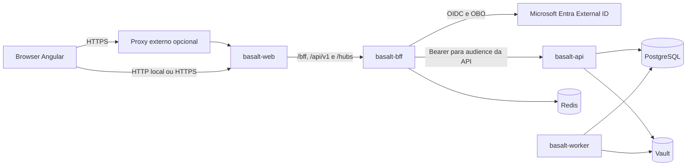

# Plano de Implementação do BFF de Identidade (substituído)

**Status:** superseded  
**Data de referência:** 29 de julho de 2026  
**Última atualização:** 29 de julho de 2026  
**Responsável:** equipe Basalt Notes  
**Origem:** IA assistida  
**Revisor humano:** pendente  
**Origem técnica:** `CommonPack/src/CBL.CommonPack.Bff` no commit `bf913f769983a24a44471ebf35f519e72895a1d6`

> Este plano foi substituído pelo [Plano do BFF com Keycloak](bff-keycloak.md) após a decisão humana de externalizar identidade e autorização para o Keycloak. Seu conteúdo é mantido apenas como histórico e não deve ser implementado.

## 1. Objetivo

Introduzir um Backend for Frontend dedicado à autenticação do browser, gerenciamento de sessão e proteção da borda HTTP do Basalt Notes. O novo host será implementado em `apps/bff`, terá assembly e namespace raiz `BasaltNotes.Bff` e será executado pelo serviço `basalt-bff`.

As classes de `CBL.CommonPack.Bff` serão copiadas para o monorepo, preservando a estrutura e o comportamento, mas sem adicionar referência de projeto, pacote ou runtime ao CommonPack. A migração altera o namespace `CBL.CommonPack.Bff` para `BasaltNotes.Bff` e adapta o código para .NET 10 e para as convenções do Basalt Notes.

Este documento orienta uma implementação futura. O [plano mestre](../../README.md) continua sendo a autoridade para visão e escopo enquanto as mudanças aqui descritas não forem incorporadas aos documentos definitivos.

## 2. Resultado esperado

Ao concluir o plano:

- o browser acessará somente `basalt-web`, que encaminhará autenticação, API e SignalR ao `basalt-bff`;
- o BFF realizará login, callback, logout, sessão, antiforgery, revogação, step-up authentication, rate limiting e token relay;
- Microsoft Entra External ID atuará como broker OIDC para identidades corporativas e provedores sociais configurados no tenant;
- o BFF usará On-Behalf-Of para adquirir um token destinado à API;
- a API aceitará somente bearer tokens com issuer, tenant e audience esperados;
- a API continuará responsável pela autorização contextual por vault, função, ação e recurso;
- Redis armazenará tickets, sessões, revogações, fingerprints, tempos de reautenticação e estado distribuído de rate limiting;
- tokens de acesso e refresh tokens não serão expostos ao Angular nem persistidos em Web Storage;
- BFF, API e Redis permanecerão sem portas públicas no deployment padrão.

## 3. Decisões já tomadas

| Tema | Decisão |
| --- | --- |
| Diretório | `apps/bff` |
| Projeto e assembly | `BasaltNotes.Bff` |
| Namespace raiz | `BasaltNotes.Bff` |
| Serviço e container | `basalt-bff` |
| Código de origem | copiar todas as classes C# de `CBL.CommonPack.Bff` |
| Dependência do CommonPack | nenhuma referência de projeto, pacote ou runtime |
| Framework de destino | .NET 10 |
| Broker de identidade | Microsoft Entra External ID |
| Provedores sociais | federados no tenant, não integrados diretamente no BFF |
| Canal BFF para API | OAuth 2.0 On-Behalf-Of com audience própria da API |
| Sessão do browser | cookie host-only, `Secure`, `HttpOnly` e `SameSite` explícito |
| Estado distribuído | Redis obrigatório e interno |
| Primeiro administrador | claim `oid` configurada para o primeiro `Owner`, restrita ao tenant esperado |
| Login local | fora do escopo desta arquitetura |
| Falha de configuração | falhar fechado quando Entra External ID ou Redis obrigatório não estiver configurado |
| Autorização | controles de borda no BFF e autorização de domínio obrigatória na API |

## 4. Decisões que exigem ADR

Antes da implementação, criar `docs/adr/0001-bff-identidade-redis.md` com status `proposed`. O ADR deve registrar:

- introdução do novo host BFF e da nova fronteira de confiança;
- substituição do login local por identidade federada;
- Entra External ID como broker de provedores corporativos e sociais;
- dois app registrations: cliente confidencial do BFF e recurso protegido da API;
- fluxo OIDC Authorization Code com PKCE no BFF e OBO até a API;
- Redis como datastore operacional obrigatório para estado de segurança;
- limites entre autenticação de borda e autorização contextual;
- dependência de conectividade externa para iniciar e renovar autenticação;
- persistência e rotação do key ring do ASP.NET Core Data Protection;
- operação degradada, recuperação, migração e rollback;
- ameaças, controles compensatórios e evidências exigidas para aceite.

O ADR deve ser aceito antes de criar infraestrutura ou alterar o contrato público.

## 5. Arquitetura alvo



### 5.1 Limites de rede

- somente `basalt-web` publica porta no perfil padrão;
- `basalt-bff`, `basalt-api`, `basalt-worker`, Redis e PostgreSQL permanecem em redes internas;
- Redis aceita conexões apenas do BFF e de probes operacionais autorizados;
- a API aceita tráfego apenas do BFF, do worker quando necessário e de probes autorizados;
- headers de identidade recebidos do browser são removidos antes do encaminhamento;
- forwarded headers são aceitos somente de proxies e redes explicitamente confiáveis.

### 5.2 Limites de responsabilidade

O BFF será responsável por:

- iniciar o challenge OIDC e processar callback e logout;
- manter cookies de autenticação, correlation e nonce;
- armazenar tickets e sessões no Redis;
- validar frontend, origem, sessão, revogação e step-up authentication;
- emitir e validar antiforgery para operações mutáveis;
- adquirir e manter tokens no servidor;
- encaminhar chamadas para API e SignalR;
- limitar requisições e detectar padrões de ataque na borda;
- aplicar headers de segurança e mascarar dados sensíveis em logs;
- expor liveness, readiness e métricas próprias.

A API continuará responsável por:

- validar assinatura, issuer, tenant, audience, expiração e scopes do bearer token;
- resolver a identidade externa para usuário e memberships internos;
- autorizar cada ação por vault, função e recurso antes de consultar dados;
- impedir autorização horizontal e elevação de privilégio;
- executar regras de negócio, filesystem, PostgreSQL e SignalR;
- auditar ações sensíveis de domínio.

O BFF pode rejeitar uma requisição antecipadamente, mas sua decisão nunca substitui a autorização da API.

## 6. Fluxos de identidade

### 6.1 Login

1. Angular consulta a sessão no BFF.
2. Sem sessão válida, o browser navega para o endpoint de login do BFF.
3. O BFF valida frontend e return URL contra allowlist.
4. O BFF inicia Authorization Code com PKCE no Entra External ID.
5. Entra autentica diretamente ou por provedor federado configurado no tenant.
6. O callback valida `state`, nonce, correlation, issuer, tenant e redirect URI.
7. O ticket e a sessão são armazenados no Redis.
8. O browser recebe apenas o cookie de sessão.
9. O BFF redireciona para um caminho local previamente validado.

### 6.2 Chamada à API

1. Angular chama `/api/v1/*` no mesmo origin com cookie e antiforgery quando aplicável.
2. O BFF valida sessão, frontend binding, revogação, anomalias e limites.
3. O BFF adquire por OBO um access token destinado à audience da API.
4. O BFF remove cookie e headers de identidade externos antes do encaminhamento.
5. A API valida o bearer token e aplica autorização contextual.
6. O BFF preserva status, corpo e headers públicos da resposta.

### 6.3 Primeiro Owner

- o operador configura tenant ID e object ID do primeiro `Owner` por secret ou arquivo montado;
- o bootstrap aceita o `oid` somente quando o token pertence ao tenant esperado;
- o vínculo é idempotente e auditado;
- depois do bootstrap, a gestão de memberships ocorre pela aplicação;
- nenhuma senha padrão ou conta local é criada.

### 6.4 Logout e revogação

- logout exige antiforgery e frontend binding válidos;
- o BFF revoga o estado local, remove ticket, sessão e tokens armazenados e encerra o cookie;
- o logout federado é acionado quando suportado pelo tenant;
- revogação administrativa invalida todas as sessões do usuário ou a sessão selecionada;
- conexões SignalR devem ser encerradas ou perder autorização de forma observável.

## 7. Origem e estratégia de cópia

### 7.1 Baseline

| Item | Valor |
| --- | --- |
| Repositório | `C:\Users\lzob8c1\projetos\CommonPack` |
| Projeto | `src/CBL.CommonPack.Bff` |
| Revisão | `bf913f769983a24a44471ebf35f519e72895a1d6` |
| Arquivos C# inventariados | 200 |
| Linhas inventariadas | 23.890 |
| Framework de origem | .NET 8 e C# 12 |
| Framework de destino | .NET 10 |

Os números são uma baseline de planejamento. A execução deve gerar novo inventário a partir da revisão registrada e explicar qualquer diferença.

### 7.2 Conteúdo incluído

Copiar todos os arquivos `.cs` destas áreas:

- `Controllers`;
- `Extensions`;
- `Features/Authentication`;
- `Features/DeviceFingerprinting`;
- `Features/FeatureFlags`;
- `Features/FrontendManagement`;
- `Features/RateLimiting`;
- `Features/SessionManagement`;
- `Features/StepUpAuthentication`;
- `Features/TokenManagement`;
- `Features/TokenRelay`;
- `HealthChecks`;
- `SharedKernel`;
- `Validation`.

O diretório `Properties` contém somente `launchSettings.json` na baseline e não entra na cópia automática. Sua configuração deve ser recriada para o novo host quando necessária.

### 7.3 Conteúdo excluído

Não copiar:

- `bin`, `obj` e `Docs`;
- `CBL.CommonPack.Bff.csproj` e `CBL.CommonPack.Bff.targets`;
- README, changelog e documentação de pacote da origem;
- artefatos NuGet, XML gerado e arquivos de cobertura;
- configurações que contenham endpoints, tenants ou secrets reais;
- referências a outros projetos `CBL.CommonPack.*`.

### 7.4 Transformações permitidas

- substituir `CBL.CommonPack.Bff` por `BasaltNotes.Bff` em namespace, `using`, XML docs e nomes internos aplicáveis;
- adaptar APIs obsoletas ou incompatíveis com .NET 10;
- corrigir comentários XML malformados e warnings que bloqueiem os gates do destino;
- substituir configuração de empacotamento por configuração de host executável;
- adaptar options, endpoint paths e integração ao contrato do Basalt Notes;
- adicionar telemetria, validações e testes exigidos pelo projeto.

Não realizar refatoração ampla durante a primeira cópia. Primeiro obter paridade compilável e testável; depois adaptar em slices pequenos.

## 8. Estrutura alvo

```text
apps/
├── web/
├── bff/
│   ├── BasaltNotes.Bff.csproj
│   ├── Program.cs
│   ├── appsettings.json
│   ├── Controllers/
│   ├── Extensions/
│   ├── Features/
│   ├── HealthChecks/
│   ├── SharedKernel/
│   └── Validation/
├── api/
└── worker/
tests/
└── backend/
    └── BasaltNotes.Bff.Tests/
deploy/
├── bff/
├── compose.yml
└── secrets/
```

`apps/bff` é um composition root e não deve receber regras de domínio de notas, vaults, busca ou indexação. As classes copiadas pertencem à fronteira de identidade e segurança específica do BFF e não serão extraídas para `libs/backend` nesta entrega.

## 9. Dependências previstas

O projeto de destino deve declarar versões centralizadas e fixadas para os equivalentes de:

- `Asp.Versioning.Mvc.ApiExplorer`;
- `Microsoft.Identity.Web`;
- `Microsoft.Identity.Web.UI`;
- autenticação JWT Bearer e OpenID Connect do ASP.NET Core;
- abstrações de cache, Memory Cache e StackExchangeRedis Cache;
- `Microsoft.Extensions.Http.Resilience`;
- Polly e Polly Extensions;
- health checks;
- `System.IdentityModel.Tokens.Jwt`;
- `System.Diagnostics.DiagnosticSource`.

Antes da inclusão, revisar compatibilidade com .NET 10, licença, manutenção, vulnerabilidades e necessidade real de cada pacote. Não adicionar pacote CommonPack.

## 10. Pacotes de trabalho

### 10.1 WP-01: ADR e documentação normativa

**Status:** not-started  
**Objetivo:** aprovar a nova fronteira de segurança antes do código.

Entregas:

- criar o ADR de BFF, Entra External ID e Redis;
- atualizar o plano mestre com stack, topologia, containers e riscos;
- atualizar [backend](../backend.md), [frontend](../frontend.md), [evolução do produto](../evolucao-produto.md) e [CI/CD e segurança](../ci-cd-seguranca.md);
- remover requisitos conflitantes de login local e ausência de Redis;
- documentar a exigência de conectividade para autenticação;
- adicionar `apps/bff` às instruções, ownership e escopos de commit.

Gate de saída:

- ADR aceito;
- documentos sem decisões contraditórias;
- links e headings validados;
- ameaça e rollback registrados.

### 10.2 WP-02: Esqueleto .NET 10

**Status:** not-started  
**Objetivo:** criar o host executável antes da cópia em massa.

Entregas:

- criar solution e projeto `BasaltNotes.Bff` quando a solução backend for inicializada;
- configurar nullable, analyzers, warnings e central package management;
- criar `Program.cs`, configuração, liveness e readiness mínimos;
- registrar options com validação no startup;
- adicionar o projeto aos comandos de restore, format, build e test.

Gate de saída:

- restore e build limpos;
- processo inicia sem secrets reais;
- configuração obrigatória ausente falha com diagnóstico sanitizado.

### 10.3 WP-03: Cópia controlada do código

**Status:** not-started  
**Objetivo:** obter paridade compilável sem dependência do CommonPack.

Ordem recomendada:

1. `SharedKernel`, validação e health checks;
2. frontend management e feature flags;
3. device fingerprinting e token management;
4. rate limiting e step-up authentication;
5. token relay e authentication;
6. session management;
7. builders, extensions e controllers base.

Procedimento por slice:

1. copiar os arquivos da área;
2. substituir o namespace raiz;
3. compilar imediatamente;
4. corrigir apenas incompatibilidades locais;
5. portar os testes correspondentes;
6. executar o teste focado;
7. registrar diferenças intencionais.

Gate de saída:

- 200 arquivos de origem conciliados com destino ou allowlist documentada;
- zero namespace `CBL.CommonPack.Bff` em código compilado;
- zero referência de projeto ou pacote ao CommonPack;
- build .NET 10 e testes focados aprovados.

### 10.4 WP-04: Entra External ID e OBO

**Status:** not-started  
**Objetivo:** fechar o fluxo de autenticação e a confiança entre BFF e API.

Entregas:

- registrar cliente confidencial do BFF;
- registrar recurso/API com scope e audience próprios;
- configurar Authorization Code com PKCE;
- configurar callback e post-logout redirect por ambiente;
- configurar OBO no token relay;
- validar issuer, tenant, audience, scopes, nonce, correlation e redirect URI;
- configurar federação social no tenant, fora do código do BFF;
- implementar bootstrap idempotente do primeiro `Owner` por `oid`.

Gate de saída:

- login, callback, sessão e logout funcionam com IdP de teste;
- API rejeita token de audience ou tenant incorretos;
- nenhum token aparece no browser ou em logs;
- usuário sem membership recebe proibição sem revelar dados.

### 10.5 WP-05: Sessão, Redis e Data Protection

**Status:** not-started  
**Objetivo:** tornar o estado de segurança distribuído e recuperável.

Entregas:

- configurar ticket store, sessões, revogações, fingerprint e auth time no Redis;
- definir prefixos por ambiente e aplicação;
- definir TTLs coerentes com cookies e tokens;
- habilitar fail-fast com `RedisCacheStartupValidator`;
- persistir Data Protection key ring em volume ou secret store apropriado;
- definir rotação, backup e permissões do key ring;
- documentar efeito de restart e perda de Redis.

Gate de saída:

- restart do BFF preserva sessões válidas conforme política;
- revogação permanece efetiva entre réplicas;
- indisponibilidade de Redis falha fechada para novas operações protegidas;
- secrets e key ring não entram em imagem, Git ou logs.

### 10.6 WP-06: Proxy HTTP e SignalR

**Status:** not-started  
**Objetivo:** tornar o BFF a única fachada dinâmica do browser.

Entregas:

- encaminhar `/api/v1/*` e `/hubs/*` para a API interna;
- preservar método, query, content type, status e corpo;
- preservar `ETag`, `If-Match`, `If-None-Match`, `Idempotency-Key` e correlation ID;
- suportar streaming, upload, cancelamento e limites de tamanho;
- suportar negotiate, WebSocket e long polling do SignalR;
- validar `Origin` no handshake;
- redigir tokens e query strings sensíveis em logs;
- processar forwarded headers antes da autenticação e apenas de proxies confiáveis.

Gate de saída:

- testes de contrato demonstram transparência do proxy;
- WebSocket autenticado e fallback funcionam;
- acesso direto à API é bloqueado no deployment;
- headers de identidade enviados pelo cliente são descartados.

### 10.7 WP-07: Integração Angular

**Status:** not-started  
**Objetivo:** consumir o BFF sem gerenciar tokens no browser.

Entregas:

- bootstrap de sessão por endpoint do BFF;
- envio de `X-Frontend-App-ID` em chamadas aplicáveis;
- integração antiforgery em mutações e logout;
- redirects para login e step-up authentication;
- tratamento distinto de 401, 403, sessão revogada e indisponibilidade;
- reconexão SignalR após renovação válida;
- remoção de qualquer persistência de access ou refresh token.

Gate de saída:

- nenhum token sensível em Local Storage, Session Storage, IndexedDB ou URL;
- fluxos essenciais funcionam após reload e expiração controlada;
- UI diferencia não autenticado, proibido e indisponível.

### 10.8 WP-08: Containers e operação

**Status:** not-started  
**Objetivo:** entregar topologia reproduzível e observável.

Entregas:

- Dockerfile multi-stage e runtime non-root do BFF;
- Redis com tag imutável, autenticação e sem porta pública;
- Compose com dependências de health e retries na aplicação;
- secrets montados fora da imagem e do Compose versionado;
- liveness de processo e readiness de Redis, key ring e API downstream;
- traces de browser para BFF e API;
- métricas de login, callback, sessão, rate limit, Redis, OBO e revogação;
- runbooks para indisponibilidade do IdP, Redis, perda do key ring e rotação de credenciais.

Gate de saída:

- Compose inicia em ambiente limpo;
- somente a porta do web é publicada;
- imagens passam por SBOM e scan de vulnerabilidades;
- logs não contêm tokens, cookies, secrets ou claims sensíveis.

### 10.9 WP-09: Testes e hardening

**Status:** not-started  
**Objetivo:** demonstrar segurança, compatibilidade e resiliência.

Entregas:

- criar `tests/backend/BasaltNotes.Bff.Tests`;
- portar e adaptar os testes do `CBL.CommonPack.Bff.Test` por feature;
- usar Redis real por Testcontainers nas integrações críticas;
- simular OIDC e OBO de forma determinística;
- adicionar testes de contrato, segurança, caos e E2E;
- executar threat model e revisão de segurança independente.

Gate de saída:

- testes unitários e de integração aprovados;
- nenhum achado crítico ou alto sem aceitação formal;
- cobertura dos caminhos de autenticação, revogação e falha parcial;
- Playwright aprovado nos navegadores e viewports suportados.

## 11. Matriz mínima de testes

| Área | Cenários obrigatórios |
| --- | --- |
| OIDC | sucesso, state inválido, nonce inválido, callback incompleto, issuer e tenant incorretos |
| Redirect | return URL local, URL externa, encoding, path base e open redirect |
| Cookie | flags, expiração, renovação, fixation, replay e logout |
| Antiforgery | token ausente, inválido, origem cruzada, login CSRF, logout CSRF e mutações |
| Frontend binding | ID permitido, ausente, desconhecido, origin divergente e spoofing |
| Sessão | criação, leitura, renovação, expiração, revogação, múltiplas sessões e restart |
| Redis | timeout, indisponibilidade, recuperação, TTL, conflito e isolamento por prefixo |
| OBO | sucesso, consentimento ausente, token expirado, scope e audience incorretos |
| API | acesso direto, cookie indevido, header de identidade falso e autorização horizontal |
| Rate limiting | usuário, IP, login, ataque distribuído, fallback e headers de resposta |
| Step-up | operação comum, sensível, MFA ausente, janela válida e expirada |
| Proxy | ProblemDetails, ETag, upload, streaming, cancelamento e timeout |
| SignalR | negotiate, WebSocket, long polling, Origin, revogação e reconexão |
| Logs | token, cookie, secret, authorization header, query string e claims sensíveis |
| Containers | usuário non-root, health, restart, rede interna, secrets e shutdown gracioso |

## 12. Critérios de aceite finais

- `apps/bff` compila em .NET 10 sem referência ao CommonPack;
- todas as 200 classes da baseline foram copiadas ou constam de uma allowlist justificada;
- o namespace compilado usa somente `BasaltNotes.Bff` como raiz do código portado;
- Entra External ID autentica identidades corporativas e sociais federadas;
- o BFF usa OBO para obter token destinado à API;
- o browser nunca recebe access token ou refresh token;
- a API rejeita acesso sem bearer token válido para sua audience;
- a API autoriza toda operação por vault e recurso, independentemente da decisão do BFF;
- Redis e Data Protection sustentam sessão e revogação entre restarts e réplicas;
- CSRF, login CSRF, open redirect, session fixation e spoofing têm testes negativos;
- `/api/v1` e `/hubs` funcionam exclusivamente pela fachada pública;
- liveness, readiness, métricas, traces e logs sanitizados estão disponíveis;
- containers são non-root, têm tags imutáveis e não expõem Redis, BFF ou API;
- documentação, ADR, contratos, runbooks e threat model correspondem à implementação;
- build, testes, Playwright, SBOM e scan de vulnerabilidades estão aprovados.

## 13. Validações de execução

Executar a partir da raiz do Basalt Notes quando os respectivos manifests existirem:

```powershell
# Documentação e estrutura
./tools/scripts/validate-repository.ps1

# Backend
dotnet restore BasaltNotes.slnx --locked-mode
dotnet format BasaltNotes.slnx --verify-no-changes
dotnet build BasaltNotes.slnx --no-restore
dotnet test BasaltNotes.slnx --no-build

# Referências proibidas no BFF
rg "CBL\.CommonPack|PackageReference.*CommonPack|ProjectReference.*CommonPack" apps/bff tests/backend/BasaltNotes.Bff.Tests
```

A busca por referências proibidas deve terminar sem resultados. Também deve existir uma verificação automatizada que compare o inventário da baseline com os arquivos portados e uma allowlist versionada.

Para containers:

```powershell
docker compose -f deploy/compose.yml config --quiet
docker compose -f deploy/compose.yml build
docker compose -f deploy/compose.yml up --wait
docker compose -f deploy/compose.yml ps
```

Os comandos finais podem ser ajustados quando os manifests forem criados, mantendo restore, format, build, testes, configuração do Compose, build de imagens e smoke test reproduzíveis.

## 14. Riscos e mitigação

| Risco | Impacto | Mitigação |
| --- | --- | --- |
| cópia em massa introduzir código sem uso | superfície de ataque e manutenção maior | feature flags fechadas, revisão por módulo e remoção somente após evidência |
| divergência futura do CommonPack | correções não chegam automaticamente | registrar revisão de origem e comparar mudanças de segurança periodicamente |
| Redis indisponível | login, sessão e revogação afetados | fail-closed, health, alertas, persistência e runbook |
| key ring perdido | sessões inválidas após restart | volume protegido, backup, rotação e teste de recuperação |
| IdP indisponível | novos logins e renovação falham | sessões existentes conforme política, timeout, circuit breaker e comunicação clara |
| proxy alterar semântica HTTP | conflito, upload ou streaming quebrado | testes de contrato para headers, status, corpo e cancelamento |
| confiança excessiva no BFF | bypass de autorização | API valida token e autoriza por recurso em todas as rotas |
| forwarded headers falsos | redirect ou origem manipulada | redes conhecidas, limpeza de headers e testes de spoofing |
| token em logs ou URL | vazamento de credencial | logger sensível, redaction e testes automatizados |
| provedor social variar claims | usuário incorreto ou sem acesso | normalização no Entra External ID e identidade estável por tenant mais `oid` |
| atualização .NET 8 para 10 | incompatibilidade ou regressão | build por slice, analyzers e testes portados antes de adaptação funcional |

## 15. Rollback

Enquanto a mudança não estiver publicada, rollback significa remover o novo host e restaurar a documentação anterior.

Após publicação:

- manter imagens anteriores imutáveis de web, BFF e API;
- preservar configuração e key ring durante rollback;
- não apagar Redis antes de expirar ou migrar sessões e revogações necessárias;
- reverter web, BFF e API como conjunto compatível;
- não restaurar acesso direto do browser à API como mitigação emergencial;
- invalidar sessões se houver dúvida sobre integridade de tickets, chaves ou revogações;
- documentar procedimento, tempo esperado e sinais de sucesso no runbook de rollout.

Rollback não pode reintroduzir login local implicitamente nem reduzir a autorização da API.

## 16. Fora do escopo

- uso do pacote ou projeto `CBL.CommonPack.Bff` diretamente;
- biblioteca BFF compartilhada em `libs/backend`;
- handlers diretos no código para Google, GitHub, Facebook ou outros provedores sociais;
- autenticação local e recuperação de senha local;
- exposição pública da API, BFF, Redis ou PostgreSQL;
- alteração da fonte canônica Markdown;
- publicação de imagem, configuração de tenant real ou deploy de produção durante a implementação inicial;
- refatoração ampla das classes antes de obter paridade compilável e testável.

## 17. Sequência recomendada de pull requests

1. ADR e atualização documental normativa.
2. Solution, projeto BFF .NET 10 e gates vazios.
3. SharedKernel, validação, health e testes correspondentes.
4. FrontendManagement, FeatureFlags e DeviceFingerprinting.
5. TokenManagement, RateLimiting e StepUpAuthentication.
6. TokenRelay, Authentication e testes OIDC/OBO.
7. SessionManagement, Redis e Data Protection.
8. Proxy HTTP, SignalR e integração da API.
9. Integração Angular e Playwright.
10. Containers, observabilidade, runbooks e hardening final.

Cada pull request deve compilar, executar seus testes focados, registrar diferenças em relação à baseline e preservar os limites de segurança já estabelecidos.

## 18. Checklist para iniciar a execução

- ADR criado e aceito;
- revisão de origem confirmada ou atualizada conscientemente;
- inventário de classes regenerado;
- solução .NET 10 e central package management disponíveis;
- app registrations de teste definidos;
- tenant Entra External ID de teste disponível;
- Redis de integração disponível por container;
- nomes de cookie, frontend ID, callback paths, scopes e audience aprovados;
- estratégia de key ring e secrets aprovada;
- threat model inicial revisado;
- responsáveis por BFF, API, frontend, segurança e operação definidos.

Nenhuma credencial, tenant real, object ID real ou secret deve ser registrado neste documento ou em fixtures versionadas.

## 19. Histórico de status

| Data | Escopo | De | Para | Evidência ou motivo | Autor |
| --- | --- | --- | --- | --- | --- |
| 2026-07-29 | plano | - | proposed | plano existente migrado para a convenção de `docs/plan` | IA assistida |
| 2026-07-29 | todas as etapas | - | not-started | nenhuma etapa possui evidência de execução registrada | IA assistida |
| 2026-07-29 | plano | proposed | superseded | decisão humana de usar Keycloak como plataforma externa de identidade e autorização | responsável pelo projeto |