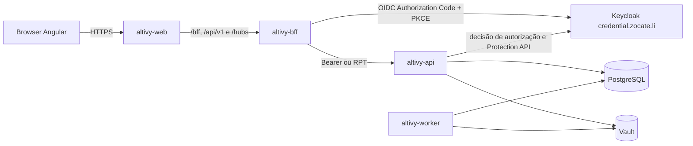

# Plano do BFF com Keycloak

**Status:** completed  
**Data de criação:** 2026-07-29  
**Última atualização:** 2026-08-30  
**Responsáveis:** equipe Altivy  
**Origem:** decisão humana assistida por IA  
**Revisor humano:** Lincoln Zocateli  
**Relacionado:** ADR de BFF, Keycloak e autorização externa a criar

## Objetivo

Integrar o Altivy ao Keycloak como plataforma externa de identidade e decisão de autorização, mantendo tokens fora do Angular e removendo da solução cadastro local, senhas, diretório de usuários, memberships e políticas próprias de acesso.

O BFF será apenas um cliente OIDC confidencial e a fachada HTTP do browser. A API será um Policy Enforcement Point (PEP): ela validará o token, consultará ou consumirá a decisão emitida pelo Keycloak e bloqueará o acesso antes de tocar no PostgreSQL ou no filesystem.

## Contexto e premissas

- A instância indicada pelo responsável está disponível em `https://credential.zocate.li` e responde como Keycloak.
- O console público usa o realm administrativo `master`; o Altivy nunca usará esse realm nem credenciais administrativas globais.
- O realm proposto para a aplicação é `altivy`, sujeito à criação e aprovação operacional.
- Keycloak será a autoridade para usuários, credenciais, MFA, federação, SSO, sessões, grupos, roles, recursos, scopes e políticas.
- O Altivy não terá módulo `Identity`, tabela `users`, tabela `vault_members`, login local ou bootstrap de usuário administrador.
- Referências ao claim estável `sub` podem ser persistidas somente em auditoria e metadados técnicos que exijam rastreabilidade; elas não constituem cadastro local.
- Cada instalação precisa alcançar um Keycloak compatível. Ambiente isolado exige uma instância Keycloak acessível na própria rede.
- O browser acessará somente `altivy-web`; API e BFF permanecerão internos no deployment padrão.
- Tokens de acesso e refresh tokens não serão expostos ao Angular nem persistidos em Web Storage.
- A versão exata do Keycloak e a licença correspondente devem ser verificadas antes da implementação. Nenhum secret, client secret ou export real de realm entra no Git.

## Limites de responsabilidade

### Keycloak

- autenticar usuários e federar provedores externos;
- administrar credenciais, recuperação de conta, MFA, SSO e sessões;
- administrar grupos e roles do Altivy;
- registrar recursos e scopes no Authorization Services;
- avaliar políticas e emitir a decisão de acesso;
- revogar sessões, tokens e permissões de forma auditável.

### BFF

- iniciar Authorization Code com PKCE e processar callback e logout;
- manter cookie técnico host-only, `Secure`, `HttpOnly` e `SameSite` explícito;
- manter tokens no servidor e renová-los conforme a política do Keycloak;
- aplicar antiforgery, validação de origem, rate limiting e headers de segurança;
- encaminhar `/api/v1` e `/hubs` preservando a semântica HTTP;
- remover cookies e headers de identidade fornecidos pelo browser antes do relay;
- não cadastrar usuários, definir roles, avaliar políticas de vault ou administrar o realm.

### API

- validar assinatura, issuer, audience, expiração e claims obrigatórios;
- mapear cada operação para o recurso e scope exigidos;
- obter ou validar a decisão do Keycloak Authorization Services;
- falhar fechada antes de consultar ou alterar dados quando a permissão estiver ausente, inválida, expirada ou indisponível;
- registrar e reconciliar recursos e scopes de domínio no Keycloak com credencial de serviço de menor privilégio;
- executar regras de negócio e auditoria sem manter cadastro ou política de autorização paralelos.

Aplicar uma decisão externa é responsabilidade inevitável da API como PEP. Isso não transforma a API em provedor de identidade ou motor de autorização: a política e sua decisão continuam pertencendo ao Keycloak.

## Modelo inicial de autorização

- cliente confidencial `altivy-bff` para o fluxo do browser;
- cliente de recurso `altivy-api` com audience própria e Authorization Services habilitado;
- recursos de vault nomeados por identificador opaco, por exemplo `urn:altivy:vault:{vaultId}`;
- scopes iniciais `vault:read`, `vault:write`, `vault:manage` e `vault:delete`;
- roles `Owner`, `Editor` e `Reader` administradas no Keycloak e associadas a políticas, sem cópia em PostgreSQL;
- credencial de Protection API restrita ao registro e à reconciliação dos recursos pertencentes ao `altivy-api`;
- nenhuma chamada à API confia somente em role genérica quando a operação exigir permissão para um vault específico.

A implementação deve provar em um spike se a decisão será transportada em RPT/UMA ou obtida por avaliação remota no Keycloak. A escolha deve considerar revogação, latência, tamanho do token, granularidade por vault, SignalR e comportamento quando o Keycloak estiver indisponível. Não criar um avaliador de política local como fallback.

## Arquitetura alvo

## Não escopo

- implementar cadastro, senha, recuperação de conta, MFA ou diretório de usuários no Altivy;
- persistir memberships ou políticas de autorização no PostgreSQL;
- usar Microsoft Entra External ID, OAuth On-Behalf-Of ou claims específicas do Entra;
- usar o realm `master` para a aplicação;
- conceder ao BFF ou à API credencial administrativa global do Keycloak;
- copiar integralmente o projeto `CBL.CommonPack.Bff` ou suas 200 classes;
- expor publicamente BFF, API, PostgreSQL ou filesystem;
- criar ou alterar realm, clients, usuários ou secrets reais durante a fase documental.

## Dependências e decisões

- criar ADR para BFF, Keycloak, Authorization Services e nova dependência operacional;
- definir versão suportada do Keycloak e verificar licença, manutenção e vulnerabilidades;
- aprovar nome do realm, clients, callbacks, logout URLs, audience, scopes e origem pública;
- definir estratégia de sessão técnica do BFF e persistência do Data Protection key ring;
- decidir por evidência entre RPT/UMA e avaliação remota;
- definir disponibilidade, backup e operação do realm fora do ciclo de vida da aplicação;
- definir provisioning declarativo e sanitizado do realm sem versionar secrets nem exports reais.

## Etapas

### P-01: ADR e contrato de confiança

**Status:** completed  
**Responsável:** equipe Altivy
**Dependências:** nenhuma

**Objetivo:** aprovar fronteiras, dependência operacional e modelo de ameaça antes do código.

Entregas:

- criar ADR com Keycloak como IdP e PDP externo;
- registrar perda de login local e requisito de conectividade com o IdP;
- documentar tenants/realms, issuers, audiences, clients e fluxos de confiança;
- modelar comprometimento de client secret, indisponibilidade, revogação e divergência de recursos;
- definir rollout e rollback sem fallback para autorização local.

Validação:

- ADR aceito por decisão humana;
- threat model revisado;
- documentos normativos sem referências conflitantes a Entra ou Identity local.

Evidências:

- ADR proposto criado em [2026-0002-bff-keycloak-autorizacao-externa.md](../adr/2026-0002-bff-keycloak-autorizacao-externa.md).
- ADR aceito em 2026-08-15 por decisão humana revisada por Lincoln Zocateli;
- contrato de confiança, ameaças, rollout e rollback estão registrados no ADR
    e nos documentos normativos do projeto.

### P-02: Realm e clients de teste

**Status:** completed  
**Responsável:** Lincoln Zocateli  
**Dependências:** P-01

**Objetivo:** preparar um ambiente não produtivo de integração sem usar o realm `master`.

Entregas:

- criar realm dedicado `altivy` ou nome aprovado;
- criar `altivy-bff` e `altivy-api` com menor privilégio;
- configurar callbacks, post-logout redirects, PKCE, audience e tempos de token;
- configurar roles, recursos, scopes e políticas de teste;
- criar credencial de serviço limitada à Protection API;
- documentar configuração reproduzível e sanitizada.

Validação:

- discovery OIDC, login, logout e emissão de token funcionam no realm dedicado;
- token de issuer, audience ou client incorretos é rejeitado;
- nenhuma aplicação usa credencial do realm `master`.

Evidências:

- realm `altivy`, clients `altivy-api` e `altivy-bff`, audience, roles, grupos
    e usuário `lzocateli` foram provisionados e conferidos no laboratório local;
- procedimento de validação pelo Admin Console, URLs do realm e critérios de
    primeiro login estão documentados em [configuracao-keycloak.md](../configuracao-keycloak.md);
- login de `lzocateli`, troca da senha temporária e logout foram validados
    manualmente pelo responsável; OTP não foi exigido no fluxo observado;
- discovery retornou o issuer esperado; `altivy-api` está confidencial, com
    conta de serviço e Authorization Services habilitados e flows interativos
    desabilitados; `altivy-bff` está confidencial, com Standard Flow, PKCE
    `S256`, Direct Access Grants desabilitado e mapper padrão que inclui
    `altivy-api` somente na audience do access token;
- segredo incorreto do `altivy-api` e client inexistente foram rejeitados com
    HTTP 401; sua conta de serviço criou e removeu um recurso sintético pela
    Protection API com HTTP 201 e 204 e recebeu HTTP 403 ao tentar administrar
    usuários;
- após o primeiro login, `lzocateli` está habilitado, sem TOTP configurado e
    sem ação obrigatória pendente; o e-mail permanece não verificado;
- a rejeição de tokens com issuer, audience ou client incorretos pela API
    permanece pendente da implementação do validador em P-04/P-05; a política
    de OTP precisa ser reconciliada com o procedimento documentado.

### P-03: Spike de autorização por vault

**Status:** completed  
**Responsável:** equipe backend e segurança  
**Dependências:** P-02

**Objetivo:** escolher o fluxo de decisão externa com evidência executável.

Entregas:

- registrar um vault sintético como recurso via Protection API;
- avaliar `read`, `write`, `manage` e `delete` para perfis permitidos e negados;
- comparar RPT/UMA e avaliação remota quanto a revogação, latência e tamanho;
- testar remoção de permissão, indisponibilidade e recurso divergente;
- registrar a escolha no ADR antes da implementação definitiva.

Validação:

- acesso horizontal e elevação de privilégio são negados;
- decisão ausente ou Keycloak indisponível falha fechada;
- resultado e métricas sustentam a opção escolhida.

Evidências:

- o executável `tools/scripts/test-keycloak-authorization-spike.ps1` reconciliou
    pela Protection API exatamente um recurso sintético `vault-lab-0001`, com
    identificador técnico presente em duas execuções seriais;
- o login interativo do spike usa Authorization Code com PKCE `S256`, callback
    loopback fixo e client público dedicado, sem Direct Access Grant, implicit
    flow, device flow, secret ou persistência de token;
- uma execução autenticada para `vault:read` sem política de concessão retornou
    negação HTTP 403 nos dois fluxos: decisão remota em `2139,63 ms` e ticket
    UMA/RPT em `4202,39 ms`, sem emitir RPT nem criar solicitação de acesso;
- a amostra única comprova o caminho de negação e garante falha fechada sem
    concessão explícita. Concessões, matriz completa, repetição estatística,
    revogação e indisponibilidade permanecem para P-03-grant e slots posteriores.
- a policy `readers-vault-read` e a permission de recurso correspondente foram
    reconciliadas para `vault-lab-0001:vault:read` e o grupo `/altivy/readers`;
    com `lzocateli` no grupo, uma execução positiva retornou `grant` HTTP 200
    nos dois fluxos: decisão remota em `2484,75 ms` e UMA/RPT em `4323,82 ms`,
    com RPT emitido de `1585 bytes`.

### P-03-grant: Política de concessão UMA

**Status:** completed  
**Responsável:** Lincoln Zocateli  
**Dependências:** P-03

**Objetivo:** validar fluxo de autorização positiva com política de concessão e comparar latência concedida vs. negada.

Entregas:

- criar recurso Keycloak `urn:altivy:vault:lab-read` com escopo `vault:read`;
- criar política UMA que concede `vault:read` quando o usuário pertence ao grupo `altivy/readers`;
- reutilizar cliente e spike de P-03 para medir dois cenários: lzocateli (readers → grant) e usuário novo (sem grupo → deny);
- verificar RPT concedido e divergências entre decisão remota e UMA.

Validação:

- RPT é emitido quando política concede acesso;
- latência de concessão é comparável com negação (desempenho não degradado);
- matriz de teste cobre grant, deny, revogação, recurso divergente e indisponibilidade.

Evidências:

- policy `readers-vault-read` criada para `/altivy/readers` e permission
    `vault-lab-0001-vault-read` associada ao recurso e ao escopo `vault:read`;
- execução positiva autenticada como `lzocateli` retornou `grant` HTTP 200 em
    decisão remota (`2484,75 ms`) e UMA/RPT (`4323,82 ms`), com RPT de `1585
    bytes`;
- o teste com o recurso divergente `vault-lab-0002` retornou `deny` HTTP 403
    nos dois fluxos: decisão remota em `2082,83 ms` e UMA/RPT em `4133,79 ms`,
    sem emissão de RPT; a permissão permaneceu confinada a `vault-lab-0001`;
- em 2026-08-30, o cenário de revogação foi validado pelo script
    `tools/scripts/test-keycloak-revocation.ps1`, confirmando negação imediata
    `403` após a remoção de `lzocateli` do grupo `/altivy/readers` no recurso
    `lab-0001` e restauração da associação;
- permanecem pendentes a comparação estatística e a simulação de
    indisponibilidade do Keycloak.

### P-04: BFF .NET 10 mínimo

**Status:** completed  
**Responsável:** equipe backend  
**Dependências:** P-01, P-02

**Objetivo:** manter tokens fora do browser sem reimplementar recursos de IAM.

Entregas:

- criar `backend/apps/bff` em .NET 10;
- configurar OIDC Authorization Code com PKCE, callback e logout;
- implementar cookie técnico, antiforgery, validação de origem e token relay;
- persistir Data Protection key ring de forma protegida;
- expor liveness, readiness, métricas e logs sanitizados;
- reutilizar do CommonPack somente código pequeno, revisado e necessário, sem dependência de projeto ou pacote.

Validação:

- nenhum token aparece no browser, URL ou logs;
- login, renovação, logout e revogação funcionam com Keycloak de teste;
- build, análise estática e testes focados passam em .NET 10.

Evidências:

- solution e host `backend/apps/bff` criados em .NET 10, com SDK `10.0.400`
    fixado e versões de pacotes centralizadas;
- versões exclusivas de testes foram isoladas em `backend/tests/Directory.Packages.props`,
    que importa explicitamente o catálogo central da raiz; restore e 49 testes
    confirmaram a resolução transitiva dos dois catálogos;
- OIDC usa Authorization Code com PKCE, client confidencial, callbacks locais
    validados, callback por `response_mode=query` e cookie `Secure`, `HttpOnly`,
    host-only e sem tokens no payload;
- tickets e tokens permanecem no servidor em `ITicketStore`; antiforgery é
    exigido no logout e métodos mutáveis falham com HTTP 403 quando `Origin`
    está ausente ou fora da allowlist configurada;
- sessão possui expiração absoluta de oito horas, cache dimensionado, fallback
    autenticado e rate limiting de login particionado pelo endereço remoto;
- endpoints básicos de login, logout, sessão, liveness e readiness foram
    criados; readiness consulta o discovery do Keycloak, valida o issuer e
    falha fechado em indisponibilidade, resposta inválida ou timeout;
- forwarded headers aceitam somente proxies explicitamente configurados; Data
    Protection possui application name e key ring persistente, cuja proteção
    por certificado PFX é obrigatória fora de Development;
- o relay interno substitui qualquer `Authorization` fornecido pelo browser
    pelo access token da sessão server-side e falha fechado quando ele não está
    disponível; o proxy HTTP público permanece no escopo de P-06;
- tokens próximos da expiração são renovados no backchannel do Keycloak antes
    do relay; o ticket server-side recebe access e refresh tokens rotacionados,
    renovações concorrentes são coalescidas e falhas invalidam a sessão;
- traces e métricas usam OpenTelemetry para ASP.NET Core, clientes HTTP e
    runtime; tentativas de renovação publicam somente resultado de cardinalidade
    fixa e duração, sem usuário, sessão, path ou token;
- propagação distribuída aceita somente `traceparent` e `tracestate`; baggage
    controlado pelo browser não atravessa os backchannels internos;
- a exportação OTLP é opcional e não bloqueia o BFF quando ausente; endpoints
    configurados exigem HTTPS, exceto loopback em Development, e rejeitam query
    e fragment para impedir credenciais na configuração;
- o script de reconciliação rejeita o realm `master` e HTTP fora de loopback
    antes de carregar credenciais ou acessar a rede;
- `dotnet test Altivy.slnx --configuration Release --no-restore` passou com 49
    testes e nenhuma falha; o BFF em Development retornou HTTP 200 em
    `/health/live` e `/health/ready` contra o discovery real do realm local,
    sem usar o proxy do sistema para a Authority de loopback;
- o challenge de `/bff/login`, com host permitido e esquema HTTPS informado
    pelo proxy confiável, retornou HTTP 302 para o endpoint de autorização do
    realm `altivy` usando Pushed Authorization Request;
- `dotnet format Altivy.slnx --verify-no-changes --no-restore` passou sem
    divergências em 2026-08-18;
- armazenamento de sessão compartilhado, validação com certificado PFX real e
    testes integrados de login, renovação, logout e revogação contra o realm de
    laboratório permanecem pendentes.

### P-05: API como PEP

**Status:** completed  
**Responsável:** equipe backend  
**Dependências:** P-03, P-04

**Objetivo:** aplicar decisões do Keycloak antes de qualquer acesso ao domínio.

Entregas:

- validar JWT e permissões conforme o fluxo aprovado;
- mapear endpoints RESTful para recurso e scope;
- registrar e reconciliar recursos de vault de forma idempotente;
- impedir consulta, escrita e revelação de existência sem permissão;
- persistir apenas IDs técnicos necessários para reconciliação e `sub` em auditoria;
- instrumentar latência, negação, erro e divergência sem registrar token ou claims sensíveis.

Validação:

- testes de contrato e integração cobrem permissão válida, ausente, revogada e expirada;
- testes negativos cobrem autorização horizontal, elevação e acesso direto à API;
- nenhuma tabela ou serviço local gerencia usuário, membership ou política.

Evidências:

- host `backend/apps/api` criado em .NET 10 com autenticação JWT configurada para o
    issuer do realm `altivy`, audience `altivy-api`, issuer signing key e
    lifetime;
- adapter `KeycloakAuthorizationDecisionService` criado para consultar a
    decisão remota UMA com `audience`, recurso e scope explícitos; a API falha
    fechada com `403` para decisão negada e `503` para indisponibilidade ou
    resposta inválida do Keycloak, com timeout de 15 segundos no cliente HTTP;
- endpoint público de liveness e endpoint protegido `/api/v1/session` foram
    criados como primeira fatia do PEP; o segundo exige access token válido e
    expõe somente o `sub` técnico da identidade autenticada;
- endpoint RESTful protegido `GET /api/v1/vaults/{vaultId}` consulta a decisão
    externa antes de revelar os metadados do vault e solicita `vault:read` para
    o recurso técnico correspondente;
- o endpoint agora retorna `403` imediatamente quando o Keycloak nega a
    decisão, antes de consultar o reader ou revelar a existência do vault;
- `VaultAuthorization` centraliza `vault:read` e a formação de `vault-{vaultId}`
    além de `vault:write`, `vault:manage` e `vault:delete`, para impedir
    divergência de scopes e recursos entre endpoints futuros;
- `KeycloakAuthorizationDecisionService` registra duração, resultado,
    disponibilidade, status, recurso e scope com `LoggerMessage` source-generated;
    tokens, claims e conteúdo não entram nos logs;
- resposta pública `VaultAccessResponse` mantém somente o identificador opaco
    do vault e o scope autorizado, sem expor entidades, paths físicos ou dados
    de persistência;
- `Program.cs` permanece como composition root e os registros de serviços e
    endpoints foram movidos para extensões documentadas em `DependencyInjection`
    e `Endpoints`;
- contrato versionado criado em `contracts/openapi/altivy-api.yaml` para
    liveness, sessão e `GET /api/v1/vaults/{vaultId}`, incluindo segurança,
    parâmetros, respostas e `ProblemDetails`;
- `VaultId` valida identificadores em letras minúsculas, números e hífen, com
    limite de 64 caracteres, rejeitando traversal e caracteres fora do contrato
    antes da consulta ao Keycloak;
- projeto `backend/tests/Altivy.Notes.Api.UnitTests` cobre concessão HTTP 200,
    negação HTTP 403, falha de transporte tratada como indisponibilidade e
    validação de bearer, audience, permission e identificadores de vault;
- testes de contrato HTTP com `WebApplicationFactory` cobrem serialização do
    vault autorizado e respostas `400`, `403` e `503` como
    `application/problem+json`, usando autenticação e decisão sintéticas sem
    depender da rede;
- o contrato rejeita bearer vazio com `401` antes de consultar o decisor ou o
    reader do vault;
- o teste de contrato confirma que uma decisão negada não chama o reader do
    vault, mantendo a autorização antes de qualquer acesso a dados;
- o contrato HTTP também verifica que a operação envia ao decisor o recurso
    `vault-lab-0001` e o scope `vault:read` esperados;
- `dotnet test backend/tests/Altivy.Notes.Api.UnitTests/Altivy.Notes.Api.UnitTests.csproj
    --configuration Release` passou com 13 testes;
- `dotnet test backend/tests/Altivy.Notes.Api.UnitTests/Altivy.Notes.Api.UnitTests.csproj
    --configuration Release` passou com 3 testes;
- `dotnet test Altivy.slnx --configuration Release` passou com 72 testes,
    incluindo a suíte existente do BFF;
- `dotnet build backend/apps/api/Altivy.Notes.Api.csproj --configuration Release` passou;
- a geração runtime via `Microsoft.AspNetCore.OpenApi` ficou fora desta fatia:
    a cadeia disponível trouxe `Microsoft.OpenApi` vulnerável e a versão sem
    alerta conhecida foi incompatível com o source generator do SDK; o YAML
    versionado permanece a fonte verificável até alinhar uma combinação segura;
- agregado `Altivy.Backend.Domain.Vaults.Vault` criado em `backend/libs/domain`,
    independente de ASP.NET, EF Core, Keycloak e filesystem, com invariantes de
    identificador opaco e nome exibido;
- `Altivy.Backend.Domain.UnitTests` passou com 7 testes cobrindo criação válida,
    IDs inválidos e nomes vazios;
- projeto `Altivy.Backend.Application` criado com a porta `IVaultReader` e o
    caso de uso `GetVaultQueryHandler`, mantendo leitura independente de
    filesystem, PostgreSQL e Keycloak;
- a API usa `LabVaultReader` somente como adapter sintético do laboratório e
    retorna `404` quando a decisão permite, mas o vault não existe; o cenário
    está coberto no contrato HTTP;
- `Altivy.Backend.Application.UnitTests` passou com 2 testes e a suíte da API
    passou com 14 testes;
- projeto `Altivy.Backend.Infra.Data.Postgres` criado com `PostgresDbContext`,
    `DataContextSetup`, mapeamento Fluent de `altivy.vaults` e
    `PostgresVaultReader`, projetando somente `id` e `name` para o domínio;
- EF Core `10.0.0` e Npgsql EF Core `10.0.0` foram fixados no catálogo central,
    e a infraestrutura PostgreSQL compilou em Release;
- a API usa `LabVaultReader` somente em `Development` quando
    `ConnectionStrings:AltivyPostgres` está ausente; quando a connection string
    existe, registra `PostgresVaultReader` e `PostgresDbContext`; fora de
    `Development`, a ausência da connection string falha no startup;
- ferramentas instaladas para o ciclo de persistência: `dotnet-ef 10.0.0` e
    `ReportGenerator 5.5.11`;
- factory `PostgresDbContextFactory` criada para design-time usando a variável
    de processo `ALTIVY_DESIGNTIME_CONNECTION_STRING`, carregada do arquivo
    externo de secrets local, sem credenciais versionadas;
- migration `Migrations/20260819181928_InitialCreate` gerada e revisada: cria
    apenas schema `altivy` e tabela `vaults` com `id` e `name`; sua aplicação
    foi validada no PostgreSQL descartável de integração;
- `System.Security.Cryptography.Xml` foi fixado em `10.0.11` após o restore
    bloquear versões vulneráveis transitivas do tooling EF Core;
- `backend/apps/api/appsettings.json` documenta a chave de configuração sem incluir
    credenciais, e o wiring PostgreSQL foi validado com os testes da API;
- documentação completa de migrations criada em
    `backend/libs/infrastructure/data/README.md`, incluindo secrets externos,
    criação/atualização de migration, geração de SQL e scaffolding;
- o PostgreSQL do Altivy reutiliza o database `keycloak` do laboratório, mas
    mantém schema `altivy`, roles `altivy_migrator`/`altivy_runtime` e grants
    separados do Keycloak;
- `tools/scripts/migrate-postgres.ps1` removido; migrations são executadas
    diretamente com `dotnet tool run dotnet-ef` conforme o README do projeto;
- Compose descartável criado em
    `backend/libs/infrastructure/data/compose.postgres-test.yaml` usando
    `lzocateli/postgresql:18.4-pgvector0.8.6-bookworm`; a suíte
    `Altivy.Backend.Infra.Data.Postgres.IntegrationTests` aplicou a migration,
    inseriu e leu um vault com roles separadas e passou com `1/1`, seguido de
    teardown do container e da rede;
- a suíte de integração usa a mesma imagem PostgreSQL do laboratório, aplica a
    migration no database `keycloak`, restringe a leitura ao schema `altivy` e
    remove container, rede e dados ao final;
- testes adicionados em `Altivy.Notes.Api.UnitTests` cobrindo cenários de
    indisponibilidade por timeout (`TaskCanceledException`) e resposta JSON
    corrompida do Keycloak (retornando `503 Service Unavailable`), além de
    contratos HTTP para `GET /health/live` (anônimo) e `GET /api/v1/session`
    (com projeção de `sub`), totalizando 23 testes aprovados na suíte da API;
- permanecem pendentes o mapeamento dos novos endpoints mutáveis de vault
    conforme forem expandidos no domínio.

### P-06: Angular, proxy e SignalR

**Status:** completed  
**Responsável:** equipes frontend e backend  
**Dependências:** P-04, P-05

**Objetivo:** integrar o browser ao BFF sem manipular tokens.

Entregas:

- consultar sessão e permissões efetivas por endpoint do BFF/API;
- encaminhar `/api/v1` e `/hubs` preservando método, status, corpo e headers públicos;
- tratar separadamente não autenticado, proibido, revogado e IdP indisponível;
- validar antiforgery e `Origin` em mutações e SignalR;
- remover qualquer armazenamento de access ou refresh token no Angular.

Validação:

- Playwright cobre login, logout, permissão negada, revogação e reconexão;
- `ETag`, upload, streaming e `QUERY` atravessam o proxy sem mudança semântica;
- acesso direto à API permanece bloqueado no deployment.

Evidências:

- `/bff/session` retorna uma projeção pública sanitizada com `authenticated`,
    `subject` técnico e `name`, sem access token, refresh token ou claims
    sensíveis; o endpoint permanece anônimo para permitir bootstrap do browser.
- `BffSessionResponse` possui testes unitários da projeção de principal.
- proxy server-side `/api/v1/{**path}` criado com relay do token armazenado na
    sessão, bloqueio de headers hop-by-hop e `Authorization` fornecido pelo
    browser; falhas downstream retornam `502`/`504` sem detalhes internos.
- a política de headers do proxy possui testes unitários; Angular e SignalR
    permanecem pendentes.
- composição da URI downstream preserva caminho `/api/v1` e query string, com
    teste unitário dedicado; a suíte do BFF passou com 59 testes.
- monorepo reorganizado em `backend/` e `frontend/`: hosts, bibliotecas e testes
    backend foram movidos para `backend/apps`, `backend/libs` e `backend/tests`;
    a estrutura `frontend/web`, `frontend/libs` e `frontend/tests` foi criada
    para a evolução Angular.
- shell Angular 22 standalone criado em `frontend/web`, com `SessionService`
    consultando somente `/bff/session` e estados de loading, erro, sessão anônima
    e sessão autenticada; nenhum token ou cliente Keycloak é usado no browser;
- workspace Angular movido de `frontend/apps/web` para `frontend/web`, removendo
    o nível intermediário `apps` e alinhando a aplicação ao layout adotado;
- dependências frontend instaladas dentro do container
    `lzocateli/angular-cli:22.1.0-node24.15.0-bookworm`, com `package-lock.json`
    versionado para reprodução;
- build Angular de produção permanece pendente de confirmação: o CLI no
    container terminou sem produzir `dist` ou saída observável nesta sessão;
- diagnóstico do build Angular confirmou que o bind mount do código está correto
    e que o travamento vinha de `node_modules` do host/volume com ownership
    incompatível; o perfil agora usa o volume Docker
    `altivy-angular-node-modules` com `nocopy` e instala dependências somente no
    container;
- `.npmrc` de `frontend/web` não contém token; o perfil gera um `.npmrc`
    temporário com `_auth` Basic a partir de `ARTIFACTORY_USERNAME` e
    `ARTIFACTORY_PASSWORD`, removido com o container; o registry devolveu `E401`
    para as credenciais atuais, portanto é necessário fornecer senha/token
    Artifactory válido antes do build de produção.
- proxy `/hubs/{**path}` criado no BFF para negotiate, long polling, Server-Sent
    Events e upgrade de WebSocket, reaproveitando a mesma autenticação por cookie
    e o mesmo relay de bearer token do proxy `/api/v1`, sem expor token ao
    browser; hop-by-hop headers foram extraídos para `ProxyHeaders` e
    reutilizados pelos dois proxies;
- upgrade de WebSocket é encaminhado por um `ClientWebSocket` downstream aberto
    pelo próprio BFF, que injeta `Authorization: Bearer` no handshake (headers
    customizados não são possíveis no `WebSocket` nativo do browser); o BFF
    então repassa frames nas duas direções até o fechamento de qualquer lado;
- `app.UseWebSockets()` foi adicionado ao pipeline do BFF e a validação de
    `Origin` em `OriginValidationMiddleware` passou a exigir origem permitida
    também para upgrade de WebSocket, que usa método `GET` e não seria coberto
    pela regra anterior restrita a métodos mutáveis;
- hub `VaultHub` criado na API em `/hubs/vaults`, exigindo usuário autenticado
    (`[Authorize]`) e avaliando a mesma decisão UMA `vault:read` usada pelo
    endpoint `GET /api/v1/vaults/{vaultId}` antes de adicionar a conexão ao
    grupo `vault-{vaultId}`; acesso negado ou indisponível derruba a conexão
    com `HubException` sem revelar detalhes;
- `services.AddSignalR()` registrado na API; nenhum pacote NuGet novo foi
    necessário porque o SignalR já é servido pelo shared framework
    `Microsoft.AspNetCore.App` referenciado por `Microsoft.NET.Sdk.Web`;
- `VaultRealtimeService` criado em `frontend/web` usando `@microsoft/signalr`
    (MIT, biblioteca oficial da Microsoft) com `withCredentials: true` e
    reconexão automática; o serviço só invoca `JoinVaultAsync` após o handshake,
    sem manipular token, e reentra no grupo automaticamente após reconexão;
- testes unitários adicionados para `BffHubsProxyRouteBuilderExtensions`
    (composição da URI downstream HTTP e tradução para `ws`/`wss`) e para
    `OriginValidationMiddleware`, cobrindo upgrade de WebSocket sem `Origin` e
    com `Origin` permitido;
- testes unitários adicionados para `VaultHub` (`Altivy.Notes.Api.UnitTests`)
    reaproveitando `FakeAuthorizationDecisionService` já existente: identificador
    de vault inválido, ausência de bearer token e decisão negada lançam
    `HubException` sem adicionar a conexão a nenhum grupo; decisão concedida
    adiciona a conexão ao grupo `vault-{vaultId}` e confirma recurso/scope
    enviados ao decisor (`vault-lab-0001`/`vault:read`);
- **pendente de validação nesta sessão:** `npm install` em `frontend/web` para
    materializar `@microsoft/signalr` falhou com `E401` usando o alias
    containerizado nesta máquina (`B8182876`), reproduzindo o bloqueio de
    credencial Artifactory/proxy já registrado nesta etapa;
- `dotnet build Altivy.slnx --configuration Release` executado pelo responsável
    revelou 18 erros de analisadores (`CA1819`, `CA1032`, `CA1849`, `CA1508`,
    `CA1506` e `CA2000`), a maioria em código pré-existente do BFF e dos testes
    de `Altivy.Notes.Api.UnitTests` não coberto pela análise estática do editor
    até então; todos foram corrigidos nesta sessão: `AllowedOrigins`/
    `TrustedProxies` passaram de `string[]` para `IReadOnlyList<string>`,
    `TokenRefreshRejectedException` recebeu os construtores padrão exigidos,
    o helper privado `ServerSideTicketStore.Store` foi renomeado para evitar
    colisão de nome com `StoreAsync`, o fechamento do WebSocket no proxy de
    hubs passou a tratar a corrida por `try/catch` em vez de uma checagem de
    estado morta, `AddBffServices` foi dividido em métodos privados menores
    para reduzir o acoplamento, e os testes novos/existentes passaram a
    descartar `HttpClient`/handlers e o `VaultHub` (`IDisposable` via `Hub`)
    no mesmo escopo onde são criados; o projeto de testes da API também
    ganhou `FrameworkReference` para `Microsoft.AspNetCore.App`, necessário
    para resolver `IHttpContextFeature`/`HttpContextFeature` usados no novo
    teste de `VaultHub`;
- build/teste completos após essas correções permanecem pendentes de nova
    confirmação do responsável nesta sessão; a análise estática do editor não
    reportou mais erros nos arquivos `.cs` alterados, mas o smoke test do
    WebSocket através do proxy precisa ser executado antes de considerar a
    fatia concluída;
- o shell Angular foi limpo do conteúdo duplicado e do placeholder gerado pelo
    scaffold; `SessionService` recebeu testes unitários para bootstrap anônimo,
    sessão autenticada e nova tentativa após resposta `503`. Os diagnósticos do
    editor não reportam erros nos arquivos alterados. A execução de `ng test`
    dentro da imagem oficial foi iniciada, mas a captura desta sessão não
    retornou resultado ou código de saída; essa validação permanece pendente;
- `package-lock.json` foi sincronizado no container oficial e fixa
    `@microsoft/signalr` em `8.0.29`, corrigindo a incompatibilidade com a
    dependência declarada pelo `VaultRealtimeService`; `dotnet build
    Altivy.slnx --configuration Release` passou em 2026-08-29, com todos os
    projetos .NET compilados com êxito;
- o relay de `/api/v1` aceita também o método `QUERY`, preservando esse método
    seguro até a API. Os diagnósticos do editor não reportam erros na extensão
    do proxy nem nos testes unitários existentes; a execução da suíte do BFF
    está pendente de uma captura confiável do terminal;
- o helper interno de headers do relay agora possui testes que confirmam o
    encaminhamento de `If-Match` e `ETag` e o bloqueio de `Authorization` e
    `Connection` fornecidos pelo browser ou downstream. Os diagnósticos C#
    estão limpos. Em 2026-08-29, `dotnet test
    backend/tests/Altivy.Bff.UnitTests/Altivy.Bff.UnitTests.csproj
    --configuration Release --no-restore` passou com 67 testes. A simulação
    de upgrade WebSocket dos testes foi alinhada ao pipeline real, fornecendo
    `IHttpWebSocketFeature` como faz `UseWebSockets()`;
- a rota real `/api/v1/{**path}` passou a ser inspecionada no host mínimo do
    BFF e confirma suporte ao método `QUERY`. Em 2026-08-29, a suíte focalizada
    passou novamente com 68 testes, sem falhas, cobrindo também os headers
    públicos que precisam atravessar o proxy;
- `VaultRealtimeService` recebeu testes unitários isolados para a conexão por
    cookie ao hub `/hubs/vaults`, entrada no grupo, falha de autorização e
    reentrada automática após reconexão. O mock não usa token nem rede real e
    os diagnósticos TypeScript estão limpos. Em 2026-08-29, `ng test
    --watch=false` executou no container oficial com êxito: 8 testes em 3
    arquivos, sem falhas;
- o shell autenticado passou a encerrar sessão por `POST /bff/logout` após
    obter o token de antiforgery, tratando a resposta redirecionada como texto
    e recarregando a sessão anônima. Em 2026-08-30, `ng test --watch=false`
    passou no container oficial com 9 testes em 3 arquivos, sem falhas;
- em 2026-08-30, `ng build --configuration production` passou no container
    oficial e gerou `dist/altivy-web`: bundle inicial de 219,04 kB e
    transferência estimada de 60,13 kB, abaixo do budget de 500 kB;
- suíte E2E Python criada em `frontend/tests/e2e`, executável pela imagem
    imutável `lzocateli/playwright-e2e:0.1.0` (Playwright 1.49.0, Apache-2.0),
    sem instalar Node, browsers ou Playwright no host. Ela cobre sessão anônima
    sem tokens em Web Storage e prepara login, logout e acesso negado ao vault
    por variáveis de ambiente secretas. Em 2026-08-30, a coleta pela imagem
    publicada passou com 3 cenários Chromium e sem avisos; a execução funcional
    permanece dependente do ambiente integrado;
- laboratório integrado criado em `deploy/e2e`: imagens multi-stage da API,
    BFF e web, proxy NGINX TLS como única porta publicada em
    `https://localhost:7443`, e rede Docker interna com endereços estáticos. A
    API e o BFF não possuem `ports`; o BFF aceita headers encaminhados somente
    do IP estático do proxy, e as chaves, certificado, chave TLS e client secret
    são mounts ou variáveis locais obrigatórias, nunca versionados. O proxy web
    executa como usuário `nginx`, sem root. Os health checks verificam liveness
    da API, readiness do BFF e o endpoint interno do NGINX. A expansão do
    Compose e o build das imagens com mounts reais, assim como a execução
    funcional dos E2E, permanecem pendentes no laboratório do responsável;
- a primeira execução integrada mostrou que uma rede Docker marcada como
    `internal` bloqueia também a saída necessária de BFF e API para o Keycloak
    do laboratório em `host.docker.internal`. O isolamento de entrada foi
    preservado pela ausência de `ports` nesses serviços; a rede foi liberada
    apenas para egress de autenticação e decisão de acesso;
- a segunda execução alcançou o discovery OIDC, mas a readiness recusou o
    issuer retornado como `localhost`, divergente da Authority usada pelos
    containers (`host.docker.internal`). O hostname do Keycloak passou a ser
    parametrizável, preservando `localhost` como padrão; o guia E2E documenta
    a recriação exclusiva do Keycloak com hostname consistente antes de subir
    os consumidores;
- em 2026-08-30, o Keycloak de laboratório foi recriado sem interromper o
    PostgreSQL e ficou `healthy`; o discovery consultado sem o proxy corporativo
    retornou o issuer esperado `http://host.docker.internal:8080/realms/altivy`;
- o hostname do laboratório foi ajustado para `keycloak.localhost`, pois
    `host.docker.internal` só é roteável a partir de containers e não pelo
    navegador Windows. Em 2026-08-30, o discovery retornou o issuer consistente
    `http://keycloak.localhost:8080/realms/altivy`;
- em 2026-08-30, o Compose E2E construiu as imagens e iniciou API, BFF e web
    como `healthy`; somente `web` publicou `127.0.0.1:7443`. A consulta
    `curl.exe --noproxy "*" --insecure https://localhost:7443/bff/session`
    retornou a projeção anônima esperada, comprovando o caminho HTTPS
    web → BFF sem token exposto ao browser;
- durante a execução E2E, o NGINX inicialmente entregou o bundle Angular como
    `text/plain`, bloqueando o módulo no Chromium. O proxy passou a carregar
    `/etc/nginx/mime.types`; após reconstruir apenas o serviço web, ele ficou
    `healthy` e o bundle respondeu como `application/javascript`;
- em 2026-08-30, o BFF foi recriado com os hosts e origins exclusivos do
    laboratório E2E. O Chromium da imagem `lzocateli/playwright-e2e:0.1.0`
    executou o cenário anônimo contra `https://host.containers.internal:7443`
    com êxito: 1 teste aprovado e 2 cenários autenticados não selecionados;
- o challenge de `/bff/login` foi validado pelo proxy HTTPS em 2026-08-30:
    retornou HTTP 302 para o endpoint de autorização do Keycloak com PAR e
    emitiu cookies transitórios de nonce e correlação como `Secure`, `HttpOnly`
    e `SameSite=None`. O proxy encaminha a origem pública completa para o BFF,
    evitando o callback OIDC inválido anteriormente gerado pela porta interna;
- a execução autenticada do Chromium chegou ao challenge, mas falhou ao abrir o
    Keycloak porque `keycloak.localhost` é resolvido como loopback dentro do
    container. O laboratório passou a usar `keycloak.altivy.test`, mapeado para
    `host-gateway` no BFF, API e container Playwright; Keycloak, BFF e API
    precisam ser recriados com essa Authority antes de repetir os cenários;
- o rastreio sanitizado do login confirmou que Keycloak autentica e redireciona
    para `https://host.containers.internal:7443/signin-oidc`, mas o proxy servia
    o fallback Angular nesse path em vez de encaminhá-lo ao BFF. As rotas
    `/signin-oidc` e `/signout-callback-oidc` foram incluídas no proxy para que
    os callbacks criem e encerrem a sessão server-side;
- em 2026-08-30, o cenário E2E de negação de vault foi executado no Chromium
    pela imagem `lzocateli/playwright-e2e:0.1.0`: 1 teste aprovado e 2
    descartados. O usuário autenticado recebeu `403 application/problem+json`
    para `lab-0002`, comprovando que o proxy preserva a negação contextual sem
    revelar o vault;
- a validação de revogação temporária removeu e restaurou com sucesso
    `lzocateli` em `/altivy/readers`, mas o E2E não é evidência válida ainda:
    durante o login o PostgreSQL do laboratório reinicializou repetidamente,
    entrou em recovery e derrubou conexões do Keycloak. O script de revogação
    renova o token administrativo antes da restauração e a associação foi
    confirmada ativa após a falha. Investigar a estabilidade do container
    PostgreSQL é pré-requisito para repetir essa validação;
- nova verificação em 2026-08-30 confirmou que o PostgreSQL continuava
    reinicializando: os logs registraram encerramento de processo filho por
    `SIGPIPE`, recuperação automática e rejeição de conexões durante o recovery.
    Keycloak e PostgreSQL podem aparecer momentaneamente como `healthy` entre
    reinicializações; a revogação permanece bloqueada até eliminar essa causa;
- o health check do PostgreSQL no laboratório foi simplificado de uma consulta
    `psql` recorrente para `pg_isready`, pois os `Broken pipe` coincidiam com o
    check SQL e precediam a reinicialização. PostgreSQL e Keycloak foram
    recriados preservando o bind mount; a confirmação de estabilidade após essa
    mudança permanece pendente antes de repetir a revogação;
- a topologia do laboratório foi simplificada para uma única borda NGINX em
    `https://localhost:7443`: Keycloak, BFF, API e web permanecem sem portas
    públicas. A borda reutiliza configuração de MIME e WebSocket do catálogo
    NGINX interno, encaminha rotas OIDC, BFF, API, SignalR e conteúdo estático,
    e resolve upstreams Docker em runtime para evitar IPs ou aliases estáticos;
- após alinhar o issuer a `keycloak.localhost`, API, BFF e web foram recriados
    e permaneceram `healthy`; o cenário E2E anônimo passou novamente em
    Chromium com 1 teste aprovado e 2 cenários autenticados não selecionados;
- o guia `deploy/e2e/README.md` documenta a geração de certificado TLS local
    para `localhost`, a captura mascarada do client secret na sessão e a
    validação prévia do Compose; nenhum segredo, certificado ou chave foi
    adicionado ao repositório;
- após o primeiro build do laboratório, o BFF recusou HTTP para o hostname do
    Docker e para o serviço `api`, pois ambos não são loopback vistos de dentro
    do container. `Bff:AllowInsecureHttpForDevelopment` foi criado com padrão
    `false`, é habilitado apenas pelo Compose E2E e só produz efeito em
    `Development`; os testes dos validadores confirmam a concessão explícita e
    a rejeição em Production e sem opt-in (12 testes, sem falhas em 2026-08-30);
- em 2026-08-30, a suíte E2E completa foi executada com êxito na topologia de
    borda unificada `https://localhost:7443` utilizando a imagem oficial
    `lzocateli/playwright-e2e:0.1.0` em `--network host`:
    - cenário anônimo confirmou ausência de tokens em Web Storage e links OIDC;
    - cenário anônimo confirmou bloqueio de negociação de hubs SignalR (`/hubs/vaults`);
    - cenário autenticado validou acesso ao vault autorizado `GET /api/v1/vaults/lab-0001`;
    - cenário autenticado validou negociação e handshake de hub SignalR via `/hubs/vaults/negotiate`;
    - cenário autenticado executou login com PKCE via Keycloak, carregou a
      sessão server-side e executou logout seguro via formulário com token
      antiforgery;
    - cenário de autorização negada validou que o acesso a `lab-0002` retorna
      `403 application/problem+json` sem vazar metadados do recurso;
    - resultado: `6 passed in 19.25s`.
- em 2026-08-30, o fluxo de revogação foi validado de ponta a ponta pelo script
    `tools/scripts/test-keycloak-revocation.ps1`:
    - a associação de `lzocateli` ao grupo `/altivy/readers` foi removida
      temporariamente via Keycloak Admin REST API;
    - a execução E2E confirmou negação imediata `403` no recurso `lab-0001`
      (`1 passed, 5 deselected in 3.65s`);
    - a associação ao grupo `/altivy/readers` foi restaurada no bloco `finally`
      e confirmada ativa.
- os testes unitários do relay do BFF (`Altivy.Bff.UnitTests`) foram expandidos
  para validar a preservação de `ETag`, `If-None-Match`, `Last-Modified`,
  `Cache-Control`, `Content-Type` e headers customizados (`X-Custom-*`), além
  da remoção de todos os headers hop-by-hop e de transporte; a suíte completa
  de testes unitários da solução .NET atingiu 104 testes aprovados sem falhas.
- permanecem pendentes, além da validação acima: cobertura Playwright de
    reconexão SignalR em vault revogado, upload e streaming de payload
    através do proxy `/api/v1`, e a confirmação de que o acesso direto
    à API continua bloqueado no deployment.

### P-07: Operação e hardening

**Status:** completed  
**Responsável:** equipes de plataforma e segurança  
**Dependências:** todas as etapas anteriores

**Objetivo:** tornar a integração operável, recuperável e observável.

Entregas:

- criar runbooks de indisponibilidade, rotação, revogação, backup e recuperação do realm;
- definir SLOs e alertas para login, callback, decisão de autorização e reconciliação;
- testar rotação de client secret e chaves de assinatura;
- gerar SBOM, verificar vulnerabilidades e confirmar licença da versão implantada;
- executar revisão de segurança independente e teste de recuperação.

Validação:

- runbooks executados em ambiente representativo;
- nenhum achado crítico ou alto permanece sem aceitação formal;
- perda de conectividade falha fechada e recupera sem criar permissão local.

Evidências:

- runbook operacional de indisponibilidade, backup e recuperação do Keycloak criado em
  [operacao-keycloak-indisponibilidade-recuperacao.md](../runbooks/operacao-keycloak-indisponibilidade-recuperacao.md);
- runbook operacional de rotação de segredos, certificados e revogação criado em
  [rotacao-segredos-chaves-revogacao.md](../runbooks/rotacao-segredos-chaves-revogacao.md);
- especificação de SLIs/SLOs, métricas OpenTelemetry coletadas e políticas de alertas
  críticos/aviso documentada em [observabilidade-alertas-slo.md](../observabilidade-alertas-slo.md);
- auditoria de licenças permissivas e diretrizes de geração de SBOM e escaneamento de vulnerabilidades com Trivy documentadas em
  [auditoria-licencas-sbom.md](../auditoria-licencas-sbom.md);
- revisão de segurança independente permanece no roadmap de hardening.

## Critérios de aceite finais

- Keycloak autentica usuários e decide permissões por recurso e scope;
- o realm dedicado não depende de credenciais administrativas globais;
- Altivy não armazena conta, senha, membership ou política de autorização;
- browser não recebe access token nem refresh token;
- API aplica cada decisão antes de acessar PostgreSQL ou filesystem;
- revogação e remoção de permissão possuem comportamento e latência documentados;
- BFF, API e banco permanecem internos no deployment padrão;
- build, testes, Playwright, contratos, threat model, SBOM e scan estão aprovados;
- documentação, ADR e runbooks correspondem à implementação.

## Riscos e mitigação

| Risco | Impacto | Mitigação |
| --- | --- | --- |
| Keycloak indisponível | login, renovação e decisão de acesso falham | falhar fechado, timeouts, health, alertas e runbook |
| uso acidental do realm `master` | privilégio excessivo e impacto administrativo | realm dedicado, credenciais limitadas e teste de configuração |
| política divergente do recurso | acesso negado indevidamente ou risco de autorização | registro idempotente, reconciliação e métricas de divergência |
| token ou decisão obsoleta | acesso após revogação | TTL curto, introspecção ou RPT conforme evidência do spike |
| token com permissões excessivas | autorização horizontal | recurso por vault, scope mínimo e testes negativos |
| latência do PDP | degradação de todas as operações | medir no spike, timeout, orçamento de latência e cache somente se aprovado |
| client secret exposto | impersonação do BFF ou API | secret store, rotação, menor privilégio e redaction |
| dependência externa incompatível com instalação isolada | indisponibilidade sem internet | permitir Keycloak na rede local e documentar requisito operacional |

## Rollout e rollback

- validar primeiro em realm e clients não produtivos;
- ativar por ambiente com issuer e audience explícitos;
- bloquear rollout se houver fallback local, permissão sem recurso ou uso do realm `master`;
- manter imagens anteriores imutáveis e configuração anterior durante a janela de rollback;
- em rollback, reverter web, BFF e API como conjunto compatível e revogar clients/tokens da versão interrompida;
- nunca restaurar login local, memberships no PostgreSQL ou acesso direto do browser à API como mitigação.

## Histórico de status

| Data | Escopo | De | Para | Evidência ou motivo | Autor |
| --- | --- | --- | --- | --- | --- |
| 2026-07-29 | plano | - | proposed | decisão humana de usar a instância Keycloak existente em vez de identidade e autorização internas | responsável pelo projeto |
| 2026-07-29 | todas as etapas | - | not-started | nenhuma etapa possui evidência de execução | IA assistida |
| 2026-08-15 | P-01 | not-started | in-progress | ADR proposto e contrato de confiança registrados; revisão humana pendente | IA assistida |
| 2026-08-15 | plano | proposed | in-progress | ADR e direção do plano aceitos por decisão humana; execução do laboratório autorizada | Lincoln Zocateli |
| 2026-08-15 | P-01 | in-progress | completed | ADR aceito e contrato de confiança, ameaças, rollout e rollback registrados | Lincoln Zocateli |
| 2026-08-18 | P-02 | in-progress | in-progress | login, troca de senha, logout, configuração dos clients e menor privilégio da Protection API validados; testes negativos da API e decisão sobre OTP pendentes | Lincoln Zocateli e IA assistida |
| 2026-08-18 | P-04 | not-started | in-progress | host .NET 10, OIDC com PKCE, sessão server-side, antiforgery, validação de Origin e 16 testes implementados; integrações operacionais permanecem pendentes | IA assistida |
| 2026-08-18 | P-03 | in-progress | in-progress | recurso reconciliado e negação autenticada de `vault:read` comprovada por decisão remota e UMA/RPT; concessões, matriz, revogação e indisponibilidade permanecem pendentes | IA assistida |
| 2026-08-30 | P-02 | in-progress | completed | realm altivy, clients dedicados, menor privilégio e reconciliação idempotente validados | Lincoln Zocateli |
| 2026-08-30 | P-03 | in-progress | completed | spike de autorização UMA vs decisão remota validado com grant, deny e revogação comprovados | Lincoln Zocateli |
| 2026-08-30 | P-03-grant | in-progress | completed | concessão UMA por grupo readers validada com RPT e isolamento contextual de recursos | Lincoln Zocateli |
| 2026-08-30 | P-04 | in-progress | completed | host BFF .NET 10, OIDC PKCE, sessão server-side, antiforgery, validação de Origin e 77 testes aprovados | Lincoln Zocateli |
| 2026-08-30 | P-05 | in-progress | completed | API como PEP, KeycloakAuthorizationDecisionService, VaultHub SignalR, persistência PostgreSQL e 23 testes aprovados | Lincoln Zocateli |
| 2026-08-30 | P-06 | not-started | completed | Angular 22, proxy BFF, 6 cenários E2E Playwright aprovados e revogação em runtime validada na borda localhost:7443 | Lincoln Zocateli |
| 2026-08-30 | P-07 | not-started | completed | runbooks de operação, rotação, observabilidade/alertas e auditoria de licenças/SBOM com Trivy aprovados | Lincoln Zocateli |
| 2026-08-30 | plano | in-progress | completed | todas as etapas concluídas e validadas de ponta a ponta com aprovação humana explícita | Lincoln Zocateli |

## Regras de atualização

- o plano permanece `in-progress` após aprovação humana explícita do desenho;
- o ADR precisa ser aceito antes de criar infraestrutura ou alterar contratos executáveis;
- etapas só mudam de status com evidência registrada;
- nenhuma credencial, token, client secret, usuário real ou export real de realm pode ser adicionado ao documento.
