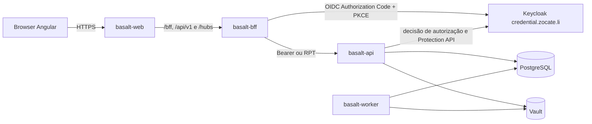

# Plano do BFF com Keycloak

**Status:** proposed  
**Data de criação:** 2026-07-29  
**Última atualização:** 2026-07-29  
**Responsáveis:** equipe Basalt Notes  
**Origem:** decisão humana assistida por IA  
**Revisor humano:** pendente  
**Relacionado:** ADR de BFF, Keycloak e autorização externa a criar

## Objetivo

Integrar o Basalt Notes ao Keycloak como plataforma externa de identidade e decisão de autorização, mantendo tokens fora do Angular e removendo da solução cadastro local, senhas, diretório de usuários, memberships e políticas próprias de acesso.

O BFF será apenas um cliente OIDC confidencial e a fachada HTTP do browser. A API será um Policy Enforcement Point (PEP): ela validará o token, consultará ou consumirá a decisão emitida pelo Keycloak e bloqueará o acesso antes de tocar no PostgreSQL ou no filesystem.

## Contexto e premissas

- A instância indicada pelo responsável está disponível em `https://credential.zocate.li` e responde como Keycloak.
- O console público usa o realm administrativo `master`; o Basalt Notes nunca usará esse realm nem credenciais administrativas globais.
- O realm proposto para a aplicação é `basalt-notes`, sujeito à criação e aprovação operacional.
- Keycloak será a autoridade para usuários, credenciais, MFA, federação, SSO, sessões, grupos, roles, recursos, scopes e políticas.
- O Basalt Notes não terá módulo `Identity`, tabela `users`, tabela `vault_members`, login local ou bootstrap de usuário administrador.
- Referências ao claim estável `sub` podem ser persistidas somente em auditoria e metadados técnicos que exijam rastreabilidade; elas não constituem cadastro local.
- Cada instalação precisa alcançar um Keycloak compatível. Ambiente isolado exige uma instância Keycloak acessível na própria rede.
- O browser acessará somente `basalt-web`; API e BFF permanecerão internos no deployment padrão.
- Tokens de acesso e refresh tokens não serão expostos ao Angular nem persistidos em Web Storage.
- A versão exata do Keycloak e a licença correspondente devem ser verificadas antes da implementação. Nenhum secret, client secret ou export real de realm entra no Git.

## Limites de responsabilidade

#### Keycloak

- autenticar usuários e federar provedores externos;
- administrar credenciais, recuperação de conta, MFA, SSO e sessões;
- administrar grupos e roles do Basalt Notes;
- registrar recursos e scopes no Authorization Services;
- avaliar políticas e emitir a decisão de acesso;
- revogar sessões, tokens e permissões de forma auditável.

#### BFF

- iniciar Authorization Code com PKCE e processar callback e logout;
- manter cookie técnico host-only, `Secure`, `HttpOnly` e `SameSite` explícito;
- manter tokens no servidor e renová-los conforme a política do Keycloak;
- aplicar antiforgery, validação de origem, rate limiting e headers de segurança;
- encaminhar `/api/v1` e `/hubs` preservando a semântica HTTP;
- remover cookies e headers de identidade fornecidos pelo browser antes do relay;
- não cadastrar usuários, definir roles, avaliar políticas de vault ou administrar o realm.

#### API

- validar assinatura, issuer, audience, expiração e claims obrigatórios;
- mapear cada operação para o recurso e scope exigidos;
- obter ou validar a decisão do Keycloak Authorization Services;
- falhar fechada antes de consultar ou alterar dados quando a permissão estiver ausente, inválida, expirada ou indisponível;
- registrar e reconciliar recursos e scopes de domínio no Keycloak com credencial de serviço de menor privilégio;
- executar regras de negócio e auditoria sem manter cadastro ou política de autorização paralelos.

Aplicar uma decisão externa é responsabilidade inevitável da API como PEP. Isso não transforma a API em provedor de identidade ou motor de autorização: a política e sua decisão continuam pertencendo ao Keycloak.

## Modelo inicial de autorização

- cliente confidencial `basalt-bff` para o fluxo do browser;
- cliente de recurso `basalt-api` com audience própria e Authorization Services habilitado;
- recursos de vault nomeados por identificador opaco, por exemplo `urn:basalt-notes:vault:{vaultId}`;
- scopes iniciais `vault:read`, `vault:write`, `vault:manage` e `vault:delete`;
- roles `Owner`, `Editor` e `Reader` administradas no Keycloak e associadas a políticas, sem cópia em PostgreSQL;
- credencial de Protection API restrita ao registro e à reconciliação dos recursos pertencentes ao `basalt-api`;
- nenhuma chamada à API confia somente em role genérica quando a operação exigir permissão para um vault específico.

A implementação deve provar em um spike se a decisão será transportada em RPT/UMA ou obtida por avaliação remota no Keycloak. A escolha deve considerar revogação, latência, tamanho do token, granularidade por vault, SignalR e comportamento quando o Keycloak estiver indisponível. Não criar um avaliador de política local como fallback.

## Arquitetura alvo

## Não escopo

- implementar cadastro, senha, recuperação de conta, MFA ou diretório de usuários no Basalt Notes;
- persistir memberships ou políticas de autorização no PostgreSQL;
- usar Microsoft Entra External ID, OAuth On-Behalf-Of ou claims específicas do Entra;
- usar o realm `master` para a aplicação;
- conceder ao BFF ou à API credencial administrativa global do Keycloak;
- copiar integralmente o projeto `CBL.CommonPack.Bff` ou suas 200 classes;
- expor publicamente BFF, API, PostgreSQL ou filesystem;
- criar ou alterar realm, clients, usuários ou secrets reais durante a fase documental.

## Dependências e decisões

- criar ADR para BFF, Keycloak, Authorization Services e nova dependência operacional;
- definir versão suportada do Keycloak e verificar licença, manutenção e vulnerabilidades;
- aprovar nome do realm, clients, callbacks, logout URLs, audience, scopes e origem pública;
- definir estratégia de sessão técnica do BFF e persistência do Data Protection key ring;
- decidir por evidência entre RPT/UMA e avaliação remota;
- definir disponibilidade, backup e operação do realm fora do ciclo de vida da aplicação;
- definir provisioning declarativo e sanitizado do realm sem versionar secrets nem exports reais.

## Etapas

### P-01: ADR e contrato de confiança

**Status:** not-started  
**Responsável:** equipe Basalt Notes  
**Dependências:** nenhuma

**Objetivo:** aprovar fronteiras, dependência operacional e modelo de ameaça antes do código.

Entregas:

- criar ADR com Keycloak como IdP e PDP externo;
- registrar perda de login local e requisito de conectividade com o IdP;
- documentar tenants/realms, issuers, audiences, clients e fluxos de confiança;
- modelar comprometimento de client secret, indisponibilidade, revogação e divergência de recursos;
- definir rollout e rollback sem fallback para autorização local.

Validação:

- ADR aceito por decisão humana;
- threat model revisado;
- documentos normativos sem referências conflitantes a Entra ou Identity local.

Evidências:

- pendente.

### P-02: Realm e clients de teste

**Status:** not-started  
**Responsável:** operador do Keycloak  
**Dependências:** P-01

**Objetivo:** preparar um ambiente não produtivo de integração sem usar o realm `master`.

Entregas:

- criar realm dedicado `basalt-notes` ou nome aprovado;
- criar `basalt-bff` e `basalt-api` com menor privilégio;
- configurar callbacks, post-logout redirects, PKCE, audience e tempos de token;
- configurar roles, recursos, scopes e políticas de teste;
- criar credencial de serviço limitada à Protection API;
- documentar configuração reproduzível e sanitizada.

Validação:

- discovery OIDC, login, logout e emissão de token funcionam no realm dedicado;
- token de issuer, audience ou client incorretos é rejeitado;
- nenhuma aplicação usa credencial do realm `master`.

Evidências:

- pendente.

### P-03: Spike de autorização por vault

**Status:** not-started  
**Responsável:** equipe backend e segurança  
**Dependências:** P-02

**Objetivo:** escolher o fluxo de decisão externa com evidência executável.

Entregas:

- registrar um vault sintético como recurso via Protection API;
- avaliar `read`, `write`, `manage` e `delete` para perfis permitidos e negados;
- comparar RPT/UMA e avaliação remota quanto a revogação, latência e tamanho;
- testar remoção de permissão, indisponibilidade e recurso divergente;
- registrar a escolha no ADR antes da implementação definitiva.

Validação:

- acesso horizontal e elevação de privilégio são negados;
- decisão ausente ou Keycloak indisponível falha fechada;
- resultado e métricas sustentam a opção escolhida.

Evidências:

- pendente.

### P-04: BFF .NET 10 mínimo

**Status:** not-started  
**Responsável:** equipe backend  
**Dependências:** P-01, P-02

**Objetivo:** manter tokens fora do browser sem reimplementar recursos de IAM.

Entregas:

- criar `apps/bff` em .NET 10;
- configurar OIDC Authorization Code com PKCE, callback e logout;
- implementar cookie técnico, antiforgery, validação de origem e token relay;
- persistir Data Protection key ring de forma protegida;
- expor liveness, readiness, métricas e logs sanitizados;
- reutilizar do CommonPack somente código pequeno, revisado e necessário, sem dependência de projeto ou pacote.

Validação:

- nenhum token aparece no browser, URL ou logs;
- login, renovação, logout e revogação funcionam com Keycloak de teste;
- build, análise estática e testes focados passam em .NET 10.

Evidências:

- pendente.

### P-05: API como PEP

**Status:** not-started  
**Responsável:** equipe backend  
**Dependências:** P-03, P-04

**Objetivo:** aplicar decisões do Keycloak antes de qualquer acesso ao domínio.

Entregas:

- validar JWT e permissões conforme o fluxo aprovado;
- mapear endpoints RESTful para recurso e scope;
- registrar e reconciliar recursos de vault de forma idempotente;
- impedir consulta, escrita e revelação de existência sem permissão;
- persistir apenas IDs técnicos necessários para reconciliação e `sub` em auditoria;
- instrumentar latência, negação, erro e divergência sem registrar token ou claims sensíveis.

Validação:

- testes de contrato e integração cobrem permissão válida, ausente, revogada e expirada;
- testes negativos cobrem autorização horizontal, elevação e acesso direto à API;
- nenhuma tabela ou serviço local gerencia usuário, membership ou política.

Evidências:

- pendente.

### P-06: Angular, proxy e SignalR

**Status:** not-started  
**Responsável:** equipes frontend e backend  
**Dependências:** P-04, P-05

**Objetivo:** integrar o browser ao BFF sem manipular tokens.

Entregas:

- consultar sessão e permissões efetivas por endpoint do BFF/API;
- encaminhar `/api/v1` e `/hubs` preservando método, status, corpo e headers públicos;
- tratar separadamente não autenticado, proibido, revogado e IdP indisponível;
- validar antiforgery e `Origin` em mutações e SignalR;
- remover qualquer armazenamento de access ou refresh token no Angular.

Validação:

- Playwright cobre login, logout, permissão negada, revogação e reconexão;
- `ETag`, upload, streaming e `QUERY` atravessam o proxy sem mudança semântica;
- acesso direto à API permanece bloqueado no deployment.

Evidências:

- pendente.

### P-07: Operação e hardening

**Status:** not-started  
**Responsável:** equipes de plataforma e segurança  
**Dependências:** todas as etapas anteriores

**Objetivo:** tornar a integração operável, recuperável e observável.

Entregas:

- criar runbooks de indisponibilidade, rotação, revogação, backup e recuperação do realm;
- definir SLOs e alertas para login, callback, decisão de autorização e reconciliação;
- testar rotação de client secret e chaves de assinatura;
- gerar SBOM, verificar vulnerabilidades e confirmar licença da versão implantada;
- executar revisão de segurança independente e teste de recuperação.

Validação:

- runbooks executados em ambiente representativo;
- nenhum achado crítico ou alto permanece sem aceitação formal;
- perda de conectividade falha fechada e recupera sem criar permissão local.

Evidências:

- pendente.

## Critérios de aceite finais

- Keycloak autentica usuários e decide permissões por recurso e scope;
- o realm dedicado não depende de credenciais administrativas globais;
- Basalt Notes não armazena conta, senha, membership ou política de autorização;
- browser não recebe access token nem refresh token;
- API aplica cada decisão antes de acessar PostgreSQL ou filesystem;
- revogação e remoção de permissão possuem comportamento e latência documentados;
- BFF, API e banco permanecem internos no deployment padrão;
- build, testes, Playwright, contratos, threat model, SBOM e scan estão aprovados;
- documentação, ADR e runbooks correspondem à implementação.

## Riscos e mitigação

| Risco | Impacto | Mitigação |
| --- | --- | --- |
| Keycloak indisponível | login, renovação e decisão de acesso falham | falhar fechado, timeouts, health, alertas e runbook |
| uso acidental do realm `master` | privilégio excessivo e impacto administrativo | realm dedicado, credenciais limitadas e teste de configuração |
| política divergente do recurso | acesso negado indevidamente ou risco de autorização | registro idempotente, reconciliação e métricas de divergência |
| token ou decisão obsoleta | acesso após revogação | TTL curto, introspecção ou RPT conforme evidência do spike |
| token com permissões excessivas | autorização horizontal | recurso por vault, scope mínimo e testes negativos |
| latência do PDP | degradação de todas as operações | medir no spike, timeout, orçamento de latência e cache somente se aprovado |
| client secret exposto | impersonação do BFF ou API | secret store, rotação, menor privilégio e redaction |
| dependência externa incompatível com instalação isolada | indisponibilidade sem internet | permitir Keycloak na rede local e documentar requisito operacional |

## Rollout e rollback

- validar primeiro em realm e clients não produtivos;
- ativar por ambiente com issuer e audience explícitos;
- bloquear rollout se houver fallback local, permissão sem recurso ou uso do realm `master`;
- manter imagens anteriores imutáveis e configuração anterior durante a janela de rollback;
- em rollback, reverter web, BFF e API como conjunto compatível e revogar clients/tokens da versão interrompida;
- nunca restaurar login local, memberships no PostgreSQL ou acesso direto do browser à API como mitigação.

## Histórico de status

| Data | Escopo | De | Para | Evidência ou motivo | Autor |
| --- | --- | --- | --- | --- | --- |
| 2026-07-29 | plano | - | proposed | decisão humana de usar a instância Keycloak existente em vez de identidade e autorização internas | responsável pelo projeto |
| 2026-07-29 | todas as etapas | - | not-started | nenhuma etapa possui evidência de execução | IA assistida |

## Regras de atualização

- o plano permanece `proposed` até aprovação humana explícita do desenho completo;
- o ADR precisa ser aceito antes de criar infraestrutura ou alterar contratos executáveis;
- etapas só mudam de status com evidência registrada;
- nenhuma credencial, token, client secret, usuário real ou export real de realm pode ser adicionado ao documento.