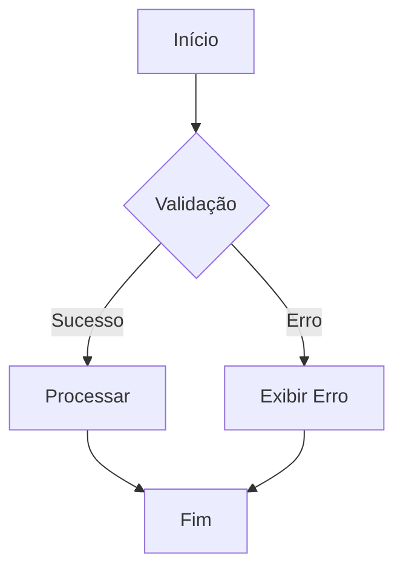
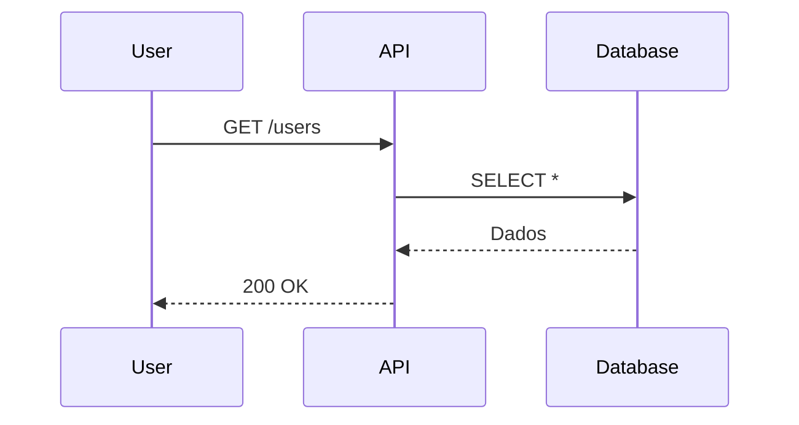
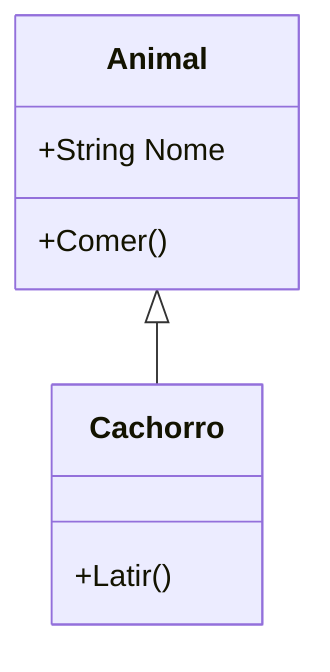
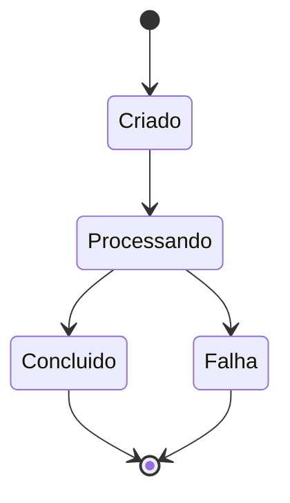
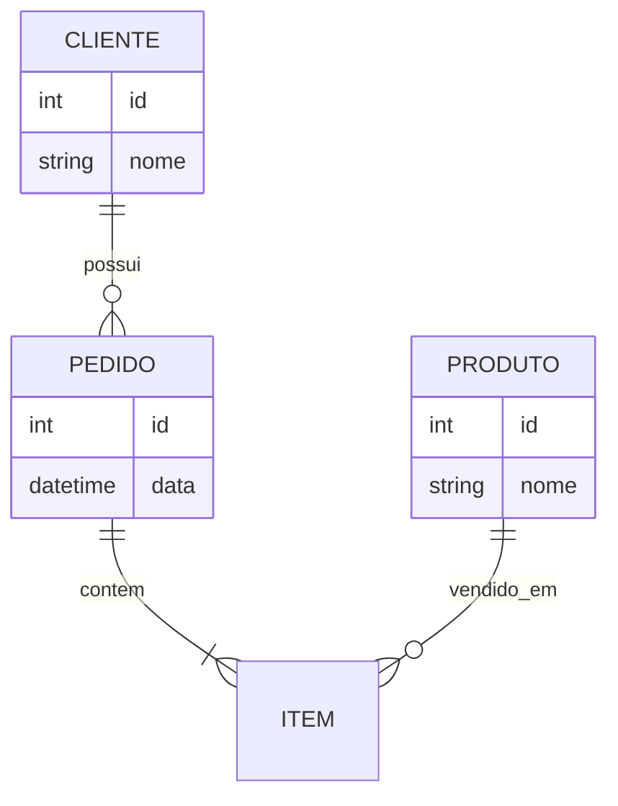
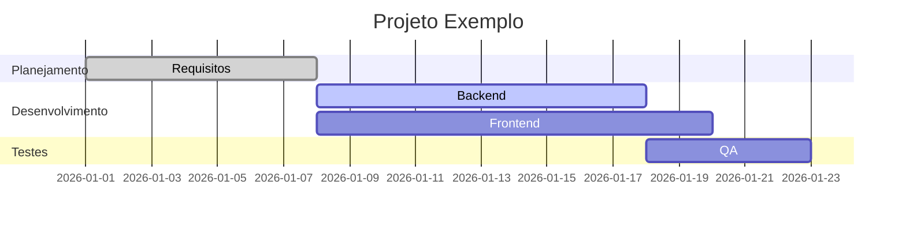
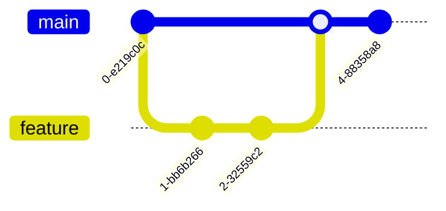

Abaixo está um arquivo Markdown de teste completo, contendo a maioria dos elementos normalmente suportados por renderizadores Markdown, incluindo Mermaid, tabelas, blocos de código, citações, listas, HTML embutido, fórmulas, emojis, task lists, links, imagens e seções recolhíveis.

# Documento de Teste Markdown

> Este documento serve para validar um renderizador Markdown completo.

---

## Sumário

- #cabeçalhos
- #formatação
- #listas
- #tabelas
- #código
- #citações
- #links
- #imagens
- #mermaid
- #html
- #task-list
- #matemática
- #emojis

---

# Cabeçalhos

# H1
## H2
### H3
#### H4
##### H5
###### H6

---

# Formatação

Texto normal.

**Negrito**

*Itálico*

***Negrito e Itálico***

~~Texto riscado~~

<ins>Texto sublinhado via HTML</ins>

Texto com `código inline`.

---

# Listas

## Lista não ordenada

- Item 1
- Item 2
  - Subitem 2.1
  - Subitem 2.2
- Item 3

## Lista ordenada

1. Primeiro
2. Segundo
3. Terceiro

## Lista mista

1. Backend
   - API
   - Banco
2. Frontend
   - Angular
   - React

---

# Tabelas

| Nome | Tecnologia | Versão |
|------|------------|---------|
| API | .NET | 8 |
| Frontend | Angular | 19 |
| Banco | SQL Server | 2022 |

### Alinhamento

| Esquerda | Centro | Direita |
|:---------|:-------:|---------:|
| A | B | C |
| 10 | 20 | 30 |

---

# Código

## JSON

```json
{
  "application": "Renderer Test",
  "version": "1.0.0",
  "enabled": true
}
```

## C#

```csharp
public class Program
{
    public static void Main()
    {
        Console.WriteLine("Hello World");
    }
}
```

## SQL

```sql
SELECT
    Id,
    Name
FROM Users
WHERE Active = 1
ORDER BY Name;
```

## Bash

```bash
#!/bin/bash

echo "Hello Markdown"
```

---

# Citações

> Citação simples.

> Esta é uma citação maior.
>
> Ela pode conter múltiplas linhas.
>
>> Até mesmo citações aninhadas.

---

# Links

- [Microsoft](https://www.microsoft.com)
- [GitHub](https://github.com)
- [Markdown Guide](https://www.markdownguide.org)

Link automático:

<https://github.com>

---

# Imagens

Imagem markdown:

https://via.placeholder.com/600x200

Imagem com link:

https://via.placeholder.com/200x80](https://github.com)

---

# Mermaid

## Fluxograma



## Sequence Diagram



## Class Diagram



## State Diagram



## ER Diagram



## Gantt



## Git Graph



---

# HTML

<div style="border:1px solid #ccc;padding:10px;border-radius:5px">
    Este é um bloco HTML incorporado.
</div>

<br/>

<details>
<summary>Clique para expandir</summary>

Conteúdo oculto via HTML.

- Item A
- Item B
- Item C

</details>

---

# Task List

- [x] Implementar API
- [x] Criar banco de dados
- [ ] Adicionar autenticação
- [ ] Executar testes
- [ ] Fazer deploy

---

# Matemática

Equação inline:

$E = mc^2$

Equação em bloco:

$$
\int_{a}^{b} x^2 dx
=
\frac{b^3-a^3}{3}
$$

Matriz:

$$
\begin{bmatrix}
1 & 2 \\
3 & 4
\end{bmatrix}
$$

---

# Emojis

✅ Concluído

⚠️ Atenção

❌ Falha

🚀 Deploy

🎉 Sucesso

😀 😎 🤖 🔥

---

# Blockquote + Código

> Exemplo de documentação:
>
> ```yaml
> apiVersion: v1
> kind: ConfigMap
> metadata:
>   name: exemplo
> ```

---

# Separador Final

---

**Fim do documento de teste Markdown.**